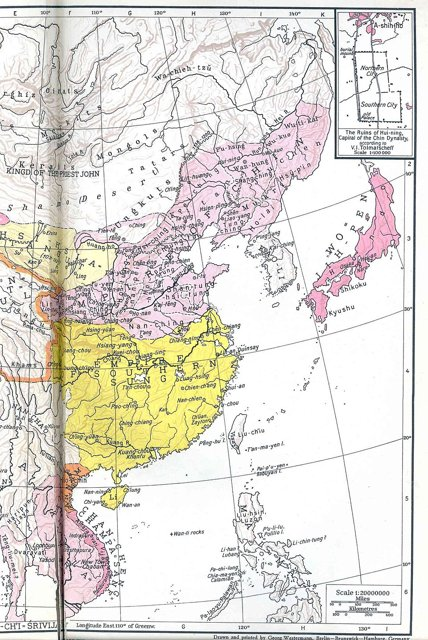
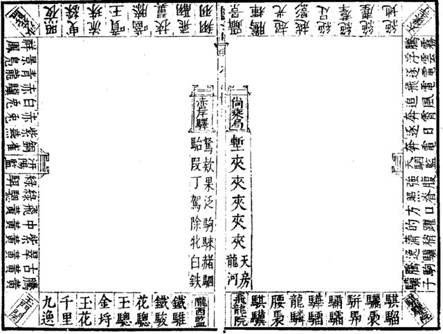
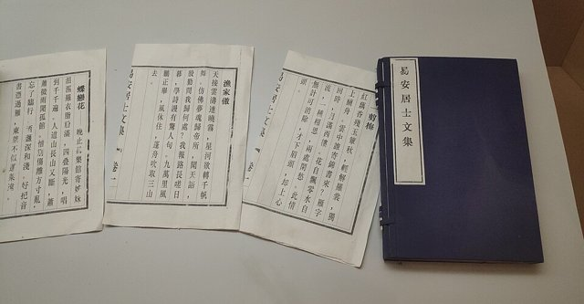

<!--
內容整理自 D:\Books\md\歷史\人物\中國\李清照生平大事記（1084—約1155）.md（Books 的人物頁為 D:\Books\html\1-2-1.中國歷史人物\李清照(1084~1155).html），並整合中文維基百科〈李清照〉條目，以自己的話改寫。
時期依筆記的六個階段：出生與家學、婚姻與金石收藏、北宋末動盪、南渡流亡與趙明誠去世、晚年漂泊與再婚爭議、晚年創作；後兩段合為一段。
兩份資料出入與處理方式：
- 生卒：筆記寫1084年—約1155年，卒年有不同說法；維基百科寫元豐七年二月初五日（1084年3月13日）生，卒於1155年5月12日，並說另有1151年、1156年等說法，born、died 依維基百科，內文註明卒年不確定。
- 青州：筆記寫1107年前後居青州；維基百科同寫1107年移居青州，這裡補上背景：1102年起父親李格非被列入元祐黨籍，1107年公公趙挺之罷相去世，趙家受新黨排擠，夫婦才回青州屏居。
- 南渡：筆記寫1127年開始南渡、1128年輾轉到江寧；維基百科寫1127年金兵將至，夫婦南下江寧，照此。
- 趙明誠卒：依維基百科寫1129年夏曆八月十八日卒於建康。
- 書畫被盜：維基百科補充1131年三月在越州借住的鍾氏家中，一夜書畫被盜，照此。
- 再嫁張汝舟：筆記與維基百科都說1132年的再嫁與訴訟屬傳統說法、有爭議，內文照此說明。
- 〈夏日絕句〉「生當作人傑」：筆記列為代表詩作，一般認為作於南渡之初（約1128年），這裡依此。
- 人名與其他時間軸一致：李煜（LiYu）、辛棄疾（XinQiji）、蘇軾（SuDongpo）、朱熹（ZhuXi）；趙明誠沒有獨立時間軸。
圖片來源（皆為 Wikimedia Commons 公有領域／CC0 作品，縮成最長邊 640px）：
- lqz-cover.jpg：李清照畫像.jpg（李清照畫像（1911年以前））
- lqz-map.jpg：Jin Dynasty ,Sourthen Song Dynasty and Western Xia Dynasty 1141.jpg（1141年前後金、南宋與西夏疆域圖（《Historical and Commercial Atlas of China》，1935））
- lqz-dama.jpg：李清照打馬圖.png（李清照《打馬圖》的圖式）
- lqz-wenji.jpg：易安居士文集书影.jpg（《易安居士文集》書影）
-->

# Periods
- 1084 ~ 1100 | 書香門第 | #868e96
  父親李格非是蘇軾賞識的文學家，母親出身名門；在汴京長大，少女時期的詞已在文壇傳誦。
- 1101 ~ 1126 | 婚姻與金石收藏 | #e64980
  與太學生趙明誠成婚，夫婦節衣縮食蒐集金石書畫；黨爭中兩家起落，屏居青州十年編撰《金石錄》，詞作多寫閨情與相思，明快清新。
- 1127 ~ 1129 | 靖康之變與南渡 | #c92a2a
  金兵南下、北宋滅亡，夫婦載著十五車書冊南渡江寧；趙明誠赴湖州任途中病逝建康，李清照從此孤身流亡。
- 1130 ~ 1155 | 晚年漂泊 | #5f3dc4
  追隨高宗行在流徙浙東，收藏屢遭散失，一度再嫁又離異；寫〈金石錄後序〉〈打馬圖經〉，晚年詞作淒苦深沉，〈聲聲慢〉〈武陵春〉成為千古絕唱。

# Events

## 1084-03-13 | 出生 {label="1084年（元豐七年）二月初五"}
李清照出生於齊州章丘明水鎮（今山東濟南章丘區）。父親李格非進士出身，官至禮部員外郎，是深受蘇軾賞識的作家，為「蘇門後四學士」之一；母親王氏是名門之後，也能文。她在汴京成長，自幼在藏書豐富的家中讀書，詩詞書畫都有很高的修養。

## 1099 | 少女詞名 {label="約1100年前後"}
少女時期的〈如夢令〉「常記溪亭日暮，沉醉不知歸路」寫遊賞泛舟的天真，另一首〈如夢令〉「昨夜雨疏風驟」以「知否？知否？應是綠肥紅瘦」惜花傷春，一出手就驚動文壇。她也寫詩和張耒的〈讀中興頌碑〉，議論唐代興亡，展現不輸男子的見識。

## 1101 | 與趙明誠成婚 {label="1101年（建中靖國元年）"}
十八歲的李清照嫁給長她三歲的太學生趙明誠，他是吏部侍郎（後來的宰相）趙挺之的兒子，熱愛金石碑刻。夫婦志趣相投，趙明誠每逢初一、十五請假，就典當衣物到大相國寺買碑帖書畫，兩人一起賞玩。婚後的詞多寫閨閣生活與對遠行丈夫的思念，如〈一剪梅〉「此情無計可消除，才下眉頭，卻上心頭」，〈醉花陰〉「莫道不銷魂，簾捲西風，人比黃花瘦」。

## 1102 | 捲入新舊黨爭 {label="1102年（崇寧元年）"}
宋徽宗改元崇寧，重用蔡京打擊舊黨，李格非被列入元祐黨籍，罷官出京；而公公趙挺之屬新黨，正步步高升。李清照曾上詩給公公請求援救父親，有「炙手可熱心可寒」之句。1103年朝廷還禁止元祐黨人的子女與宗室通婚，她的處境十分艱難。

## 1107 | 屏居青州 {label="1107年（大觀元年）"}
趙挺之罷相後不久去世，趙家受到蔡京排擠，李清照隨丈夫回到青州（今山東青州）故居，一住十多年。她把書房命名為「歸來堂」，自號「易安居士」，取自陶淵明〈歸去來兮辭〉。夫婦全心整理金石書畫，飯後在歸來堂烹茶，互考某事出自某書第幾卷第幾頁，猜中者先喝茶，常常笑得茶潑滿懷。趙明誠據此撰成《金石錄》。

## 1121 | 萊州相聚 {label="1121年（宣和三年）"}
趙明誠出任萊州（今山東萊州）知州，李清照隨後前往相聚。此後趙明誠又調任淄州。〈鳳凰臺上憶吹簫〉等寫別離與思念的詞作，多出自婚後這段夫婦時聚時散的歲月。

## 1127 | 靖康之變與南渡 {label="1127年（靖康二年、建炎元年）"}

前一年金兵圍攻汴京，這年徽宗、欽宗被俘北去，北宋滅亡，高宗在南京應天府即位。趙明誠因母喪南下江寧（今南京），李清照留在青州整理收藏，挑出最精要的部分裝了十五車南運，年底青州兵變，留在故居十幾間屋子的書冊全部燒毀。

## 1128 | 〈夏日絕句〉 {label="約1128年"}
李清照抵達江寧，趙明誠任江寧知府。南渡之初，朝廷只想求和偏安，她寫下〈夏日絕句〉：「生當作人傑，死亦為鬼雄。至今思項羽，不肯過江東。」借項羽寧死不肯渡江逃生，諷刺南宋君臣的苟且。1129年江寧發生兵變，趙明誠縋城逃走，因此被罷官。

## 1129 | 趙明誠病逝 {label="1129年（建炎三年）八月十八日"}
趙明誠奉命改知湖州，獨自赴建康（江寧）面聖時染上瘧疾，李清照日夜兼程趕去照顧，他仍在八月十八日病逝，年四十九歲。李清照在祭文中寫道：「白日正中，嘆龐翁之機捷；堅城自墮，憐杞婦之悲深。」此後她孤身帶著殘存的收藏流亡。

## 1130 | 追隨行在流徙 {label="1130年（建炎四年）"}
金兵渡江南下，高宗從越州、明州一路逃到海上。李清照為了追隨朝廷，從越州、明州輾轉到溫州，一路流離，收藏一再散失；她又被誣陷曾將玉壺獻給金人，為洗清嫌疑，想把銅器獻給朝廷，卻始終沒能追上。

## 1131 | 書畫被盜 {label="1131年（紹興元年）三月"}
李清照到越州（今浙江紹興），借住當地鍾姓人家，一夜之間僅存的書畫被盜走大半。當年夫婦傾盡心力蒐集的金石古卷幾乎散佚殆盡，令她大受打擊，寫作也轉向對現實的憂患。

## 1132 | 再嫁張汝舟的爭議 {label="1132年（紹興二年），傳統說法"}
傳統記載說，李清照在杭州病中再嫁右承務郎張汝舟，婚後發現對方覬覦她的收藏並對她施暴，又揭發他虛報舉數騙取官職，不惜依法陪坐兩年牢也要離婚，婚姻僅維持百日，經翰林學士綦崇禮營救，九天後獲釋，她寫〈投翰林學士綦崇禮啟〉致謝。這件事在明清以後引起爭論，有人認為是誣衊，至今仍無定論。

## 1134 | 〈金石錄後序〉 {label="1134年（紹興四年）"}

李清照為亡夫的《金石錄》寫下〈金石錄後序〉，回憶夫婦蒐集金石書畫的甘苦，以及收藏在戰亂中一步步散失的經過，「得之艱而失之易」，是宋代散文的名篇。同年金兵再度南侵，她避難金華，寫《打馬圖經》並作序，借博戲寄寓對收復失地的期望。

## 1135 | 金華與〈武陵春〉 {label="1135年（紹興五年）"}
在金華，她寫下〈題八詠樓〉「江山留與後人愁」，以及〈武陵春〉：「風住塵香花已盡，日晚倦梳頭。物是人非事事休，欲語淚先流……只恐雙溪舴艋舟，載不動、許多愁。」國破、家亡、夫死、物散的悲痛，都化在平淡的語言裡。

## 1140 | 〈聲聲慢〉與晚年 {label="約1140年代"}
晚年定居臨安（今杭州），〈聲聲慢〉以「尋尋覓覓，冷冷清清，淒淒慘慘戚戚」連用七組疊字開頭，結尾「這次第，怎一個愁字了得」，寫盡孤獨衰老之悲，被譽為千古絕唱。〈永遇樂〉以元宵的熱鬧對照昔日汴京的繁華與今日的憔悴。她在〈詞論〉中提出「詞別是一家」，主張詞要協音律、尚文雅，與詩有別，並批評柳永「詞語塵下」、蘇軾等人的詞是「句讀不葺之詩」。

## 1155-05-12 | 逝世 {label="約1155年（卒年另有1151、1156年等說法）"}

李清照晚年的行蹤漸不可考，傳統認為約七十多歲時在臨安去世。她的《易安居士文集》與詞集都已失傳，後人輯有《漱玉詞》，存詞約五十首、詩十餘首、文不到十篇。前期明快清新、後期淒婉深沉，以尋常語入詞、善用白描與疊字，形成「易安體」；朱熹說「本朝婦人能文者，惟魏夫人及李易安二人而已」。她與同鄉的辛棄疾並稱「濟南二安」，是中國文學史上最重要的女詞人。
