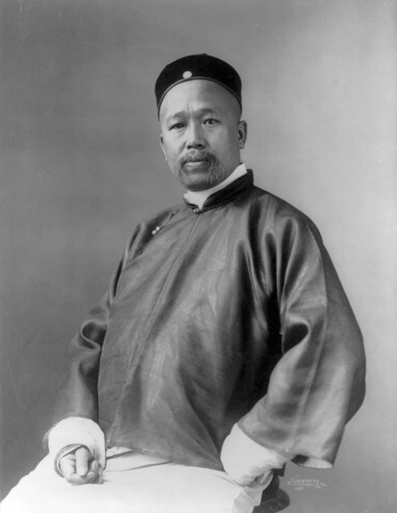
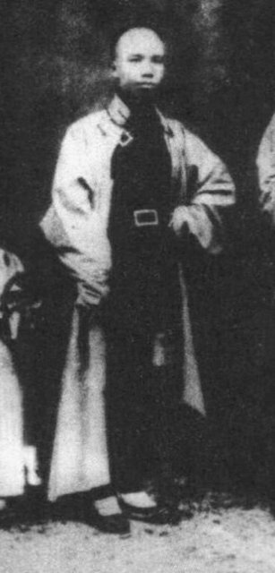
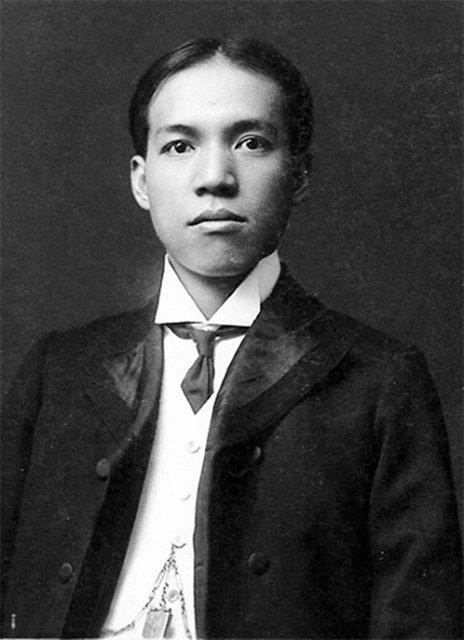
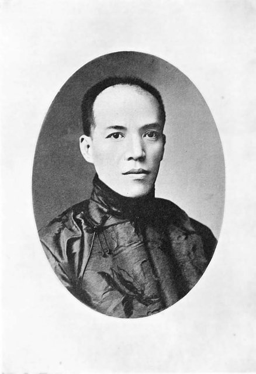
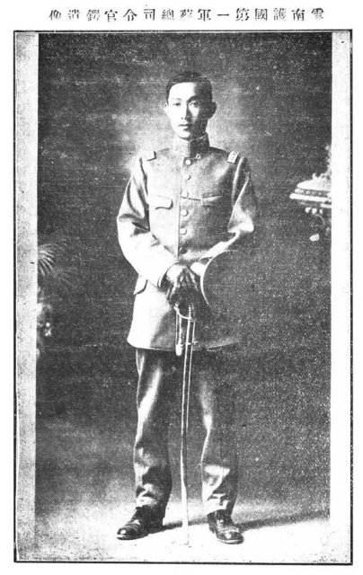

<!--
內容整理自 D:\Books\html\1-2-1.中國歷史人物\梁啟超(1873~1929).html（沒有對應的 md 筆記），並整合中文維基百科〈梁啟超〉條目，以自己的話改寫。
時期依頁面的階段歸納：少年求學、維新運動與戊戌變法、流亡日本與思想轉變、立憲運動、民國初年的政治、護國運動與反袁、歐遊與思想再轉變、晚年學術生涯。
兩份資料出入與處理方式：
- 生卒：兩份一致，同治十二年正月廿六（1873年2月23日）生於廣東新會茶坑鄉，1929年1月19日卒於北平協和醫院，享年55歲（虛歲57）。頁面寫「病逝於北京」，1928年起北京改稱北平，這裡寫北平。
- 科舉：頁面寫1884年參加科舉、1889年中舉；維基百科補充1884年10月院試第一成為秀才、1889年8月鄉試中第八名舉人，採維基百科。1890年春會試落第、經陳千秋介紹拜康有為為師，取自維基百科；萬木草堂1891年設立、梁啟超任學長。
- 公車上書：頁面與維基百科都說實際上書過程與簽名人數仍有爭議，照此謹慎寫法。維基百科還記同年創辦《萬國公報》（後改名《中外紀聞》）、強學會12月被禁，併入1895年的事件。
- 《時務報》1896年8月9日創刊、梁任主筆；長沙時務學堂中文總教習（1897年），兩份一致。
- 戊戌變法：維基百科補充1898年6月11日《明定國是詔》頒布、7月3日梁獲光緒召見、9月政變後避入日本使館、乘日本軍艦「大島號」離境、11月抵日，12月創辦《清議報》，採維基百科。
- 流亡期間的活動：頁面寫1899–1900年在海外華人之間奔走、與自立軍有所聯繫；維基百科補充1899年底抵檀香山組織保皇會、1900年唐才常的自立軍事洩失敗、同年赴澳洲宣傳，併入1900年的事件。1903年訪美（2月出發、11月返回橫濱、寫成《新大陸遊記》）頁面沒有，取自維基百科；維基百科說他訪美後轉向更堅定地主張君主立憲。
- 立憲運動：頁面寫1905年考察憲政、1906年宣布預備立憲、1907年參與政聞社；維基百科補充政聞社1907年10月17日在東京成立，1908年被清廷查封。1911年3月應林獻堂之邀訪臺、10月武昌起義後曾到奉天策劃未成，取自維基百科。
- 民國：頁面寫1912年回國、創辦《庸言》，1913年組進步黨、任司法總長；維基百科補充1912年11月回國、1913年5月29日進步黨成立、9月11日入熊希齡內閣任司法總長，1914年任幣制局總裁；1915年8月22日發表〈異哉所謂國體問題者〉；1916年5月護國軍軍務院在肇慶成立、梁任撫軍兼政務委員長；1917年7月任段祺瑞內閣財政總長、11月30日去職，採維基百科的日期。
- 歐遊：頁面寫1918年底赴歐、1919年觀察戰後歐洲、1920年回國；維基百科給出1918年12月29日出發、1920年3月5日回到上海，並記1920年組織共學社，採維基百科。《歐遊心影錄》兩份都沒有出版日期，只在事件中提及。
- 《中國歷史研究法》：頁面列在1923年；維基百科說是1921年在南開大學講授中國文化史的講稿整理而成。這裡寫在1921年（講授），並說明頁面的年份。
- 晚年：頁面寫1925年任清華研究院導師、1926年前後參與圖書館事務；維基百科補充1925年秋同時任京師圖書館館長、1926年3月在協和醫院割除右腎、1924年夫人李蕙仙病逝，併入相關事件。
- 頁面的「總表」與各段的思想分析寫進時期說明與相關事件，不另立事件；〈敬業與樂業〉照頁面寫在1922年。
- 人名與其他時間軸一致：康有為、光緒帝、慈禧太后、譚嗣同、孫中山、袁世凱、蔡鍔、段祺瑞、張勳、溥儀、張君勱、蔣百里（蔣方震）。
圖片來源（皆為 Wikimedia Commons 公有領域／CC0 作品；註明「共用」者沿用其他時間軸已有的圖片）：
- lq-cover.jpg：Liang Qichao, Liangyou 1928-12-30.jpg（梁啟超像（《良友》畫報，1928））
- keju-kang.jpg（康有為，1905年攝，美國國會圖書館藏（與中國科舉制度大事記時間軸共用））
- lq-tan.jpg：Tansitong.jpg（譚嗣同）
- lq-japan.jpg：梁启超在日本期间.jpg（流亡日本時期的梁啟超）
- lq-justice.jpg：MinistroDeJusticiaLiangQichao.jpg（任司法總長時的梁啟超）
- lq-caie.jpg：蔡鍔.jpg（蔡鍔）
-->

# Periods
- 1873-02-23 ~ 1890 | 少年求學 | #868e96
  生於廣東新會的士人家庭，自幼熟讀經史，十一歲成為秀才、十六歲中舉，原本走在傳統士人的道路上。
- 1890 ~ 1898-09 | 維新運動與戊戌變法 | #e8590c
  拜康有為為師，在萬木草堂接受新思想；甲午戰敗後參與公車上書、主筆《時務報》、任時務學堂總教習，1898年參與百日維新。
- 1898-09 ~ 1905 | 流亡日本與「新民」 | #1971c2
  政變後流亡日本，創辦《清議報》《新民叢報》，以《新民說》提倡國民意識與公共責任，到檀香山、澳洲、美洲聯繫華僑，與革命派分歧日深。
- 1905 ~ 1912 | 立憲運動 | #2f9e44
  清廷宣布預備立憲，他組織政聞社推動憲政，卻對清廷的誠意日益失望；武昌起義後，君主立憲的路走到盡頭。
- 1912 ~ 1918 | 民國政治與護國 | #c92a2a
  回國參與政黨政治，組進步黨、任司法總長，與袁世凱分道揚鑣，發表〈異哉所謂國體問題者〉，與蔡鍔推動護國戰爭，又反對張勳復辟、短暫任財政總長。
- 1918 ~ 1929-01-19 | 歐遊與晚年學術 | #7048e8
  遊歷戰後歐洲，反思西方文明的困境，回國後轉向文化、史學與教育，任清華國學研究院導師與京師圖書館館長。

# Events

## 1873-02-23 | 出生於廣東新會
梁啟超生於廣東新會縣茶坑鄉，字卓如、任甫，號任公，又號飲冰室主人。家中有傳統儒學背景，他幼年就接受經史教育，熟讀儒家經典，記憶與寫作能力出眾。傳統經學訓練為他日後的政治論述、歷史研究與文化批判奠定了基礎。

## 1884-10 | 院試第一，成為秀才
十一歲的梁啟超在院試考取第一，成為秀才。1887年起他在廣州學海堂等處繼續求學，擴展傳統學術的訓練。

## 1889-08 | 中舉
十六歲的梁啟超在廣州鄉試中第八名舉人，取得傳統士人社會的功名。隨著清朝內外危機不斷，他逐漸認為光靠傳統經學與科舉，解決不了中國面臨的根本問題。

## 1890 | 拜康有為為師

1890年春，梁啟超進京會試落第；秋天經陳千秋介紹，拜康有為為師。康有為主張重新詮釋儒家經典，以論證政治改革的必要，師徒後來並稱「康梁」。
1891年康有為設立萬木草堂，梁啟超任學長。他在這裡重新詮釋儒學，開始思考議會、憲政與法律，並認識到改革也要改變社會大眾的知識與觀念，從傳統士人轉變為近代改革思想家。

## 1895 | 公車上書與強學會
甲午戰敗，清朝與日本簽訂《馬關條約》。康有為、梁啟超等聯合進京會試的舉人上書，反對和約、主張變法，史稱「公車上書」，把國家危機轉化為公開的政治改革訴求；實際上書過程、簽名人數與是否正式遞交，史學界仍有不同考證。
同年他參與創辦《萬國公報》（後改名《中外紀聞》）、參加強學會的活動，12月強學會被禁。他發現報刊能突破官僚體系的限制，成為傳播知識、評論政治與動員社會的工具。

## 1896-08-09 | 主筆《時務報》
《時務報》在上海創刊，梁啟超任主筆，發表大量政論，宣傳政治改革、新式教育、西方政治法律與經濟知識，批判官僚積弊。他的文章結合歷史典故、時事與新知識，富有感染力，影響晚清知識界甚大，也使他成為中國近代報刊史上的代表人物。

## 1897 | 長沙時務學堂總教習
梁啟超受聘為湖南長沙時務學堂的中文總教習，教學重視政治、歷史、經濟與時事，鼓勵學生理解國家現況，而不是只準備科舉。他認為教育應與國家社會的需要結合，新知識不只是技術，也包括政治制度與社會思想，人才培養是改革的基礎。

## 1898-06-11 | 戊戌變法
光緒帝頒布《明定國是詔》，維新變法開始，史稱「百日維新」，內容包括改革官制、籌辦京師大學堂、改革科舉、鼓勵工商業與軍事改革。梁啟超在北京協助康有為，7月3日獲光緒帝召見。
他不是所有改革政策的制定者，但是維新思想的重要宣傳者與推動者。

## 1898-09 | 戊戌政變，流亡日本

9月，慈禧太后重新掌權，光緒帝被軟禁，維新派遭到逮捕，譚嗣同等六人被處死。梁啟超避入日本使館，化裝離京，乘日本軍艦「大島號」離開，11月抵達日本。
這是他人生的轉折點：此前他希望透過皇帝與官僚體制推動改革，此後轉向海外流亡與報刊宣傳，把重心放在思想傳播、國民教育與憲政主張。12月，他在橫濱創辦《清議報》，批判清朝弊政、介紹世界局勢，仍支持君主立憲，與主張革命的孫中山逐漸分道揚鑣。

## 1899-12-31 | 檀香山與保皇會
梁啟超在日本接觸新的政治觀念與社會學說，1899年在東京創立大同高等學校；年底化名抵達檀香山，組織保皇會分會、向華僑募款。

## 1900 | 自立軍失敗
義和團與八國聯軍事件期間，康有為、梁啟超等維新人士與唐才常的自立軍有所聯繫，希望藉機推動政治變革。7月，自立軍的起事計畫外洩失敗，唐才常8月在武昌被處決。改革派再次面臨如何取得實際政治力量的難題。
同年秋，梁啟超赴澳洲巡迴宣傳。1901年他寫作《中國史敘論》與《新史學》，批評舊史學只寫帝王將相。

## 1902-02-08 | 《新民叢報》與《新民說》

梁啟超在橫濱創辦《新民叢報》，連載《新民說》（1902–1906）。所謂「新民」，不只是增加知識或學會新技術，而是改變國民的觀念：人民要理解自己與國家整體的關係，關注公共利益，了解權利也承擔義務，打破陳舊觀念，接受新式教育。
他認為中國積弱不只是政府的問題，也與人民的思想與公共生活方式有關。這些論述深刻影響了近代中國的國民觀念、民族主義與政治思想。

## 1903-02-20 | 遊歷美洲
梁啟超從橫濱出發遊歷美洲，4月抵紐約、5月抵華盛頓，年底回到橫濱，寫成《新大陸遊記》。這趟旅行後，他更堅定地主張君主立憲。
1903到1905年，他與孫中山等革命派展開論戰，爭論清朝是否還能改革、中國該漸進改革還是革命、中國是否已具備共和的條件；1905年同盟會成立後，《民報》與《新民叢報》的筆戰達到高峰。

## 1906 | 清廷宣布預備立憲
清政府派大臣出國考察憲政，1906年正式宣布預備立憲。梁啟超持續論述君主立憲的必要：憲政可以用法律規範政府權力，建立穩定秩序，讓國民逐步參與公共事務；與革命派相比，他更擔心激烈的政權更替會造成長期動亂。

## 1907-10-17 | 成立政聞社
梁啟超等立憲派在東京成立政聞社，想把立憲主張從個別知識分子的文章，發展成持續的政治運動，從報刊論述走向組織化的政治參與。1908年政聞社被清廷查封。
1909年各省諮議局陸續成立，1910年立憲派要求速開國會，梁啟超在上海創辦《國風報》；但清廷的立憲推動緩慢，皇族與官僚仍掌握大權，立憲派對清廷的誠意越來越失望。

## 1911-03-24 | 訪問臺灣
梁啟超應林獻堂之邀到日治下的臺灣考察。這年10月武昌起義爆發，革命擴展到各省，清朝統治崩潰；他11月從神戶趕到奉天，想策動政局未果。辛亥革命證明清廷已無法靠有限的改革維持統治，他必須重新思考中國該建立何種政治制度。

## 1912-11 | 回國，創辦《庸言》
清帝退位、中華民國成立後，梁啟超結束十四年的流亡，1912年11月回國，在天津創辦《庸言》，關注民國的政治秩序、憲法與國家治理。他逐漸接受共和國的現實，但認為推翻君主不等於建立了現代國家：共和要能運作，需要法治、穩定的政府、政治責任與有公共意識的國民。

## 1913-09-11 | 組進步黨，任司法總長

1913年5月，梁啟超參與整合共和黨、民主黨、統一黨，組成進步黨；9月他入熊希齡內閣，任司法總長，想推動法制建設，1914年又任幣制局總裁。
袁世凱逐步削弱國會與政黨政治、集中權力，與梁啟超重視的憲政原則衝突。他認為民國應該讓權力受法律限制，而不是由新的強人取代舊的皇帝，於是在1914年底離職，與袁世凱分道揚鑣。

## 1915-08-22 | 〈異哉所謂國體問題者〉
籌安會鼓吹帝制，梁啟超發表〈異哉所謂國體問題者〉，公開反對袁世凱稱帝。12月袁世凱稱帝，他與學生蔡鍔等人聯絡，投入反袁行動，從一度參與袁世凱政府的人物，轉變為反對帝制復辟的重要力量。

## 1915-12-25 | 護國戰爭

雲南宣布獨立反對帝制，護國戰爭爆發。梁啟超的角色主要是政治論述、組織聯繫與輿論動員；1916年5月，護國軍軍務院在廣東肇慶成立，他任撫軍兼政務委員長。
袁世凱被迫取消帝制，6月6日病逝，護國運動取得成果。但中央權威隨之衰退，各地軍事勢力崛起，民國進入軍閥政治的時期。11月，蔡鍔病逝。

## 1917-07 | 反對張勳復辟，任財政總長
張勳擁溥儀復辟，梁啟超公開反對，支持段祺瑞的討逆行動，復辟很快失敗。7月他任段祺瑞內閣的財政總長，想處理民初嚴重的財政金融問題，但政治角力、軍費與利益衝突使改革難行，11月30日辭職，此後逐漸遠離政府行政。

## 1918-12-29 | 赴歐遊歷
梁啟超與張君勱、蔣百里（蔣方震）等人從上海出發，1919年2月抵達巴黎，參與巴黎和會的會外活動，並考察戰後歐洲的政治、社會與文化。
一戰的巨大傷亡動搖了許多人對西方文明必然進步的信念。他開始反思：西方雖有先進的科學與制度，也可能因民族競爭、軍事主義與權力衝突走向災難；中國是否應毫無保留地模仿西方，傳統文化在現代世界還有什麼價值？這些思考後來寫成《歐遊心影錄》。

## 1920-03-05 | 回國，轉向文化與學術
梁啟超回到上海，4月在北京組織共學社，9月成立講學社，推動學術交流、介紹西方思想、研究中國歷史與傳統文化。他的思想不是從崇尚西方轉為排斥西方，而是開始重新思考中國該如何吸收現代知識，同時保有批判與選擇的能力。

## 1921 | 《中國歷史研究法》
梁啟超在天津南開大學講授中國文化史，講稿整理為《中國歷史研究法》（頁面列在1923年）。他主張歷史不應只是帝王將相的紀錄，而要研究社會制度、思想文化與整體的人類生活，研究者必須辨析史料，有明確的問題意識與分析架構，嘗試把近代學術方法引入中國史學。

## 1922 | 〈敬業與樂業〉
梁啟超發表演講〈敬業與樂業〉：敬業是認真履行職責，樂業是從工作中找到意義，主張把個人責任、職業倫理與社會生活結合起來。這篇文章後來成為華文教育常選的讀本。
1922至1923年，他也關注科學與人生觀的關係：科學能幫助人理解自然、改善生活，卻不必然能回答人生意義、道德責任與價值選擇的問題，因此也要重視哲學、倫理與文化。這年年底，他被確診患有心臟病。

## 1925 | 清華國學研究院導師
1924年，夫人李蕙仙病逝，《中國近三百年學術史》出版。1925年秋，梁啟超應聘為清華學校國學研究院導師，同時任京師圖書館館長，重視文獻保存與學術資源的普及。早年他希望透過政治改革改變中國，晚年則更重視以知識、教育與文化研究建立長期的社會基礎。

## 1926-03 | 割除右腎
1926年起梁啟超便血，入北平協和醫院治療，3月割除右腎，此後健康每況愈下。1927年前後，他進一步減少公開政治活動，把重心放在家庭、學術與著述；子女中，梁思成成為建築學家、梁思永成為考古學家、梁思禮成為火箭控制專家。

## 1929-01-19 | 病逝於北平
梁啟超在北平協和醫院逝世，享年55歲，葬於今北京植物園內的梁啟超墓。他一生的文章與著述後來編為《飲冰室合集》。
他經歷了晚清變法、民國建國與近代思想轉型，政治主張多次轉變，卻始終關注國家富強、國民素質、制度改革，以及中國如何回應世界變局。他的政治理想沒能在有生之年實現，但他在報刊、教育、國民意識、史學與思想文化上的貢獻，持續影響中國近代知識界。
