<!--
內容整理自中文維基百科「李斯特·費倫茨」與英文維基百科「Franz Liszt」條目（CC BY-SA 4.0），並以台灣用語改寫摘要。
https://zh.wikipedia.org/zh-tw/李斯特·費倫茨
https://en.wikipedia.org/wiki/Franz_Liszt
中文條目的生平章節較簡略，細節主要參考英文條目。
圖片皆為 Wikimedia Commons 上的公有領域作品（封面：Herman Biow 1843 年所攝肖像）。
-->

# Periods
- 1811 ~ 1821 | 童年@雷丁(Raiding)
  出生在匈牙利王國的小村莊多博爾揚（今奧地利雷丁）。父親亞當是埃斯特哈齊親王的莊園管事，也是熱心的業餘音樂家；母親是奧地利的德意志人，所以李斯特從小說德語，晚年才學會用匈牙利文寫作。不到5歲就會在鋼琴上即興演奏。
- 1821 ~ 1823 | 維也納求學
  在貴族資助下到維也納學習，隨貝多芬的學生徹爾尼學琴，徹爾尼教了他一年半、分文不取；也隨宮廷樂長薩列里學作曲。
- 1823 ~ 1835 | 巴黎時期
  全家遷居巴黎。巴黎音樂院以不收外國人為由拒絕他入學，他改隨私人老師學習，以神童之姿巡演法國與英國。父親死後他靠教琴養活自己和母親，經歷一段宗教懷疑與內省的低潮，也結識雨果、喬治·桑、白遼士、蕭邦等人。
- 1835 ~ 1839 | 與達古爾特伯爵夫人：瑞士與義大利
  為避開醜聞，與已婚的達古爾特伯爵夫人移居日內瓦，之後遊歷瑞士與義大利，生下三個孩子。這段旅程日後孕育出鋼琴曲集《巡禮之年》。
- 1839 ~ 1847 | 巡演全歐：李斯特狂熱
  為籌建波昂貝多芬紀念碑而展開巡演，八年間公開演出超過一千場，所到之處掀起被海涅稱為「李斯特狂熱」的熱潮。他也把大量演出收入捐給慈善事業。35歲時在巔峰狀態中退出巡演舞台。
- 1848 ~ 1861 | 威瑪宮廷樂長@Weimar
  定居威瑪，擔任宮廷樂長，指揮宮廷音樂會、舉辦白遼士與華格納作品的音樂節，並創造「交響詩」這種新形式，讓威瑪成為新音樂的重鎮。他與華格納、白遼士等人被稱為「新德意志樂派」，與布拉姆斯陣營形成「浪漫派之戰」。
- 1861 ~ 1869 | 羅馬時期@Rome
  原定在羅馬與卡洛琳公主成婚卻臨時受阻。之後接連失去兒子與女兒，隱居羅馬近郊的修道院，加入方濟會並領受小品，人稱「李斯特神父」。
- 1869 ~ 1886 | 「三分生活」：羅馬、威瑪、布達佩斯
  每年往返羅馬、威瑪與布達佩斯三地，在威瑪開設大師班、擔任布達佩斯皇家音樂院院長，教學分文不取，扶持了許多年輕音樂家。晚年作品轉向陰鬱，並有預示20世紀無調性音樂的實驗。

# Events

## 1811-10-22 | 出生@雷丁
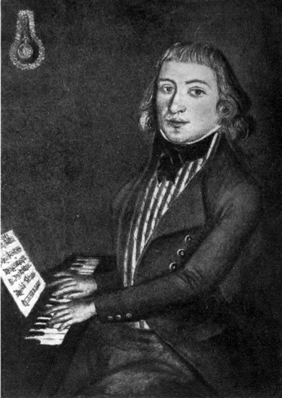
父親亞當在埃斯特哈齊親王手下擔任莊園管事，會彈鋼琴、吉他與長笛，與海頓、胡梅爾都有私交。李斯特也從彌撒與巡迴鄉間的吉普賽樂隊接觸到音樂。

## 1820 | 9歲首次公開演出
在肖普朗舉行第一場公開音樂會，成功後又在普雷斯堡與埃斯特哈齊親王的宮廷演出。一群富有的贊助人因此出資讓他到維也納深造。

## 1822-12-01 | 維也納首演
演出大獲成功，受到奧地利與匈牙利貴族圈的歡迎，也見到了貝多芬與舒伯特。他的老師徹爾尼與薩列里，都對他的即興與視奏能力讚嘆不已。

## 1823-04-13 | 「貝多芬之吻」
在維也納的告別音樂會上，據說貝多芬走上台親吻他的額頭，彷彿為他施行藝術的洗禮。這個故事流傳甚廣，但真實性仍有爭議。

## 1824 | 第一部出版作品
11歲時寫的《迪亞貝利圓舞曲變奏》收錄在迪亞貝利邀集50位作曲家合寫的變奏曲集中，他是年紀最小的作者，書中稱他「十一歲的男孩」。（同一主題，貝多芬寫成了著名的《迪亞貝利變奏曲》。）

## 1824-03-08 | 巴黎首場音樂會
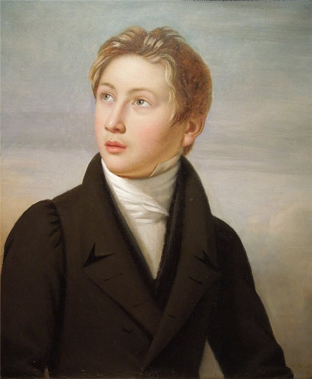
前一年全家遷居巴黎，雖然巴黎音樂院以不收外國人為由拒絕他入學，但他的系列音樂會非常成功。之後隨父親巡演法國與英國，還為英王喬治四世演奏。

## 1825-10 | 唯一的歌劇《唐·桑契》首演
在他14歲生日前不久首演，反應熱烈，但只演了四場，如今已鮮為人知。

## 1827 | 父親去世
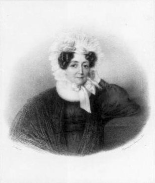
父親死於傷寒，李斯特停止巡演，留在巴黎教琴養活母親，常從清晨教到深夜，也從此染上抽菸喝酒的習慣。他愛上學生卡洛琳·聖克里克，卻遭對方的父親拆散，隨後大病一場，巴黎報紙甚至誤登了他的訃聞。

## 1830-12-04 | 結識白遼士
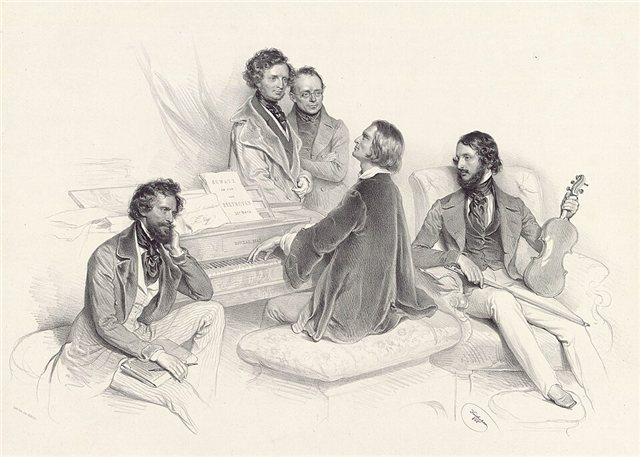
在白遼士《幻想交響曲》首演前一天兩人相識，很快成為摯友。白遼士的配器手法對李斯特日後的交響詩影響很大。

## 1832-02-26 | 出席蕭邦巴黎首演
在普萊耶爾音樂廳聽了蕭邦的巴黎首演，大為讚嘆，兩人到1833年中已成為好友。

## 1832-04 | 聽帕格尼尼演奏
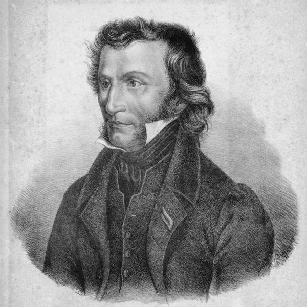
聽完帕格尼尼的音樂會後，立志要在鋼琴上達到帕格尼尼在小提琴上的境界，有時一天練琴長達14小時。後來寫出《帕格尼尼大練習曲》。

## 1833-04-02 | 與蕭邦首次同台
在白遼士為妻子籌辦的慈善音樂會上合奏雙鋼琴奏鳴曲。同年李斯特開始與達古爾特伯爵夫人交往，也擔任了白遼士的婚禮證婚人。

## 1835-12-18 | 長女布蘭丁出生@日內瓦
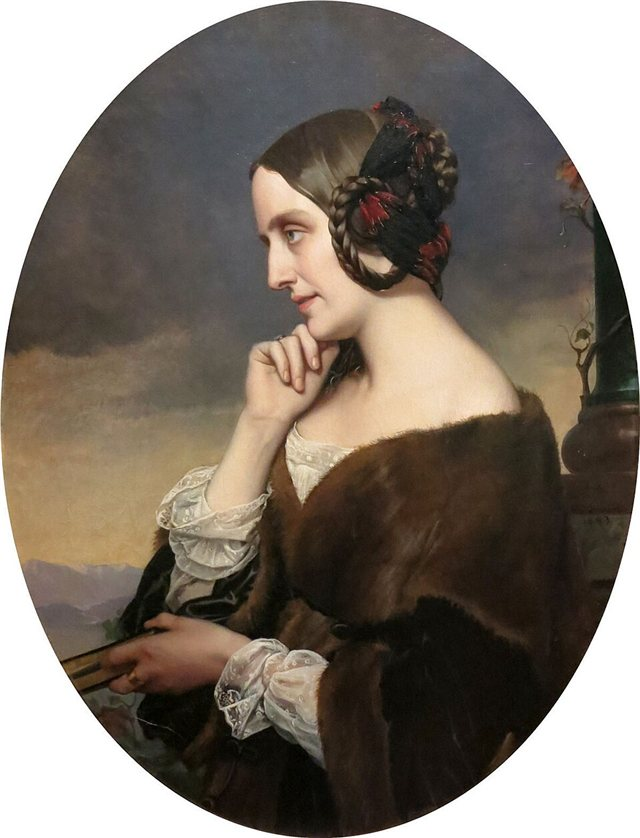
為避開醜聞，與伯爵夫人移居日內瓦。他在新成立的日內瓦音樂院任教，也為音樂刊物撰稿。

## 1837-03-31 | 與塔爾貝格的「鋼琴決鬥」
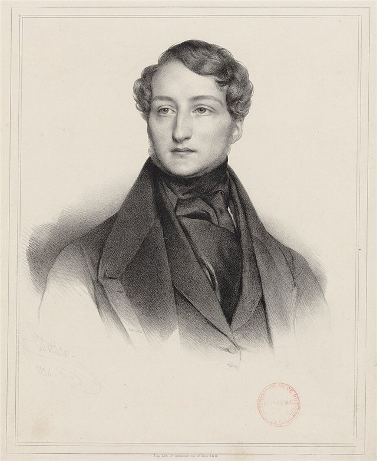
為了平息兩派樂迷的爭論，兩位鋼琴大師在貝爾焦約索公主的沙龍同台較量，為義大利難民募款。公主拒絕判定勝負，留下名言：「塔爾貝格是世界第一的鋼琴家，李斯特則是獨一無二。」

## 1837-12-24 | 女兒科西瑪出生@科莫
與伯爵夫人在義大利旅居期間出生，日後先後嫁給李斯特的學生畢羅與華格納。這段遊歷瑞士與義大利的經驗，後來寫成鋼琴曲集《巡禮之年》。

## 1838 | 《帕格尼尼大練習曲》出版
六首以鋼琴重現帕格尼尼小提琴炫技的練習曲（後修訂為《帕格尼尼大練習曲》），其中包括著名的〈鐘〉。

## 1839 | 為貝多芬紀念碑募款
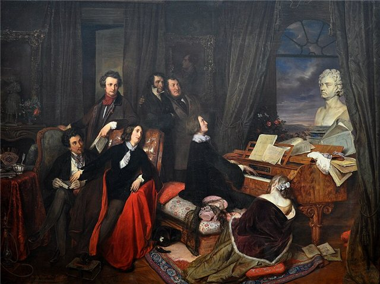
得知波昂的貝多芬紀念碑計畫因資金不足快要告吹，承諾以音樂會籌款。伯爵夫人帶著孩子回到巴黎，李斯特則展開全歐巡演，兩人關係漸行漸遠。

## 1841-04-25 | 與蕭邦最後一次同台
在巴黎為貝多芬紀念碑舉辦的慈善音樂會。兩人此後漸行漸遠，原因眾說紛紜。

## 1841-12 | 柏林音樂會：「李斯特狂熱」興起
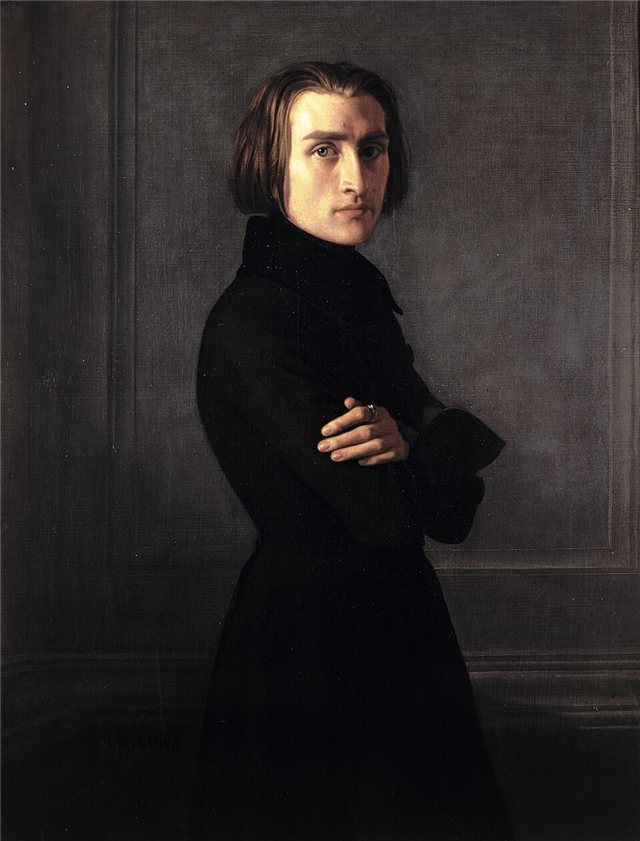
1841到1842年冬天在柏林的系列音樂會，掀起前所未見的狂熱。女性樂迷爭搶他的雪茄菸蒂、咖啡渣、手帕與手套，詩人海涅後來把這種現象命名為「李斯特狂熱」。

## 1842-05 | 為漢堡大火災民義演
他把大量演出收入捐給慈善事業，包括科隆大教堂與佩斯聖史蒂芬大教堂的建築基金、醫院與學校。漢堡大火後也為無家可歸的災民舉行義演。

## 1844-05 | 與達古爾特伯爵夫人分手
1841與1843年夏天兩人還曾帶孩子在萊因河的島上度假，但最終在這年正式分手。

## 1847 | 在基輔結識卡洛琳公主
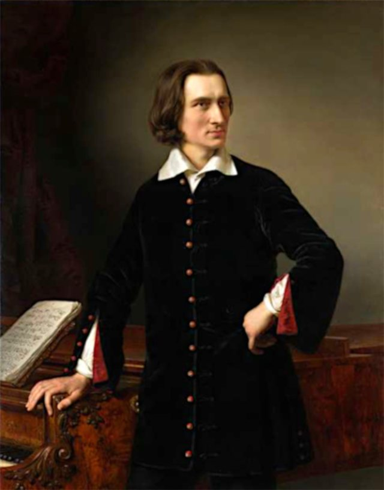
巡演烏克蘭時結識波蘭裔的卡洛琳·賽恩-維根斯坦公主。她認識李斯特才幾週，就決定隨他前往威瑪。

## 1847-09 | 最後一場收費音樂會
在伊莉莎白格勒舉行生涯最後一場收費演出，35歲時在巔峰狀態中退出巡演舞台，從此專心作曲，也讓他的演奏傳奇從未褪色。

## 1848-07 | 定居威瑪擔任宮廷樂長
六年前已獲威瑪宮廷「特別樂長」的頭銜，這時正式定居。卡洛琳公主隨後也來到威瑪，兩人在秋天開始同居。

## 1850-08-28 | 指揮華格納《羅恩格林》首演
在威瑪推出華格納歌劇《羅恩格林》的首演，並舉辦白遼士與華格納作品的音樂節，大力推廣新音樂。

## 1857 | 科西瑪嫁給畢羅；加入方濟會第三會
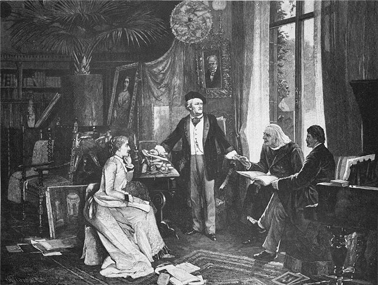
女兒科西瑪嫁給李斯特的學生、鋼琴大師漢斯·馮·畢羅（她後來改嫁華格納）。同年6月李斯特加入方濟會第三會。

## 1858 | 辭去威瑪宮廷樂長
新任劇院總監處處刁難，削減演出、否決他的曲目，甚至在他推出的歌劇首演上組織抗議，李斯特憤而辭職。

## 1859-12-13 | 兒子丹尼爾去世
年僅20歲，死因不明。1860年代成為李斯特私人生活中最悲傷的十年。

## 1861-10-22 | 羅馬婚禮受阻
卡洛琳終於取得前一段婚姻的撤銷，兩人預定在李斯特50歲生日當天於羅馬成婚，梵蒂岡卻在前一天派人阻止。此後卡洛琳放棄結婚的念頭，隱居寫作批判教會的長篇著作。

## 1862-09-11 | 女兒布蘭丁去世
產後手術引發敗血症，年僅26歲。李斯特寫信給朋友，表示要退隱獨居。

## 1863-06-20 | 隱居羅薩利奧聖母修道院
搬進羅馬近郊修道院的一個簡樸小房間，房裡放著一架鋼琴，他仍持續作曲。中文維基提到的名曲《森林的細語》就寫於這段時期。

## 1865-04-25 | 領受剪髮禮，成為「李斯特神父」
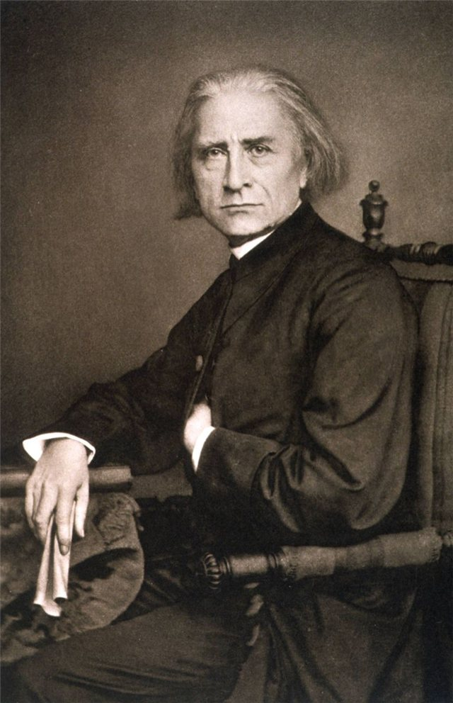
由霍恩洛厄樞機主持剪髮禮，7月又領受四個小品，此後人們常稱他「李斯特神父」。他身穿神父黑袍在各地授課，分文不取。

## 1867-06-08 | 《匈牙利加冕彌撒》
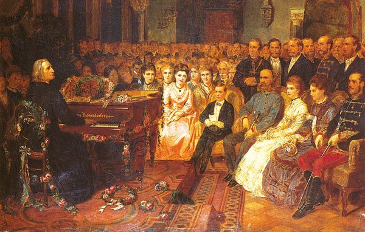
為法蘭茲·約瑟夫一世與伊莉莎白（茜茜）加冕為匈牙利國王與王后而作，在布達的馬提亞斯教堂首演，由他親自指揮。匈牙利人視他為民族英雄。

## 1869-01 | 重返威瑪開設大師班
應威瑪大公之邀回到威瑪，在宮廷園丁的小屋開設鋼琴大師班，一教就是十七年。他被視為「大師班」這種教學形式的開創者。

## 1875-11-14 | 布達佩斯皇家音樂院成立
匈牙利國會通過設立皇家音樂院，李斯特獲提名為院長。這所學校在1925年改名為李斯特音樂院。從此他每年往返羅馬、威瑪與布達佩斯，自稱「三分生活」。

## 1881-07 | 摔下樓梯，健康衰退
在威瑪住處摔下樓梯，臥床數週，之後白內障、牙病與疲勞接踵而來。晚年常感到絕望與死亡的陰影，他說：「我心中有一股深沉的悲傷，不時必須化為聲音傾洩而出。」

## 1886-01-13 | 在羅馬為德布西演奏
在羅馬的梅迪奇別墅為年輕的德布西等人演奏《巡禮之年》中的〈泉水邊〉與他改編的舒伯特《聖母頌》。德布西日後形容李斯特踩踏板的方式「就像呼吸一樣」。

## 1886-07-31 | 逝世@拜魯特
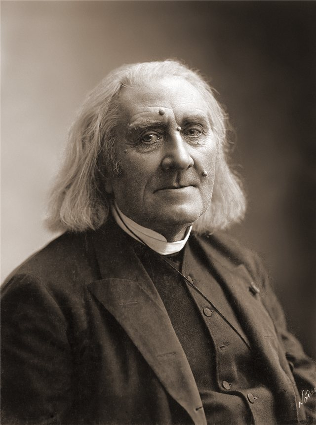
到拜魯特支持女兒科西瑪主辦的華格納音樂節，期間發燒、咳嗽，於午夜前去世，享年74歲，官方死因為肺炎。依科西瑪的意願安葬於拜魯特市立墓園。
