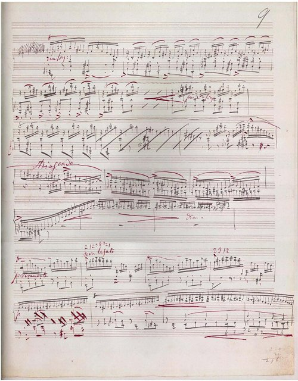

<!--
內容整理自本機筆記〈李斯特主要作品〉（D:\Books\md\音樂\李斯特主要作品.md，網頁版在知識圖譜的「5-2.音樂家作品」），做法比照「貝多芬主要作品」。
- 每首作品一則事件，日期採「創作時間」（多年創作的作品以區間呈現；「年代」以十年計、「世紀」以百年計，修訂或出版年份只寫在顯示文字裡），事件顏色依筆記的類別段落區分：交響詩、交響曲與其他大型管弦樂作品、鋼琴協奏曲與鋼琴、管弦樂作品、鋼琴獨奏代表作、匈牙利狂想曲、改編曲、歌劇幻想曲與音樂會炫技曲、室內樂與其他器樂作品、宗教音樂、清唱劇與合唱作品。
- 「約」、「前後」、修訂、出版等不是單純年份的寫法，以原文作為顯示文字。
- 作品編號是目錄編號，不等於創作順序，時間軸依創作時間排序。
- 時期沿用「李斯特生平」時間軸的主要時期（重疊的細分時期不列）。
- 筆記「優先聆聽」清單中的作品另註明順序。
- 以 follows 排在「李斯特生平」之後；生平事件見該時間軸。
圖片來源（皆為 Wikimedia Commons 公有領域作品；註明「共用」者沿用生平時間軸的圖片）：
- liszt-1841-lehmann.jpg（雷曼所繪李斯特像，1839（與李斯特生平共用））
- mw-liszt-sonata.jpg：Liszt - manuscript of Sonata in B minor, p. 11.jpg（B 小調鋼琴奏鳴曲的手稿）
- liszt-1832-paganini.jpg（帕格尼尼像，李斯特聽他演奏後立志成為鋼琴上的帕格尼尼（與李斯特生平共用））
-->

# Periods
- 1811 ~ 1821 | 童年@雷丁(Raiding)
  出生在匈牙利王國的小村莊多博爾揚（今奧地利雷丁）。父親亞當是埃斯特哈齊親王的莊園管事，也是熱心的業餘音樂家；母親是奧地利的德意志人，所以李斯特從小說德語，晚年才學會用匈牙利文寫作。不到5歲就會在鋼琴上即興演奏。
- 1821 ~ 1823 | 維也納求學
  在貴族資助下到維也納學習，隨貝多芬的學生徹爾尼學琴，徹爾尼教了他一年半、分文不取；也隨宮廷樂長薩列里學作曲。
- 1823 ~ 1835 | 巴黎時期
  全家遷居巴黎。巴黎音樂院以不收外國人為由拒絕他入學，他改隨私人老師學習，以神童之姿巡演法國與英國。父親死後他靠教琴養活自己和母親，經歷一段宗教懷疑與內省的低潮，也結識雨果、喬治·桑、白遼士、蕭邦等人。
- 1835 ~ 1839 | 與達古爾特伯爵夫人：瑞士與義大利
  為避開醜聞，與已婚的達古爾特伯爵夫人移居日內瓦，之後遊歷瑞士與義大利，生下三個孩子。這段旅程日後孕育出鋼琴曲集《巡禮之年》。
- 1839 ~ 1847 | 巡演全歐：李斯特狂熱
  為籌建波昂貝多芬紀念碑而展開巡演，八年間公開演出超過一千場，所到之處掀起被海涅稱為「李斯特狂熱」的熱潮。他也把大量演出收入捐給慈善事業。35歲時在巔峰狀態中退出巡演舞台。
- 1848 ~ 1861 | 威瑪宮廷樂長@Weimar
  定居威瑪，擔任宮廷樂長，指揮宮廷音樂會、舉辦白遼士與華格納作品的音樂節，並創造「交響詩」這種新形式，讓威瑪成為新音樂的重鎮。他與華格納、白遼士等人被稱為「新德意志樂派」，與布拉姆斯陣營形成「浪漫派之戰」。
- 1861 ~ 1869 | 羅馬時期@Rome
  原定在羅馬與卡洛琳公主成婚卻臨時受阻。之後接連失去兒子與女兒，隱居羅馬近郊的修道院，加入方濟會並領受小品，人稱「李斯特神父」。
- 1869 ~ 1886 | 「三分生活」：羅馬、威瑪、布達佩斯
  每年往返羅馬、威瑪與布達佩斯三地，在威瑪開設大師班、擔任布達佩斯皇家音樂院院長，教學分文不取，扶持了許多年輕音樂家。晚年作品轉向陰鬱，並有預示20世紀無調性音樂的實驗。

# Events

## 1848 ~ 1854 | S.95 《山上所聞》（Ce qu’on entend sur la montagne） {color=#c92a2a label="1848–1854，數次修訂"}
類別：交響詩第1號（交響詩）。

## 1849 ~ 1854 | S.96 《塔索：哀嘆與凱旋》（Tasso: Lamento e Trionfo） {color=#c92a2a label="1849–1854，修訂"}
類別：交響詩第2號（交響詩）。

## 1850 ~ 1855 | S.97 《前奏曲》（Les Préludes） {color=#c92a2a}
類別：交響詩第3號（交響詩）。入門推薦聆聽第 5 首。

## 1853 ~ 1854 | S.98 《奧菲歐》（Orpheus） {color=#c92a2a}
類別：交響詩第4號（交響詩）。

## 1850 ~ 1859 | S.99 《普羅米修斯》（Prometheus） {color=#c92a2a label="1850年代中期"}
類別：交響詩第5號（交響詩）。

## 1851 ~ 1854 | S.100 《馬采帕》（Mazeppa） {color=#c92a2a label="1851–1854，後修訂"}
類別：交響詩第6號（交響詩）。

## 1853 | S.101 《節慶之聲》（Festklänge） {color=#c92a2a label="1853，後修訂"}
類別：交響詩第7號（交響詩）。

## 1854 ~ 1856 | S.102 《葬禮英雄曲》（Héroïde funèbre） {color=#c92a2a}
類別：交響詩第8號（交響詩）。

## 1854 | S.103 《匈牙利》（Hungaria） {color=#c92a2a label="1854，後修訂"}
類別：交響詩第9號（交響詩）。

## 1858 | S.104 《哈姆雷特》（Hamlet） {color=#c92a2a}
類別：交響詩第10號（交響詩）。

## 1855 ~ 1857 | S.105 《匈奴之戰》（Hunnenschlacht） {color=#c92a2a}
類別：交響詩第11號（交響詩）。

## 1856 ~ 1857 | S.106 《理想》（Die Ideale） {color=#c92a2a}
類別：交響詩第12號（交響詩）。

## 1881 ~ 1882 | S.107 《從搖籃到墳墓》（Von der Wiege bis zum Grabe） {color=#c92a2a}
類別：交響詩第13號（交響詩）。

## 1854 | S.108 《浮士德交響曲》（Eine Faust-Symphonie） {color=#1971c2 label="1854，後續修訂至1857前後"}
類別：三樂章交響曲（交響曲與其他大型管弦樂作品）。入門推薦聆聽第 10 首。

## 1855 ~ 1856 | S.109 《但丁交響曲》（Eine Symphonie zu Dantes Divina Commedia） {color=#1971c2 label="1855–1856，後修訂"}
類別：交響曲（交響曲與其他大型管弦樂作品）。

## 1856 ~ 1861 | S.110 《浮士德情節選曲》（Episoden aus Lenau’s Faust） {color=#1971c2}
類別：管弦樂作品組曲（交響曲與其他大型管弦樂作品）。

## 1848 ~ 1882 | S.95–S.107 十三首交響詩 {color=#1971c2 label="約1848–1882"}
類別：標題管弦樂（交響曲與其他大型管弦樂作品）。

## 1863 | S.113 《薩爾維波洛尼亞》（Salve Polonia） {color=#1971c2}
類別：管弦樂作品（交響曲與其他大型管弦樂作品）。

## 1800 ~ 1899 | S.119 《匈牙利狂想曲》管弦樂相關改編 {color=#1971c2 label="19世紀中後期"}
類別：管弦樂改編（交響曲與其他大型管弦樂作品）。

## 1834 | S.120 《幻想交響曲》：取材自白遼士《李里奧》 {color=#e67700}
類別：鋼琴與管弦樂（鋼琴協奏曲與鋼琴、管弦樂作品）。

## 1830 ~ 1839 | S.121 《詛咒》（Malédiction） {color=#e67700 label="約1830年代構思，後修訂"}
類別：鋼琴與弦樂（鋼琴協奏曲與鋼琴、管弦樂作品）。

## 1848 ~ 1852 | S.122 根據貝多芬《雅典的廢墟》主題所作幻想曲 {color=#e67700}
類別：鋼琴與管弦樂（鋼琴協奏曲與鋼琴、管弦樂作品）。

## 1846 ~ 1852 | S.123 《匈牙利民謠幻想曲》 {color=#e67700 label="約1846–1852"}
類別：鋼琴與管弦樂（鋼琴協奏曲與鋼琴、管弦樂作品）。

## 1835 ~ 1856 | S.124 降E大調第一號鋼琴協奏曲 {color=#e67700}
類別：鋼琴協奏曲（鋼琴協奏曲與鋼琴、管弦樂作品）。入門推薦聆聽第 4 首。

## 1839 ~ 1861 | S.125 A大調第二號鋼琴協奏曲 {color=#e67700}
類別：鋼琴協奏曲（鋼琴協奏曲與鋼琴、管弦樂作品）。

## 1847 ~ 1864 | S.126 《死之舞》（Totentanz） {color=#e67700 label="1847–1864，經多次修訂"}
類別：鋼琴與管弦樂幻想曲（鋼琴協奏曲與鋼琴、管弦樂作品）。入門推薦聆聽第 9 首。

## 1851 | S.139 《超技練習曲》十二首 {color=#2f9e44}
類別：鋼琴練習曲（鋼琴獨奏代表作）。入門推薦聆聽第 6 首。

## 1838 ~ 1851 | S.140／S.141 《帕格尼尼大練習曲》不同版本 {color=#2f9e44 label="1838、1851修訂版"}

類別：鋼琴練習曲（鋼琴獨奏代表作）。

## 1848 ~ 1849 | S.144 《音樂會練習曲》三首 {color=#2f9e44 label="1848–1849前後"}
類別：鋼琴練習曲（鋼琴獨奏代表作）。

## 1862 ~ 1863 | S.145 《音樂會練習曲》兩首 {color=#2f9e44 label="1862–1863前後"}
類別：鋼琴練習曲（鋼琴獨奏代表作）。

## 1830 ~ 1849 | S.158 《但丁讀後感：奏鳴曲式幻想曲》 {color=#2f9e44 label="1830年代至1849年前後，經修訂"}
類別：鋼琴幻想曲（鋼琴獨奏代表作）。

## 1852 ~ 1853 | S.178 B小調鋼琴奏鳴曲 {color=#2f9e44}

類別：鋼琴奏鳴曲（鋼琴獨奏代表作）。入門推薦聆聽第 3 首。

## 1851 | S.176 《詼諧曲與進行曲》相關作品 {color=#2f9e44 label="1851前後"}
類別：鋼琴獨奏（鋼琴獨奏代表作）。

## 1830 ~ 1859 | S.172 《詩意與宗教和諧》相關鋼琴作品 {color=#2f9e44 label="1830年代至1850年代，多次修訂"}
類別：鋼琴曲集（鋼琴獨奏代表作）。入門推薦聆聽第 11 首。

## 1848 ~ 1855 | S.160 《朝聖之年》第一年：瑞士 {color=#2f9e44}
類別：鋼琴套曲（鋼琴獨奏代表作）。入門推薦聆聽第 8 首。

## 1846 ~ 1849 | S.161 《朝聖之年》第二年：義大利 {color=#2f9e44 label="1846–1849，後修訂"}
類別：鋼琴套曲（鋼琴獨奏代表作）。

## 1859 | S.162 《朝聖之年》第二年補遺：威尼斯與那不勒斯 {color=#2f9e44}
類別：鋼琴套曲（鋼琴獨奏代表作）。

## 1877 ~ 1882 | S.163 《朝聖之年》第三年 {color=#2f9e44}
類別：鋼琴套曲（鋼琴獨奏代表作）。

## 1850 | S.541 《愛之夢》三首 {color=#2f9e44}
類別：鋼琴夜曲／抒情小品（鋼琴獨奏代表作）。入門推薦聆聽第 1 首。

## 1849 ~ 1850 | S.172相關版本 《安慰曲》（Consolations） {color=#2f9e44 label="1849–1850前後，後修訂"}
類別：鋼琴小品（鋼琴獨奏代表作）。入門推薦聆聽第 11 首。

## 1850 ~ 1859 | S.213 《即興圓舞曲》（Valse-Impromptu） {color=#2f9e44 label="1850年代前後，版本有異"}
類別：鋼琴圓舞曲（鋼琴獨奏代表作）。

## 1859 ~ 1860 | S.514 《梅菲斯特圓舞曲》第1號 {color=#2f9e44 label="1859–1860，後修訂"}
類別：鋼琴圓舞曲（鋼琴獨奏代表作）。入門推薦聆聽第 7 首。

## 1885 | S.215 《無調性小步舞曲》（Bagatelle sans tonalité） {color=#2f9e44}
類別：晚期鋼琴小品（鋼琴獨奏代表作）。

## 1881 | S.199 《灰色雲彩》（Nuages gris） {color=#2f9e44}
類別：晚期鋼琴小品（鋼琴獨奏代表作）。

## 1846 ~ 1853 | S.244 《匈牙利狂想曲》第一至第十五首 {color=#862e9c label="1846–1853前後"}
類別：鋼琴狂想曲（匈牙利狂想曲）。入門推薦聆聽第 2 首。

## 1847 | S.244／第2首 《匈牙利狂想曲》第2號，升C小調 {color=#862e9c}
類別：鋼琴狂想曲（匈牙利狂想曲）。入門推薦聆聽第 2 首。

## 1847 | S.244／第6首 《匈牙利狂想曲》第6號，降D大調 {color=#862e9c}
類別：鋼琴狂想曲（匈牙利狂想曲）。入門推薦聆聽第 2 首。

## 1847 | S.244／第12首 《匈牙利狂想曲》第12號，升C小調 {color=#862e9c}
類別：鋼琴狂想曲（匈牙利狂想曲）。入門推薦聆聽第 2 首。

## 1847 | S.244／第15首 《拉科奇進行曲》 {color=#862e9c label="1847，後有不同版本"}
類別：鋼琴狂想曲（匈牙利狂想曲）。入門推薦聆聽第 2 首。

## 1882 ~ 1885 | S.244／第16–19首 後期增補的匈牙利狂想曲 {color=#862e9c}
類別：鋼琴狂想曲（匈牙利狂想曲）。入門推薦聆聽第 2 首。

## 1841 | S.393 《唐璜的回憶》（Réminiscences de Don Juan） {color=#0c8599 label="1841前後，後修訂"}
類別：歌劇幻想曲（改編曲、歌劇幻想曲與音樂會炫技曲）。

## 1841 ~ 1844 | S.394 《諾瑪的回憶》（Réminiscences de Norma） {color=#0c8599 label="1841–1844前後，後修訂"}
類別：歌劇幻想曲（改編曲、歌劇幻想曲與音樂會炫技曲）。

## 1859 | S.398 《弄臣》音樂會模仿曲（Paraphrase de concert sur Rigoletto） {color=#0c8599}
類別：歌劇改編曲（改編曲、歌劇幻想曲與音樂會炫技曲）。

## 1860 ~ 1869 | S.420 《浮士德圓舞曲》（Valse de Faust） {color=#0c8599 label="1860年代前後"}
類別：歌劇改編曲（改編曲、歌劇幻想曲與音樂會炫技曲）。

## 1800 ~ 1899 | S.434 根據威爾第歌劇主題所作的幻想曲與改編曲 {color=#0c8599 label="19世紀中後期"}
類別：歌劇改編曲（改編曲、歌劇幻想曲與音樂會炫技曲）。

## 1830 ~ 1869 | S.464 貝多芬交響曲鋼琴改編系列 {color=#0c8599 label="1830年代至1860年代，依曲目而異"}
類別：交響曲鋼琴改編（改編曲、歌劇幻想曲與音樂會炫技曲）。

## 1800 ~ 1899 | S.565 舒伯特歌曲鋼琴改編系列 {color=#0c8599 label="19世紀中後期"}
類別：歌曲鋼琴改編（改編曲、歌劇幻想曲與音樂會炫技曲）。

## 1800 ~ 1899 | S.558 舒伯特《魔王》等歌曲的鋼琴改編相關作品 {color=#0c8599 label="19世紀中後期"}
類別：歌曲鋼琴改編（改編曲、歌劇幻想曲與音樂會炫技曲）。

## 1830 ~ 1839 | S.127 小提琴與鋼琴奏鳴曲相關作品 {color=#5f3dc4 label="1830年代"}
類別：室內樂（室內樂與其他器樂作品）。

## 1835 | S.128 《水手之歌》主題大二重奏協奏曲（Grand Duo concertant） {color=#5f3dc4 label="約1835，後修訂"}
類別：小提琴與鋼琴（室內樂與其他器樂作品）。

## 1872 | S.129 《婚禮頌》（Epithalam） {color=#5f3dc4}
類別：小提琴與鋼琴（室內樂與其他器樂作品）。

## 1800 ~ 1899 | S.130 《輓歌》（Élégie）相關版本 {color=#5f3dc4 label="19世紀中後期"}
類別：室內樂（室內樂與其他器樂作品）。

## 1800 ~ 1899 | S.132 小提琴與鋼琴作品相關編制 {color=#5f3dc4 label="19世紀中後期"}
類別：室內樂（室內樂與其他器樂作品）。

## 1800 ~ 1899 | S.135 室內樂作品相關編制 {color=#5f3dc4 label="19世紀中後期"}
類別：室內樂（室內樂與其他器樂作品）。

## 1857 ~ 1862 | S.2 《聖伊莉莎白傳奇》（Die Legende von der heiligen Elisabeth） {color=#a61e4d}
類別：神劇（宗教音樂、清唱劇與合唱作品）。

## 1866 ~ 1872 | S.3 《基督》（Christus） {color=#a61e4d}
類別：神劇（宗教音樂、清唱劇與合唱作品）。入門推薦聆聽第 12 首。

## 1846 ~ 1869 | S.8 《四聲部彌撒曲》 {color=#a61e4d label="1846–1869，不同版本"}
類別：彌撒曲（宗教音樂、清唱劇與合唱作品）。

## 1857 ~ 1858 | S.9 《格拉納彌撒曲》（Missa solemnis） {color=#a61e4d}
類別：彌撒曲（宗教音樂、清唱劇與合唱作品）。

## 1866 ~ 1869 | S.11 《匈牙利加冕彌撒曲》 {color=#a61e4d}
類別：彌撒曲（宗教音樂、清唱劇與合唱作品）。

## 1867 ~ 1871 | S.12 《安魂彌撒曲》（Requiem） {color=#a61e4d}
類別：宗教合唱作品（宗教音樂、清唱劇與合唱作品）。

## 1855 ~ 1866 | S.13 《第13篇詩篇》 {color=#a61e4d label="1855–1866，不同版本"}
類別：聲樂與管弦樂（宗教音樂、清唱劇與合唱作品）。

## 1800 ~ 1899 | S.44 《聖體頌》（Ave verum corpus）相關作品 {color=#a61e4d label="19世紀中後期"}
類別：宗教合唱作品（宗教音樂、清唱劇與合唱作品）。
