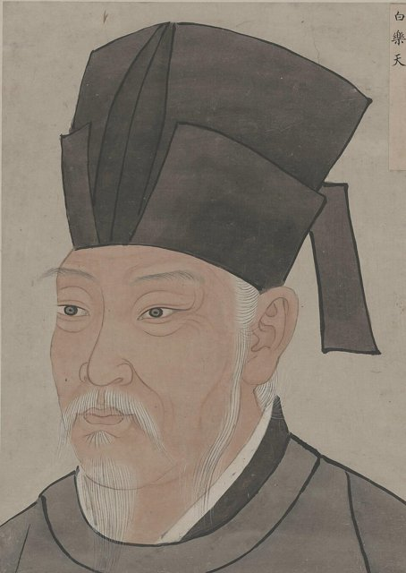

<!--
內容整理自 D:\Books\md\歷史\人物\中國\劉禹錫生平大事記（772—842）.md（Books 的人物頁為 D:\Books\html\1-2-1.中國歷史人物\劉禹錫(772~842).html），並整合中文維基百科〈劉禹錫〉條目，以自己的話改寫。
時期依筆記的六個階段（早年、科舉入仕、永貞革新、長期貶謫、重返中央、晚年），貶謫一段依地點細分為朗州、連州到和州。
兩份資料出入與處理方式：
- 出生地：筆記寫籍貫河南洛陽；維基百科寫郡望說法不一（中山、彭城等），772年生於嘉禾（今浙江嘉興），童年受詩僧皎然、靈澈薰陶，照維基百科補充。
- 科舉：筆記寫793年進士、795年前後博學宏詞科；維基百科寫793年與柳宗元同榜進士，同年又登博學宏詞科，795年再中吏部取士科、授太子校書，這裡依維基百科。
- 805年貶謫：筆記只寫貶朗州司馬；維基百科寫九月先貶連州刺史，十月行至江陵再貶朗州司馬，照此。「二王八司馬」依維基百科補充。
- 朗州時間：筆記寫「十年」；維基百科寫謫居近九年（805年十月到815年），內文寫將近十年。
- 和州：筆記標題作824年、內文作寶曆元年（825）；依維基百科，長慶四年（824）夏轉和州刺史，赴任途中作〈西塞山懷古〉。
- 〈酬樂天揚州初逢席上見贈〉：筆記放在晚年；依維基百科，是826年冬罷和州刺史、北返途中在揚州與白居易相會時所作，這裡放在826年。
- 〈陋室銘〉：筆記同時提到朗州與和州兩種說法，並說年代有考證空間；這裡依傳統說法放在和州時期，內文註明。
- 〈烏衣巷〉〈石頭城〉屬〈金陵五題〉，一般認為作於和州任內，放在和州時期。
- 晚年官職與卒年依維基百科補充：840年改秘書監、841年加檢校禮部尚書，842年秋病逝洛陽，臨終前撰《子劉子自傳》。
- 人名與其他時間軸一致：白居易（BaiJuyi）、元稹（YuanZhen）、韓愈（HanYu）；柳宗元、王叔文、裴度沒有獨立時間軸。
圖片來源（皆為 Wikimedia Commons 公有領域／CC0 作品，縮成最長邊 640px）：
- lyx-cover.jpg：Riu Yu hsi.jpg（劉禹錫像（線描））
- bjy-cover.jpg：唐名臣像-21-白樂天.jpg（《唐名臣像》中的白居易像（與白居易生平時間軸共用））
-->

# Periods
- 772 ~ 792 | 江南的少年 | #868e96
  生於安史之亂後的江南，父親劉緒在鹽鐵機構任職；自幼讀經史詩書，童年就陪著詩僧皎然、靈澈吟詠。
- 793 ~ 804 | 科舉入仕 | #1971c2
  與柳宗元同榜進士，連登博學宏詞科，歷任幕府書記、監察御史，在長安與王叔文、柳宗元等主張改革的官員往來密切。
- 805 ~ 814 | 永貞革新與朗州 | #c92a2a
  順宗即位後參與王叔文的改革，數月即失敗，被貶朗州司馬；在湖南接觸民歌，寫〈竹枝詞〉，作《天論》。
- 815 ~ 826 | 連州、夔州、和州 | #e67700
  奉召回京，卻因玄都觀桃花詩再貶連州，此後歷任夔州、和州刺史；喪母、喪友，仍以豪健的詩筆寫民歌與懷古。
- 827 ~ 842 | 重返中央與劉白唱和 | #2f9e44
  回到洛陽、長安，再遊玄都觀；歷任蘇州、汝州、同州刺史後，晚年以太子賓客分司東都，與白居易詩酒唱和，病逝洛陽。

# Events

## 772 | 出生 {label="772年（唐代宗大曆七年）"}
劉禹錫字夢得，自稱中山郡人（漢中山靖王劉勝之後），籍貫一般寫作洛陽，郡望則各書說法不一。安史之亂時，祖父帶著獨子劉緒南遷，劉緒後來在鹽鐵轉運機構任職，劉禹錫便出生在嘉禾（今浙江嘉興）。他自幼受父親教導，童年在吳興一帶就陪著詩僧皎然、靈澈吟詩，打下文學根基。

## 793 | 進士及第 {label="793年（貞元九年）"}
二十二歲與柳宗元同榜考中進士，同年又考取博學宏詞科；795年再中吏部取士科，授太子校書。797年父親在揚州去世，他回鄉守喪。柳宗元從此成為他一生最重要的朋友，兩人政治理想相近，後來同遭貶謫，並稱「劉柳」。

## 800 | 杜佑的掌書記 {label="800年（貞元十六年）"}
淮南節度使杜佑兼領徐泗濠節度使，聘劉禹錫為掌書記，後改任淮南節度使掌書記，替杜佑代筆撰寫奏狀。

## 803 | 監察御史 {label="803年（貞元十九年）"}
前一年調任渭南縣主簿，這年升任監察御史，負責糾舉官員失職。柳宗元也在此前後進入御史臺。劉禹錫在長安與韋執誼、王叔文、韓愈等人往來，看到朝廷的腐敗與宦官、藩鎮的弊病，逐漸站到改革的一方。

## 805-04 | 永貞革新 {label="805年（永貞元年）春"}
正月德宗去世，久病的順宗即位，王叔文、王伾進入中樞，推動整頓政務與財政：打擊貪官、限制宦官干政、收回財權。劉禹錫轉任屯田員外郎，負責度支鹽鐵的案牘，與柳宗元同為改革的核心成員。

## 805-10 | 貶朗州司馬 {label="805年（永貞元年）九月至十月"}
改革觸動宦官、藩鎮與部分朝臣的利益，宦官聯合節度使逼迫順宗讓位給太子李純（唐憲宗），史稱「永貞內禪」。王叔文、王伾被貶，改革只維持了幾個月就告終。劉禹錫九月先被貶為連州刺史，十月走到江陵又再貶為朗州（今湖南常德）司馬；柳宗元貶永州司馬，改革派共八人被貶為州司馬，後世稱「二王八司馬」。

## 806 | 朗州與〈竹枝詞〉 {label="805–815年"}
劉禹錫在朗州謫居將近十年。他接觸當地少數民族與民間的歌謠，把民歌的形式寫進文人詩，作〈竹枝詞〉十多首，語言通俗活潑，帶有民歌的節奏與生活氣息。〈秋詞〉「自古逢秋悲寂寥，我言秋日勝春朝」，一反悲秋的傳統，表現他豪邁樂觀的性格。

## 814 | 《天論》 {label="814年（元和九年）"}
劉禹錫寫成《天論》上、中、下三篇，回應柳宗元的〈天說〉，提出「天人交相勝」：自然與人類社會各有規律，有時人勝天、有時天勝人，是中唐重要的哲學論著。

## 815 | 玄都觀桃花與再貶連州 {label="815年（元和十年）"}
劉禹錫與柳宗元等人奉召回長安，他遊玄都觀見桃花盛開，寫下「玄都觀裡桃千樹，盡是劉郎去後栽」，被認為諷刺十年間新得勢的權貴，不久又被貶為播州（今貴州遵義一帶）刺史。播州偏遠艱苦，柳宗元上書願以自己的柳州與他互換，因劉母年事已高；御史中丞裴度也出面說情，劉禹錫改任連州（今廣東連州）刺史，五月到任。

## 819 | 母喪與柳宗元之死 {label="819年（元和十四年）"}
在連州將近五年，劉禹錫苦悶中以佛法自遣，與僧人往來頻繁。這年母親去世，他護喪北歸洛陽，途中得知柳宗元已在柳州病逝，年僅四十七歲，悲痛不已。此後他撫養柳宗元的幼子，整理柳宗元的遺稿，編成文集。

## 822 | 夔州刺史 {label="821年授官，822年正月到任"}
服喪期滿，劉禹錫出任夔州（今重慶奉節）刺史，積極處理政務。巴渝一帶本有竹枝歌的傳統，他重新整理改作〈竹枝詞〉組詩，如「山桃紅花滿上頭，蜀江春水拍山流。花紅易衰似郎意，水流無限似儂愁」；另一首「東邊日出西邊雨，道是無晴卻有晴」以晴雨諧音情意，是竹枝詞最為人傳誦的句子。

## 824 | 和州刺史與懷古詩 {label="824年（長慶四年）夏"}
劉禹錫轉任和州（今安徽和縣）刺史，赴任途中經過西塞山，寫下〈西塞山懷古〉：「王濬樓船下益州，金陵王氣黯然收」，以西晉滅吳反思歷史興亡。和州任內他也寫了〈金陵五題〉，其中〈烏衣巷〉「舊時王謝堂前燕，飛入尋常百姓家」與〈石頭城〉，以簡潔的語言寫出繁華消逝的感慨。傳統上也把〈陋室銘〉「斯是陋室，惟吾德馨」與和州時期聯繫在一起，但寫作年代仍有不同看法。

## 826 | 揚州初逢白居易 {label="826年（寶曆二年）冬"}

劉禹錫罷和州刺史北返，在揚州與白居易相會。白居易在席上贈詩，感嘆他被貶「二十三年折太多」；劉禹錫答以〈酬樂天揚州初逢席上見贈〉：「沉舟側畔千帆過，病樹前頭萬木春」，在感傷中仍能接受新生事物，表現歷經挫折後的豁達。兩人此後成為一生的詩友。

## 827 | 回到洛陽 {label="827年（大和元年）"}
自805年被貶以來，經歷朗州、連州、夔州、和州二十多年的地方生涯，劉禹錫終於回到洛陽，任主客郎中、分司東都。

## 828 | 再遊玄都觀 {label="828年（大和二年）春"}
劉禹錫到長安任集賢殿學士，重遊玄都觀，當年的桃樹已蕩然無存，寫下〈再遊玄都觀〉：「種桃道士歸何處？前度劉郎今又來。」與十三年前的桃花詩遙相呼應，表明歷經打擊仍不改其志。829年改任禮部郎中，兼集賢殿學士。

## 831 | 外放蘇州、汝州、同州 {label="831–836年"}
十月，因支持他的裴度罷相，劉禹錫再度外放為蘇州刺史，在江南名城頗受士人敬重；834年改任汝州刺史，835年改任同州刺史。

## 836 | 太子賓客分司東都 {label="836年（開成元年）秋"}
劉禹錫因足疾離開同州，改任太子賓客、分司東都，後世因此稱他「劉賓客」。此後長住洛陽，與白居易、裴度、牛僧孺等人飲酒、遊覽、唱和，與白居易並稱「劉白」，留下《劉白唱和集》等。白居易為他的詩集作序，稱他「詩豪者也」，此稱遂流傳後世。840年改任秘書監，841年加檢校禮部尚書，所以也稱「劉尚書」。

## 842 | 病逝洛陽 {label="842年（會昌二年）秋"}
劉禹錫晚年多病，仍寫作唱和不輟。臨終前撰寫《子劉子自傳》，回顧家世與一生仕歷，秋天病逝於洛陽，享年七十一歲（虛歲），追贈戶部尚書，葬於滎陽檀山。他在長期貶謫中保持豪健的詩風，懷古詩的歷史意識、民歌體的〈竹枝詞〉，對後世都有深遠影響。
