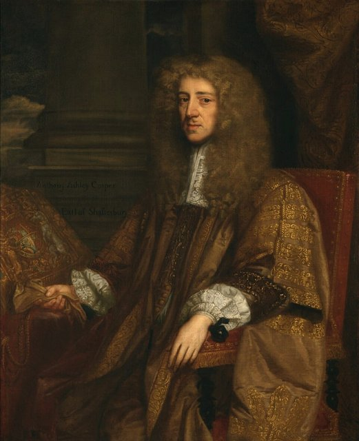
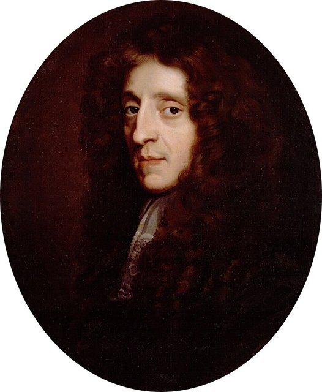
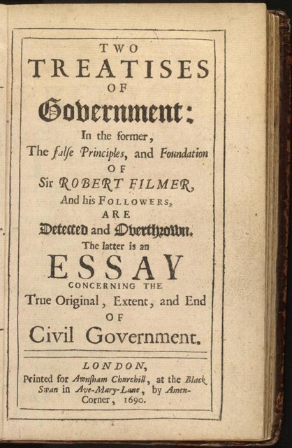
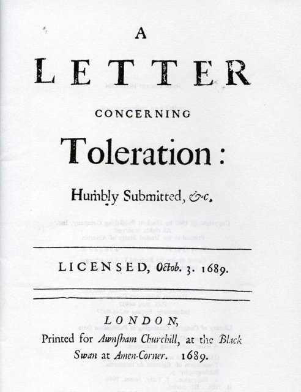
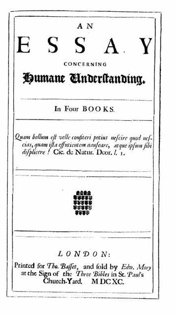

<!--
內容整理自本機筆記〈洛克（John Locke）生平大事記（1632–1704）〉（圖表\洛克（John Locke）生平大事記（1632–1704）.md）與中文維基百科「約翰·洛克」條目（CC BY-SA 4.0），以台灣用語改寫摘要。
https://zh.wikipedia.org/zh-tw/约翰·洛克
史料與日期說明：
- 你提供的網址「洛克」在中文維基百科不是人物條目，改讀「約翰·洛克」條目。
- 返國時間：維基百科寫1688年隨奧蘭治親王的妻子返回英格蘭；實際上他是1689年2月隨瑪麗（後來的瑪麗二世）一同渡海回國，此處依此。
- 《政府論兩篇》與《人類理解論》都在1689年12月出版，扉頁年份印為1690年；筆記以「1689–1690」概括，此處採1689年12月。
- 出生地 Wrington：維基百科譯為「威靈頓村」，容易與威靈頓（Wellington）混淆，此處譯作「靈頓」。
- 1660年代早期的保守著作《關於政府的兩篇短論》（Two Tracts on Government）、1665年出使克萊沃、1668年當選皇家學會會員、參與起草《卡羅來納基本憲法》並投資皇家非洲公司、1684年被牛津基督堂學院開除、流亡期間使用化名、1695年推動廢除出版審查法、1696年貨幣重鑄論爭等細節，係依一般公認的史實補充。
- 1670年代的旅法經歷，筆記寫1675–1679年，與維基百科一致。
圖片來源（皆為 Wikimedia Commons 公有領域／CC0 作品）：
- loc-cover.jpg：Godfrey Kneller - Portrait of John Locke (Hermitage).jpg
- loc-shaftesbury.jpg：Anthony Ashley-Cooper, 1st Earl of Shaftesbury Portrait.jpg
- loc-greenhill.jpg：John Locke by John Greenhill.jpg
- loc-treatises.jpg：Locke treatises of government page.jpg
- loc-toleration.jpg：Letter Concerning Toleration.jpg
- loc-essay.jpg：Locke Essay 1690.jpg
-->

# Periods
- 1632 ~ 1652 | 清教徒家庭與西敏公學 | #f08c00
  生於薩默塞特郡的清教徒律師家庭，父親在內戰中為國會派作戰；靠父親上司的推薦進入倫敦的西敏公學。
- 1652 ~ 1667 | 牛津的學者與醫生 | #2f9e44
  在牛津基督堂學院求學、任教，厭倦經院哲學，轉而投入醫學與波以耳的實驗科學。
- 1667 ~ 1683 | 沙夫茨伯里伯爵的左右手 | #c92a2a
  成為輝格黨領袖沙夫茨伯里伯爵的私人醫師與顧問，參與政治、貿易與殖民事務，並開始寫作《人類理解論》與《政府論》。
- 1683 ~ 1689 | 荷蘭流亡 | #495057
  伯爵失勢、刺殺國王的陰謀案爆發後逃往荷蘭，用化名躲避追捕，在流亡中完成《人類理解論》與《論宗教寬容》。
- 1689 ~ 1704 | 光榮革命後的聲望與晚年 | #1971c2
  隨新王后返國，主要著作相繼出版，成為輝格黨與歐洲學界的思想領袖；晚年在友人瑪莎姆夫人的鄉間宅邸度過。

# Events

## 1632-08-29 | 出生@靈頓
生於英格蘭西南部薩默塞特郡的靈頓村，當天就受洗；同年稍晚，史賓諾莎也在阿姆斯特丹出生。父親同名約翰·洛克，是擔任治安法官書記的律師兼小地主；父母都是清教徒。他在布里斯托南方的彭斯福德長大。

## 1642 | 英國內戰爆發
國王查理一世與國會爆發內戰，父親加入國會派軍隊，在上司波帕姆上校麾下擔任騎兵隊長。這層關係日後成為他求學的門路；而這場國王與國會之爭，也正是他一生政治思想的起點。

## 1647 | 進入西敏公學
在已成為國會議員的波帕姆推薦下，進入倫敦的西敏公學，學習拉丁文、希臘文與希伯來文。1649年1月，國王查理一世在離學校不遠的白廳被處死，據說學校當天把學生留在校內。

## 1652 | 進入牛津大學基督堂學院
以優異成績進入牛津大學基督堂學院。他覺得以亞里斯多德為主的經院課程枯燥乏味，反而私下閱讀笛卡兒等近代哲學家的著作，發現那比學校教的有趣得多。

## 1656-02 | 取得學士學位
取得學士學位，1658年再取得碩士，之後留在基督堂學院擔任研究員，教授希臘文與修辭學。透過同學洛爾的介紹，他開始投入醫學與實驗研究，並結識化學家波以耳，協助他做實驗、記錄天氣觀測，深受實驗哲學的影響。

## 1660 | 王政復辟與早期政治著作
查理二世復辟，他和許多英國人一樣歡迎王政恢復，寫下兩篇討論政府能否管制宗教儀式的文章，立場相當保守，主張國家有權決定宗教的外在形式——與他日後主張宗教寬容的立場大不相同。

## 1665-11 | 出使克萊沃
擔任英國外交使團的秘書，前往勃蘭登堡選侯治下的克萊沃。他驚訝地看到喀爾文派、路德派與天主教徒在當地和平共處，這次經驗讓他開始思考：宗教寬容並不會危害國家的安定。

## 1666-07 | 結識沙夫茨伯里伯爵

在牛津結識政治人物艾希利勳爵（後來的第一代沙夫茨伯里伯爵）。勳爵來牛津飲用礦泉水治療肝病，兩人一見如故，勳爵力邀他到倫敦擔任私人醫師與顧問，從此改變了他的一生。

## 1667 | 搬到倫敦，跟隨西德納姆學醫
搬進艾希利勳爵在倫敦的宅邸，同時跟隨名醫西德納姆學習臨床醫學。西德納姆重視觀察病人實際症狀、不迷信理論的作風，深刻影響了他日後重視經驗的知識論。同年寫成《論寬容》的初稿。

## 1668-06 | 伯爵的肝臟手術
艾希利勳爵的肝臟囊腫惡化，他主導其他醫師會診，說服勳爵接受在當時極為冒險的手術，在腹部植入銀管引流。手術成功，勳爵終生感激，說是洛克救了他一命。同年11月，他當選皇家學會會員。

## 1669 | 參與殖民與貿易事務
擔任北美卡羅來納殖民地領主們的秘書，參與起草《卡羅來納基本憲法》；後來又擔任貿易與殖民委員會的秘書，還投資了從事奴隸貿易的皇家非洲公司。他一方面主張人人生而自由，一方面參與殖民與奴隸制度，這個矛盾至今仍是學界討論的焦點。

## 1671 | 構思《人類理解論》
與五六位朋友在他的房間討論道德與宗教問題，大家很快就陷入僵局。他想到，在討論這些問題之前，應該先弄清楚人的理解能力能及於哪些事物、又有哪些限度。他當場寫下的草稿，就是《人類理解論》的起點；這本書他斷斷續續寫了將近二十年。

## 1672 | 伯爵出任大法官

艾希利勳爵受封沙夫茨伯里伯爵，出任英格蘭大法官，他也隨之擔任政府職務。但伯爵很快與國王查理二世決裂，成為反對派「輝格黨」的領袖，主張排除信奉天主教的王弟約克公爵（後來的詹姆士二世）的王位繼承權。

## 1675-11 | 旅居法國
伯爵失勢，他也因健康不佳（長年的哮喘）前往法國休養，在蒙佩利爾與巴黎住了三年多，研究醫學、結識伽桑狄學派的哲學家，並繼續寫作《人類理解論》。

## 1679-04 | 返國與《政府論》

回到英國，正值「排除危機」——國會試圖立法禁止約克公爵繼位。在伯爵的鼓勵下，他在1679至1682年間秘密寫作《政府論兩篇》：第一篇駁斥菲爾默「君權神授、國王是亞當的繼承人」的主張；第二篇提出人在自然狀態下就擁有生命、自由與財產的自然權利，政府是人民為了保障這些權利而同意成立的，若政府背叛這個託付，人民有權反抗。這本書過去被認為是為光榮革命辯護，但其實早在革命前就已大致寫成。

## 1683-09 | 逃往荷蘭
沙夫茨伯里伯爵前一年已逃往荷蘭並在當地去世；1683年，一群輝格黨人被揭發密謀在萊伊莊園附近刺殺國王與約克公爵，多位輝格黨領袖被捕處死。雖然沒有證據顯示他直接參與，他仍感到危險，燒毀部分文件，悄悄逃往荷蘭。

## 1684-11 | 被牛津開除
國王查理二世下令，牛津基督堂學院開除他的研究員資格。隔年英國政府把他列入要求荷蘭引渡的名單，他改用化名、四處搬家躲藏，在阿姆斯特丹等地與醫生、神學家往來，並專心修訂《人類理解論》。

## 1685 | 《論宗教寬容》

天主教徒的詹姆士二世即位，同年法王路易十四廢除保障新教徒的《南特詔令》。他在流亡中以拉丁文寫成《論宗教寬容書簡》，主張國家只負責保護人民的生命與財產，教會是自願參加的團體，靈魂的得救無法用武力強迫，因此政府不應干涉信仰。不過他認為無神論者與效忠外國君主的天主教徒不在寬容之列。

## 1689-02 | 隨瑪麗王后返國
1688年底，荷蘭的奧蘭治親王威廉率軍登陸英格蘭，詹姆士二世出逃，史稱「光榮革命」。1689年2月，他和威廉的妻子瑪麗同船返回英國；威廉與瑪麗隨後接受《權利法案》，共同即位為威廉三世與瑪麗二世。他婉拒了出任駐勃蘭登堡大使的邀請。

## 1689-12 | 《人類理解論》與《政府論》出版

《論宗教寬容書簡》、《政府論兩篇》與《人類理解論》在一年內相繼出版。《人類理解論》主張人心生來就像一張「白紙」，沒有天生的觀念，所有知識都來自感覺與反省這兩種經驗；他也區分物體本身具有的「初性」（形狀、大小、運動）與存在於感受中的「次性」（顏色、聲音、味道）。這本書讓他名滿歐洲，《政府論》卻是匿名出版，他到死前才在遺囑中承認是自己寫的。

## 1691 | 定居奧茨莊園
健康惡化、受不了倫敦的煙霧，他搬到艾塞克斯郡奧茨莊園，住在好友瑪莎姆夫人（劍橋柏拉圖學派哲學家卡德沃斯的女兒）家中，度過晚年。牛頓等學者常來拜訪，與他討論神學與《聖經》詮釋。

## 1693 | 《教育漫話》
出版《教育漫話》，原本是寫給友人談如何教養兒子的書信。他主張教育的首要目標是培養健全的身體與品格，透過習慣、榜樣與鼓勵引導孩子，反對體罰與死背；書中的觀點後來影響了盧梭的《愛彌兒》。

## 1695 | 《基督教的合理性》與出版自由
出版《基督教的合理性》，主張基督教的核心信仰簡單而合乎理性。同年他協助國會議員反對延長《出版許可法》，使英國廢除出版前審查制度，這是英國新聞與出版自由的重要里程碑。他也參與當時的貨幣重鑄論爭，主張維持銀幣的足額價值。

## 1696-05 | 貿易委員會委員
出任新成立的貿易與殖民委員會委員，處理國際貿易、殖民地行政、愛爾蘭亞麻業與濟貧等問題，並積極參與政策制定；1700年因健康因素辭職。

## 1704-10-28 | 逝世@奧茨莊園
在奧茨莊園去世，享年72歲；據說臨終時瑪莎姆夫人正在床邊為他朗讀《詩篇》。他終身未婚，葬於附近海萊佛教堂的墓地，墓誌銘是他親自撰寫的拉丁文，說自己是「一個以微薄財產過著滿足生活的人」。他的思想經由伏爾泰、孟德斯鳩傳入法國，又深刻影響美國開國元勳——《獨立宣言》中「生命、自由與追求幸福」的權利，以及「政府的正當權力來自被統治者的同意」，都可以看到他的影子。
