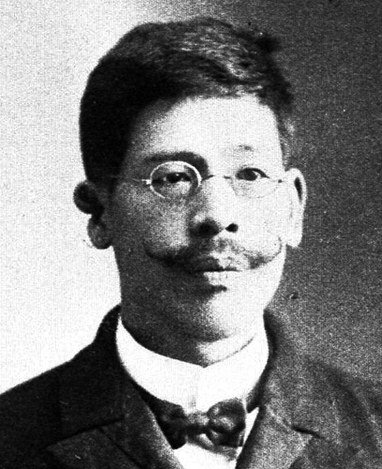
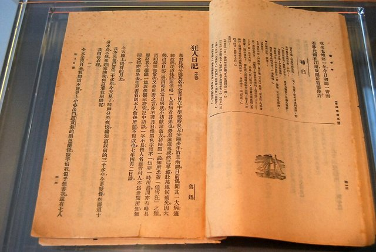
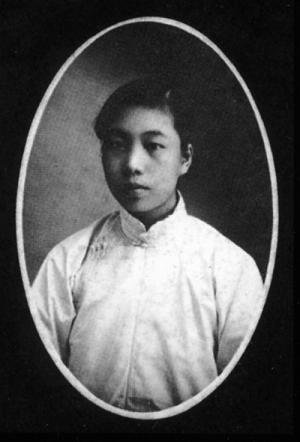
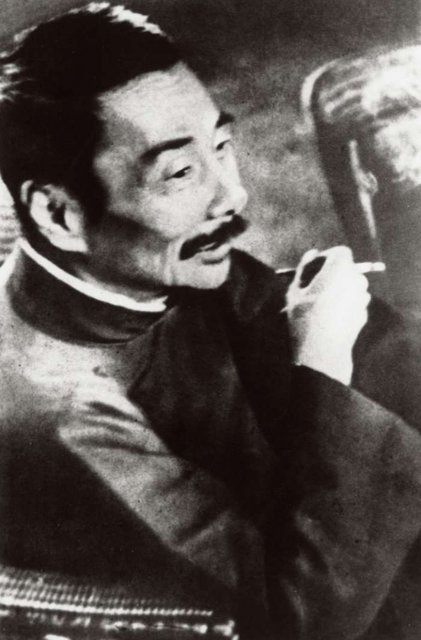

<!--
內容整理自 D:\Books\html\1-2-1.中國歷史人物\魯迅(1881~1936).html（沒有對應的 md 筆記），並整合中文維基百科〈魯迅〉條目，以自己的話改寫。
時期依頁面「思想發展脈絡」的四個階段並拆細：童年與家道中落、南京求學與留日、回國任教與教育部、新文化運動與小說、北京後期與南下、上海時期。
兩份資料出入與處理方式：
- 生卒：兩份一致，1881年9月25日生於浙江紹興府會稽縣，1936年10月19日因肺結核卒於上海，享年55歲（虛歲56）。
- 頁面多以年份敘述，維基百科補上月份：1898年5月入江南水師學堂並改名周樹人、1899年2月入礦路學堂、1902年2月赴日、1906年3月退學、1921年12月發表〈阿Q正傳〉、1926年8月南下廈門、1927年1月到廣州中山大學、1927年10月遷居上海，採維基百科。
- 《吶喊》：頁面寫1922年出版，維基百科寫1923年；《吶喊》一般記為1923年8月出版，採1923年並註明。
- 〈狂人日記〉：頁面寫1918年；一般記為1918年5月刊於《新青年》第四卷第五號，採「1918-05」。
- 與朱安成婚：頁面沒有；維基百科正文作1906年7月26日、資訊框作7月6日，只寫「1906年夏」。
- 1923年7月與周作人決裂、1927年起與許廣平同居、1929年周海嬰出生（維基百科是由1936年「年僅七歲」推算），頁面沒有，取自維基百科並在事件中說明。
- 中國左翼作家聯盟：頁面寫1930年參與成立；維基百科這部分只記1930年2月參與發起中國自由運動大同盟，左聯成立於1930年3月2日，依常見記載補上日期。
- 安葬：維基百科記10月22日葬於上海萬國公墓，1956年遷葬虹口公園，寫進最後一則事件；「魯迅墓」列為 notNames，避免地名誤配。
- 頁面的「重要作品年表」「思想發展脈絡」「與胡適的比較」「歷史地位與評價」寫進時期說明與相關事件，不另立事件；各作品的初刊、結集與出版年份不同，照頁面說明以常見年份為主。
- 人名與其他時間軸一致：蔡元培、陳獨秀、胡適、周作人、章太炎、藤野嚴九郎、許廣平、張勳。
圖片來源（皆為 Wikimedia Commons 公有領域／CC0 作品；註明「共用」者沿用其他時間軸已有的圖片）：
- lx-cover.jpg：LuXun1930.jpg（魯迅，1930）
- lx-fujino.jpg：Fujino Genkuro.jpg（藤野嚴九郎）
- lx-madman.jpg：A Madman's Diary - Lu Xun.JPG（〈狂人日記〉的早期刊本）
- lx-xu.jpg：Xu Guangping.jpg（許廣平）
- lx-1936.jpg：Lu Xun 1936.jpg（魯迅，1936）
-->

# Periods
- 1881-09-25 ~ 1898 | 童年與家道中落 | #868e96
  生於紹興的士大夫家庭，讀三味書屋；祖父因科場案入獄、父親久病去世，家道中落，讓他看見人情冷暖，也注意到醫療與迷信的問題。
- 1898 ~ 1909 | 南京求學與留日 | #1971c2
  改名周樹人，進江南水師學堂、礦路學堂，赴日學醫；仙台的幻燈片事件後棄醫從文，翻譯外國文學，師從章太炎。
- 1909 ~ 1918 | 回國任教與教育部 | #2f9e44
  在杭州、紹興任教，經歷辛亥革命，進入教育部隨政府北遷，整理古籍、碑刻，累積深厚的學術基礎。
- 1918 ~ 1926 | 新文化運動與小說 | #c92a2a
  以「魯迅」為筆名發表〈狂人日記〉，接著寫〈孔乙己〉〈藥〉〈故鄉〉〈阿Q正傳〉〈祝福〉，出版《吶喊》《彷徨》與《中國小說史略》，支持女師大學生。
- 1926 ~ 1927-10 | 南下廈門與廣州 | #e8590c
  三一八慘案後離開北京，到廈門大學、廣州中山大學任教，四一二事件後辭職。
- 1927-10 ~ 1936-10-19 | 上海時期 | #7048e8
  定居上海，以雜文、翻譯與文學評論介入社會，參與左翼作家聯盟，推動新興木刻版畫，扶持青年作家，直到病逝。

# Events

## 1881-09-25 | 出生於浙江紹興
魯迅生於浙江紹興府會稽縣東昌坊口的周家新臺門，原名周樟壽，字豫才，家族有科舉與士大夫的背景。1887年起他接受家塾教育，1892年進三味書屋，跟隨壽鏡吾讀書，培養出對歷史、文學與民間故事的興趣。
他接受過完整的傳統教育，日後才能從歷史與文化內部批判他所熟悉的傳統。

## 1893 | 祖父科場案，家道中落
祖父周福清因科場舞弊案入獄，被判「斬監候」，周家多年奔走疏通、變賣家產，家道由此衰落。從有地位的家庭跌落到經濟困窘，讓魯迅深刻體會到人情冷暖與社會階級。

## 1896 | 父親去世
父親周伯宜久病不癒而去世。少年魯迅常為父親求醫、買藥，親眼看見當時的醫療環境，這段經歷影響了他日後對庸醫、迷信與社會冷漠的思考，也是他後來赴日學醫的原因之一。

## 1898-05 | 進南京江南水師學堂，改名周樹人
魯迅離開家鄉，進入南京的江南水師學堂，改名周樹人，從傳統私塾轉向新式教育，是人生的重要轉折。1899年2月，他轉入江南陸師學堂附設的礦務鐵路學堂，學習礦務與鐵路，接觸近代科學與實業救國的思想，1902年1月畢業。

## 1902-02 | 赴日留學
魯迅到日本，入東京弘文學院學日語，深入接觸日本與西方的現代思想；1903年起他閱讀、翻譯外國文學，接觸進化論與民族主義的論述，開始思考中國社會與民族的前途。

## 1904 | 仙台學醫

魯迅從弘文學院畢業，進入仙台醫學專門學校學醫，解剖學老師是藤野嚴九郎。他希望透過醫學改善中國人的健康與處境。

## 1906-03 | 幻燈片事件，棄醫從文
依魯迅後來的回憶，他在課堂上看到日俄戰爭的幻燈片：一名被認為是中國人的人即將被處決，周圍有一群中國人在觀看。他開始思考：即使身體健康了，如果精神麻木，社會能真正改變嗎？
他認為中國迫切需要的不只是治療身體，還有思想與精神的改造，於是在3月從仙台醫專退學，轉到東京從事文學、翻譯與思想批判。同年夏天，他奉母命回國與朱安成婚。

## 1908 | 師從章太炎，翻譯《域外小說集》
1907年，魯迅發表〈人之歷史〉等文章，重視個人精神、民族命運與思想啟蒙；1908年，他師從章太炎，深入接觸傳統學術與革命思想，並與弟弟周作人一起翻譯外國文學，1909年合譯出版《域外小說集》。

## 1909 | 回國任教
1909年夏，魯迅從日本回國，先後在杭州的浙江兩級師範學堂與紹興任教，深入了解地方社會與教育環境。1911年辛亥革命爆發，紹興政局變動，他參與地方教育事務，親身經歷清朝覆亡與共和革命，也看見理想與政治現實的落差。

## 1912 | 進入教育部
魯迅應蔡元培之邀，進入南京臨時政府教育部任職，隨後隨教育部遷到北京，從事社會教育與文化行政。1913到1916年，他大量研究古籍、碑刻與傳統文化，為日後的小說創作與歷史研究累積素材。1917年張勳復辟，讓他對政治與社會現實深感失望。

## 1918-05 | 〈狂人日記〉

魯迅首次以「魯迅」為筆名，在《新青年》發表白話小說〈狂人日記〉。小說以一名被視為瘋子的敘述者，透過他恐懼與懷疑的眼光，揭露傳統禮教「吃人」的本質：某些道德規範吞噬了個人的生命、自由與尊嚴。
這篇小說在形式上採用現代白話小說的敘事，在內容上把傳統禮教當成可以重新檢驗與批判的對象，通常被視為中國現代文學史上具有里程碑意義的第一篇現代白話小說。同年他還發表〈孔乙己〉，寫落魄讀書人的悲劇，批判科舉文化與社會冷漠。

## 1919 | 〈藥〉與五四運動
魯迅發表〈藥〉，描寫革命者的犧牲，以及群眾的迷信與麻木。五四運動爆發後，新文化運動影響擴大，他的文學批判與當時的思想改革互相呼應。1920年他寫〈一件小事〉，1921年寫〈故鄉〉，描寫返鄉後的人際隔閡與社會變遷。

## 1921-12 | 〈阿Q正傳〉
魯迅在《晨報副刊》連載中篇小說〈阿Q正傳〉。主角阿Q生活在社會底層，常被欺負，卻靠自我安慰與「精神勝利」維持優越感；小說呈現社會壓迫、自欺、旁觀者心理與權力關係，也諷刺把革命理解成權力更替、而不觸及思想改變的現象。
阿Q不能簡單等同於所有中國人，他是一個具象徵性的文學人物，用來探討特定社會環境中的心理與制度問題。

## 1923 | 《吶喊》與《中國小說史略》
魯迅的第一本小說集《吶喊》出版（頁面列在1922年），集中呈現早期的小說創作，奠定他現代小說家的地位；同年《中國小說史略》出版，兼具創作與學術研究的成就。
7月，弟弟周作人寫信與他絕交，兄弟從此失和。1924年他寫〈祝福〉，透過祥林嫂的悲劇，批判女性受到的壓迫、迷信與社會冷漠。

## 1925 | 女師大風潮
魯迅在北京大學、北京女子師範大學授課，支持女師大學生對校方的抗爭，與教育行政當局發生衝突。他的雜文越來越成為直接介入現實社會的形式，1925年出版雜文集《熱風》，寫小說〈傷逝〉，探討個人解放與社會環境的矛盾。

## 1926-03-18 | 三一八慘案
北京的請願群眾遭軍警開槍鎮壓，學生與民眾死傷，女師大學生劉和珍等人遇難。魯迅寫下〈紀念劉和珍君〉等文章，追問追求改革的青年為何遭到暴力鎮壓、當權者如何用言論為暴力辯護、社會又該如何面對犧牲者。
這年他出版小說集《彷徨》與雜文集《墳》《華蓋集》，並寫作回憶散文，後來結集為《朝花夕拾》，其中有〈從百草園到三味書屋〉〈藤野先生〉。

## 1926-08 | 南下廈門大學
魯迅對北洋政府失望，離開北京，到廈門大學任文科教授，開始新的教學生涯。

## 1927-01 | 廣州中山大學
魯迅離開廈門，到廣州中山大學任中國語言文學系主任兼教務主任，接近當時革命運動與政治衝突的中心。4月上海發生四一二事件，國共分裂，大批共產黨人與革命人士被捕殺；他與校方及相關政治問題衝突，辭去職務。同年散文詩集《野草》出版，以象徵、夢境與哲理表現內心的衝突。

## 1927-10 | 定居上海

魯迅遷居上海，並與許廣平同居，開始生命最後九年的上海時期，創作重心從早期小說轉向雜文、文學評論、翻譯與文化運動。1928年出版雜文集《而已集》；1929年，兒子周海嬰出生。

## 1930-03-02 | 中國左翼作家聯盟
魯迅參與中國左翼作家聯盟在上海成立，與左翼文藝運動的關係更密切；他關注文學與社會現實的關係，認為作家不應忽視階級壓迫、政治暴力與人民生活。但他並不完全服從任何單一組織，也曾與不同立場的人激烈論爭，始終保留對教條主義、權力壓迫與思想僵化的批判。
1931年，國民黨加強鎮壓左翼文化人士，部分青年作家被捕殺害，他更加重視文化工作者的處境與文藝自由。

## 1932 | 雜文與翻譯
魯迅出版《三閒集》《二心集》，1933年出版《偽自由書》，1934年出版《南腔北調集》，以諷刺、論辯與批判介入公共討論，同時持續翻譯外國文學、扶持青年作家。

## 1934 | 推動新興木刻版畫
魯迅晚年特別重視木刻版畫，介紹歐洲與蘇聯的版畫、舉辦展覽、支持青年版畫家。他認為版畫成本低、容易複製傳播，能讓藝術走出少數人的收藏，進入社會生活，促進了現代中國版畫的發展。

## 1936 | 《故事新編》
魯迅出版《故事新編》，重新詮釋古代神話與歷史故事，把古代題材與現代思想結合；晚年的雜文後來編為《且介亭雜文》等集。這一年他病情惡化，仍持續寫作、翻譯與參與文藝活動。

## 1936-10-19 | 病逝於上海

魯迅清晨在上海施高塔路大陸新村寓所因肺結核去世，享年55歲，10月22日葬於上海萬國公墓，1956年遷葬虹口公園。
他擴展了現代中文文學的題材與表現方式，讓普通人的生活、底層的處境與精神困境成為文學的主題；他相信社會改革不能只是政治權力的更替，也需要人們重新檢視自己的觀念與生活方式。他的思想與政治立場在不同時期受到不同群體的詮釋，理解他既要看他對傳統與權力的批判，也要回到作品本身。
