<!--
內容整理自中文維基百科「古斯塔夫·馬勒」與英文維基百科「Gustav Mahler」條目（CC BY-SA 4.0），並以台灣用語改寫摘要。
https://zh.wikipedia.org/zh-tw/古斯塔夫·马勒
https://en.wikipedia.org/wiki/Gustav_Mahler
中文條目大致譯自英文條目，生平細節以英文條目為準。
《大地之歌》與第九號交響曲在他死後的首演，兩個條目的生平段落沒有記載，係依一般公認的史實補充。
圖片皆為 Wikimedia Commons 上的公有領域（含PD-US）作品（封面：莫里茨·奈爾1907年攝於維也納宮廷歌劇院）。
-->

# Periods
- 1860 ~ 1875 | 童年@伊赫拉瓦
  生於波希米亞說德語的猶太家庭，「永遠是闖入者，從不受歡迎」的流亡感伴隨他一生。在伊赫拉瓦聽著街頭小調、民謠與軍樂隊的號角長大，這些聲音後來都成了他音樂的語彙。
- 1875 ~ 1880 | 維也納音樂院
  考進維也納音樂院學鋼琴與作曲，結識胡戈·沃爾夫，旁聽布魯克納的課，深受華格納的音樂吸引，也鑽研叔本華、尼采等德國哲學。
- 1880 ~ 1888 | 巡迴各地的年輕指揮
  從溫泉小鎮的輕歌劇開始，一路在盧比安納、奧洛穆克、卡塞爾、布拉格、萊比錫的劇院累積經驗。專制的指揮風格讓他到處和樂團起衝突，卻也屢創佳績。
- 1888 ~ 1897 | 布達佩斯與漢堡
  出任布達佩斯皇家歌劇院總監，再轉往漢堡市立劇院擔任首席指揮，深得柴可夫斯基與畢羅賞識。夏天在阿特湖畔的作曲小屋寫下第二、第三號交響曲，作曲家的名聲逐漸建立。
- 1897 ~ 1907 | 維也納宮廷歌劇院總監@Vienna
  改信天主教後當上維也納宮廷歌劇院總監，十年間徹底改革歌劇院、還清債務，卻也飽受反猶媒體攻擊。夏天在沃爾特湖畔作曲，第四到第八號交響曲都誕生於此，並與阿爾瑪結婚。
- 1907 ~ 1911 | 紐約與最後歲月@New York
  長女夭折、自己確診心臟病後，轉往紐約大都會歌劇院與紐約愛樂。第八號交響曲在慕尼黑首演是他一生最大的成功，但阿爾瑪的外遇讓他心力交瘁。1911年病逝維也納，享年50歲。

# Events

## 1860-07-07 | 出生@卡利什捷
生於波希米亞的卡利什捷村（今屬捷克），是14個孩子中的第二個，哥哥在嬰兒時夭折。家族出身貧寒，祖母是街頭小販；父親伯恩哈德從車夫做到旅店老闆，母親是當地肥皂商的女兒。全家是說德語的猶太人，在波希米亞屬於少數中的少數。

## 1860-12 | 遷居伊赫拉瓦
父親帶著全家搬到兩萬人口的商業城市伊赫拉瓦，經營釀酒廠與酒館。後來在這裡出生的12個孩子中只有6個長大成人。他在這裡聽著街頭歌曲、舞曲、民謠，以及軍樂隊的號角與進行曲長大。

## 1864 | 發現祖父母家的鋼琴
4歲時在祖父母家發現一架鋼琴，立刻愛上它，很快就被當地人視為神童。

## 1870 | 10歲首次公開演出
在伊赫拉瓦市立劇院首次公開演奏鋼琴。他熱愛音樂，學校成績單卻說他心不在焉、課業靠不住。1871年父親送他到布拉格念中學，他過得很不快樂，不久就回家了。

## 1875-04-13 | 弟弟恩斯特病逝
與他感情很好的弟弟恩斯特久病不治，他和朋友著手寫一部歌劇紀念弟弟，但樂譜和劇本都沒有留下來。

## 1875 | 考進維也納音樂院
父親支持他走音樂之路，他在名鋼琴家艾普斯坦面前試奏後被錄取，前兩年鋼琴都拿到獎。他和同學胡戈·沃爾夫成為好友；沃爾夫受不了學院的規矩被開除，馬勒也差點被退學，靠寫了一封悔過信才逃過一劫。

## 1877-12-16 | 布魯克納第三號交響曲首演
他常去旁聽布魯克納的課，雖然不是正式學生，卻深受影響。布魯克納第三號交響曲首演時觀眾大多離席，他和幾位同學後來把這首交響曲改編成鋼琴版送給布魯克納。

## 1878 | 音樂院畢業，進入維也納大學
拿到文憑但沒得到優秀獎章。他依父親的要求勉強通過中學會考，進入維也納大學修讀文學與哲學。朋友利皮納帶他認識叔本華、尼采等哲學家的思想，影響他的音樂一輩子。

## 1880 | 清唱劇《悲嘆之歌》；第一份指揮工作
完成第一部重要作品《悲嘆之歌》，已經可以聽見「純粹的馬勒」，但直到1901年才首演。同年夏天在溫泉小鎮巴德哈爾的小木造劇院指揮輕歌劇，這份「慘澹的小差事」是他指揮生涯的起點。

## 1881-09 | 盧比安納的劇院
在盧比安納（今斯洛維尼亞首都）的劇院待了半年，第一次指揮完整的歌劇——威爾第的《遊唱詩人》。

## 1883 | 奧洛穆克與卡塞爾
1月到摩拉維亞的奧洛穆克劇院任職，他說一踏進劇院「就像在等待上帝的怒火」，但仍贏得原本懷疑他的媒體。8月轉往德國卡塞爾的皇家劇院，上司處處刁難他。

## 1884 | 《行路之歌》

對女高音約翰娜·里希特的熱戀無疾而終，他把寫給她的情詩譜成歌曲集《行路之歌》，其中兩首的旋律後來用進了第一號交響曲。6月他為戲劇《塞金根的號手》寫的配樂首演，這是他的作品第一次正式公開演出。年初他曾想當指揮家畢羅的助理，卻被拒絕。

## 1885 | 布拉格德意志劇院
辭去卡塞爾的工作，到布拉格的皇家新德意志劇院擔任指揮。一年內指揮了14部歌劇共68場，成功演出莫札特與華格納，也第一次指揮了貝多芬第九號交響曲。

## 1886-07 | 萊比錫歌劇院
到萊比錫任職，與資深同事尼基許立刻展開競爭。1887年初尼基許生病，馬勒接手指揮華格納的《指環》，大受歡迎，但專制的作風和繁重的排練讓樂團很不滿。

## 1888-01-20 | 補完韋伯的《三個平托》
受作曲家韋伯的孫子之託，整理補寫韋伯未完成的歌劇《三個平托》，首演非常成功，柴可夫斯基也出席了第三場演出。這次成功大大提升了他的名氣與收入。據傳他和韋伯孫子的妻子有一段熱烈卻無疾而終的戀情。

## 1888-03 | 完成第一號交響曲
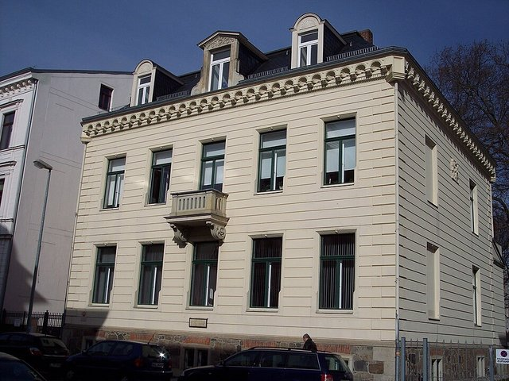
2、3月間寫成第一號交響曲，當時是五個樂章的交響詩。差不多同時，他發現了德國民謠詩集《少年魔號》，往後12年的創作大多與它有關。

## 1888-10 | 布達佩斯皇家歌劇院總監
因和舞台總監爭執辭去萊比錫的職位後，經朋友推薦出任布達佩斯皇家匈牙利歌劇院總監。他小心處理當地保守派與改革派的對立，隔年1月才首度登台，用匈牙利語演出華格納的《萊因的黃金》與《女武神》。

## 1889 | 雙親與妹妹相繼過世；第一號交響曲首演失敗
2月父親去世，9月妹妹、10月母親也相繼過世，他從此扛起照顧四個弟妹的責任。自己也飽受偏頭痛、喉嚨感染等病痛所苦。11月20日第一號交響曲在布達佩斯首演，終樂章引發噓聲，同學還挖苦說他和許多指揮一樣，證明了自己不是作曲家。

## 1890-12-16 | 布拉姆斯讚賞他的《唐喬凡尼》
他在布達佩斯指揮的莫札特《唐喬凡尼》大獲成功，連出席的布拉姆斯都讚不絕口。

## 1891-03 | 漢堡市立劇院首席指揮
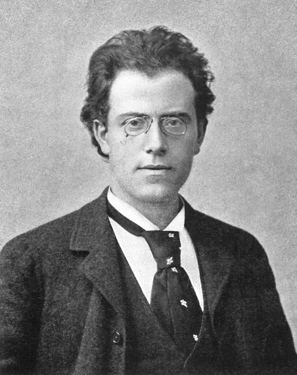
匈牙利政局轉向保守，新任總監想掌控藝術方向，他早已祕密和漢堡簽約，拿了一大筆遣散費離開布達佩斯。在漢堡的第一季，他首次指揮《崔斯坦與伊索德》，並在柴可夫斯基面前指揮《尤金·奧涅金》的德國首演，柴可夫斯基稱讚他「確實是個天才」。

## 1892 | 唯一一次訪英
率漢堡的歌手到倫敦演出八週的德國歌劇，他指揮的《崔斯坦》讓年輕的佛漢威廉士聽得恍恍惚惚，兩晚都睡不著。但他婉拒了之後的邀約，因為想把夏天留給作曲。

## 1893 | 阿特湖畔的作曲小屋
在上奧地利阿特湖畔的施坦巴赫買下一處隱居地，從此夏天專心作曲成為他一生的習慣。他在這裡寫下許多《少年魔號》歌曲，以及第二、第三號交響曲。10月他在漢堡以「巨人」為名指揮修訂後的第一號交響曲。

## 1894 | 接掌畢羅的音樂會
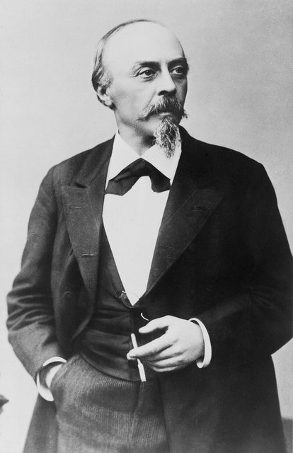
當年在卡塞爾拒絕他的畢羅，後來非常欣賞他的指揮，畢羅去世後，他接手指揮漢堡的訂閱音樂會。

## 1895-12-13 | 第二號交響曲「復活」首演
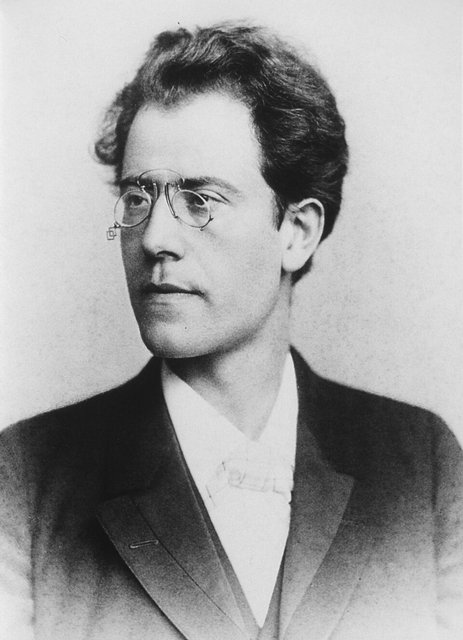
在柏林親自指揮首演，獲得好評。他的助理指揮布魯諾·華爾特說，馬勒作為作曲家的成名可以從這一天算起。同年2月，弟弟奧托自殺身亡。

## 1897-02 | 改信天主教
他從小就立志到維也納發展，從1895年起透過有力人士運作，爭取維也納宮廷歌劇院總監的職位。當時猶太人不能擔任這個職位，他在1897年2月改信天主教，這很可能只是現實考量，他一生其實是不可知論者。

## 1897-10-08 | 維也納宮廷歌劇院總監
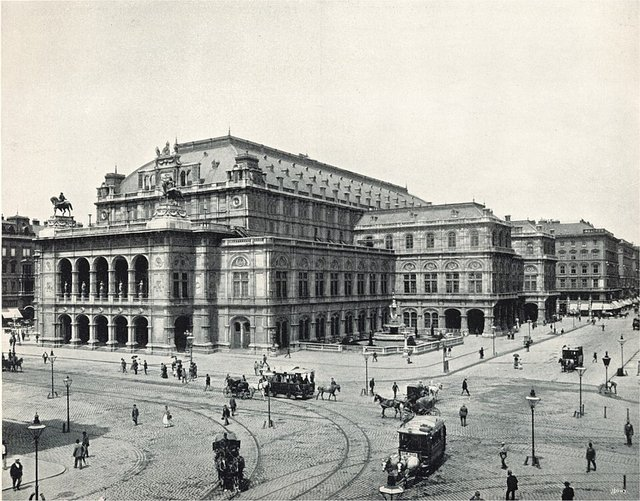
5月以《羅安格林》與《魔笛》在維也納一鳴驚人，8月推出維也納第一次不刪節的《指環》，沃爾夫說這是他第一次聽到夢想中的《指環》。10月正式接任總監，38歲就執掌帝國最高的藝術殿堂，讓維也納人既驚訝又不安。作家褚威格回憶，能在街上看見馬勒，就足以讓人隔天向朋友炫耀。

## 1898-09 | 接掌維也納愛樂音樂會
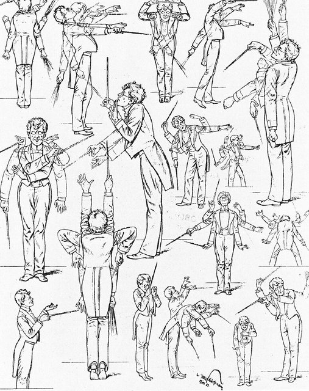
李希特辭職後，他獲選為維也納愛樂訂閱音樂會的指揮，觀眾人數大增，但樂團成員很不滿他擅自改寫名曲的配器和額外的排練。1900年率團到巴黎萬國博覽會演出，觀眾稀少、虧了大錢，還得向羅斯柴爾德家族借錢讓樂團回家。1901年4月他辭去這個職位。

## 1900 | 第四號交響曲；沃爾特湖畔的新小屋
在卡林西亞沃爾特湖畔的麥爾尼格蓋了新的作曲小屋和別墅，開始他的「中期」創作。第四號交響曲於1901年11月在慕尼黑首演。1901到1904年間，他以呂克特的詩寫下《呂克特之歌》與《悼亡兒之歌》。

## 1902-03-09 | 與阿爾瑪結婚
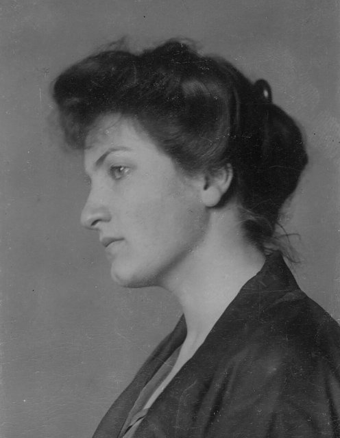
1901年11月在一場聚會上認識畫家莫爾的繼女阿爾瑪·辛德勒，兩人為了澤姆林斯基的芭蕾爭論起來，隔天又約在歌劇院見面，很快陷入熱戀。婚禮低調舉行，當時阿爾瑪已懷孕，長女瑪麗亞在11月出生，次女安娜生於1904年。他要求家裡只能有一個作曲家，阿爾瑪必須放棄作曲，這成了兩人婚姻的心結。

## 1902-06-09 | 第三號交響曲完整首演
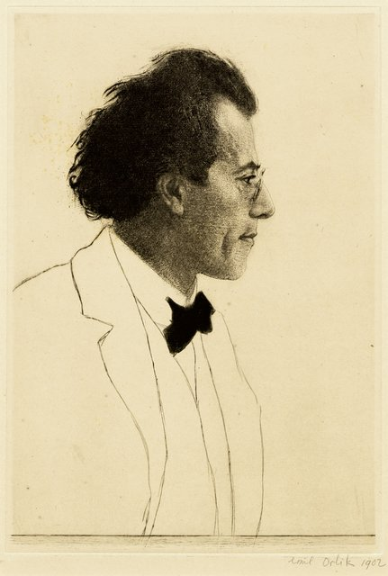
在克雷費爾德的音樂節上首演，此後「馬勒的首演之夜」成為樂壇盛事。他也聘請維也納分離派的藝術家羅勒擔任歌劇院的首席舞台設計師，兩人合作推出二十多齣著名製作。

## 1904 | 第五號交響曲首演
在科隆首演。1906年第六號交響曲在埃森首演，1905年《呂克特之歌》與《悼亡兒之歌》也在維也納首演。

## 1906 | 八週寫成第八號交響曲
在麥爾尼格以驚人的速度，只花八週就寫完規模龐大的第八號交響曲。

## 1907-07-12 | 長女夭折；確診心臟病
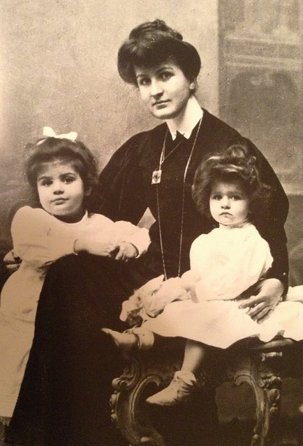
在維也納飽受反猶媒體圍剿、身心俱疲的他帶著家人到麥爾尼格度假，兩個女兒卻都染上猩紅熱與白喉。次女安娜康復了，四歲的長女瑪麗亞卻在兩週後不治。緊接著他又被診斷出心臟有缺陷，必須避免劇烈運動。全家離開麥爾尼格，從此再也沒有回去過。

## 1907-10-15 | 告別維也納
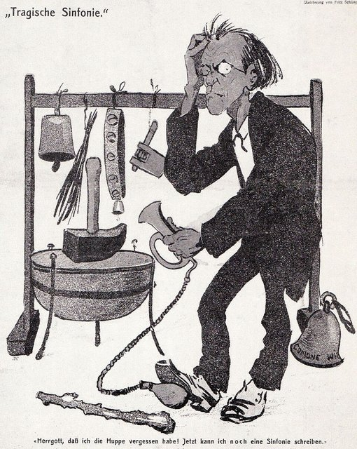
6月他已和紐約大都會歌劇院簽約。10月15日指揮《費德里奧》，這是他在維也納宮廷歌劇院的第645場、也是最後一場演出。他讓歌劇院煥然一新、還清了債務，卻沒交到幾個朋友，據說他對待樂手就像馴獅師對待獅子。他貼在布告欄上的告別信被人撕下丟在地上。12月他啟程前往紐約。

## 1908-01-01 | 大都會歌劇院首演
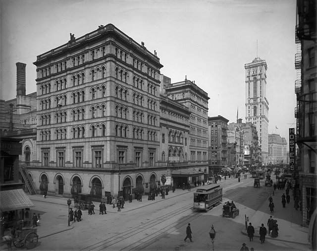
在紐約以《崔斯坦與伊索德》首次登台，第一季大獲好評。夏天他回到奧地利，在托布拉赫的松林中蓋了第三間、也是最後一間作曲小屋。

## 1908 | 《大地之歌》
以唐詩的德文改寫本為歌詞，寫成交響曲式的歌曲集《大地之歌》。他刻意不給它編號，想躲開「第九號交響曲的詛咒」——他相信貝多芬、舒伯特、布魯克納都是寫完第九號就過世的。9月第七號交響曲在布拉格首演。

## 1909 | 紐約愛樂指揮
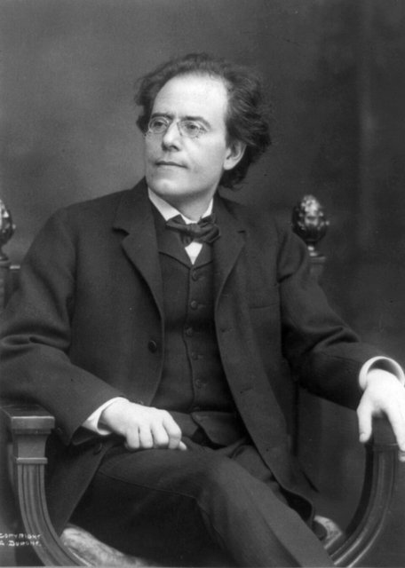
大都會歌劇院請來托斯卡尼尼與他分擔指揮工作，他改任重組後的紐約愛樂指揮。1909到1910年樂季他指揮了46場音樂會，但曲目對一般觀眾來說太艱深，樂季結束時虧損嚴重。夏天他在歐洲寫作第九號交響曲。

## 1910-09-12 | 第八號交響曲「千人」首演
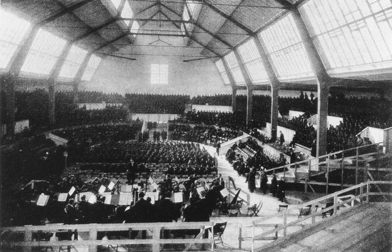
在慕尼黑首演，是他生前最後一部首演的作品，也是他一生最大的成功。但演出前他發現阿爾瑪和年輕建築師葛羅培斯有了外遇，痛苦之下去找佛洛伊德諮商。佛洛伊德指出，要阿爾瑪放棄作曲造成了很大傷害，他接受了，開始鼓勵阿爾瑪作曲，還幫她編輯、推廣作品，並把第八號交響曲獻給她。這年夏天他也寫完第十號交響曲的慢板樂章，其餘四個樂章只留下草稿。

## 1911-02-21 | 最後一場音樂會
發燒到40度仍堅持在卡內基音樂廳指揮，這是他的最後一場音樂會。之後被診斷出細菌性心內膜炎，當時幾乎無藥可醫。4月全家搭船返回歐洲，先到巴黎就醫。

## 1911-05-18 | 逝世@維也納
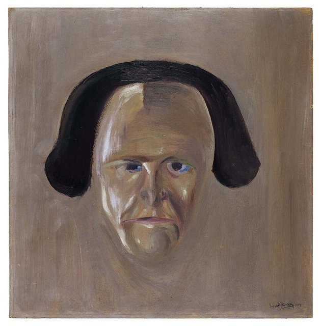
在維也納的療養院因肺炎陷入昏迷後去世，享年50歲。依他的遺願葬在格林青公墓、長女瑪麗亞的旁邊，墓碑上只刻著他的名字，因為「來找我的人會知道我是誰，其他人不需要知道」。荀白克、布魯諾·華爾特、羅勒、畫家克林姆等人出席葬禮，荀白克的花圈上寫著「神聖的古斯塔夫·馬勒」。

## 1911-11-20 | 《大地之歌》首演
在他死後半年，由布魯諾·華爾特在慕尼黑指揮首演。第九號交響曲也在1912年由華爾特於維也納首演。

## 1940 | 阿爾瑪出版回憶錄
阿爾瑪後來嫁給葛羅培斯、再嫁作家魏菲爾，活到1964年。她出版的《回憶馬勒》被後來的傳記作者批評內容片面、自我美化，扭曲了馬勒的形象。納粹時期馬勒的音樂在歐洲大部分地區被禁演。

## 1955 | 國際馬勒協會成立
在維也納成立，布魯諾·華爾特擔任首任會長，致力於出版馬勒作品的完整校訂版。二次大戰後新一代聽眾重新發現了他的音樂，馬勒從此成為演出與錄音最頻繁的作曲家之一。
