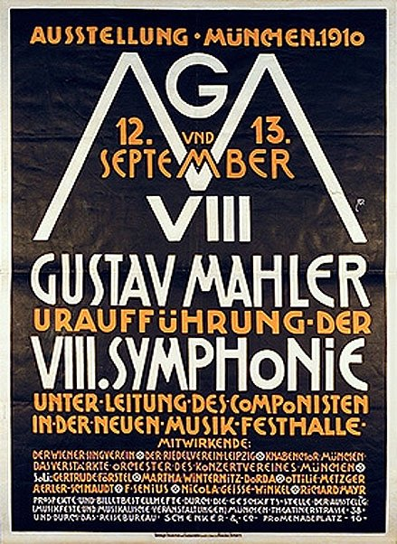
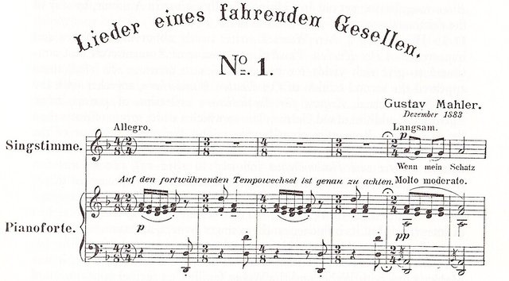

<!--
內容整理自本機筆記〈馬勒主要作品〉（D:\Books\md\音樂\馬勒主要作品.md，網頁版在知識圖譜的「5-2-1.音樂家作品」），做法比照「貝多芬主要作品」。
- 每首作品一則事件，日期採「創作時間」（多年創作的作品以區間呈現；「年代」以十年計、「世紀」以百年計，修訂或出版年份只寫在顯示文字裡），事件顏色依筆記的類別段落區分：交響曲、交響性歌曲與歌曲套曲、室內樂與早期器樂作品。
- 「約」、「前後」、修訂、出版等不是單純年份的寫法，以原文作為顯示文字。
- 作品編號是目錄編號，不等於創作順序，時間軸依創作時間排序。
- 時期沿用「馬勒生平」時間軸的主要時期（重疊的細分時期不列）。
- 筆記「優先聆聽」清單中的作品另註明順序。
- 以 follows 排在「馬勒生平」之後；生平事件見該時間軸。
圖片來源（皆為 Wikimedia Commons 公有領域作品；註明「共用」者沿用生平時間軸的圖片）：
- mahler-1902-orlik.jpg（奧爾利克所繪馬勒像，1902（與馬勒生平共用））
- mahler-1884-wayfarer.jpg（《流浪者之歌》第一首的樂譜（與馬勒生平共用））
- mw-mahler-8.jpg：Plakat zur Uraufführung der VIII. Symphonie von Gustav Mahler.jpg（1910年慕尼黑第八號交響曲首演的海報）
-->

# Periods
- 1860 ~ 1875 | 童年@伊赫拉瓦
  生於波希米亞說德語的猶太家庭，「永遠是闖入者，從不受歡迎」的流亡感伴隨他一生。在伊赫拉瓦聽著街頭小調、民謠與軍樂隊的號角長大，這些聲音後來都成了他音樂的語彙。
- 1875 ~ 1880 | 維也納音樂院
  考進維也納音樂院學鋼琴與作曲，結識胡戈·沃爾夫，旁聽布魯克納的課，深受華格納的音樂吸引，也鑽研叔本華、尼采等德國哲學。
- 1880 ~ 1888 | 巡迴各地的年輕指揮
  從溫泉小鎮的輕歌劇開始，一路在盧比安納、奧洛穆克、卡塞爾、布拉格、萊比錫的劇院累積經驗。專制的指揮風格讓他到處和樂團起衝突，卻也屢創佳績。
- 1888 ~ 1897 | 布達佩斯與漢堡
  出任布達佩斯皇家歌劇院總監，再轉往漢堡市立劇院擔任首席指揮，深得柴可夫斯基與畢羅賞識。夏天在阿特湖畔的作曲小屋寫下第二、第三號交響曲，作曲家的名聲逐漸建立。
- 1897 ~ 1907 | 維也納宮廷歌劇院總監@Vienna
  改信天主教後當上維也納宮廷歌劇院總監，十年間徹底改革歌劇院、還清債務，卻也飽受反猶媒體攻擊。夏天在沃爾特湖畔作曲，第四到第八號交響曲都誕生於此，並與阿爾瑪結婚。
- 1907 ~ 1911 | 紐約與最後歲月@New York
  長女夭折、自己確診心臟病後，轉往紐約大都會歌劇院與紐約愛樂。第八號交響曲在慕尼黑首演是他一生最大的成功，但阿爾瑪的外遇讓他心力交瘁。1911年病逝維也納，享年50歲。

# Events

## 1884 ~ 1888 | GMW 10 第一號交響曲（D 大調；早期版本曾稱《巨人》） {color=#c92a2a label="1884–1888；後續修訂"}
類別：交響曲（交響曲）。入門推薦聆聽第 10 首。

## 1888 ~ 1894 | GMW 18 第二號交響曲《復活》（c 小調） {color=#c92a2a}
類別：交響曲、獨唱與合唱（交響曲）。

## 1895 ~ 1896 | GMW 24 第三號交響曲（d 小調） {color=#c92a2a}
類別：交響曲、女中音與合唱（交響曲）。

## 1899 ~ 1901 | GMW 29 第四號交響曲（G 大調） {color=#c92a2a label="1899–1901；終樂章歌曲構思較早"}
類別：交響曲、女高音（交響曲）。

## 1901 ~ 1902 | GMW 44 第五號交響曲（升 c 小調起始，終至 D 大調） {color=#c92a2a label="1901–1902；後續修訂配器"}
類別：交響曲（交響曲）。入門推薦聆聽第 4 首。

## 1903 ~ 1905 | GMW 46 第六號交響曲《悲劇》（a 小調） {color=#c92a2a}
類別：交響曲（交響曲）。入門推薦聆聽第 5 首。

## 1904 ~ 1905 | GMW 47 第七號交響曲（e 小調起始，終至 C 大調） {color=#c92a2a}
類別：交響曲（交響曲）。

## 1906 ~ 1907 | GMW 48 第八號交響曲《千人交響曲》（降 E 大調） {color=#c92a2a}

類別：交響曲、獨唱、合唱（交響曲）。入門推薦聆聽第 6 首。

## 1908 ~ 1909 | GMW 50 第九號交響曲（D 大調） {color=#c92a2a}
類別：交響曲（交響曲）。入門推薦聆聽第 7 首。

## 1910 | GMW F51 第十號交響曲（升 f 小調，未完成） {color=#c92a2a}
類別：未完成交響曲（交響曲）。

## 1878 ~ 1880 | GMW 1 《泣訴之歌》（Das klagende Lied） {color=#1971c2 label="1878–1880；1893、1898–1899、1906修訂"}
類別：獨唱、合唱與管弦樂（交響性歌曲與歌曲套曲）。入門推薦聆聽第 9 首。

## 1880 | GMW 2 《在春天》（Im Lenz） {color=#1971c2}
類別：藝術歌曲（交響性歌曲與歌曲套曲）。

## 1880 | GMW 3 《冬之歌》（Winterlied） {color=#1971c2}
類別：藝術歌曲（交響性歌曲與歌曲套曲）。

## 1880 | GMW 4 《草地上的五月舞》（Maitanz im Grünen） {color=#1971c2}
類別：藝術歌曲（交響性歌曲與歌曲套曲）。

## 1880 ~ 1887 | GMW 5 《漢斯與葛蕾特》（Hans und Grethe） {color=#1971c2}
類別：藝術歌曲（交響性歌曲與歌曲套曲）。

## 1880 ~ 1887 | GMW 6–9 早期歌曲，包括《春日早晨》《回憶》等 {color=#1971c2}
類別：藝術歌曲（交響性歌曲與歌曲套曲）。

## 1884 ~ 1885 | GMW 10 《流浪者之歌》（Lieder eines fahrenden Gesellen） {color=#1971c2 label="1884–1885起；後續修訂"}

類別：四首歌曲套曲（交響性歌曲與歌曲套曲）。入門推薦聆聽第 10 首。

## 1887 ~ 1889 | GMW 12–20 《少年魔號》歌曲早期作品群 {color=#1971c2 label="約1887–1889"}
類別：藝術歌曲（交響性歌曲與歌曲套曲）。

## 1892 ~ 1893 | GMW 21–29 《少年魔號》歌曲，包括《守夜人的夜歌》《天上的生活》等 {color=#1971c2}
類別：藝術歌曲（交響性歌曲與歌曲套曲）。

## 1893 | GMW 30c 《少年魔號》歌曲〈聖安東尼向魚講道〉的交響曲素材 {color=#1971c2 label="1893起"}
類別：歌曲／交響曲素材（交響性歌曲與歌曲套曲）。

## 1896 | GMW 31d 《人啊，請留意！》（O Mensch! Gib acht!） {color=#1971c2}
類別：女中音歌曲；後用於第三號交響曲（交響性歌曲與歌曲套曲）。

## 1896 | GMW 32 《三位天使唱著甜美的歌》（Es sungen drei Engel） {color=#1971c2}
類別：藝術歌曲（交響性歌曲與歌曲套曲）。

## 1896 ~ 1899 | GMW 33–36 《少年魔號》歌曲，包括〈高超智慧的讚歌〉、〈號角吹響的地方〉等 {color=#1971c2}
類別：藝術歌曲（交響性歌曲與歌曲套曲）。

## 1901 | GMW 38 《鼓手》（Der Tamboursg’sell） {color=#1971c2}
類別：藝術歌曲（交響性歌曲與歌曲套曲）。

## 1901 ~ 1902 | GMW 39–43 《呂克特歌曲》（Rückert-Lieder）相關作品 {color=#1971c2}
類別：藝術歌曲（交響性歌曲與歌曲套曲）。

## 1901 ~ 1904 | GMW 45 《悼亡兒之歌》（Kindertotenlieder） {color=#1971c2}
類別：五首歌曲套曲（交響性歌曲與歌曲套曲）。

## 1908 ~ 1909 | GMW 49 《大地之歌》（Das Lied von der Erde） {color=#1971c2}
類別：男高音、女中音／男中音與管弦樂（交響性歌曲與歌曲套曲）。入門推薦聆聽第 8 首。

## 1876 ~ 1877 | 未編號 a 小調鋼琴四重奏第一樂章 {color=#e67700}
類別：鋼琴與弦樂室內樂；存有片段（室內樂與早期器樂作品）。

## 1876 ~ 1877 | GMW F52 小提琴、中提琴、大提琴與鋼琴四重奏片段 {color=#e67700}
類別：室內樂；未完成（室內樂與早期器樂作品）。

## 1876 | 未編號 鋼琴五重奏第一樂章 {color=#e67700}
類別：室內樂；佚失（室內樂與早期器樂作品）。

## 1876 | 未編號 小提琴與鋼琴奏鳴曲 {color=#e67700}
類別：室內樂；佚失（室內樂與早期器樂作品）。

## 1876 ~ 1878 | 未編號 鋼琴組曲 {color=#e67700}
類別：鋼琴獨奏；佚失（室內樂與早期器樂作品）。

## 1876 ~ 1878 | 未編號 交響曲草稿 {color=#e67700}
類別：交響曲；佚失（室內樂與早期器樂作品）。

## 1880 | GMW B59 布魯克納第三號交響曲的四手聯彈改編（與 Rudolf Krzyzanowski 合作） {color=#e67700}
類別：鋼琴改編作品（室內樂與早期器樂作品）。

## 1887 | GMW B60 韋伯《三個平托》（Die drei Pintos）的補作與編配 {color=#e67700}
類別：歌劇改編（室內樂與早期器樂作品）。

## 1903 | GMW B61 韋伯《尤麗安特》（Euryanthe）的補作與編配 {color=#e67700}
類別：歌劇改編（室內樂與早期器樂作品）。

## 1907 | GMW B62 韋伯《奧伯龍》（Oberon）的補作與編配 {color=#e67700 label="1907年以前"}
類別：歌劇改編（室內樂與早期器樂作品）。

## 1905 ~ 1906 | GMW B63 莫札特《費加洛婚禮》的宣敘調編配與作曲 {color=#e67700}
類別：歌劇改編（室內樂與早期器樂作品）。

## 1909 | GMW B64 巴赫管弦樂組曲選段的編配 {color=#e67700}
類別：管弦樂改編（室內樂與早期器樂作品）。
