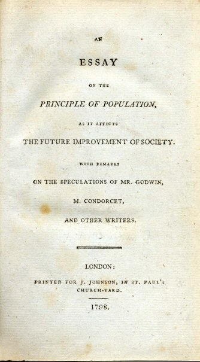
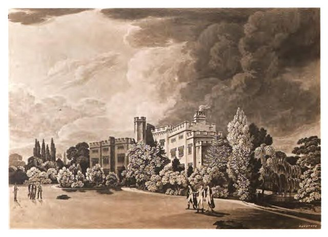
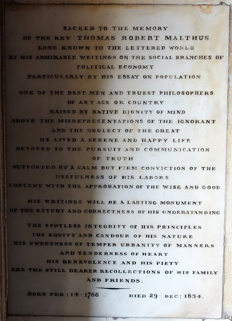

<!--
內容整理自 D:\Books\md\歷史\人物\思想家\馬爾薩斯生平大事記.md（Books 的人物頁為 D:\Books\html\4-1-2.經濟學家\馬爾薩斯(1766~1834).html），並整合中文維基百科〈托馬斯·羅伯特·馬爾薩斯〉條目，以自己的話改寫。
時期依筆記的生平時間軸歸納：家學與劍橋、《人口論》、海利伯里的教授、晚年。
兩份資料出入與處理方式：
- 生卒：筆記與維基百科都寫1766年2月13日生、1834年12月23日卒於巴斯，依此。
- 聖職：筆記寫1788年取得學士並擔任牧師；馬爾薩斯是1789年受聖職，任薩里郡奧克伍德教堂的助理牧師，這裡依此。
- 《人口論概要》：筆記寫1827年；這是1830年出版的，1827年出版的是《政治經濟學定義》，這裡依此。
- 筆記中「1770年代」「1790年代」「1810年代」等概括性的條目寫進相鄰事件。
- 人名與其他時間軸一致：亞當·斯密（AdamSmith）、李嘉圖（Ricardo）；古典學派的整體發展見 ClassicalEconomics。
圖片來源（皆為 Wikimedia Commons 公有領域／CC0 作品，縮成最長邊 640px）：
- mal-vallotton.jpg：Thomas Malthus by Vallotton.jpg（瓦洛東所繪馬爾薩斯木刻像）
- ce-essay.jpg：An Essay on the Principle of Population.jpg（《人口論》1798年初版書名頁（與古典經濟學派時間軸共用））
- mal-haileybury.jpg：Haileybury college.jpg（東印度公司的海利伯里學院，19世紀初的版畫）
- mal-plaque.jpg：Thomas Robert Malthus plaque - Bath Abbey - Bath, England - DSC09894.jpg（巴斯修道院內的馬爾薩斯紀念碑）
-->

# Periods
- 1766 ~ 1797 | 家學與劍橋 | #868e96
  父親是與盧梭、休謨往來的鄉紳思想家，在家接受自由派的教育，劍橋耶穌學院畢業後成為鄉村牧師，親眼看見農村的貧困。
- 1798 ~ 1804 | 《人口論》 | #c92a2a
  為了反駁父親與葛德文的人類可完善論，匿名出版《人口論》，引起巨大爭議；第二版大幅擴充，加入「道德抑制」。
- 1805 ~ 1827 | 海利伯里的教授 | #1971c2
  任東印度學院政治經濟學教授，研究地租與有效需求，與李嘉圖亦敵亦友地長年論戰。
- 1828 ~ 1834 | 晚年 | #5f3dc4
  理論影響新濟貧法的制定，晚年參與統計學會的創立，在巴斯去世。

# Events

## 1766-02-13 | 出生於薩里郡
托馬斯·羅伯特·馬爾薩斯出生在英國薩里郡的魯克里莊園，是家中第六個孩子。父親丹尼爾·馬爾薩斯是富裕的鄉紳，崇拜盧梭，與休謨等啟蒙思想家往來，相信人類社會可以不斷進步。馬爾薩斯天生兔唇，說話略有障礙，由父親安排家庭教師在家受教育。

## 1784 | 劍橋耶穌學院
進入劍橋大學耶穌學院，主修數學，也學習古典文學，1788年以優異成績畢業，1793年成為學院的研究員。

## 1789 | 擔任鄉村牧師
馬爾薩斯受英國國教會聖職，在薩里郡奧克伍德教堂擔任助理牧師。在這個貧窮的教區，他看到農民家庭子女眾多、生活困苦，嬰兒出生數遠多於死亡數，這些觀察成為他思考人口問題的起點。

## 1798 | 匿名出版《人口論》

法國大革命後，葛德文、孔多塞等人相信人類社會能夠無限完善、消滅貧窮。馬爾薩斯與父親辯論後寫成《人口論》匿名出版：人口若不受限制，每二十五年左右就會倍增，以幾何級數成長，糧食生產卻只能以算術級數增加，因此貧窮、饑荒與疾病無法避免，人口只能靠戰爭、疾病、饑荒等「積極抑制」，或晚婚、節育等「預防抑制」維持平衡。這本小書立刻引起激烈爭論，經濟學因此被稱為「憂鬱的科學」。

## 1803 | 《人口論》第二版
馬爾薩斯走訪歐洲各國蒐集人口資料，出版大幅擴充的第二版，篇幅增加數倍，並加入「道德抑制」：人們可以靠晚婚與婚前禁慾減緩人口成長，結論比第一版溫和。他反對當時的濟貧法，認為救濟會鼓勵窮人早婚多生，反而加劇貧困。

## 1804 | 結婚
三十八歲的馬爾薩斯與表親哈麗特·埃克索爾結婚，婚後育有三個孩子。他雖然主張晚婚與節制生育，自己也是較晚才成家。

## 1805 | 東印度學院教授

馬爾薩斯被任命為東印度公司新設學院（後來的海利伯里學院）的歷史與政治經濟學教授，這是英國第一個政治經濟學教授職位。他在這裡任教直到去世，培養了許多到印度任職的行政官員，學生暱稱他「人口馬爾薩斯」。

## 1811 | 與李嘉圖結識
馬爾薩斯讀了李嘉圖有關金價的文章後主動寫信給他，兩人從此通信辯論了十多年，討論貨幣、地租、穀物法與經濟停滯。兩人觀點常常相反：李嘉圖支持自由貿易、相信薩伊法則，馬爾薩斯支持穀物法、擔心需求不足；但他們私交甚篤，李嘉圖臨終前寫的最後一封信就是給馬爾薩斯的。

## 1815 | 地租理論
馬爾薩斯出版《地租的本質與發展研究》，與李嘉圖同年各自提出差額地租理論：人口增加迫使人們耕種較貧瘠的土地，肥沃土地的地主因此獲得愈來愈多的地租。不同的是，馬爾薩斯為穀物法辯護，認為保護農業有助於國家的糧食安全與穩定。

## 1820 | 《政治經濟學原理》
馬爾薩斯出版《政治經濟學原理》，質疑「供給創造需求」的薩伊法則，認為社會可能出現普遍的生產過剩與「有效需求不足」，地主與非生產性的消費有助於維持需求。他的觀點在當時被李嘉圖學派壓倒，一百多年後凱因斯卻在〈馬爾薩斯傳〉中推崇他，認為經濟學若沿著馬爾薩斯而非李嘉圖的路線發展，世界會更好。

## 1821 | 政治經濟學俱樂部
馬爾薩斯與李嘉圖、詹姆斯·穆勒等人在倫敦成立政治經濟學俱樂部，每月聚會討論經濟問題，是英國最早的經濟學專業社群之一。1827年他出版《政治經濟學定義》，1830年又出版《人口論概要》整理自己的人口理論。

## 1834 | 新濟貧法與逝世

受馬爾薩斯人口論的影響，英國國會通過新濟貧法，取消院外救濟、要求貧民進入條件嚴苛的濟貧院。同年他參與創立倫敦統計學會（後來的皇家統計學會）。12月23日，馬爾薩斯在巴斯探望岳家時因心臟病去世，享年六十八歲，葬於巴斯修道院。1838年達爾文讀了《人口論》，從生存競爭中得到天擇理論的關鍵靈感。
