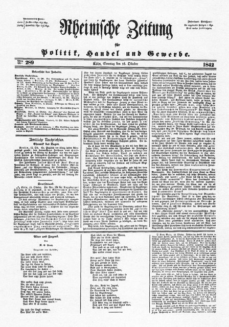
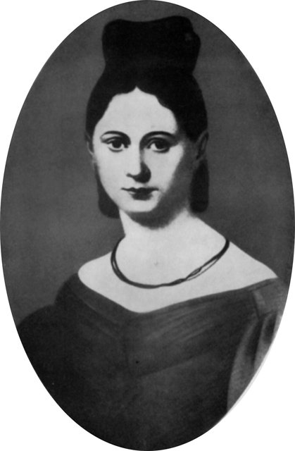
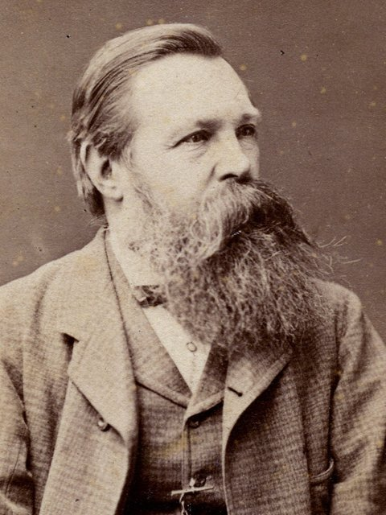
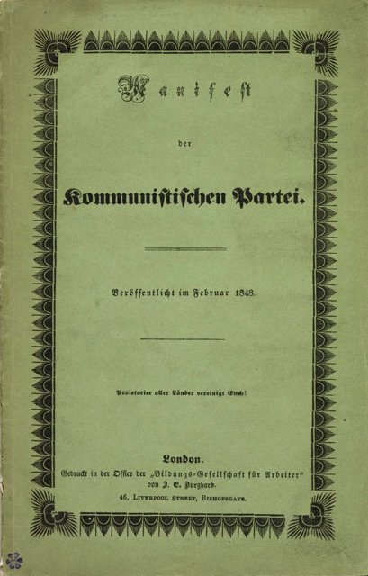
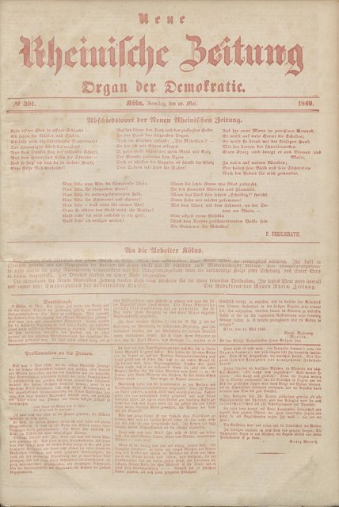
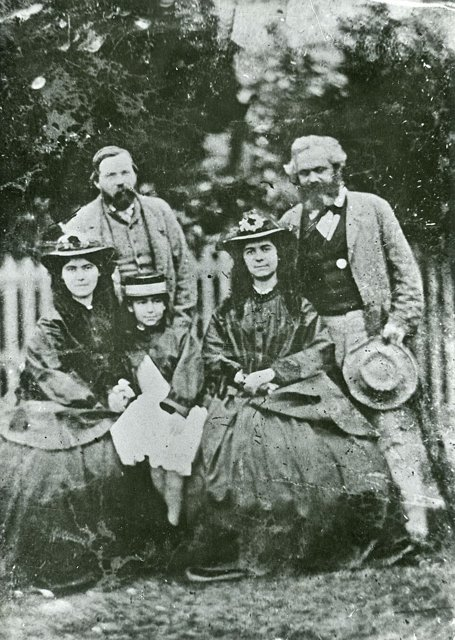
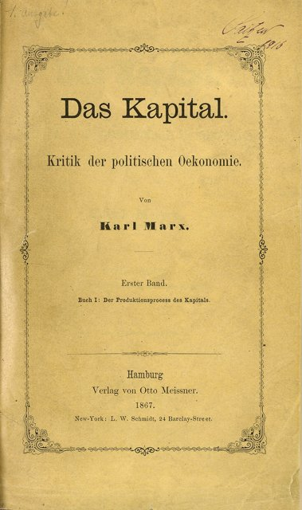

<!--
內容整理自 D:\Books\md\歷史\人物\思想家\馬克思（Karl Marx）生平大事記.md，並整合中文維基百科〈卡爾·馬克思〉條目，以自己的話改寫。Books 的相關頁面在 D:\Books\html\2-2.哲學家（馬克思、馬克思生平、馬克思時間軸、馬克思與歷史唯物論）。
時期依筆記的七個階段：出生與求學、新聞工作、布魯塞爾、1848年革命、倫敦流亡、第一國際與《資本論》、晚年。
處理方式：
- 生卒：筆記與維基百科都寫1818年5月5日生於特里爾、1883年3月14日卒於倫敦，依此。
- 筆記的著作年表寫進相關事件；《資本論》第二、三卷由恩格斯在1885、1894年編輯出版，寫進最後一則事件。
- 人名索引的補充名單原本有「馬克思」一筆，有了獨立時間軸後移除，原有的 notNames（聖馬克思、馬克思兄弟）移到這裡。
- 人名與其他時間軸一致：黑格爾（Hegel）、李嘉圖（Ricardo）、涂爾幹（Durkheim）、韋伯（MaxWeber）；恩格斯、燕妮沒有獨立時間軸。馬克思主義經濟學與社會主義的後續發展見 SocialistEconomics。
- tag 用「社會學」，與涂爾幹、韋伯並列為古典社會學的三位奠基者。
圖片來源（皆為 Wikimedia Commons 公有領域／CC0 作品，縮成最長邊 640px）：
- soe-marx.jpg：Karl Marx by John Jabez Edwin Mayall 1875 - Restored.png（馬克思，1875年梅奧爾攝（修復版）（與社會主義經濟學時間軸共用））
- mx-rheinische.jpg：Rheinische-zeitung-1842a.jpg（《萊茵報》1842年10月的一期）
- mx-jenny.jpg：Jenny-von-Westphalen.jpg（燕妮·馮·威斯特法倫像）
- soe-engels.jpg：Friedrich Engels portrait (cropped).jpg（恩格斯像（與社會主義經濟學時間軸共用））
- soe-manifesto.jpg：Communist-manifesto.png（《共產黨宣言》1848年德文初版封面（與社會主義經濟學時間軸共用））
- mx-nrz.jpg：Neue Rheinische Zeitung. 1849.05.19. N301. P01. D01. V01-1.2 Universitäts- und Stadtbibliothek Köln (USB-Digital).jpg（以紅色油墨印刷的《新萊茵報》最後一期，1849年5月19日（科隆大學與城市圖書館））
- mx-family.jpg：Marx+Family and Engels.jpg（1860年代在倫敦的馬克思（右後）、恩格斯（左後）與馬克思的三個女兒）
- soe-kapital.jpg：Zentralbibliothek Zürich Das Kapital Marx 1867.jpg（《資本論》第一卷1867年初版書名頁（蘇黎世中央圖書館）（與社會主義經濟學時間軸共用））
-->

# Periods
- 1818 ~ 1841 | 特里爾與大學 | #868e96
  生於普魯士萊茵省特里爾的猶太律師家庭，在波昂與柏林讀法律，卻迷上黑格爾哲學，加入青年黑格爾派，以古希臘哲學論文取得博士學位。
- 1842 ~ 1844 | 新聞工作與思想轉型 | #e67700
  主編《萊茵報》遭查禁，與燕妮結婚後到巴黎，從批判宗教與國家轉向研究政治經濟學，結識一生的合作者恩格斯。
- 1845 ~ 1849 | 歷史唯物主義與1848年革命 | #c92a2a
  被逐出巴黎，在布魯塞爾與恩格斯建立歷史唯物主義，發表《共產黨宣言》；投身1848年革命失敗後，流亡倫敦。
- 1850 ~ 1872 | 倫敦流亡與《資本論》 | #1971c2
  在貧困與喪子之痛中，每天到大英博物館研究政治經濟學，靠恩格斯接濟與報紙稿費維生；領導第一國際，1867年出版《資本論》第一卷。
- 1873 ~ 1883 | 晚年 | #5f3dc4
  健康日益衰退，持續修訂《資本論》、研究俄國農村公社與人類學；妻子與長女相繼去世後，在倫敦病逝。

# Events

## 1818-05-05 | 出生於特里爾
卡爾·馬克思生於普魯士萊茵省的特里爾，是家中九個孩子中存活下來的長子。父母都出身猶太拉比家族，父親亨利希是律師，為了保住職業，在他出生前改信基督新教。特里爾曾受法國統治多年，啟蒙思想與法國大革命的影響深厚。

## 1835 | 波昂大學與柏林大學
馬克思進入波昂大學讀法律，喝酒、欠債、參加決鬥，一年後被父親轉送柏林大學。1836年他與自幼相識、出身貴族家庭的燕妮·馮·威斯特法倫秘密訂婚。在柏林，他放棄法律，熱衷於黑格爾哲學，加入以宗教批判聞名的「青年黑格爾派」。

## 1841 | 哲學博士
馬克思以論文《德謨克利特與伊壁鳩魯自然哲學之差別》取得耶拿大學的哲學博士學位。他原本希望在大學任教，但普魯士政府打壓青年黑格爾派，他的老師兼好友布魯諾·鮑威爾被解除教職，學術之路因此斷絕。

## 1842-10 | 《萊茵報》主編

馬克思到科隆擔任自由派報紙《萊茵報》的主編，撰文批評普魯士的書報審查與禁止窮人撿拾林中枯枝的法律，第一次接觸到物質利益與經濟問題。報紙的發行量大增，1843年3月卻被普魯士政府查禁。

## 1843-06-19 | 與燕妮結婚，移居巴黎

馬克思與燕妮結婚，十月移居巴黎，與盧格合辦《德法年鑑》，發表〈論猶太人問題〉與〈黑格爾法哲學批判導言〉，寫下「宗教是人民的鴉片」。他接觸法國的社會主義者與工人團體，並開始研究斯密、李嘉圖等人的政治經濟學。

## 1844-08 | 與恩格斯結識；《經濟學哲學手稿》

恩格斯從英國返德途中路過巴黎，兩人在攝政咖啡館長談十天，發現觀點完全一致，從此展開四十年的合作；恩格斯根據曼徹斯特的觀察寫成《英國工人階級狀況》。同年馬克思寫下《1844年經濟學哲學手稿》，提出「異化勞動」：工人與自己的勞動產品、勞動過程、人的本質以及他人相疏離（這份手稿到1932年才出版）。

## 1845-02 | 被逐出巴黎，移居布魯塞爾
在普魯士政府施壓下，法國把馬克思驅逐出境，他移居比利時布魯塞爾，並放棄普魯士國籍，此後終身無國籍。他寫下〈關於費爾巴哈的提綱〉：「哲學家們只是以不同的方式解釋世界，問題在於改變世界。」1845年至1846年與恩格斯合寫《德意志意識形態》，提出歷史唯物主義：物質生產方式決定社會的政治、法律與思想。1847年出版《哲學的貧困》批判蒲魯東，並加入共產主義者同盟。

## 1848-02 | 《共產黨宣言》

受共產主義者同盟委託，馬克思與恩格斯在倫敦發表《共產黨宣言》：「一切至今存在的社會的歷史都是階級鬥爭的歷史」，資產階級創造了空前的生產力，也造就了自己的掘墓人無產階級，結尾號召「全世界無產者，聯合起來！」宣言發表時，巴黎正爆發二月革命，革命浪潮隨即席捲歐洲。

## 1848-06 | 《新萊茵報》與革命失敗

馬克思被比利時驅逐，經巴黎回到科隆，創辦《新萊茵報》，支持德國的民主革命。革命失敗後報紙被查禁，1849年5月他再被驅逐出普魯士，最後一期以紅色油墨印刷。8月他流亡倫敦，此後在這裡度過餘生。

## 1850 | 倫敦的貧困歲月

馬克思一家擠在倫敦蘇活區的兩間小房裡，常常交不出房租、典當衣物，幾個孩子在貧病中夭折，1855年八歲的兒子埃德加去世，令他痛不欲生。恩格斯回到父親在曼徹斯特的紡織公司工作，長年寄錢接濟他。1852年他寫成《路易·波拿巴的霧月十八日》，分析拿破崙三世的政變，開頭說：歷史事件會出現兩次，「第一次是悲劇，第二次是鬧劇」。

## 1852 | 《紐約每日論壇報》通訊員
馬克思擔任美國《紐約每日論壇報》的歐洲通訊員約十年，報導歐洲政治、英國的殖民統治、印度與中國的鴉片戰爭與太平天國等時事，許多稿件其實由恩格斯代筆。這是他流亡期間少數固定的收入來源。

## 1857 | 大英博物館與《政治經濟學批判》
1857年經濟恐慌爆發，馬克思以為革命將至，日夜趕寫後來稱為《政治經濟學批判大綱》的手稿。他幾乎每天到大英博物館的圖書館閱讀政治經濟學與英國政府的工廠調查報告。1859年出版《政治經濟學批判》，序言簡要概括了歷史唯物主義：「不是人們的意識決定人們的存在，相反，是人們的社會存在決定人們的意識。」

## 1864-09-28 | 第一國際成立
各國工人代表在倫敦聖馬丁堂成立國際工人協會（第一國際），馬克思起草成立宣言與章程，成為實際的領導人。他在協會中與蒲魯東派、巴枯寧的無政府主義派長期鬥爭。

## 1867-09-14 | 《資本論》第一卷

馬克思在漢堡出版《資本論》第一卷：商品的價值由社會必要勞動時間決定，工人出賣的是「勞動力」，創造的價值卻超過工資，差額就是資本家無償占有的「剩餘價值」；資本為了競爭不斷累積，造成工人的相對貧困、產業後備軍與周期性危機。這本書出版時反應冷淡，1872年俄文譯本是第一個外文版本，後來成為社會主義運動最重要的經典。

## 1871 | 巴黎公社與《法蘭西內戰》
普法戰爭後，巴黎工人與市民建立巴黎公社，七十多天後被政府軍血腥鎮壓。馬克思以第一國際的名義發表《法蘭西內戰》，讚揚公社是「工人階級的政府」，他因此在歐洲被稱為「紅色恐怖博士」。1872年第一國際在海牙大會上分裂，總部遷往紐約，1876年解散。

## 1875 | 《哥達綱領批判》
德國兩個工人政黨合併，通過「哥達綱領」，馬克思寫信批評其中的拉薩爾主義，提出共產主義社會將分為兩個階段，較高階段實行「各盡所能，按需分配」。這封信在他去世後由恩格斯發表。晚年他的健康惡化，常到歐洲各地療養，同時研究俄國的農村公社與人類學，思考革命是否可能不必經過資本主義階段。

## 1883-03-14 | 逝世於倫敦
1881年12月妻子燕妮因癌症去世，1883年1月長女小燕妮也病逝，馬克思在3月14日於倫敦家中的扶手椅上去世，享年六十四歲，葬於海格特墓園，葬禮只有十一人參加。恩格斯在墓前說：「正像達爾文發現有機界的發展規律一樣，馬克思發現了人類歷史的發展規律。」恩格斯整理他的遺稿，在1885年與1894年出版《資本論》第二、三卷。馬克思的思想後來成為社會主義運動與20世紀許多革命政權的理論基礎，也深刻影響了社會學、經濟學與史學。
