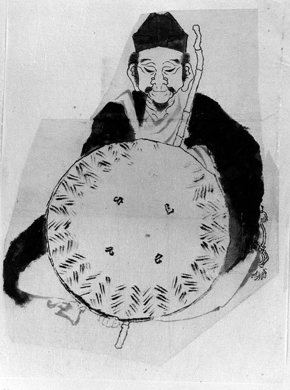
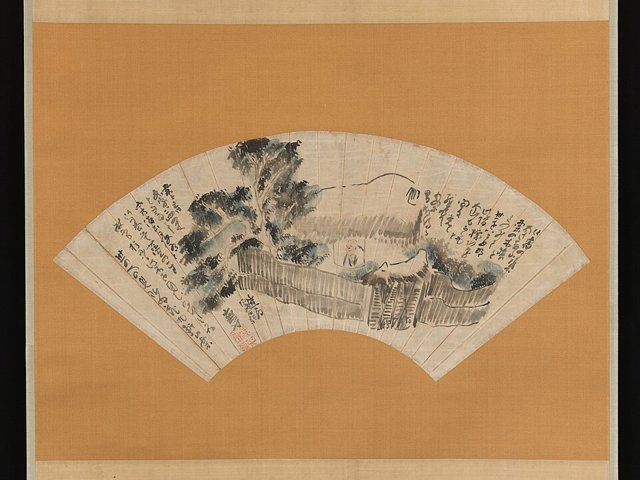

<!--
內容整理自 D:\Books\html\6-4.日本文學家\松尾芭蕉.html（沒有對應的 md 筆記），並整合中文維基百科〈松尾芭蕉〉條目，以自己的話改寫。
時期依生平歸納：伊賀時代、江戶的俳諧宗匠、芭蕉庵與紀行、奧之細道與晚年。
兩份資料出入與處理方式：
- 生卒：生於寬永二十一年（1644年），月日不詳，born 只寫年份，年齡為約數；元祿七年十月十二日（西曆1694年11月28日）死於大坂，兩份一致。
- 主君：頁面寫1666年年輕主君病逝；維基百科補充主君是藤堂良忠（俳號蟬吟），兩份一致。
- 移居江戶：維基百科寫1672年，頁面寫1680年前後遷居深川；兩者都對，分成兩則事件。芭蕉庵：維基百科說弟子1680年建庵、1681年弟子李下送來芭蕉樹，1682年起用「芭蕉」為俳號，照維基百科。
- 「古池」句：維基百科寫1686年，照此。
- 奧之細道：頁面與維基百科都寫1689年出發；出發日依一般記載的元祿二年三月二十七日（西曆1689年5月16日）。維基百科說《奧之細道》1694年完成，刊行則在他死後的1702年，兩者都寫。
- 「不易流行」：頁面說是晚年提出的理念，一般認為是在奧之細道旅行後形成，寫進1689年之後的時期說明與1691年事件。
- 頁面說他出發前「據傳已交代身後事」，照此謹慎寫法。
- 人名：同行弟子河合曾良，與頁面一致。
圖片來源（皆為 Wikimedia Commons 公有領域／CC0 作品；註明「共用」者沿用其他時間軸已有的圖片）：
- ba-cover.jpg：Matsuo Basho by Sugiyama Sanpu.jpg（杉山杉風所繪松尾芭蕉像）
- ba-hokusai.jpg：Katsushika Hokusai - Portrait of the Poet Matsuo Bashō (^) - 56.121.11 - Metropolitan Museum of Art.jpg（葛飾北齋所繪芭蕉像，大都會藝術博物館藏）
- ba-buson.jpg：奥の細道図扇面-Scene from The Narrow Road to the Deep North (Oku no hosomichi) MET DP-12232-168.jpg（與謝蕪村〈奧之細道圖扇面〉，大都會藝術博物館藏）
-->

# Periods
- 1644 ~ 1672 | 伊賀時代 | #868e96
  生於伊賀國上野的低階武士家庭，少年出仕藤堂家，與年輕主君良忠一同學習俳諧；主君早逝後離開武家，在京都與家鄉學習。
- 1672 ~ 1680 | 江戶的俳諧宗匠 | #1971c2
  到江戶發展，以「桃青」為號，逐漸成為收徒、評判句會的宗匠。
- 1680 ~ 1689 | 芭蕉庵與紀行 | #2b8a3e
  遷居深川結庵，參禪修身，以「芭蕉」為號，寫下「古池」等名句，展開《野曝紀行》等旅行。
- 1689 ~ 1694-11-28 | 奧之細道與晚年 | #495057
  與弟子曾良徒步東北與北陸，回來後提出「不易流行」與「輕み」的理念，最後一次西行時病逝大坂。

# Events

## 1644 | 出生於伊賀國
松尾芭蕉生於伊賀國上野（今三重縣伊賀市），本名松尾宗房，幼名金作。父親松尾與左衛門是有苗字的低階武士兼農民，家境並不富裕。1656年，父親去世。

## 1662 | 出仕藤堂家，開始學俳諧
少年芭蕉到伊賀上野的藤堂家當差，服侍年紀相仿的藤堂良忠（俳號蟬吟）。良忠喜好俳諧，兩人一起向京都的北村季吟學習貞門派俳諧，芭蕉的句子這一年前後開始見於記錄，1664年在京都出版的句集中收有他的作品。

## 1666 | 主君早逝
年輕的主君良忠病逝，芭蕉辭去藤堂家的職務，沒有繼續服侍新主。此後幾年他往返京都與家鄉，學習俳諧與漢詩文，為日後的創作打底。

## 1672 | 前往江戶
芭蕉把自己編選、評判的句合集《貝殼》獻給家鄉的天滿宮後，前往江戶發展。他在江戶結交俳人，一度做過神田上水的修繕工作維生。1675年起以「桃青」為號，與「李白」相對，表示對唐代詩人的尊崇。

## 1676 | 成為俳諧宗匠
芭蕉在江戶被公認為俳諧宗匠，開始收徒、主持句會與評判比賽，門下逐漸聚集寶井其角、服部嵐雪等弟子。

## 1680 | 遷居深川芭蕉庵
芭蕉離開熱鬧的日本橋，遷到隅田川東岸的深川，住進弟子為他建的草庵。1681年弟子李下送來一株芭蕉樹種在庭中，草庵因此稱為「芭蕉庵」，1682年起他也以「芭蕉」為號。他在附近的佛頂和尚門下參禪，俳風也從機智的文字遊戲，轉向閒寂、樸素的境界。

## 1682 | 芭蕉庵燒毀
江戶大火延燒到深川，芭蕉庵被燒毀，芭蕉一度到甲斐避居。1683年，母親在故鄉去世；同年冬天，弟子們為他重建第二座芭蕉庵。

## 1684 | 《野曝紀行》
秋天，芭蕉從江戶出發，經東海道到伊勢、伊賀故鄉、京都、奈良與尾張，1685年夏天回到江戶。這次旅行的紀行文《野曝紀行》，開頭就以「野曝」（曝屍荒野）自況，可見他抱著死在途中的覺悟上路。

## 1686 | 「古池」句

芭蕉寫下「古池や蛙飛び込む水の音」（古池，青蛙躍入，水聲響），以青蛙入水的一瞬聲響，襯出四周的寂靜，成為他最著名的俳句，也被視為「蕉風」俳諧的確立。1687年他又到鹿島神宮賞月，寫成《鹿島紀行》，並展開到關西的《笈之小文》之旅。

## 1689-05-16 | 奧之細道之旅

芭蕉賣掉芭蕉庵，與弟子河合曾良從深川出發，北上日光、松島、平泉，橫越到日本海側的酒田、象潟，再經北陸南下，秋天抵達美濃的大垣，全程約兩千四百公里、歷時約五個月。據說他出發前已交代了身後事。
沿途的見聞與俳句，後來寫成紀行文《奧之細道》，平泉的「夏草や兵どもが夢の跡」、立石寺的「閑さや岩にしみ入る蟬の聲」都出自這趟旅程。

## 1691 | 回到江戶，「不易流行」
旅行後的兩年，芭蕉在京都、近江一帶拜訪門人，在落柿舍寫下《嵯峨日記》，指導弟子編成句集《猿蓑》。這段時期他提出「不易流行」：好的俳句要兼有跨越時代的本質（不易）與隨時代變化的新意（流行）。1691年冬天，他回到江戶，住進弟子搭建的第三座芭蕉庵。

## 1693 | 閉門謝客
秋天，芭蕉一度閉門一個月不見任何人，調養身心。晚年他提倡「輕み」，主張用平易、日常的語言寫出深意，同時修訂《奧之細道》的文稿。

## 1694-11-28 | 病逝大坂
夏天，芭蕉最後一次離開江戶西行，經故鄉伊賀與京都到大坂，途中病倒，十月十二日在大坂的旅宿去世，享年約51歲。臨終前寫下「旅に病んで夢は枯野をかけ廻る」（旅途染病，夢在枯野上奔走），遺體依他的遺願葬在近江的義仲寺。
《奧之細道》在1702年刊行，至今是日本最著名的紀行文學；芭蕉也被後人尊為「俳聖」。
