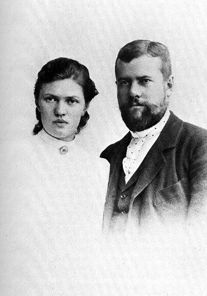
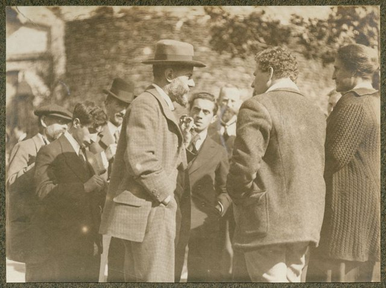

<!--
內容整理自 D:\Books\md\歷史\人物\思想家\馬克斯韋伯（Max Weber）生平大事記.md（Books 的人物頁為 D:\Books\html\2-2.哲學家\馬克斯韋伯.html），並整合中文維基百科〈馬克斯·韋伯〉條目，以自己的話改寫。
時期依筆記的八個階段：出生與家庭、大學教育、學術崛起、精神疾病、宗教社會學、現代社會學的建立、大戰、魏瑪共和；部分合併為六段。
兩份資料出入與處理方式：
- 生卒：筆記與維基百科都寫1864年4月21日生於艾福特、1920年6月14日卒於慕尼黑，依此。
- 《中國的宗教：儒教與道教》：筆記的著作表寫1915年、大事表寫1917年；這篇先在1915年以〈世界宗教的經濟倫理〉系列刊於《社會科學與社會政策文庫》，1920年修訂收入《宗教社會學論文集》，這裡依1915年。
- 精神崩潰：維基百科寫1897年至1904年，筆記寫1898－1903年；父親在1897年8月與他激烈爭吵後不久去世，隔年他陷入嚴重的精神崩潰，這裡依此敘述。
- 1919年參與凡爾賽和會德國代表團、同年起任慕尼黑大學教授，依維基百科與通行說法補充。
- 標題用全名「馬克斯·韋伯」：其他時間軸裡的「韋伯」多半指作曲家卡爾·瑪麗亞·馮·韋伯（白遼士、馬勒、華格納、莫札特等）或韋伯太空望遠鏡，只寫「韋伯」會讓人名索引大量誤配，所以不加簡稱的別名。
- 人名與其他時間軸一致：馬克思（Marx）、涂爾幹（Durkheim）；瑪麗安娜·韋伯、雅斯培沒有獨立時間軸。
圖片來源（皆為 Wikimedia Commons 公有領域／CC0 作品，縮成最長邊 640px）：
- mw-cover.jpg：Max Weber, 1918.jpg（馬克斯·韋伯，1918）
- mw-marianne.jpg：Max and Marianne Weber 1894.jpg（馬克斯與瑪麗安娜·韋伯，1894）
- mw-lauenstein.jpg：Max Weber in Lauenstein, 1917.png（1917年在勞恩斯坦城堡的文化研討會上，韋伯（中，戴帽）與青年學生討論戰後的德國）
-->

# Periods
- 1864 ~ 1881 | 柏林的政治家庭 | #868e96
  生於艾福特，父親是民族自由黨的國會議員，母親是虔誠的新教徒；在柏林的家中自幼結識當時的政治人物與學者。
- 1882 ~ 1897 | 法學與經濟學的崛起 | #1971c2
  在海德堡、柏林、哥廷根讀法律與歷史，以商業公司史與羅馬農業史取得博士與教授資格，研究東易北河的農業勞工，三十歲即任弗萊堡大學經濟學教授。
- 1898 ~ 1903 | 精神崩潰 | #c92a2a
  與父親激烈爭吵後父親猝逝，他陷入多年的憂鬱與失眠，辭去教職，四處療養。
- 1904 ~ 1913 | 新教倫理與社會學的建立 | #2b8a3e
  訪美歸來後出版《新教倫理與資本主義精神》，主編《社會科學與社會政策文庫》，創立德國社會學會，在海德堡的家中主持知識分子聚會。
- 1914 ~ 1920 | 大戰、世界宗教與魏瑪 | #5f3dc4
  大戰中管理軍醫院、研究世界宗教的經濟倫理；戰後參與德國民主黨與和會代表團，發表〈以學術為志業〉〈以政治為志業〉，在慕尼黑病逝。

# Events

## 1864-04-21 | 出生於艾福特
馬克西米利安·卡爾·埃米爾·韋伯生於普魯士薩克森省的艾福特，是八個孩子中的長子。父親老馬克斯·韋伯是律師、市府官員，後來成為民族自由黨的國會議員；母親海倫妮出身胡格諾派的富裕家庭，篤信新教、重視道德與社會服務。父母截然不同的性格與價值觀，深刻影響了他的一生。

## 1869 | 遷居柏林
全家遷居柏林。父親在家中招待歷史學家蒙森、狄爾泰等政治與學術名流，少年韋伯耳濡目染，閱讀了大量古典與歷史著作，十幾歲就寫下有關德國歷史的論文送給家人。

## 1882 | 海德堡大學
十八歲的韋伯進入海德堡大學讀法律，也修習經濟學、歷史與哲學。他加入學生兄弟會，熱衷喝啤酒與擊劍，臉上留下了決鬥的傷疤。之後他在史特拉斯堡服兵役，再轉往柏林、哥廷根大學就讀，1886年通過法律實習考試。

## 1889 | 法學博士
韋伯以《中世紀商業公司的歷史》取得法學博士學位，1891年以《羅馬農業史及其對公法與私法的意義》取得大學教授資格，在柏林大學教授法律。

## 1893 | 與瑪麗安娜結婚

韋伯與表姪女瑪麗安娜·施尼特格爾結婚，瑪麗安娜後來成為女權運動者與學者，也是韋伯身後整理遺著、撰寫傳記的人。前一年他為社會政策協會完成〈東易北河地區農業勞工狀況〉的調查，分析容克地主改用波蘭季節工的經濟與政治後果，引起學界的注意。

## 1894 | 弗萊堡大學經濟學教授
三十歲的韋伯出任弗萊堡大學的國民經濟學教授，1895年發表就職演說〈民族國家與經濟政策〉，帶有濃厚的民族主義色彩。1896年轉任海德堡大學教授，接替歷史學派經濟學家克尼斯的講座。

## 1897 | 父親去世與精神崩潰
1897年夏天，韋伯因父親對母親的專橫態度而與父親激烈爭吵，把父親趕出家門，幾週後父親猝然去世，兩人沒有和解。隔年韋伯陷入嚴重的憂鬱、失眠與精神衰竭，無法講課，到義大利等地長期療養，1903年辭去教授職位。此後他以私人學者的身分研究寫作，靠母親家族的遺產生活。

## 1904 | 訪美與《新教倫理與資本主義精神》
韋伯應邀到美國聖路易的世界博覽會演講，遊歷美國各地，觀察新教教派與資本主義社會。同年他與宋巴特等人接手主編《社會科學與社會政策文庫》，在1904年至1905年分兩部分發表《新教倫理與資本主義精神》：喀爾文教派的「預選說」使信徒焦慮地在世俗職業中勤奮工作、節儉累積，以證明自己是蒙恩的選民，這種「入世禁慾」的職業倫理，意外地孕育了講求理性計算的現代資本主義精神。他也指出，當宗教的動機消失後，理性化的經濟秩序會成為一個「鐵的牢籠」。

## 1906 | 俄國革命研究
1905年俄國革命爆發後，韋伯為了追蹤局勢自學俄文，在1906年發表〈俄羅斯資產階級民主的狀況〉等長文，分析俄國的政治發展與民主化的困難。

## 1909 | 創立德國社會學會
韋伯與齊美爾、滕尼斯等人創立德國社會學會，並堅持社會科學應保持「價值中立」，區分事實的分析與價值判斷，後來因為學會內部的爭論而退出。他在海德堡的家成為知識分子的聚會場所，參加者包括雅斯培、盧卡奇、布洛赫等人。

## 1913 | 理解社會學與《經濟與社會》
韋伯發表〈論理解社會學的幾個範疇〉，主張社會學要「解釋性地理解」人們賦予行動的主觀意義，並以「理念型」作為比較分析的工具。他開始為一部經濟學叢書撰寫後來成為《經濟與社會》的巨著，提出傳統型、卡理斯瑪型與法理型三種正當支配，並分析科層制是現代社會最有效率的組織形式。

## 1914 | 第一次世界大戰

大戰爆發後，五十歲的韋伯擔任後備軍官，負責管理海德堡地區的軍醫院。他起初支持戰爭，後來批評德國的無限制潛艇戰與兼併主張，呼籲政治改革與議會化。

## 1915 | 世界宗教的經濟倫理
韋伯在《文庫》開始發表〈世界宗教的經濟倫理〉系列，比較各大宗教如何塑造不同的經濟行為：1915年的《中國的宗教：儒教與道教》、1916年的《印度的宗教：印度教與佛教》、1917年至1918年的《古代猶太教》，試圖回答為什麼理性的資本主義首先在西方出現。

## 1918 | 德國戰敗與魏瑪共和
德國戰敗、帝制崩潰，韋伯參與創立德國民主黨，參加起草魏瑪憲法的討論，主張設立由人民直選、權力強大的總統，以制衡議會。1919年他作為德國代表團的專家前往凡爾賽和會，反對和約中德國單獨承擔戰爭責任的條款。

## 1919 | 〈以學術為志業〉與〈以政治為志業〉
韋伯在慕尼黑為大學生發表兩場著名的演講：〈以學術為志業〉指出現代世界已經「除魅」，學術只能提供知識與清明，不能告訴人們該信仰什麼；〈以政治為志業〉把國家定義為「在一定領土內成功宣稱壟斷正當使用暴力的人類共同體」，並提出政治人物須在「信念倫理」與「責任倫理」之間取捨。同年他接任慕尼黑大學的社會學講座。

## 1920-06-14 | 逝世於慕尼黑
韋伯感染西班牙流感併發肺炎，在慕尼黑去世，享年五十六歲。生前他完成《宗教社會學論文集》第一卷的修訂；遺稿由妻子瑪麗安娜整理，1922年出版《經濟與社會》。韋伯的理性化、科層制、正當支配與方法論，與馬克思、涂爾幹並列為現代社會學的三大理論傳統，戰後經帕森斯的翻譯介紹，影響遍及社會學、政治學與經濟史。
