<!--
內容整合自三份資料，以自己的話改寫：
- 知識圖譜「梅迪奇家族——從藥商到佛羅倫斯之主」（D:\Books\html\1-1.西方歷史\梅迪奇家族.html，八章概述）
- 知識圖譜「梅迪奇家族傳記——佛羅倫斯王朝」（D:\Books\html\1-1.西方歷史\梅迪奇家族2.html；md 原稿在 D:\Books\md\歷史\人物\梅迪奇家族，五章十五節）
- 中文維基百科「麥地奇家族」（https://zh.wikipedia.org/zh-tw/美第奇家族）
時期依傳記的五章。
資料出入的處理：
- 銀行創立：傳記與概述都作1397年，維基寫喬凡尼「從1410年開始」從事銀行業，這裡採1397年。
- 家徽的紅球：概述說可能來自藥丸或錢幣，傳記說是藥丸，維基則說藥丸的說法出自16世紀法國宮廷、用來貶低凱薩琳出身平民，較可信的解釋是錢幣；這裡兩說並陳，以錢幣為較可信的說法。
- 薩爾韋斯特羅在1378年梳毛工起義中的角色：概述只說他「扮演重要角色」，維基寫他「鎮壓」起義，這裡只寫他當時擔任正義旗手、在起義中舉足輕重，1382年遭放逐。
- 主教座堂圓頂：傳記說科西莫是主要贊助人之一，維基說科西莫委託布魯內萊斯基完成；工程的正式業主是主教座堂工程處，這裡寫「科西莫是贊助者之一」。
- 佛羅倫斯公爵：傳記作1532年亞歷山德羅受封，維基寫「1537年麥地奇家族獲得佛羅倫斯公爵的稱號」（實為科西莫一世繼任公爵之年），這裡採1532年。
- 家族契約：傳記把它放在1743年（安娜去世之年），概述與一般記載是1737年簽訂，這裡在1737年記契約、1743年記安娜去世與遺囑生效。
- 傳記所述最後一位大公「1748年艾克斯拉沙佩勒條約確認」傳位的說法未採用；維基記為絕嗣後大公爵位轉給洛林家族的法蘭茲·史蒂芬。
- 教宗名號：利奧十世即天主教譯名的良十世，克勉七世即克雷芒七世。
- 家族分支（維基「家族分支」一節）未列入年表。
圖片來源（皆為 Wikimedia Commons 公有領域／CC0 作品；註明「共用」者沿用文藝復興時間軸已有的圖片）：
- renaissance-1475-adoration-medici.jpg（波提且利〈東方三博士朝聖〉，畫中的三博士以梅迪奇家族成員為原型（與文藝復興時間軸共用））
- med-coat.jpg：Coat of arms of the House of de' Medici.png（梅迪奇家族的紋章：金底紅球，最上方一顆是法王路易十一御賜的藍底金百合）
- med-ciompi.jpg：G. L. Gatteri, Il tumulto dei ciompi, Trieste, CMSA.jpg（加特里〈梳毛工起義〉，19世紀）
- med-giovanni.jpg：Giovanni di Bicci de' Medici Portrait by Agnolo Bronzino.jpg（布隆津諾所繪喬凡尼·迪·比奇像，16世紀）
- med-cosimo.jpg：Pontormo - Ritratto di Cosimo il Vecchio - Google Art Project.jpg（蓬托莫所繪科西莫像，1519–1520）
- renaissance-1440-duomo-codice-rustici.jpg（15世紀《魯斯蒂奇抄本》中的聖母百花大教堂與圓頂（與文藝復興時間軸共用））
- med-sforza.jpg：Francesco Sforza.jpg（米蘭公爵弗朗切斯科·斯福爾扎像）
- med-careggi.jpg：The Birthday of Plato Celebrated in the Villa di Careggi by Lorenzo the Magnificent.jpg（19世紀想像畫〈洛倫佐在卡雷吉別墅慶祝柏拉圖誕辰〉）
- renaissance-1478-lorenzo-bust.jpg（洛倫佐的彩繪赤陶胸像（與文藝復興時間軸共用））
- med-pazzi.jpg：To Commemorate the Pazzi Conspiracy, 1478 MET 55343.jpg（貝托爾多為紀念帕齊陰謀鑄造的獎章，背面是主教座堂內的行刺場面）
- med-charles.jpg：Francesco granacci, entrata di Carlo VIII a Firenze.jpg（格拉納奇〈查理八世進入佛羅倫斯〉）
- med-leox.jpg：Raphael - Pope Leo X with two cardinals.jpg（拉斐爾〈教宗利奧十世與兩位樞機〉，左為後來的克勉七世）
- renaissance-1517-95-theses.jpg（《九十五條論綱》的早期印本（與文藝復興時間軸共用））
- med-clement.jpg：Sebastiano del Piombo (Italian) - Pope Clement VII - Google Art Project.jpg（塞巴斯蒂亞諾·德爾·皮翁博所繪克勉七世像）
- renaissance-1555-sack-of-rome.jpg（描繪1527年羅馬之劫的版畫（與文藝復興時間軸共用））
- med-alessandro.jpg：Jacopo Pontormo - Alessandro de' Medici - WGA18108.jpg（蓬托莫所繪亞歷山德羅·德·梅迪奇像）
- med-catherine.jpg：Catherine de Médicis - atelier de François Clouet.jpg（克盧埃工作室所繪凱薩琳·德·梅迪奇像）
- med-cosimoi.jpg：Agnolo Bronzino - Cosimo I de' Medici in armour - Google Art Project.jpg（布隆津諾所繪身穿盔甲的科西莫一世）
- med-marciano.jpg：Giorgio Vasari - The battle of Marciano in Val di Chiana - Google Art Project.jpg（瓦薩里〈馬爾恰諾之戰〉，佛羅倫斯軍在此擊敗錫耶納，舊宮五百人大廳）
- med-pitti.jpg：Giusto Utens - Palazzo Pitti and the Forte Belvedere - WGA24195.jpg（烏滕斯所繪皮蒂宮與波波里花園的弦月形壁畫，1599）
- med-marie.jpg：Peter Paul Rubens - The Landing of Marie de Médicis at Marseilles - WGA20337.jpg（魯本斯〈瑪麗·德·梅迪奇在馬賽登陸〉）
- med-leoxi.jpg：Pope Leo XI.jpg（教宗良十一世像）
- med-sidereus.jpg：Sidereus Nuncius Medicean Stars.jpg（《星際信使》中記錄「梅迪奇星」位置的書頁，1610）
- med-galileo.jpg：Galileo before the Holy Office - Joseph-Nicolas Robert-Fleury, 1847.png（羅伯特-弗勒里〈伽利略在宗教裁判所〉，1847）
- med-giangastone.jpg：Richter, Franz Ferdinand - Official portrait of Gian Gastone de' Medici in grand ducal robes.jpg（里希特所繪身穿大公禮袍的吉安·加斯托內）
- med-annamaria.jpg：Attributed to van Douven - Anna Maria Luisa de' Medici.png（傳范杜文所繪安娜·瑪麗亞·路易莎像）
-->

# Periods
- 1360 ~ 1429 | 羊毛商與銀行家 | #b08900
  喬凡尼·迪·比奇從穆杰羅鄉下到佛羅倫斯，創立梅迪奇銀行，靠著替教廷管錢與遍布全歐的分行，成為歐洲最富有的家族之一。
- 1429 ~ 1464 | 科西莫：不稱王的統治者 | #2f9e44
  科西莫被流放一年後凱旋，此後三十年不擔任正式官職，卻以選舉操作、稅收與恩庇網絡掌控共和國；他大舉贊助建築、雕塑與柏拉圖學院，死後被尊為「祖國之父」。
- 1464 ~ 1494 | 洛倫佐：華麗與空心 | #1971c2
  「華麗者」洛倫佐是詩人、外交家與藝術贊助者，佛羅倫斯進入文藝復興的黃金時代；但銀行在他手中走下坡，他死後兩年，家族被逐出佛羅倫斯。
- 1494 ~ 1569 | 教宗與公爵 | #862e9c
  家族流亡十八年後重返佛羅倫斯，接連出了利奧十世與克勉七世兩位教宗，共和國也改為世襲的公國，最後由科西莫一世受封托斯卡尼大公。
- 1569 ~ 1743 | 大公國的衰落與遺產 | #495057
  大公國在政治、財政與子嗣上逐漸衰敗，家族女兒嫁入法國王室，大公贊助伽利略；1737年男系絕嗣，最後一位成員以家族契約把全部收藏永遠留給佛羅倫斯。

# Events

## 1360 | 喬凡尼·迪·比奇出生於穆杰羅
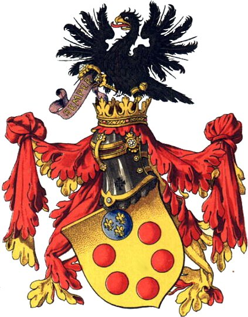
喬凡尼·迪·比奇·德·梅迪奇生於佛羅倫斯北方的穆杰羅山區。梅迪奇（Medici）一字和義大利文的「醫生」同源，家徽上的紅球有藥丸、錢幣、金塊等說法，以錢幣最可信。家族早年經營羊毛貿易與小額放貸，並不顯赫；黑死病過後的佛羅倫斯階級流動劇烈，喬凡尼到伯父在羅馬開的銀行當學徒，學會了替教廷經手金錢的生意。

## 1378 | 薩爾韋斯特羅與梳毛工起義
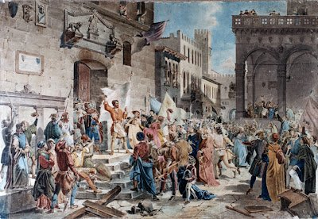
薩爾韋斯特羅·德·梅迪奇是第一位留名史冊的家族成員。1378年他擔任佛羅倫斯共和國的「正義旗手」，在震動全城的梳毛工起義中舉足輕重，但1382年遭到放逐，家族在政壇沉寂了一段時間。

## 1397 | 梅迪奇銀行開業
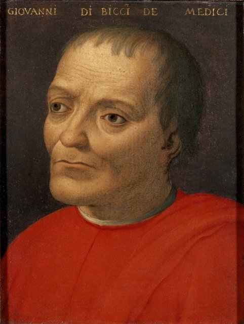
1397年，喬凡尼在佛羅倫斯創立梅迪奇銀行，主要業務是替教廷把全歐的什一稅匯往羅馬，以及替羊毛貿易融資。銀行用匯票避開教會禁止放高利貸的規定，以匯差賺取利息，並採用複式簿記；各地分行由經理出小股、總行控股，像是連鎖加盟的前身。

## 1414 ~ 1418 | 成為教廷的銀行
梅迪奇銀行在羅馬、威尼斯、日內瓦、布魯日、倫敦開設分行，形成橫跨歐洲的金融網絡。康斯坦茨會議結束教會大分裂後，梅迪奇替新教宗馬丁五世管理財務，成為教廷的銀行；教廷的收入穩定，但教宗一換人合約就得重談，也埋下了政治風險。

## 1419 | 布魯內萊斯基重建聖羅倫佐教堂
喬凡尼委託布魯內萊斯基重建聖羅倫佐教堂，後來這裡成為梅迪奇家族的教堂與墓地。喬凡尼也贊助馬薩喬，是家族中第一位藝術贊助人。

## 1429 | 喬凡尼去世
喬凡尼去世時，梅迪奇銀行已是歐洲最大的銀行之一。他為人謹慎低調，據傳留給兒子科西莫與洛倫佐的告誡是「不要炫富、不要參政」，但留給科西莫的不只是財富，還有遍布歐洲權力中心的人脈。

## 1433 ~ 1434 | 科西莫流放與凱旋
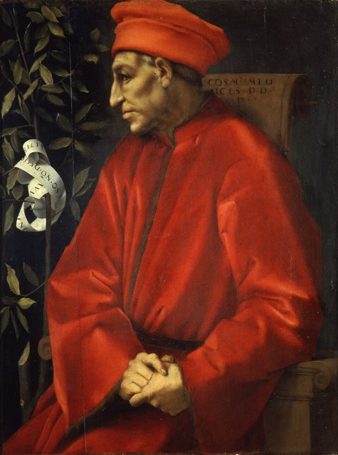
1433年9月，科西莫得罪當權的阿爾比齊家族，以叛國罪被捕，原判死刑，靠著金錢打點改判流放威尼斯。一年後佛羅倫斯因戰爭與加稅陷入財政困境，1434年10月科西莫被市民迎回，阿爾比齊家族反遭流放。梅迪奇家族從此成為共和國非正式的統治者，這一年才是梅迪奇時代真正的起點。

## 1436 | 主教座堂圓頂完工
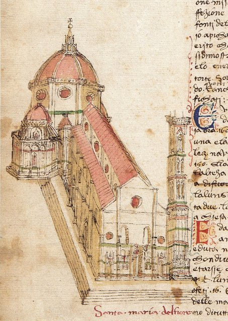
聖母百花大教堂的圓頂在布魯內萊斯基主持下完工，是當時世界最大的穹頂，科西莫是贊助者之一。科西莫在藝術上的花費超過佛羅倫斯史上任何人：出資重建聖馬可修道院並設立藏書樓，贊助多納太羅（青銅〈大衛〉）、弗拉·安傑利科與菲利普·利皮。贊助既能收買人心，也是銀行家為放貸「贖罪」的方式。

## 1434 ~ 1464 | 不稱王的統治
科西莫始終只是一介平民，卻以親信把持選舉委員會、用稅制打擊政敵、借貸與高薪籠絡支持者，掌控佛羅倫斯三十年。他的名言是「國家不能靠念珠治理」，市民稱他為「平民的保護者」。

## 1454 | 洛迪和約
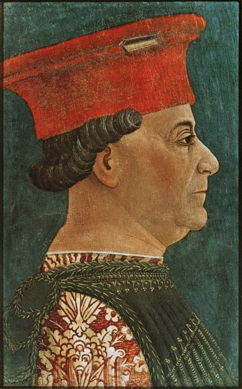
佛羅倫斯與米蘭交戰十多年後，科西莫促成與米蘭公爵斯福爾扎簽訂洛迪和約，米蘭、那不勒斯、佛羅倫斯形成均勢，義大利北部維持了約四十年的和平。

## 1462 | 柏拉圖學園
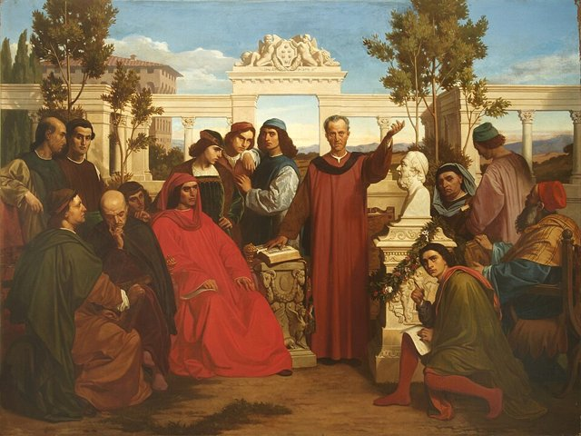
科西莫在卡雷吉別墅設立柏拉圖學園，資助費奇諾把柏拉圖全集譯成拉丁文，新柏拉圖主義從此成為佛羅倫斯文藝復興的哲學核心。

## 1464 | 科西莫去世，尊為「祖國之父」
科西莫去世後，佛羅倫斯在他的墓上刻下「祖國之父」（Pater Patriae）。葬禮簡樸，權力傳給患痛風的兒子皮耶羅，幕後統治從此變成父子相傳。

## 1469 | 洛倫佐接班
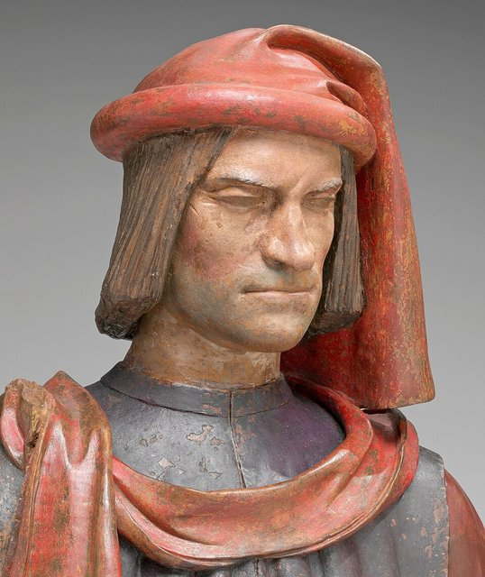
皮耶羅早逝，科西莫的孫子洛倫佐20歲接掌家族，人稱「華麗者」（il Magnifico）。他是詩人、外交家，贊助波提且利、波利齊亞諾，少年米開朗基羅還住在他家、與他同桌吃飯；佛羅倫斯在他治下成為文藝復興的典範。但他無心經營銀行，倫敦、布魯日分行接連虧損，甚至挪用公款填補。

## 1478 | 帕齊陰謀
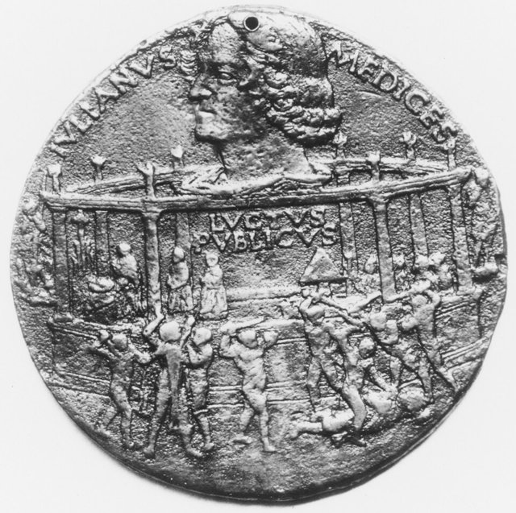
1478年4月26日復活節彌撒，銀行對手帕齊家族聯合教宗西斯篤四世，在主教座堂行刺梅迪奇兄弟：弟弟朱利亞諾當場被殺，洛倫佐負傷逃進聖器室。憤怒的市民把陰謀者吊死在市政廳窗外，連身穿祭衣的比薩總主教也不例外，教宗因此對佛羅倫斯全城處以絕罰。洛倫佐隨後親赴那不勒斯談判化解戰事，威望反而大增，成為「義大利天平的指針」。

## 1492 | 洛倫佐去世
洛倫佐43歲病逝，同年哥倫布抵達美洲。兒子皮耶羅二世繼位，被稱為「不幸的皮耶羅」。

## 1494 | 梅迪奇家族被逐出佛羅倫斯
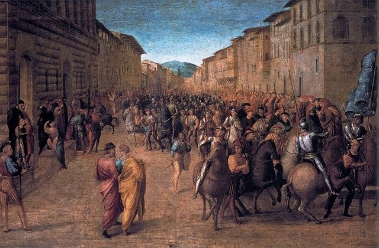
法王查理八世入侵義大利，皮耶羅二世割地求和，激怒佛羅倫斯人，梅迪奇家族被逐出城，宅邸遭到洗劫。修士薩佛納羅拉在城中推行神權統治，舉行「虛榮之火」焚燒奢侈品、書籍與藝術品，直到1498年他本人被處以火刑。銀行空虛、接班人無能、外敵入侵，六十年的幕後統治一夕結束。

## 1512 | 重返佛羅倫斯
靠著教宗與西班牙軍隊的力量，梅迪奇家族在流亡十八年後重返佛羅倫斯。

## 1513 | 利奧十世當選教宗
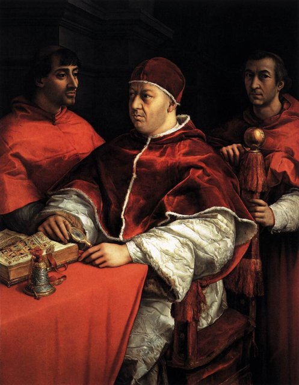
洛倫佐之子喬凡尼當選教宗，稱利奧十世（良十世），梅迪奇從銀行家成為基督教世界之主。據說他對弟弟說：「上帝既然給了我們教廷，就讓我們好好享受。」他養大象、贊助拉斐爾、重建聖伯多祿大殿，並販售贖罪券籌款。

## 1517 | 贖罪券與宗教改革
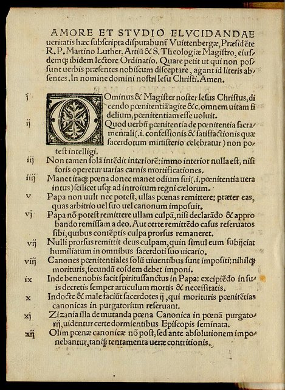
利奧十世為重建聖伯多祿大殿販售贖罪券，成為馬丁·路德發表《九十五條論綱》的直接導火線，宗教改革由此爆發——銀行家的兒子，間接促成了教會的分裂。

## 1523 | 克勉七世當選教宗
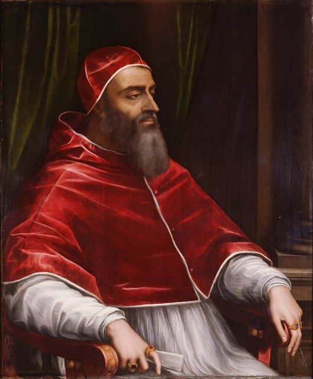
朱利亞諾（帕齊陰謀中遇刺者）的私生子朱利奧當選教宗，稱克勉七世，是梅迪奇家族的第二位教宗。

## 1527 | 羅馬之劫
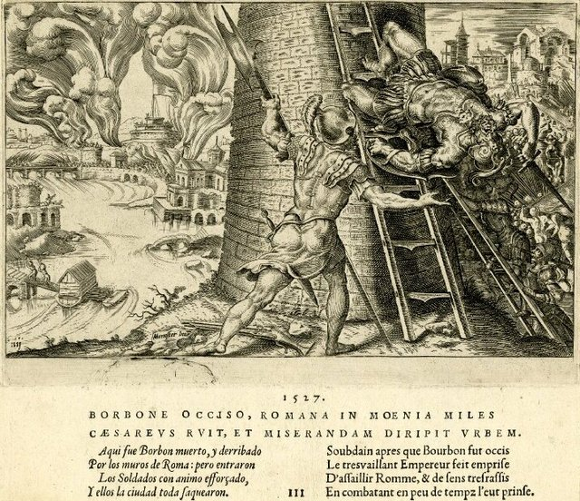
克勉七世在法國與神聖羅馬帝國之間搖擺，1527年帝國軍隊洗劫羅馬。他後來拒絕英王亨利八世的離婚請求，導致英格蘭教會與羅馬決裂。

## 1532 | 亞歷山德羅成為佛羅倫斯公爵
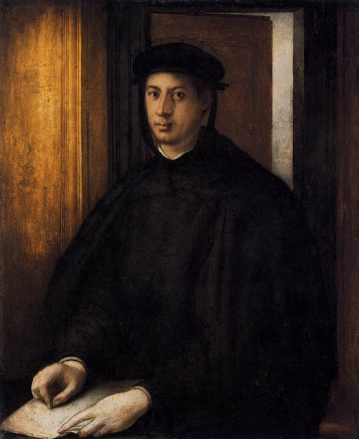
佛羅倫斯共和國改為公國，克勉七世讓亞歷山德羅受封為佛羅倫斯公爵，梅迪奇從幕後的家族正式成為世襲的王朝。

## 1533 | 凱薩琳嫁入法國王室
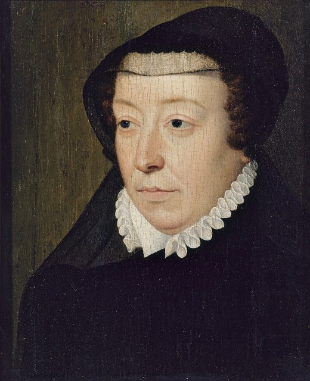
洛倫佐的曾孫女凱薩琳·德·梅迪奇嫁給法國王子亨利（後來的亨利二世），日後成為王后與王太后，三個兒子先後成為法王；1572年聖巴托羅繆之夜屠殺新教徒，她是核心人物之一。

## 1537 | 亞歷山德羅遇刺，科西莫一世繼任
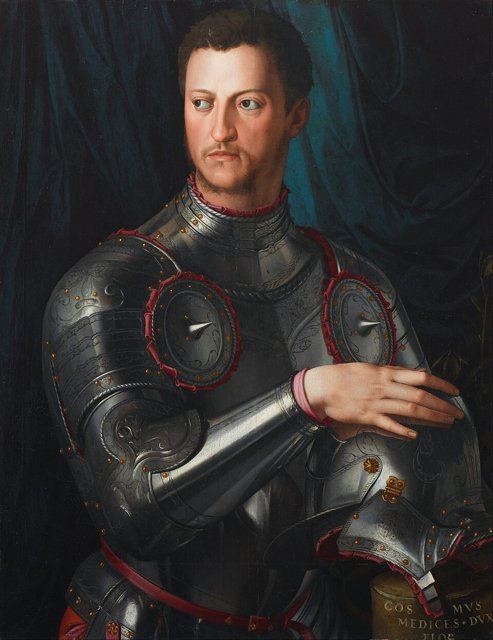
亞歷山德羅為人殘暴荒淫，1537年被堂弟洛倫齊諾刺殺，身後沒有合法子嗣。17歲的旁支子弟科西莫（老洛倫佐一系、黑條喬凡尼之子）被推為公爵，眾人原以為他只是傀儡，他卻處決共和派、建立常備軍與行政體系，牢牢掌握權力。

## 1550 | 買下皮蒂宮
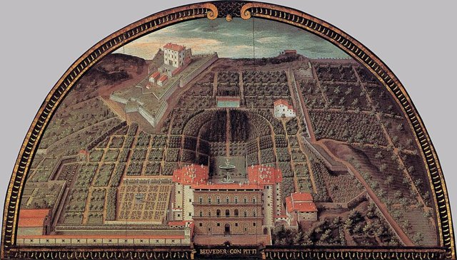
科西莫一世的妻子、托雷多的埃莉諾拉買下皮蒂宮，後來成為大公的宮殿，宮後闢有波波里花園。

## 1555 | 征服錫耶納
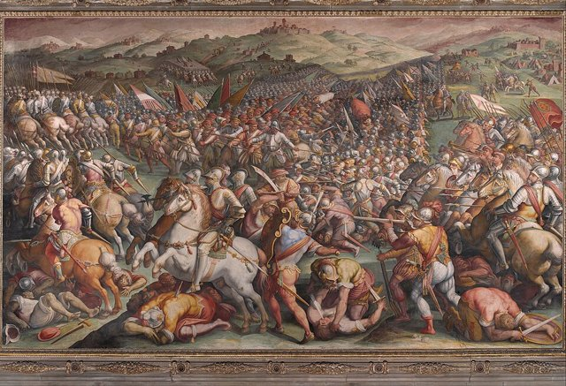
科西莫一世征服錫耶納，托斯卡尼大致統一於梅迪奇治下。

## 1560 | 烏菲茲動工
科西莫一世委託瓦薩里興建烏菲茲（Uffizi，原意為「辦公廳」），集中政府機關，後來成為收藏家族藝術品的美術館；1562年又設立設計學院。

## 1569 | 托斯卡尼大公
教宗庇護五世授予科西莫一世「托斯卡尼大公」頭銜。從1397年開設銀行到1569年受封大公，梅迪奇家族花了172年，從幕後的銀行家變成正式的世襲君主。

## 1600 | 瑪麗·德·梅迪奇成為法國王后
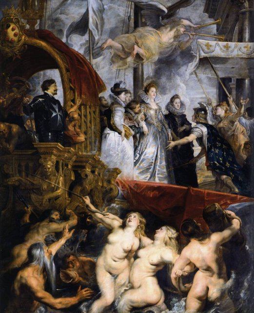
瑪麗·德·梅迪奇嫁給法王亨利四世，是路易十三的母親，後來擔任攝政。1622至1625年間，魯本斯為她繪製了二十四幅連作，其中包括〈瑪麗·德·梅迪奇在馬賽登陸〉。

## 1605 | 良十一世
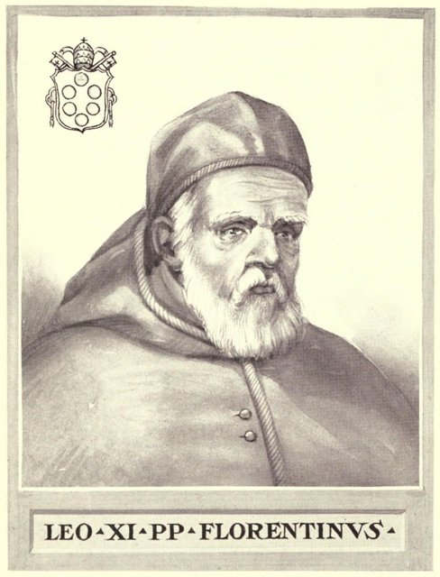
梅迪奇旁支出身的亞歷山德羅·奧塔維亞諾當選教宗良十一世，在位不到一個月便去世。

## 1610 | 梅迪奇星
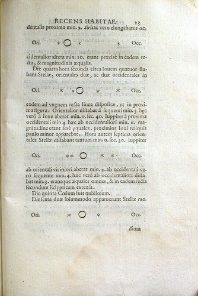
伽利略發現木星的四顆衛星，以大公之名命名為「梅迪奇星」並獻給科西莫二世。大公聘他為宮廷首席數學家，給予高薪並免除教學。

## 1633 | 伽利略受審
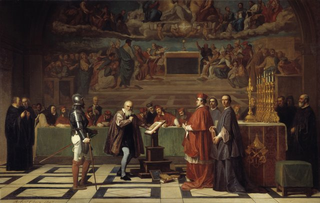
伽利略在羅馬受宗教裁判，托斯卡尼大使館提供住處，但大公不敢得罪教宗，只能有限度地保護他。1642年伽利略在佛羅倫斯近郊的阿切特里去世，這是梅迪奇王朝最後的文化光彩。

## 1723 | 最後的大公
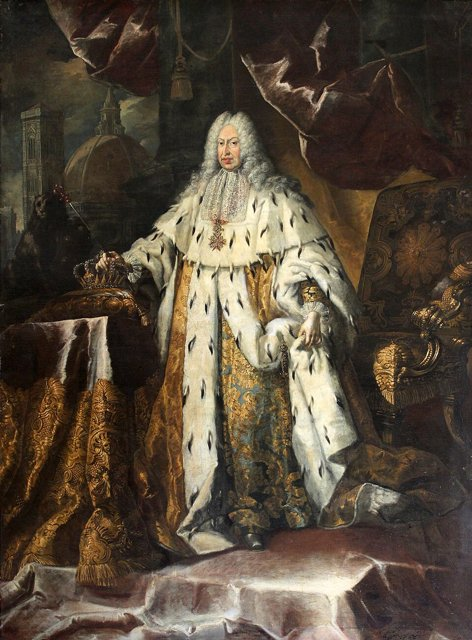
吉安·加斯托內繼位，成為第七代、也是最後一位托斯卡尼大公。此時銀行早已無足輕重，大公國淪為歐洲列強角力的棋子，家族在政治、財政與子嗣上同步衰敗。

## 1737 | 男系絕嗣與家族契約
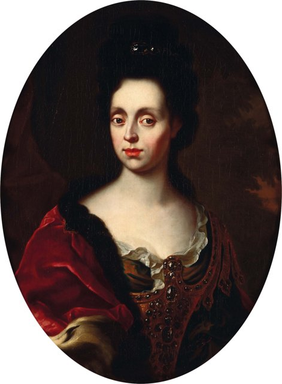
吉安·加斯托內無嗣而終，托斯卡尼大公的爵位轉給洛林家族的法蘭茲·史蒂芬（後來的神聖羅馬皇帝法蘭茲一世），統治佛羅倫斯的梅迪奇家族至此絕嗣。他的姊姊安娜·瑪麗亞·路易莎與新統治者簽下「家族契約」（Patto di Famiglia）：梅迪奇累積的全部收藏——烏菲茲、皮蒂宮、波波里花園的館藏——永遠不得移出佛羅倫斯，並向公眾開放。

## 1743 | 安娜·瑪麗亞·路易莎去世
梅迪奇家族最後一位成員安娜·瑪麗亞·路易莎去世，家族收藏依契約全數留在佛羅倫斯，今天是烏菲茲美術館與帕拉提納美術館的核心館藏。從銀行到王朝，梅迪奇家族最終留下的是一座城市的美。
