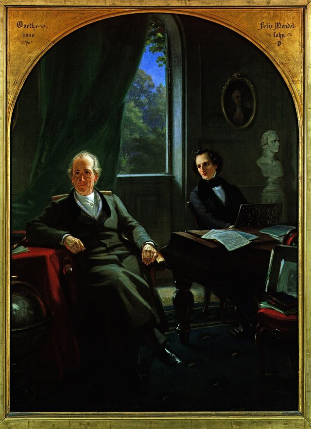
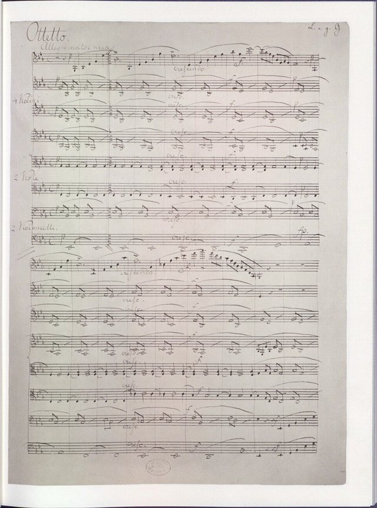
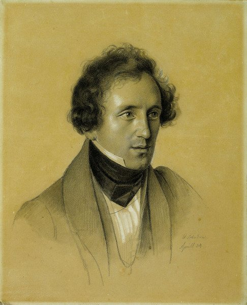
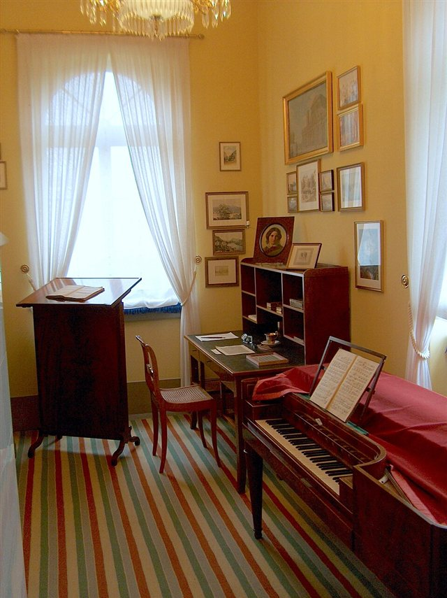
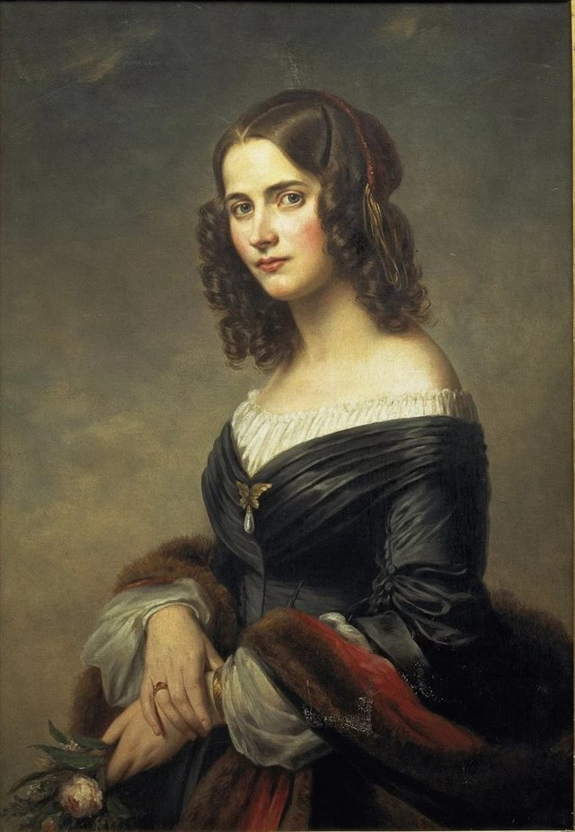
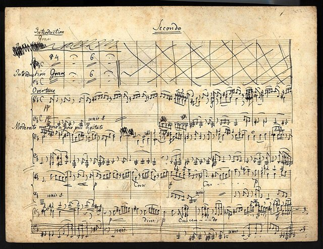
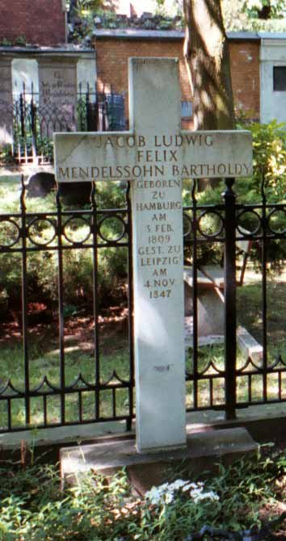

<!--
內容整理自中文維基百科「費利克斯·孟德爾頌」條目（CC BY-SA 4.0），並以台灣用語改寫摘要。
https://zh.wikipedia.org/zh-tw/費利克斯·孟德爾頌
圖片皆為 Wikimedia Commons 上的公有領域作品（封面：Eduard Magnus 1846 年油畫肖像）。
-->

# Periods
- 1809 ~ 1811 | 出生@漢堡(Hamburg)
  出生於當時仍是獨立城邦的漢堡。父親亞伯拉罕是銀行家，祖父是著名的猶太哲學家摩西·孟德爾頌。
- 1811 ~ 1829 | 神童時期@柏林(Berlin)
  為躲避拿破崙對家族銀行的報復，全家遷居柏林。父母在家中經營沙龍，往來的多是藝術家、音樂家與學者，孟德爾頌在濃厚的知識氛圍中成長，與姐姐范妮一同接受完整的音樂教育。
- 1829 ~ 1832 | 遊歷歐洲
  首度訪問英國與蘇格蘭，之後前往維也納、佛羅倫斯、米蘭、羅馬與那不勒斯。這段旅程孕育了《赫布里底群島》序曲、「蘇格蘭」與「義大利」交響曲等名作。
- 1833 ~ 1835 | 杜塞道夫音樂總監@Düsseldorf
  爭取柏林歌唱學院總監落選後，接下杜塞道夫音樂總監一職，這是他第一份有薪的音樂職位。他對日常行政與地方風氣感到厭倦，於1834年底辭職。
- 1835 ~ 1847 | 萊比錫時期@Leipzig
  出任萊比錫布商大廈管弦樂團指揮，大力推動城市的音樂生活：舉辦演奏十八世紀音樂的「歷史音樂會」、演出同時代作曲家的新作，並於1843年創立萊比錫音樂學院。
- 1841 ~ 1845 | 往返柏林宮廷
  普魯士國王腓特烈·威廉四世希望他主持柏林的音樂改革。孟德爾頌為宮廷寫了教堂音樂與多部戲劇配樂，但國王承諾的音樂學校經費與職權始終沒有落實，他最後樂於回到萊比錫。

# Events

## 1809-02-03 | 出生@漢堡
在家中排行第二，姐姐范妮同樣展現出過人的音樂天分。日後首演他小提琴協奏曲的費迪南德·大衛，一年後就出生在同一棟房子裡。

## 1811 | 舉家遷往柏林
家族擔心拿破崙報復他們的銀行突破大陸封鎖，連夜離開漢堡。

## 1816-03-21 | 受洗為基督徒
七歲時與兄弟姐妹在柏林家中受洗，加入改革宗教會，並取了「雅各布·路德維希」兩個名字。父母後來也受洗，全家改用「孟德爾頌·巴托爾迪」的姓氏。

## 1819-05 | 隨策爾特學習作曲
開始跟隨卡爾·弗里德里希·策爾特學習對位法與作曲，一直學到1835年。策爾特崇拜巴赫，深深影響了孟德爾頌對巴洛克音樂的喜好。

## 1821 | 結識歌德

策爾特帶12歲的孟德爾頌拜訪七十多歲的歌德。歌德驚嘆於他的即興與視奏能力，認為他的成就遠超過同年紀時的莫札特。

## 1821 ~ 1823 | 13首弦樂交響曲
12到14歲之間，為家中的私人音樂會寫下13首弦樂交響曲，可以聽出巴赫、海頓、莫札特與貝多芬的影響。這些作品在他去世很久之後才出版。

## 1824 | 第1號交響曲；師事莫謝萊斯
15歲完成第一部為完整管弦樂團而寫的c小調交響曲。同年隨鋼琴家伊格納茲·莫謝萊斯學習，莫謝萊斯坦言能教他的不多，兩人後來成為終生好友。

## 1825 | 降E大調弦樂八重奏

16歲的作品，被視為他成為成熟作曲家的標誌，至今仍是最常演出的室內樂名作之一。

## 1826 | 《仲夏夜之夢》序曲
17歲時根據莎士比亞劇作寫成，是最早的「音樂會序曲」之一：不為舞台演出而寫，而是讓聽眾在音樂會中聯想文學情節。

## 1826 ~ 1829 | 就讀柏林大學
因翻譯古羅馬劇作家泰倫提烏斯的劇本獲得入學資格，旁聽黑格爾的美學、甘斯的歷史與李特爾的地理學講座。

## 1827 | 歌劇《卡馬喬的婚禮》首演
根據《堂吉訶德》情節寫成，在柏林首演反應冷淡，是他生前唯一上演的歌劇。此後他再也沒有完成任何歌劇。

## 1829-03-11 | 指揮《馬太受難曲》復演
在柏林指揮巴赫的《馬太受難曲》，這是巴赫去世後此曲首次在萊比錫以外演出，掀起巴赫音樂在歐洲的復興。20歲的孟德爾頌因此聲名大噪。

## 1829 | 首次訪問英國與蘇格蘭
在倫敦指揮自己的第1號交響曲大獲成功，奠定在英國的聲譽。夏天遊歷蘇格蘭，在荷里路德宮記下「蘇格蘭」交響曲的開頭主題。他一生共訪英十次。

## 1830 | 《赫布里底群島》序曲
造訪斯塔法島的芬戈洞穴後，當場在信中寫下序曲的開頭主題，又名《芬戈洞穴》。同年展開義大利之旅。

## 1833-01 | 柏林歌唱學院總監落選
策爾特去世後，他希望接任柏林歌唱學院音樂總監，卻在選舉中敗給倫根哈根，原因可能是年紀太輕，也有人懷疑與他的猶太血統有關。

## 1833 | 「義大利」交響曲首演；就任杜塞道夫音樂總監

親自指揮A大調第4號交響曲「義大利」首演，但生前一直想修改，始終沒有出版。同年在下萊茵音樂節指揮亨德爾的《以色列人在埃及》，帶動德國的亨德爾復興。

## 1835 | 接掌萊比錫布商大廈管弦樂團

婉拒慕尼黑歌劇院等邀約，出任萊比錫布商大廈管弦樂團指揮，把樂團帶上巔峰。

## 1836 | 清唱劇《聖保羅》首演
在杜塞道夫的下萊茵音樂節首演，當時父親剛過世不久。許多同時代人認為這是他最傑出的作品，鞏固了他在歐洲的地位。

## 1837-03-28 | 與塞西爾結婚

與法國改革宗牧師之女塞西爾·讓勒諾結婚，育有五名子女。

## 1839-03-21 | 首演舒伯特第9號交響曲
舒曼發現舒伯特這部交響曲的手稿並寄給孟德爾頌，他在萊比錫指揮首演，此時舒伯特已去世十多年。

## 1840-06-25 | 第2號交響曲《頌歌》首演
為慶祝谷登堡發明印刷術四百週年而寫的康塔塔交響曲，在萊比錫首演。同年寫的《節慶歌曲》中有一段旋律，後來成為聖誕頌歌《聽啊！天使高聲唱》的曲調。

## 1841 | 《安提戈涅》配樂
應普魯士國王之邀，為索福克勒斯的悲劇《安提戈涅》譜寫配樂，之後又陸續為多部古典戲劇配樂。

## 1842 | 「蘇格蘭」交響曲首演；晉見維多利亞女王
斷斷續續寫了十三年的a小調第3號交響曲在萊比錫首演。訪英時在白金漢宮晉見維多利亞女王與阿爾伯特親王，女王演唱了她最喜歡的一首「他的」歌，他才坦承那其實是姐姐范妮的作品。

## 1843 | 創立萊比錫音樂學院
說服莫謝萊斯、舒曼、費迪南德·大衛等人加入任教，這所學校即今天的萊比錫孟德爾頌音樂戲劇學院。同年完成《仲夏夜之夢》全劇配樂，包括著名的《婚禮進行曲》。

## 1844 | e小調小提琴協奏曲
為好友費迪南德·大衛而寫，兩人在創作過程中密切合作。約阿希姆把它與貝多芬、布拉姆斯、布魯赫的作品並列為四大小提琴協奏曲。同年10月結識瑞典女高音珍妮·林德。

## 1846-08-26 | 清唱劇《以利亞》首演@伯明罕

受伯明罕三年音樂節委託創作，在伯明罕市政廳首演，和《聖保羅》一樣深受巴赫影響。

## 1847 | 最後一次訪英
在維多利亞女王與阿爾伯特親王面前指揮「蘇格蘭」交響曲，並擔任貝多芬第4號鋼琴協奏曲的獨奏。

## 1847-05-14 | 姐姐范妮去世
范妮的死對孟德爾頌打擊極大。此後寫下的f小調第6號弦樂四重奏，是他最後一部重要作品，情感格外強烈。

## 1847-11-04 | 逝世@萊比錫

在萊比錫因一連串中風去世，年僅38歲。葬禮在萊比錫舉行，安葬於柏林聖三一教堂墓園，莫謝萊斯與舒曼都是扶靈者。

## 1858-01-25 | 《婚禮進行曲》用於英國皇室婚禮
維多利亞長公主與普魯士王儲腓特烈的婚禮上演奏此曲，從此成為西方婚禮最受歡迎的音樂之一。
