<!--
內容整理自 D:\Books\html\9-2.藝術家\米開朗基羅生平大事記.html（沒有對應的 md 筆記），以自己的話改寫。
時期依頁面的七個階段歸納：出身與早年學藝、初赴羅馬與《聖殤》、佛羅倫斯時期、西斯汀天頂畫、教宗工程與美第奇陵墓、《最後的審判》與晚期藝術、建築事業與晚年；後兩段內容相近的部分合併。
處理方式：
- 頁面提醒帶「約」「前後」的年份是概略年代，不是精確到單一日期，這裡照寫，並用 label 保留；享年頁面寫「約88歲」。
- 頁面在1546年後的條目（聖彼得大教堂、卡比托利歐廣場、《佛羅倫斯聖殤》、《隆達尼尼聖殤》、詩歌）年份寬鬆（如1530–1550年代），照寫，不補細節。
- 頁面把「《聖殤》於1498年接受委託、1499年完成」分成兩則，這裡併成一則；《大衛像》的1501年委託與1501–1504年完成併成一則。
- 頁面將達文西的《安吉里之戰》寫作「安吉里」，這裡依達文西時間軸統一為「安吉亞里」。美第奇依本站既有寫法統一為梅迪奇；儒略二世、利奧十世、保祿三世的譯名依頁面。
- 頁面的「重要作品總表」「藝術特色與歷史地位」「與達文西的比較」「濃縮年表」寫進時期說明與最後一則事件，不另立事件。
圖片（皆為 Wikimedia Commons 上的公有領域或 CC0 作品，縮成最長邊 640px 的 JPEG）：
- mic-cover.jpg：Michelango Portrait by Volterra.jpg（沃爾泰拉所繪的米開朗基羅像）
- mic-centaurs.jpg：Michelangelo, battaglia dei centauri, casa buonarroti.jpg（浮雕《半人馬之戰》，約1490–1492，佛羅倫斯博納羅蒂之家）
- mic-bacchus.jpg：Michelangelo Bacchus.jpg（《酒神巴克斯》，1496–1497）
- mic-pieta.jpg：Michelangelo's Pietà Saint Peter's Basilica Vatican City.jpg（聖伯多祿大殿的《聖殤》，1498–1499）
- mic-david.jpg：Replica Michelangelo's David black background.jpg（佛羅倫斯領主廣場上的《大衛像》複製品（原作現藏學院美術館））
- mic-doni.jpg：Tondo Doni, por Miguel Ángel.jpg（《多尼圓畫》，約1503–1504）
- mic-cascina.jpg：La batalla de Cascina - Sangallo.jpg（桑加洛依米開朗基羅的《卡西納之戰》草圖所作的摹本）
- mic-adam.jpg：Michelangelo - Creation of Adam (cropped).jpg（天頂畫《創造亞當》）
- mic-ceiling.jpg：Sistine Chapel ceiling photo 2.jpg（西斯汀禮拜堂天頂畫）
- mic-moses.jpg：Michelangelo - Moses - San Pietro in Vincoli-11.jpg（羅馬聖伯多祿鎖鏈教堂的儒略二世陵墓與《摩西像》）
- mic-library.jpg：Laurentian Library vestibule.jpg（勞倫齊圖書館的前廳）
- mic-judgment.jpg：Last Judgement (Michelangelo).jpg（《最後的審判》，1536–1541）
- mic-pauline.jpg：Conversion of Saul, from Michelangelo's fresco in the Pauline Chapel at the Vatican MET DP844274.jpg（米開朗基羅《聖保祿的皈依》的版畫（大都會藝術博物館藏））
- mic-dome.jpg：Saint Peter's Basilica Dome from Square Garden Vatican 14.jpg（聖彼得大教堂的圓頂）
- mic-campidoglio.jpg：Piazza del Campidoglio Roma.jpg（羅馬的卡比托利歐廣場）
-->

# Periods
- 1475 ~ 1494 | 出身與早年學藝 | #868e96
  生於卡普雷塞，在佛羅倫斯進入吉蘭達約畫坊，又進入羅倫佐·德·梅迪奇支持的雕塑學習圈；早期浮雕《階梯聖母》《半人馬之戰》顯示他對人體動態的早熟掌握。
- 1494 ~ 1500 | 初赴羅馬與《聖殤》 | #1971c2
  1494年離開佛羅倫斯，1496年首次到羅馬，創作《酒神巴克斯》與《聖殤》，奠定早期聲望。
- 1501 ~ 1505 | 佛羅倫斯與《大衛像》 | #2f9e44
  回到佛羅倫斯完成《大衛像》，畫《多尼圓畫》，接下《卡西納之戰》壁畫委託，1505年應儒略二世之召赴羅馬。
- 1506 ~ 1512 | 西斯汀禮拜堂天頂畫 | #e8590c
  儒略二世陵墓計畫受阻後，承擔《創世紀》天頂畫，1512年揭幕。
- 1513 ~ 1533 | 教宗工程與梅迪奇陵墓 | #7048e8
  陵墓計畫多次縮減，創作《摩西像》；為聖洛倫佐教堂設計新聖器室與勞倫齊圖書館，並在1527年的政治動盪中參與佛羅倫斯的城防。
- 1534 ~ 1545 | 《最後的審判》與晚期藝術 | #d6336c
  1534年永久移居羅馬，完成《最後的審判》與保祿小堂壁畫，風格轉向強烈的精神衝突與宗教焦慮。
- 1546 ~ 1564 | 建築事業與晚年 | #495057
  受命主持聖彼得大教堂，設計卡比托利歐廣場，晚年的《隆達尼尼聖殤》更簡化修長，1564年去世。

# Events

## 1475-03-06 | 出生於卡普雷塞
出生於托斯卡尼的卡普雷塞（Caprese，今常稱 Caprese Michelangelo）。家族與佛羅倫斯有聯繫，父親盧多維科曾任地方行政職務；米開朗基羅日後主要在佛羅倫斯成長與受訓。

## 1481 | 成長於佛羅倫斯文化環境 {label=約1481—1488年}
自幼對繪畫與雕刻展現興趣。佛羅倫斯當時是人文主義、古典學術與藝術贊助的重要中心，藝術家、學者與富有家族共同形塑了文藝復興的文化環境。

## 1488 | 進入吉蘭達約畫坊 {label=1488年前後}
進入畫家多梅尼科·吉蘭達約的工作坊受訓。除了繪畫技法，他也在此接觸壁畫製作、人物構圖與大型藝術工程的實務。

## 1489 | 進入梅迪奇家族的雕塑學習環境 {label=約1489—1492年}
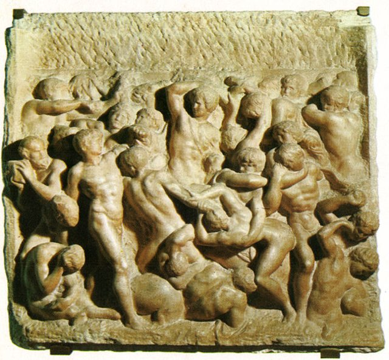
進入由羅倫佐·德·梅迪奇支持的雕塑學習圈，接觸古典雕像與人文主義思想。這段經歷對他日後理解人體比例、古典形式與藝術家的社會地位十分重要。約1490至1492年，他逐漸形成早期的雕塑作品：浮雕《階梯聖母》與《半人馬之戰》，後者以多人物交錯、強烈的身體動勢呈現古典題材，顯示他對人體動態與雕塑空間的早熟掌握。

## 1492 | 羅倫佐·德·梅迪奇去世
羅倫佐去世後，佛羅倫斯的政治與文化局勢逐漸變動。米開朗基羅失去重要的贊助環境，開始面對新的政治局勢與藝術市場。

## 1494 | 離開佛羅倫斯，前往波隆那
法國國王查理八世入侵義大利，引發半島的政治震盪。米開朗基羅離開佛羅倫斯，短暫停留波隆那，接觸當地的雕塑傳統與教會藝術委託；約1495年他短暫回到佛羅倫斯，繼續雕塑創作，也逐漸累積獨立承接委託的經驗。

## 1496 | 首次前往羅馬
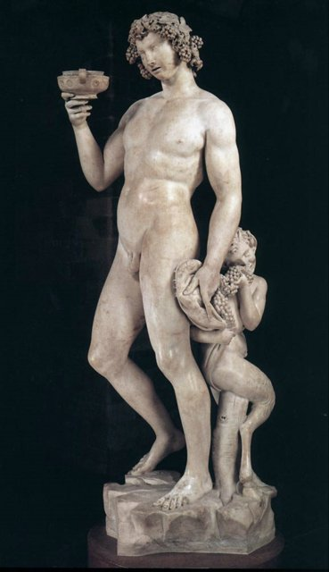
前往羅馬，開始接觸古羅馬雕塑、建築遺跡與教廷的贊助網絡。羅馬的古典遺產與教會委託，成為他藝術生涯的重要推力。1496至1497年，他創作《酒神巴克斯》（Bacchus），以古典神祇為題，呈現微妙的平衡、肉身質感與略帶醉態的姿勢，顯示他對古典雕塑的研究，以及把理想美與不穩定感並置的能力。

## 1498 | 《聖殤》委託與完成 {label=1498—1499年}
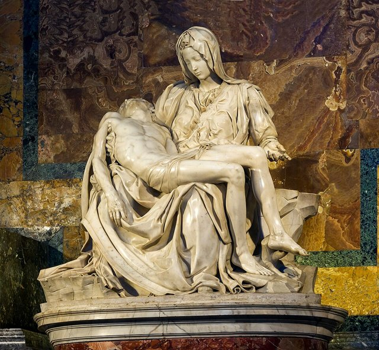
法國樞機主教讓·德·比萊爾委託他為聖伯多祿大殿相關空間創作《聖殤》（Pietà），他把聖母抱持基督遺體的宗教題材，轉化為高度精緻而富有情感張力的雕塑。1499年完成後成為他早期最重要的代表作之一：聖母的沉靜、基督身體的柔和處理，以及金字塔式構圖，使作品兼具莊嚴、悲憫與理想化的美感，也是他少數有明確簽名的作品之一。《聖殤》的成功讓他獲得更廣泛的認可，也為他返回佛羅倫斯、接受大型公共委託奠定基礎。

## 1501 | 《大衛像》 {label=1501—1504年}
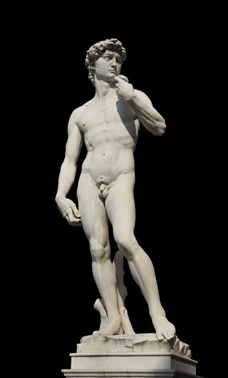
回到佛羅倫斯，受託使用一塊先前已被其他雕刻家處理、但長期未完成的巨大大理石創作《大衛像》（David）。他選擇表現大衛迎戰歌利亞之前的緊張時刻，而不是勝利後的姿態：理想化而有力量的人體、凝視的方向與手部的細節，呈現警覺、決斷與內在張力。1504年作品完成後，佛羅倫斯的委員會討論它的安置位置，最後把它放在市政廳（領主宮）前方，這個公共位置強化了雕像的政治象徵意義，使它成為佛羅倫斯共和國的象徵之一，體現公民勇氣與抵抗強權的精神。

## 1503 | 繪製《多尼圓畫》 {label=1503—1504年前後}
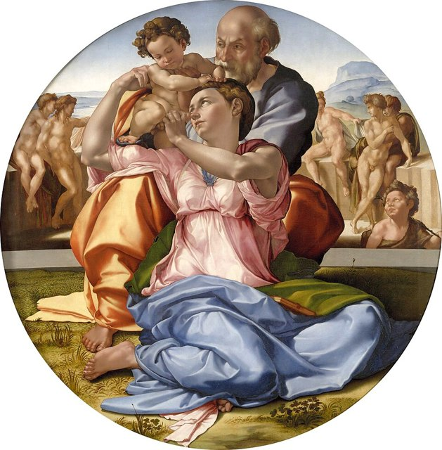
《多尼圓畫》（Doni Tondo）是重要的架上繪畫。畫中人物以雕塑般的體量與扭轉姿勢構成，顯示他把雕塑思維帶入繪畫，並以鮮明的色彩與複雜的人體組合探索新的表現方式。

## 1504 | 《卡西納之戰》壁畫委託
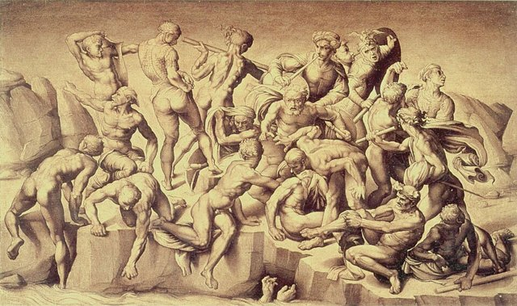
受命為佛羅倫斯市政廳創作《卡西納之戰》（Battle of Cascina）壁畫，原計畫與達文西的《安吉亞里之戰》形成競逐。壁畫最終沒有依原計畫完成，但相關的草圖與構想對後世藝術家影響深遠。

## 1505 | 儒略二世召他前往羅馬
教宗儒略二世（Julius II）邀請他設計宏大的陵墓工程。這項計畫開啟了雙方長期而複雜的合作關係，也使他進入教廷大型藝術工程的核心。

## 1505 ~ 1506 | 儒略二世陵墓計畫受阻
他曾前往卡拉拉採石場挑選大理石，準備製作陵墓雕像。然而教宗改變優先事項，工程一度停擺，雙方也發生衝突；米開朗基羅離開羅馬，後來在政治壓力與協調下重返教廷工程。

## 1508 | 開始西斯汀禮拜堂天頂畫

教宗要求他為梵蒂岡的西斯汀禮拜堂（Sistine Chapel）繪製天頂畫。雖然他自認主要是雕塑家，仍承擔這項艱鉅的壁畫工程，並逐步發展出規模宏大、人物動勢強烈的視覺系統。1508至1512年，他繪製以《創世紀》為核心的系列，包括上帝創造天地、創造亞當、夏娃的誕生、原罪與逐出伊甸園，以及挪亞的故事，周邊安排先知、女先知與其他人物，構成繁複而統一的神學與藝術敘事。其中的《創造亞當》（The Creation of Adam）以即將相觸的手指表現生命賦予的瞬間，成為西方藝術史最廣為人知的圖像之一。

## 1512 | 天頂畫揭幕
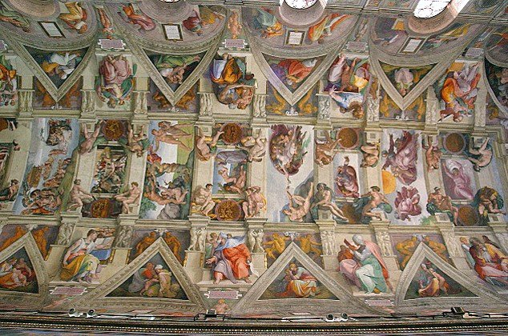
西斯汀禮拜堂天頂畫完成並公開展示，確立米開朗基羅作為頂尖畫家的地位。作品的宏大尺度、人體塑造與構圖創新，對文藝復興晚期與風格主義藝術產生深遠影響。天頂畫不是單純把聖經故事排列在天花板上，而是透過建築框架、人物姿態、神學主題與視覺節奏，把整個禮拜堂轉化為一個統一的精神空間。

## 1513 | 儒略二世去世，陵墓計畫再次調整
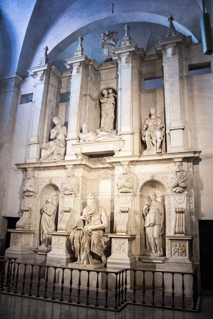
儒略二世去世後，陵墓計畫經過多次縮減與修改，米開朗基羅仍持續投入相關雕塑，其中《摩西像》是這項工程最著名的作品之一。約1513至1516年，他創作《摩西像》（Moses）與相關雕像，以強烈的坐姿、厚重的鬍鬚與蓄勢待發的神情，表現先知的威嚴與內在力量；陵墓原先規畫中的部分「奴隸」雕像，後來成為獨立欣賞的重要作品，人物彷彿從石材中掙脫。

## 1516 | 聖洛倫佐教堂立面計畫 {label=1516年前後}
為佛羅倫斯的聖洛倫佐教堂設計立面，計畫最終沒有完成。這反映大型藝術工程常受贊助者的財務、政治變動與工程條件影響。

## 1520 | 設計梅迪奇家族陵墓小堂 {label=1520年起}
為佛羅倫斯聖洛倫佐教堂的新聖器室（New Sacristy）設計陵墓與雕像，紀念梅迪奇家族成員；雕塑與建築相互配合，把人物、墓室與象徵時間流逝的寓意結合，其中《晝》《暮》《晨》《夜》是以時間、沉睡與生命流逝為主題的寓意人物。

## 1524 | 參與勞倫齊圖書館設計 {label=約1524年起}
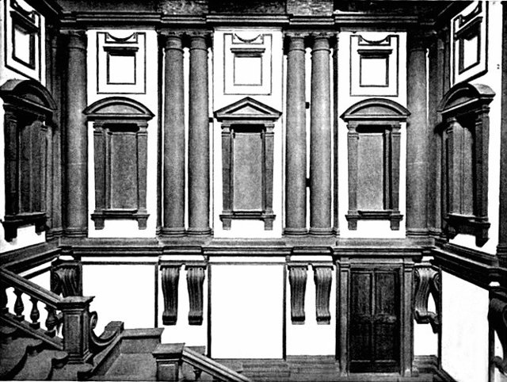
勞倫齊圖書館（Laurentian Library）以大膽的樓梯、牆面比例與空間處理聞名。其建築語彙不完全遵循古典秩序的平穩規則，而是透過張力與出人意表的形式，預示風格主義的發展。

## 1527 | 羅馬之劫與佛羅倫斯政治變動
羅馬遭到劫掠，義大利政治局勢劇烈動盪；佛羅倫斯一度推翻梅迪奇家族的統治，米開朗基羅參與城市防禦工程，顯示他不只是一位受雇的藝術家，也曾直接投入城市政治與公共事務。

## 1530 | 梅迪奇勢力恢復，佛羅倫斯工程受挫 {label=1530年前後}
佛羅倫斯重新落入梅迪奇家族控制後，米開朗基羅的政治處境與工作安排變得複雜，部分工程延宕或沒有完成，但他仍持續發展雕塑與建築構想。

## 1534 | 永久移居羅馬
離開佛羅倫斯，定居羅馬，後半生主要在此工作。他的創作逐漸由理想化的青春人體，轉向更強烈的精神衝突、宗教焦慮與生命反思。

## 1536 | 《最後的審判》 {label=1536—1541年}

教宗保祿三世委託他在西斯汀禮拜堂的祭壇牆繪製《最後的審判》（The Last Judgment）。與天頂畫相比，這件作品更強調末日審判、救贖與懲罰的戲劇性。1541年完成並揭幕：畫面以基督為中心，周圍人物在上升、下降、等待與掙扎之間形成巨大的旋渦。人物的裸露身體與強烈的動勢曾引發爭論，後來部分裸露處被加上遮蔽，反映藝術、宗教規範與時代道德觀之間的張力。

## 1542 | 保祿小堂壁畫 {label=約1542—1550年}
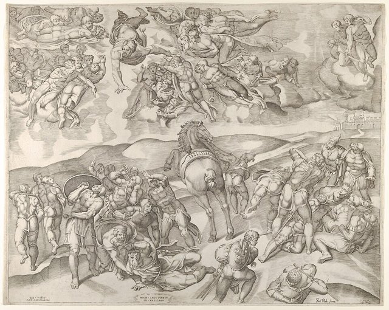
在梵蒂岡的保祿小堂（Pauline Chapel）創作《聖保祿的皈依》與《聖伯多祿的倒釘十字架》。作品不以外在壯觀為唯一目的，而更著重信仰轉折、苦難與精神力量。

## 1540 | 持續修訂儒略二世陵墓工程 {label=1540年代}
《摩西像》最後安置在羅馬聖伯多祿鎖鏈教堂的儒略二世陵墓。這項延續數十年的計畫經歷多次縮減，成為米開朗基羅與教廷贊助關係複雜性的代表案例。

## 1546 | 受命負責聖彼得大教堂建築工程
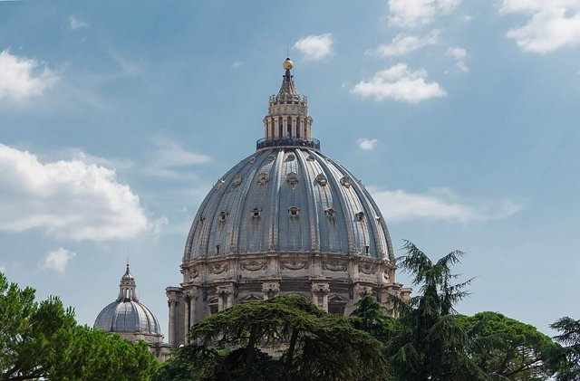
教宗保祿三世任命他參與並主導聖彼得大教堂的建築設計。他接手時，工程已歷經多位建築師與多次方案變更；他重新整理既有方案，以集中式空間、厚重的牆體與清楚的幾何秩序強化設計，並推進圓頂工程，為後來的大圓頂設計奠定重要基礎。現今圓頂是在他去世後，由其他建築師依其方案繼續完成的。

## 1550 | 設計卡比托利歐廣場 {label=約1530—1550年代}
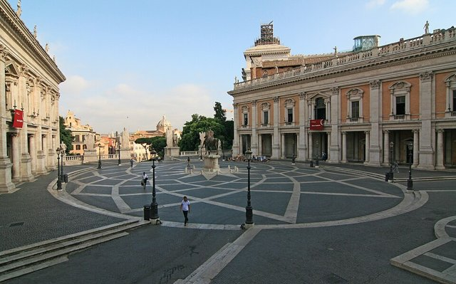
參與羅馬卡比托利歐山（Campidoglio）的都市規畫，調整廣場的整體配置、建築立面與視覺軸線，展現他把雕塑式的構想擴展到城市空間的能力。

## 1550 | 《佛羅倫斯聖殤》 {label=1540—1550年代}
《佛羅倫斯聖殤》（又稱《尼哥底母聖殤》）呈現他晚年對死亡、救贖與自身信仰的沉思。製作過程中曾遭他自己破壞，後由他人修整，現存狀態保留了創作與修補的痕跡。

## 1555 | 《隆達尼尼聖殤》 {label=1550年代後期—1564年}
《隆達尼尼聖殤》（Rondanini Pietà）是他晚年持續修改的雕塑。人物比例與形體趨於修長、表面處理更為簡化，與早年《聖殤》的完美、圓融形成對照，表現出近乎超越肉身的精神性。他晚年也寫下大量詩作，主題包括愛、時間、藝術、死亡與宗教信仰；晚年作品常呈現未完成感與深刻的內在張力，這些特徵不宜一概視為技術不足，也可理解為他對形體、精神與完成性的持續追問。

## 1564-02-18 | 逝世於羅馬
在羅馬去世，享年約88歲。遺體後來運回佛羅倫斯，安葬於聖十字聖殿（Basilica of Santa Croce）。他的藝術聲望在生前已極高，後世把他與達文西、拉斐爾並列為文藝復興盛期最重要的藝術巨匠。他的特色與地位有幾點：人體是精神的載體，他藉身體的扭轉、緊繃與姿態傳達意志、痛苦、信仰與精神掙扎；雕塑思維貫穿不同的媒材，即使在繪畫與建築中也以立體厚重的體量組織畫面與空間；風格由早期《聖殤》《大衛像》的理想化形體，走向晚年《隆達尼尼聖殤》的簡化、修長而不安定；部分雕塑保留粗鑿的痕跡，人物彷彿仍被石材束縛，這種未完成性可能受委託變動、時間與材料影響，也啟發後人從藝術理念討論它的美學價值；他與教宗、梅迪奇家族與城市政府的合作，顯示大型藝術創作高度依賴政治、宗教與財務條件，他個性強烈、常與委託者衝突，卻也逐漸確立藝術家作為具有獨立思想與創造力的文化人物之形象。其人體表現、戲劇性構圖與空間處理深刻影響風格主義、巴洛克藝術與後世的雕塑繪畫。與達文西重視觀察、自然研究與科學探索相比，他以雕塑家為核心，強調人體力量、精神張力與宏大而戲劇性的形式。
