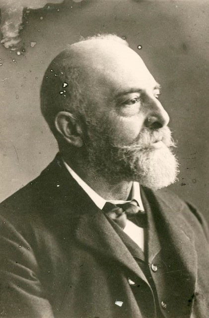
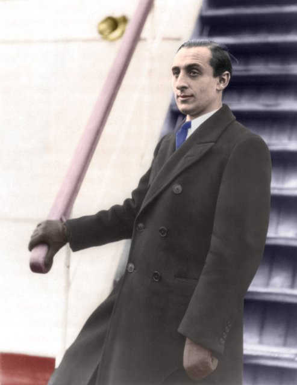
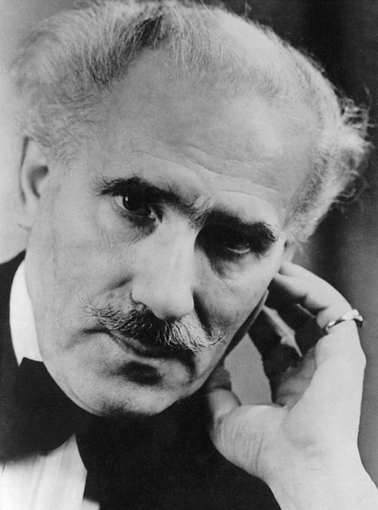

<!--
內容整理自本機筆記〈內森·密爾斯坦（Nathan Milstein）生平大事記〉（D:\Books\md\音樂\表演家\密爾斯坦（Nathan Milstein）生平大事記.md），以自己的話改寫。
時期依筆記的九個階段歸納為七段。
處理方式：
- 出生日期：筆記說明有1903年與1904年兩種記載，與俄羅斯當時用儒略曆、後來換算成格里曆有關；筆記以「1903年12月31日（儒略曆）／1904年1月13日（格里曆）」為主，這裡 born 採格里曆1904-01-13，事件內文並陳兩種日期，年齡的計算依1904年。
- 筆記對他進入聖彼得堡音樂學院的年份有1914、1915兩種記載，對1928年赴美與1929年美國首秀也有出入，這裡依筆記並陳，不當成定論。
- 筆記指出葛萊美獎的正式頒獎年份是1976年（部分簡介混淆為1975年），這裡採1976年。
- 筆記的「最後一場公開音樂會」是1986年7月，部分簡介概括為1986或1987年，這裡依筆記較精確的說法。
- 「米爾斯坦」是這位小提琴家在其他筆記（如歐伊斯特拉夫、霍洛維茲）的寫法，以 aliases 讓人名索引一併比對。譯名：霍洛維茲、普羅高菲夫、托斯卡尼尼與其他時間軸一致；葛拉祖諾夫依歐伊斯特拉夫時間軸。
- 筆記的「演奏風格」「代表作品」「與海飛茲、歐伊斯特拉夫的比較」「歷史地位」寫進時期說明與最後一則事件，不另立事件；筆記裡寫給讀者的話（「你先前也查詢過……」）未收錄。
- 人名用·分隔（筆記作・）。
圖片（Wikimedia Commons 公有領域或 CC0）：
- mil-cover.jpg：Nathan Milstein.jpg（密爾斯坦，1920年代）
- hei-auer.jpg：Leopold Auer.jpg（奧爾，1913年以前；與海飛茲時間軸共用）
- hor-1930s.jpg：Vladimir Horowitz LOC 3b00629.jpg（霍洛維茲，1930年代（Bain 新聞社）；與霍洛維茲時間軸共用）
- hor-toscanini.jpg：Arturo Toscanini c1930.jpg（托斯卡尼尼；與霍洛維茲時間軸共用）
-->

# Periods
- 1904 ~ 1913 | 敖德薩的童年@敖德薩 | #868e96
  生於商人家庭，母親是業餘小提琴愛好者；跟著敖德薩的名師斯托利亞爾斯基打下精準穩定的基礎，很早就接觸格拉祖諾夫的協奏曲。
- 1914 ~ 1918 | 聖彼得堡與奧爾 | #1971c2
  前往聖彼得堡深造，師從俄羅斯小提琴學派的奧爾，也就是海飛茲與艾爾曼的老師；1917年的俄國革命改變了整個音樂環境。
- 1919 ~ 1924 | 與霍洛維茲的友誼 | #2f9e44
  1919年前後開始職業演出，1921年在基輔結識年輕鋼琴家霍洛維茲，兩人在蘇聯巡演，也演出普羅高菲夫的《第一號小提琴協奏曲》，累積室內樂的合作經驗。
- 1925 ~ 1928 | 走向西歐 | #e8590c
  1925年與霍洛維茲離開蘇聯，在柏林、布魯塞爾、巴黎演出，1926年向伊薩伊請益，1928年前後前往美國。
- 1929 ~ 1944 | 美國的建立 | #c92a2a
  1929年與斯托科夫斯基、費城管弦樂團在美國登台，1930年在紐約站穩腳步，1942年成為美國公民。
- 1945 ~ 1985 | 巴赫錄音與榮譽 | #5f3dc4
  戰後往返歐美；1950年代錄製巴赫《無伴奏小提琴奏鳴曲與組曲》，成為最重要的藝術遺產，1976年獲葛萊美獎；也為貝多芬與布拉姆斯的協奏曲編寫華彩。
- 1986 ~ 1992 | 告別與回憶 | #495057
  1986年在斯德哥爾摩舉行最後一場音樂會，之後因跌倒傷及左手而告別舞台；1990年出版回憶錄《從俄羅斯到西方》，1992年在倫敦去世。

# Events

## 1904-01-13 | 出生@敖德薩 {label=1903年12月31日（儒略曆）／1904年1月13日（格里曆）}
出生於敖德薩，當時屬於俄羅斯帝國，今天位在烏克蘭。出生年份有1903與1904兩種記載，與俄羅斯當時使用儒略曆、後來換算成格里曆有關。敖德薩是黑海沿岸的重要港口，19世紀末到20世紀初東歐文化交流活躍，不同民族、語言與文化在此交會，音樂活動興盛，孕育出不少傑出的演奏家。他出生於經濟條件相對寬裕的家庭，父親經商，母親是業餘的小提琴愛好者，因此他很早就接觸音樂、接受專業訓練。

## 1910 | 師從斯托利亞爾斯基 {label=約1910年前後}
年幼時開始學小提琴，後來師從敖德薩的名教師彼得·斯托利亞爾斯基；歐伊斯特拉夫也是他的學生。斯托利亞爾斯基重視基本功、音準、弓法與演奏紀律，培養出多位國際級的小提琴家，為密爾斯坦打下穩定的技術基礎。他日後雖以技巧高超聞名，卻不依賴誇張的動作或炫技式的表現，而是把技巧融入音樂本身。

## 1914 | 展現天分
少年時就展現出色的能力，傳記提到他很早就接觸亞歷山大·葛拉祖諾夫的《A小調小提琴協奏曲》，也受這位作曲家的音樂世界影響；葛拉祖諾夫曾親自指揮自己的作品，這類接觸讓他較早進入專業音樂環境，逐漸從神童成長為具有獨立思考的演奏者。

## 1915 | 前往聖彼得堡，師從奧爾 {label=1914–1915年前後}

離開敖德薩，到聖彼得堡接受更高階的音樂教育；傳記對他進入聖彼得堡音樂學院的年份有1914年與1915年兩種記載，不宜視為毫無爭議的定論。這段時期最重要的是師從著名小提琴教育家利奧波德·奧爾，奧爾是俄羅斯小提琴學派的重要人物，培養過海飛茲、米沙·艾爾曼等人，教學重視技巧，也重視音色控制、音樂品味、弓法與個人詮釋。如果說斯托利亞爾斯基幫他建立早期的技術基礎，奧爾則讓他接觸俄羅斯小提琴傳統中更成熟的藝術觀念；但他並非單純複製老師，往後逐漸形成獨立的判斷，對巴赫的理解尤其顯示這種獨立性——既重視結構，也注重聲部之間的關係，而不只是展示技巧。

## 1917 | 俄國革命
俄國革命爆發，帝國原有的政治與社會秩序劇烈變動，不只是政治，也影響了演出機會、交通、經濟條件與國際文化交流。他此後一度在蘇聯境內演出，並與霍洛維茲等音樂家合作；直到1920年代中期，才逐步離開蘇聯的音樂環境，進入西歐與美國的國際舞台。

## 1919 | 開始職業演奏
前後開始以職業小提琴家的身分公開演出，曾由姊姊莎拉擔任鋼琴伴奏。這是他從音樂學院學生轉為職業演奏家的重要時期：他必須透過公開演出面對不同的聽眾、音樂廳與演奏環境，逐漸建立自己的詮釋風格，他後來穩定、精準而高度自律的演奏，是長期舞台實踐的成果。

## 1920 | 在敖德薩正式登台
傳記把他1920年在敖德薩的演出視為正式登台的里程碑。當時俄羅斯正處於革命後的動盪，音樂家既要維持演出，也要適應新的社會秩序；他早年累積的實際演奏經驗，也是日後能在不同國家長期發展的基礎。

## 1921 | 與霍洛維茲相識

1921年前後在基輔結識年輕的鋼琴家弗拉基米爾·霍洛維茲，兩人很快成為深交，展開長期合作。霍洛維茲以強烈的舞台魅力、驚人的技巧與戲劇性聞名，密爾斯坦則相對內斂，偏重演奏的線條、結構與精緻；兩人性格不同，形成互補。他們曾在蘇聯巡演，也曾與大提琴家皮亞蒂戈爾斯基等人合作。這段友誼為他累積室內樂的經驗（要與鋼琴家協調節奏、呼吸與音樂方向）、擴大演出機會，也促成藝術上的交流。

## 1923 | 普羅高菲夫《第一號小提琴協奏曲》
與霍洛維茲合作在蘇聯演出謝爾蓋·普羅高菲夫的《第一號小提琴協奏曲》，由霍洛維茲以鋼琴代替管弦樂團伴奏。這首協奏曲色彩鮮明、旋律較自由，有新穎的和聲與節奏，對演奏者的音樂理解與技巧都要求很高。他早早就接觸這類現代作品，說明他的曲目不限於傳統的炫技曲目，也解釋他後來兼具古典嚴謹與現代感的演奏風格。

## 1925 | 離開蘇聯，前往西歐
與霍洛維茲等音樂家前往西歐，這是他人生極具決定性的轉折：離開原有的音樂環境後，他不再只靠俄羅斯境內的演出機會，而是逐步建立跨國演奏生涯。此後他在柏林、布魯塞爾、巴黎等地活動，這些城市匯集演奏家、作曲家、樂評與唱片業者，既是演出地點，也是建立藝術聲譽的平台。

## 1926 | 向伊薩伊請益
前往布魯塞爾，向比利時小提琴家歐仁·伊薩伊請教演奏與詮釋。伊薩伊是19世紀末到20世紀初的重要小提琴家、作曲家與教育者，演奏融合深厚的浪漫表現力、精湛技巧與鮮明個性，所寫的《六首無伴奏小提琴奏鳴曲》也是獨奏曲目的重要作品。密爾斯坦不是重新接受全面的基礎訓練，而是想透過與成熟藝術家的交流深化自己的詮釋觀念；傳記指出伊薩伊相當欣賞他，認為他已達到高度成熟的藝術水準。他的風格不是由單一老師塑造，而是早期訓練、與不同演奏家的交流、廣泛的曲目研究與長期舞台實踐共同形成。

## 1928 | 前往美國
部分傳記記載他在1928年前往美國，是進入美國音樂市場的重要一步，但他在美國的正式演出首秀是在1929年。當時美國的交響樂團、音樂廳與唱片市場迅速發展，為歐洲演奏家提供新的機會。

## 1929-10-28 | 美國首秀
與費城管弦樂團合作，由利奧波德·斯托科夫斯基指揮，在美國登台，象徵他正式進入美國主要的交響樂團與音樂會體系。此後他逐漸建立自己的聽眾群，吸引人的不只是高難度的技巧，還有完整的音樂表現、精準度與成熟的品味。1930年他在紐約登台，進一步擴大在美國的影響力；紐約是當時美國古典音樂的重要中心，在此受到好評有助於爭取其他城市的演出、唱片合約與樂團合作。他沒有刻意塑造華麗的明星形象，而靠演奏品質與音樂判斷建立聲望。

## 1930 | 擴充曲目 {label=1930年代}
1930年代他持續演出協奏曲、奏鳴曲與獨奏作品，曲目涵蓋巴洛克、古典、浪漫與部分近代作品，不侷限於少數容易獲得掌聲的炫技曲目。他的演奏觀念強調：技巧必須服務於音樂，而不能取代音樂；即使面對高難度作品，也傾向讓技術自然融入旋律與結構。

## 1936 | 托斯卡尼尼的告別音樂會

指揮家阿圖羅·托斯卡尼尼結束在紐約愛樂的音樂總監任期前，曾邀請密爾斯坦擔任他告別音樂會的獨奏家之一。托斯卡尼尼以對樂譜的嚴謹、清晰的節奏與高標準著稱，與他合作對獨奏者的節奏穩定、結構掌握與和樂團的協調都要求很高，這反映密爾斯坦已在美國古典音樂界建立起相當的聲譽。

## 1942 | 取得美國公民身分
成為美國公民，確立了他與美國的長期關係。他的藝術養成深受俄羅斯小提琴傳統影響，也在歐洲受過薰陶，但往後的演奏、錄音與國際巡演都與美國音樂生活密切相關，因此常被稱為俄羅斯出生的美國小提琴家。

## 1945 | 戰後往返歐美
第二次世界大戰後，他繼續在美國與歐洲之間活動，沒有因取得美國公民身分就放棄歐洲的音樂生活，而是長期維持跨國演出，與各國的管弦樂團、鋼琴家與音樂機構合作；戰後古典音樂市場與唱片工業逐漸恢復，他的演奏透過音樂會與錄音傳給更多無法親臨現場的聽眾。

## 1950 | 巴赫《無伴奏小提琴奏鳴曲與組曲》 {label=1950年代}
1950年代錄製巴赫《無伴奏小提琴奏鳴曲與組曲》BWV 1001–1006，成為他最重要的藝術遺產之一。這組作品沒有鋼琴或管弦樂伴奏，演奏者要獨自處理旋律、和聲暗示、對位、節奏、舞曲風格與整體結構，難處不只是技術，而是如何讓單旋律的樂器呈現多聲部音樂的豐富。他的巴赫特別受重視：聲部清晰，節奏穩定，表現內斂而不過度誇張，並把高難度的技巧自然融入作品結構，而不是刻意突出。進入1950年代，他已不再只是早年備受矚目的神童，而是具有成熟判斷的國際演奏家：他的成就也表現在曲目選擇、長期的錄音計畫、對作品的研究，以及不斷修正細節的態度上，尤其重視指法與弓法，即使是熟悉的作品也會重新思考如何讓音符更清晰、樂句更自然。

## 1960-02-08 | 好萊塢星光大道
獲得好萊塢星光大道的榮譽，表彰他在唱片錄音領域的貢獻，顯示他的影響力已超越現場演奏，延伸到錄音與大眾文化領域；對古典音樂家而言，錄音能讓演奏跨越地理限制，並在演奏者離世後繼續被聆聽與研究。

## 1968 | 法國榮譽軍團勳章
獲頒法國榮譽軍團勳章，反映他在國際音樂界長期累積的聲望，以及對歐洲古典音樂文化的貢獻；他雖長期在美國發展，演奏生涯始終與歐洲音樂傳統保持密切的聯繫。

## 1970 | 華彩與改編 {label=1970年代}
1970年代他依然維持高水準的演奏，也持續投入樂曲改編、指法設計與作品研究：為貝多芬與布拉姆斯的小提琴協奏曲編寫華彩樂段，也改編帕格尼尼、蕭邦、李斯特、穆索斯基、德布西等人的作品。為既有的協奏曲創作華彩，不只是增加高難度的音符，更需要理解原作的風格、和聲與整體結構，顯示他也具有創作者與編曲者的思考能力。

## 1976 | 巴赫錄音獲葛萊美獎
以巴赫《無伴奏小提琴奏鳴曲與組曲》的錄音，獲得第18屆葛萊美獎的器樂獨奏類獎項。這項榮譽肯定的是沒有管弦樂團伴奏的獨奏，演奏者必須獨立呈現整部作品的結構、聲部關係與張力；他對巴洛克音樂的理解，是清楚、精確、富有結構感，又保有旋律的生命力。正式的頒獎年份是1976年，部分簡介把它與1975年的錄音年份混在一起，查閱時應以葛萊美官方紀錄為準。

## 1980 | 高齡仍維持水準 {label=1980年代初}
他的職業生涯極為漫長，高齡仍持續演奏，並未靠早年的名聲維持地位。小提琴演奏對身體控制的要求很高，包括左手指法、弓臂協調、姿勢穩定與精細的肌肉控制，隨年齡增長這些能力需要更細緻的維持，他長期保持良好的技術狀態，顯示他不只有天賦，也有不斷研究與改善演奏方法的能力。

## 1986-07 | 斯德哥爾摩的最後一場音樂會
在瑞典的斯德哥爾摩舉行最後一場公開演奏會，當時已經82歲。之後他在一次跌倒中嚴重傷到左手，無法再以原來的方式演奏，職業生涯就此結束。他的告別不是因為藝術能力自然衰退，而是意外的傷勢，令人格外惋惜。部分簡介把演奏生涯的終點概括為1986年或1987年，較精確的說法是：最後一場公開演奏會在1986年舉行，隨後的傷勢使他無法繼續原有的演奏活動。

## 1990 | 回憶錄《從俄羅斯到西方》
與索洛蒙·沃爾科夫合作出版回憶錄《從俄羅斯到西方》（*From Russia to the West: The Musical Memoirs and Reminiscences of Nathan Milstein*），記錄他在俄羅斯的成長、早年師承、與霍洛維茲等人的交往，以及從蘇聯走向西歐和美國的經歷。回憶錄畢竟是當事人事後的記憶與詮釋，要確認特定事件的日期或細節，仍須與其他傳記與歷史資料相互比對。

## 1992-12-21 | 逝世@倫敦
在倫敦去世，享年88歲，是20世紀早期俄羅斯小提琴傳統的重要代表。他的演奏生涯近七十年，風格典雅清晰：音色清澈集中而有歌唱性，技巧精確卻不刻意炫耀，詮釋尊重結構、避免過度煽情，同時是研究者般的演奏家，對作品改編、華彩與指法弓法細節講究。他的錄音，尤其是巴赫的無伴奏作品，以及貝多芬、布拉姆斯、柴可夫斯基的協奏曲，至今仍是欣賞與研究小提琴演奏的重要參考。與海飛茲高度集中、精準而有強烈個人風格，以及歐伊斯特拉夫厚實的音色與深沉的表達相比，他最適合用來理解典雅、清晰、結構嚴謹的小提琴藝術：他的偉大不在於以技巧壓倒音樂，而在於讓精湛的技巧、理性的結構與優雅的表達融為一體。
