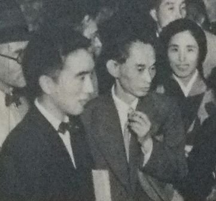
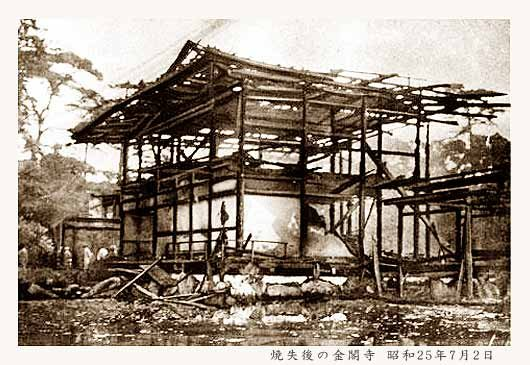

<!--
內容整理自 D:\Books\html\6-4.日本文學家\三島由紀夫.html（沒有對應的 md 筆記），並整合中文維基百科〈三島由紀夫〉條目，以自己的話改寫。
時期依生平歸納：祖母身邊的童年、學習院與戰爭、從大藏省到職業作家、《金閣寺》與身體改造、行動的季節。
兩份資料出入與處理方式：
- 生卒：1925年1月14日生於東京四谷；1970年11月25日在自衛隊市谷駐屯地切腹自盡，兩份一致，得年45歲。
- 祖母撫養：頁面說出生不久被祖母帶離父母、撫養到十二歲，維基百科寫祖母夏子1939年1月去世，兩者合併。
- 筆名：維基百科寫1941年十六歲發表《繁花盛開的森林》，一般記載這是第一次使用「三島由紀夫」的筆名，照此。
- 徵兵：維基百科寫1944年徵兵檢查、1945年入營時被軍醫誤診為肺浸潤而免役，照此寫在1945年。
- 拜訪川端：〈日本文學家總覽〉頁面說他「十六歲投稿獲賞識」，與一般記載的1946年拜訪川端、《煙草》刊登不同，這裡依一般記載寫在1946年，與〈川端康成生平〉時間軸一致。
- 健身：維基百科寫1955年開始健身、游泳與劍道，頁面說持續十餘年，照此。
- 結婚：維基百科寫1958年經介紹認識杉山瑤子，一般記載當年6月結婚，只寫1958年。
- 《憂國》：維基百科寫1965年自編自演同名電影；小說發表於1961年，電影在1966年公開，寫在1966年並說明。
- 諾貝爾獎：維基百科寫1963至1968年間（1966年除外）五度獲提名，1968年由川端康成得獎，照此；頁面說「三度擦身而過」，取維基百科的次數。
- 楯之會：頁面寫1968年創立，維基百科譯作「盾會」，這裡照頁面作「楯之會」。
- 1969年東大全共鬥辯論：取自維基百科。
- 最後的行動：頁面說當天上午交出《豐饒之海》最終卷的原稿、演說遭士兵訕笑，與維基百科一致；同行四人中的森田必勝隨他切腹，依一般記載補充。
- 人名與其他時間軸一致：川端康成、太宰治、土方巽（〈舞蹈史〉時間軸提到土方巽改編他的《禁色》）。
圖片來源（皆為 Wikimedia Commons 公有領域／CC0 作品；註明「共用」者沿用其他時間軸已有的圖片）：
- mi-cover.jpg：Yukio Mishima, 1955.jpg（木門拳所攝三島由紀夫，1955）
- mi-kawabata.jpg：Mishima, Kawabata, Masugi.jpg（三島由紀夫與川端康成（升木同框），1951年《朝日畫報》）
- mi-kinkaku.jpg：Burned Kinkaku.jpg（縱火後燒毀的金閣（1950年7月））
-->

# Periods
- 1925-01-14 ~ 1937 | 祖母身邊的童年 | #868e96
  出生不久被祖母夏子帶到身邊撫養，體弱多病，很少與同齡孩子玩耍，在學習院初等科開始寫作。
- 1937 ~ 1947 | 學習院與戰爭 | #1971c2
  在學習院中等科、高等科嶄露文才，以「三島由紀夫」為筆名出道；徵兵時因誤診免役，戰後拜訪川端康成。
- 1947 ~ 1955 | 從大藏省到職業作家 | #e8590c
  東京大學法學部畢業後進入大藏省，九個月後辭職，以《假面的告白》《禁色》《潮騷》成為戰後文壇的明星。
- 1955 ~ 1966 | 《金閣寺》與身體改造 | #e03131
  開始健身鍛鍊，寫出《金閣寺》《鹿鳴館》《憂國》，結婚成家，多次獲提名諾貝爾文學獎。
- 1966 ~ 1970-11-25 | 行動的季節 | #495057
  寫作《豐饒之海》四部曲，體驗自衛隊、組織楯之會，最後在市谷駐屯地發表演說並切腹自盡。

# Events

## 1925-01-14 | 出生於東京
三島由紀夫生於東京市四谷區，本名平岡公威，父親平岡梓是農林省的官員。出生不到兩個月，他就被同住的祖母夏子帶到自己的房間撫養，直到十二歲才回到父母身邊。祖母出身武士家系、體弱又神經質，不准他在陽光下奔跑，只讓他和女孩子玩，這段童年後來寫進《假面的告白》。

## 1931 | 學習院初等科
公威進入以皇族與華族子弟為主的學習院初等科，開始寫詩與短文。1937年升上中等科，加入文藝部，在校內雜誌發表作品。1939年祖母去世。

## 1941 | 以「三島由紀夫」為筆名出道
十六歲的公威寫出短篇小說《繁花盛開的森林》，國文老師清水文雄大為激賞，推薦刊登在同人雜誌《文藝文化》上，並替他取了「三島由紀夫」的筆名，以免他的父親反對。他受日本浪漫派的影響，憧憬古典美與「為美而死」。

## 1944 | 學習院高等科畢業
三島以首席成績從學習院高等科畢業，獲天皇頒賜銀錶，同年進入東京帝國大學法學部，並出版第一本小說集《繁花盛開的森林》。

## 1945 | 徵兵免役
三島接到入營通知，軍醫把他的感冒誤診為肺浸潤，判定不適合服役，他因此免於上戰場，而一起入伍的同齡人許多戰死。這份「倖存」的罪惡感與對壯烈之死的嚮往，糾纏了他的後半生。同年他的妹妹美津子病逝。

## 1946 | 拜訪川端康成

三島帶著自己的稿子拜訪川端康成，川端推薦他的短篇《煙草》刊登在雜誌《人間》上，從此成為三島終身的提攜者。

## 1947 | 進入大藏省
三島從東京大學法學部畢業，通過高等文官考試，進入大藏省銀行局任職。但他白天上班、晚上寫作，身體吃不消，1948年9月辭職，專心當職業作家。

## 1949 | 《假面的告白》
三島出版長篇小說《假面的告白》，以第一人稱告白一名少年察覺自己對同性肉體的欲望，必須戴上「正常」的假面活著，大膽的題材讓他一躍成為戰後文壇的明星。1951年他又發表以同性戀世界為題材的《禁色》。

## 1951-12 | 環遊世界
三島以《朝日新聞》特派員的身分從橫濱出發，遊歷北美、南美與歐洲，1952年5月回國。在希臘，他被古典雕像的健美與明朗深深打動，寫成遊記《阿波羅之杯》，也成為他日後改造身體的起點。

## 1954 | 《潮騷》
三島以希臘古典《達夫尼斯與克羅伊》為藍本，寫出以三重縣神島為舞台、漁夫青年與海女純樸相戀的《潮騷》，成為暢銷書，獲新潮社文學賞，多次被拍成電影。

## 1955 | 開始健身
三十歲的三島開始上健身房做重量訓練，後來又學拳擊與劍道，把孱弱的身體鍛鍊成肌肉結實的體格，此後持續了十多年。他主張「文武兩道」，認為精神與肉體應當合一。

## 1956 | 《金閣寺》

三島以1950年京都金閣寺遭見習僧人縱火燒毀的真實事件為題材，寫出《金閣寺》：一名口吃的青年僧人被金閣的美所支配，最後縱火燒掉它。這部作品獲讀賣文學賞，成為他最受推崇的代表作。同年他的劇作《鹿鳴館》上演。

## 1958 | 結婚
三島與日本畫家杉山寧的長女瑤子結婚，之後育有一女一男，在東京馬込建了一棟西洋風格的住宅。

## 1963 | 諾貝爾文學獎提名
三島在1963至1968年間（1966年除外）五度獲提名諾貝爾文學獎，是當時最年輕的被提名者之一，作品也大量被譯成英文，在歐美享有很高的知名度。

## 1966 | 電影《憂國》
三島把自己1961年的短篇《憂國》拍成電影，自編、自導、自演，飾演在二二六事件後切腹自盡的青年軍官，預示了他自己的結局。他在1965年開始連載《豐饒之海》四部曲的第一部《春雪》，以輪迴轉世貫穿明治到戰後的日本。1967年起他多次到自衛隊體驗入伍。

## 1968 | 楯之會與川端得獎
三島自費組織私人民兵團體「楯之會」，招募學生接受自衛隊的訓練，宣稱要保衛天皇與日本的傳統。同年10月，諾貝爾文學獎頒給了他的恩師川端康成，據說這個結果讓他深受打擊。

## 1969-05-13 | 與東大全共鬥辯論
三島應政治立場相反的東京大學全共鬥學生邀請，到東大駒場校區與約一千名學生辯論，雙方唇槍舌劍卻也不乏相互尊重。這場辯論的錄影在半世紀後整理成紀錄片。

## 1970-11-25 | 市谷駐屯地事件
當天上午，三島交出《豐饒之海》最終卷《天人五衰》的原稿，隨後帶領四名楯之會成員到東京市谷的陸上自衛隊東部方面總監部，綁架總監，要求集合自衛官。他在陽台上發表演說，呼籲自衛隊起來修改憲法、恢復天皇與軍隊的地位，台下的官兵報以噓聲與訕笑。演說失敗後，他回到總監室切腹自盡，楯之會的森田必勝隨後也自盡，得年45歲。
事件震驚全世界，川端康成趕到現場。三島的死至今仍有許多不同的解讀：政治抗議、美學的完成，或是對自身肉體與死亡長期迷戀的終點。
