<!--
內容整理自本機筆記《莫內（Claude Monet）生平大事記》（D:\Books\md\藝術\莫內（Claude Monet）生平大事記.md，網頁版為 D:\Books\html\9-2.藝術家\莫內(1840~1926，Claude Monet).html），並整合中文維基百科〈克勞德·莫內〉條目，以自己的話改寫。
時期依筆記的七個階段與居住地歸納：童年與軍旅（勒阿弗爾、巴黎、阿爾及利亞）、格萊爾畫室與早期成名、阿讓特伊與印象派形成、韋特伊與吉維尼定居、系列繪畫成熟、晚年大型《睡蓮》、身後。
兩份資料出入與處理方式：
- 與布丹相識：筆記寫1858年，維基百科寫約1856年，兩者相差不大，以「約1856–1858年」顯示。
- 阿爾及利亞兵役：筆記寫1860—1861年服役後因健康離開，維基百科寫1860至1862年；兩者都說因傷寒離開，這裡寫1861年並以「1860–1862年」顯示範圍。
- 《印象·日出》：筆記的時間軸寫在1873年，但「代表作品」與藏館標示都是1872年（11月，勒阿弗爾港），維基百科亦記為1872年，採1872年，1874年首次展出。
- 第一次印象派畫展：筆記只寫「1874年4月」，維基百科沒有給日期；這裡採一般史實的1874年4月15日至5月15日，地點為攝影師納達爾的工作室。路易·勒魯瓦的評論登在《喧鬧》（Le Charivari）。
- 與卡米耶結婚：筆記與維基百科都寫1870年，月日說法不一，只寫年份；結婚後不久即因普法戰爭離開法國。
- 搬到韋特伊：筆記與維基百科都寫1878年；維基百科補充是與好友奧什代（Ernest Hoschedé）一家共住，奧什代1878年破產後逃往比利時。卡米耶死於1879年9月5日（筆記有日期，維基百科只有年份）。
- 吉維尼：筆記寫1883年租下，維基百科補充是4月在火車上看到，5月初租下；筆記寫1890年購入，維基百科寫11月。莫內與愛麗絲1892年結婚（日期兩者都沒寫，只寫年份）。
- 白內障手術：筆記寫1923年「接受手術」，維基百科寫「兩次白內障手術」，採兩次的寫法；手術後色彩感受改變、睡蓮變得更藍，並重畫部分作品。
- 橘園美術館的《睡蓮》：筆記1918年承諾捐贈、1922年簽署文件、1927年5月17日揭幕；維基百科沒有橘園的日期，採筆記。
- 筆記說1876年與奧什代夫婦「建立聯繫」，維基百科說1878年奧什代破產；這裡把兩家的往來寫在1878年的事件。筆記說1887年杜朗–呂埃爾協助莫內在紐約展出，與常見史實（1886年紐約的大型印象派展）略有出入，不寫成獨立事件，只在1881年的事件說明杜朗–呂埃爾逐漸穩定購買莫內的畫。
- 拍賣與盜竊：維基百科的1998與2007年迪耶普懸崖被盜、2012年愛爾蘭國家美術館《阿讓特伊流域的孤舟》遭破壞等事件與生平關聯較低，沒有收錄；《乾草堆》2019年的紀錄與2008年《睡蓮》的成交只保留2019年一則。
- 筆記附的「重要代表作品」「藝術風格與貢獻」「系列畫表」「重要人物關係」「與其他印象派畫家比較」「十個關鍵年份」寫進時期說明與相關事件，不另立事件；筆記裡的多個圖片來源連結沒有轉錄。
- 譯名：Claude Monet 依筆記作「莫內」，卡米耶·東西厄（Camille Doncieux）、愛麗絲·奧什代、歐仁·布丹、杜朗–呂埃爾與其他時間軸一致，人名用·分隔（筆記作・）；「莫奈」另列為 aliases。Europe 時間軸中的「莫內」指讓·莫內（Jean Monnet），已用 notNames 排除。
圖片來源（皆為 Wikimedia Commons 公有領域／CC0 作品）：
- mo-cover.jpg：Claude Monet 1899 Nadar crop.jpg（納達爾拍攝的莫內，1899）
- mo-lehavre.jpg：Claude Monet, French - Port of Le Havre - Google Art Project.jpg（莫內〈勒阿弗爾港〉）
- mo-picnic.jpg：Le Déjeuner sur l'herbe - Monet (Pushkin Museum).jpg（莫內〈草地上的午餐〉（普希金美術館藏的習作），1865–1866）
- mo-camille.jpg：Claude Monet - Camille.JPG（莫內〈穿綠衣的卡米耶〉，1866）
- mo-grenouillere.jpg：Claude Monet La Grenouillére.jpg（莫內〈蛙塘〉，1869）
- mo-renoir.jpg：Pierre-Auguste Renoir - Claude Monet painting in his Garden at Argenteuil.jpg（雷諾瓦〈莫內在阿讓特伊的花園裡作畫〉，1873）
- mo-impression.jpg：Monet - Impression, Sunrise.jpg（莫內〈印象·日出〉，1872，瑪摩丹美術館）
- mo-manet.jpg：Edouard Manet.- Monet peignant sur son atelier-bâteau.jpg（馬奈〈在工作室船上作畫的莫內〉，1874）
- mo-japonaise.jpg：Monet Japonaise.jpg（莫內〈日本女人〉，1876，波士頓美術館）
- mo-station.jpg：Claude Monet - The Saint-Lazare Station - Google Art Project.jpg（莫內〈聖拉扎爾車站〉，1877）
- mo-camilledead.jpg：Claude Monet - Camille Monet sur son lit de mort.JPG（莫內〈卡米耶安躺病榻〉，1879，奧賽美術館）
- mo-giverny.jpg：Jardins de Claude Monet à Giverny.jpg（吉維尼莫內花園的睡蓮池）
- mo-haystacks.jpg：Claude Monet, Grainstacks in the Sunlight, Morning Effect, 1890, oil on canvas 65 x 100 cm.jpg（莫內〈陽光下的乾草堆，早晨的效果〉，1890）
- mo-rouen.jpg：Claude Monet - The Portal of Rouen Cathedral in Morning Light (1894) - Getty Center 2001.33.jpg（莫內〈晨光中的魯昂大教堂正門〉，1894，蓋提中心）
- mo-bridge.jpg：Claude Monet, The Japanese Footbridge, 1899, NGA 74796.jpg（莫內〈日本橋〉，1899，美國國家藝廊）
- mo-parliament.jpg：Claude Monet, Houses of Parliament, London, 1900-1903, 1933.1164, Art Institute of Chicago.jpg（莫內〈倫敦國會大廈〉，1900–1903，芝加哥藝術博物館）
- mo-venice.jpg：Claude Monet, Le Grand Canal.jpg（莫內〈大運河〉，1908）
- mo-lilies.jpg：Claude Monet - Water Lilies - 1906, Ryerson.jpg（莫內〈睡蓮〉，1906，芝加哥藝術博物館（賴爾森））
- mo-studio.jpg：Claude Monet in his studio in Giverny, 1920.jpg（莫內在吉維尼大畫室中，1920）
-->

# Periods
- 1840-11-14 ~ 1862 | 童年、布丹與軍旅 | #868e96
  生於巴黎，五歲隨家人搬到諾曼第的勒阿弗爾；少年靠漫畫賺零用錢，在布丹的引導下學會戶外寫生，1859年到巴黎，1861年服兵役到阿爾及利亞，因傷寒離開軍隊。
- 1862 ~ 1871 | 格萊爾畫室與早期成名 | #2f9e44
  進入格萊爾畫室結識雷諾瓦、西斯萊與巴齊耶，作品進入沙龍，以《穿綠衣的卡米耶》受到注意；1870年結婚後為避普法戰爭到倫敦與荷蘭。
- 1871 ~ 1878 | 阿讓特伊與印象派形成 | #f08c00
  定居塞納河畔的阿讓特伊，反覆畫河、橋與帆船，《印象·日出》讓流派得名，1874年首次獨立畫展，之後到1879年還有三次印象派畫展。
- 1878 ~ 1891 | 韋特伊、卡米耶之死與吉維尼定居 | #e03131
  搬到韋特伊，次子出生、卡米耶去世，1883年遷居吉維尼，生活逐漸穩定，也開始買下房子改造花園。
- 1891 ~ 1909 | 系列繪畫成熟期 | #7048e8
  乾草堆、白楊樹、魯昂大教堂、泰晤士河、威尼斯，同一個景物在不同光線下反覆畫，研究時間與光線如何改變所見。
- 1909 ~ 1926-12-05 | 晚年與大型睡蓮 | #0c8599
  愛麗絲、長子相繼去世，視力衰退，仍投入巨幅睡蓮裝飾畫，1918年承諾捐給法國，動過兩次白內障手術，1926年逝世。
- 1926-12-05 ~ 2019 | 身後：橘園、吉維尼與市場 | #495057
  橘園的橢圓形展廳讓睡蓮成為沉浸式的藝術體驗，吉維尼的房子與花園開放參觀，作品在拍賣市場上屢創高價。

# Events

## 1840-11-14 | 出生於巴黎
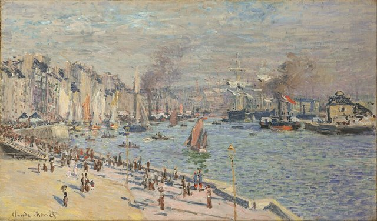
莫內出生在巴黎拉斐特街，次年受洗，名叫奧斯卡–克洛德（Oscar-Claude）。父親阿道夫從事食品與船舶補給相關的生意，母親路易絲·奧布雷（Louise Aubrée）喜愛音樂。
1845年前後全家搬到諾曼第的勒阿弗爾（Le Havre）。父親希望他繼承家業，他卻想當藝術家。港口、海岸、船隻與變化多端的天候，成為他日後風景畫的重要視覺經驗。

## 1856 ~ 1858 | 漫畫、母親去世與歐仁·布丹 {label="約1856–1858年"}
少年莫內以人物漫畫與諷刺肖像在當地小有名氣，甚至有人願意花錢買；1851年他進入勒阿弗爾的中學學習藝術，啟蒙老師是雅克–弗朗索瓦·奧沙爾（Jacques-François Ochard）。
1857年1月，母親去世，莫內退學，與姨媽萊卡德爾夫人同住。約1856至1858年間，他在諾曼第海灘結識畫家歐仁·布丹（Eugène Boudin）。布丹鼓勵他走出畫室，到海邊與自然環境中直接作畫，他開始接觸戶外寫生（plein air），領悟光線、天空、雲層與海面變化的重要。

## 1859 | 前往巴黎
莫內到巴黎，在羅浮宮臨摹，也在瑞士學院（Académie Suisse）學習與交流（維基百科另提到他在這段時期結識馬奈）。他沒有完全依傳統美術學院的訓練路線發展，而是逐漸尋找自己的藝術方向。

## 1861 | 阿爾及利亞兵役 {label="1860–1862年"}
莫內被徵召，到法國殖民地阿爾及利亞服役。當地強烈的陽光、色彩與自然環境，可能加深了他對光線與色彩的興趣。他染上傷寒，因為健康問題離開軍隊，父親與姨媽幫他付錢免除剩餘的兵役。

## 1862 | 進入格萊爾畫室
回到法國後，莫內進入畫家夏爾·格萊爾（Charles Gleyre）的畫室，在這裡認識雷諾瓦（Renoir）、西斯萊（Sisley）與巴齊耶（Bazille），他們後來都是印象派的重要人物。同年，他也接觸荷蘭畫家約翰·容金德（Johan Jongkind），加深了對風景畫與戶外寫生的興趣。
1863至1864年，他與同伴到楓丹白露森林與諾曼第海岸寫生，1864年在翁弗勒爾作畫，與布丹、容金德與巴齊耶交流。他越來越不滿足於在畫室裡依傳統規範完成作品。

## 1865 | 作品進入沙龍
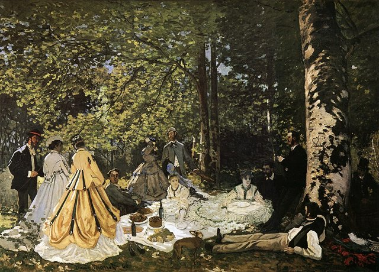
莫內的兩幅海景獲巴黎官方沙龍接受展出。他開始創作大型人物畫《草地上的午餐》（Le Déjeuner sur l'herbe），卡米耶·東西厄（Camille Doncieux）逐漸成為他的伴侶，也擔任模特兒。

## 1866 | 《穿綠衣的卡米耶》
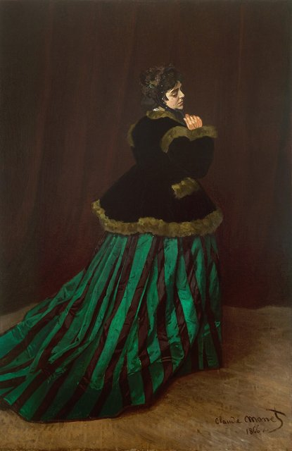
莫內以卡米耶為模特兒，完成《穿綠衣的卡米耶》（Camille，又名《綠衣女子》），在沙龍獲得相當好的反應。畫面展現他在人物造型、服裝質感與光線處理上的能力，他開始受到藝術評論界注意。

## 1867 | 長子尚出生
莫內與卡米耶的長子尚（Jean）出生。莫內持續面臨經濟困難，家庭生活不穩定。1868年多次遭遇財務困境，勒阿弗爾的船主高迪貝爾夫婦曾提供協助。他在聖阿德雷斯等地創作海景與家庭生活題材。

## 1869 | 與雷諾瓦並肩作畫
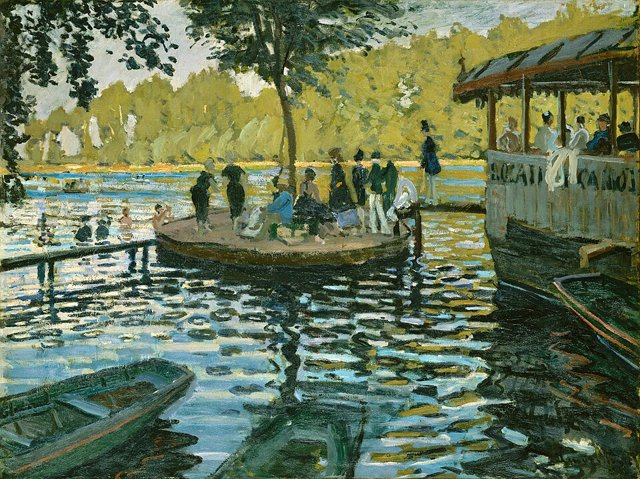
莫內在布吉瓦爾（Bougival）附近的聖米歇爾作畫，與雷諾瓦一起描繪河岸與戶外休閒生活。兩人對光線、水面反射與人物活動的觀察，成為印象派風景畫的重要發展。

## 1870 | 結婚與普法戰爭
1870年，莫內與卡米耶結婚。同年7月普法戰爭爆發，莫內為了避開戰事，帶著家人前往英國。他在倫敦接觸英國風景畫，尤其對康斯太勃（Constable）與透納（J. M. W. Turner）處理光線與大氣的方式印象深刻。

## 1871 | 倫敦、荷蘭與阿讓特伊
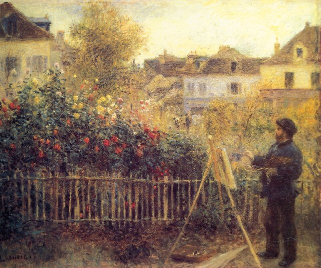
1871年春，英國皇家藝術學院拒絕展出他的作品。他在倫敦與畢沙羅（Pissarro）重逢，並認識藝術商人保羅·杜朗–呂埃爾（Paul Durand-Ruel），後者日後成為推廣印象派的關鍵人物。
接著他到荷蘭贊丹（Zaandam）創作了約25幅作品，也首次遊覽阿姆斯特丹；10或11月回到法國，定居巴黎近郊的阿讓特伊（Argenteuil），直到1878年。

## 1872 | 《印象·日出》
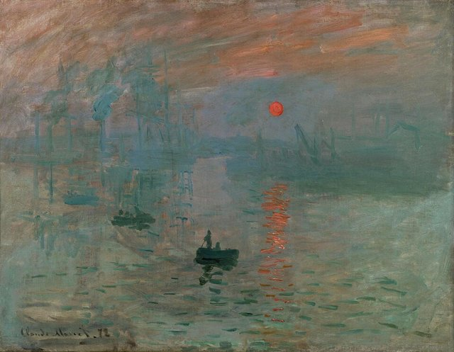
莫內在阿讓特伊期間常直接在戶外作畫，描繪塞納河、帆船、橋梁與河岸住宅，捕捉瞬間的光線與色彩變化。1872年11月，他畫下勒阿弗爾港的晨景《印象·日出》（Impression, soleil levant）。
畫面是晨霧、太陽、船隻與水面倒影，他不追求港口建築與船隻的精確細節，而是以快速的筆觸呈現當下的視覺印象。這幅畫後來成為印象派名稱的來源，現藏巴黎瑪摩丹美術館。

## 1874-04-15 ~ 1874-05-15 | 第一次印象派畫展
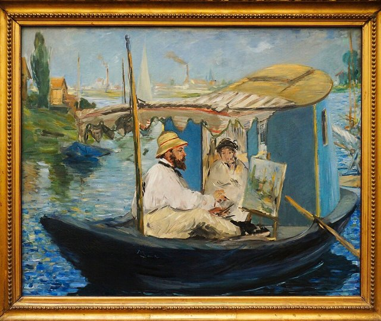
莫內與雷諾瓦、畢沙羅、西斯萊、竇加與莫里索等人，在攝影師納達爾（Nadar）位於巴黎卡普辛大道的工作室舉辦第一次獨立畫展，莫內展出《印象·日出》。
評論家路易·勒魯瓦（Louis Leroy）在報上諷刺這批畫只是「印象」，以帶嘲諷意味的口氣使用「印象派」一詞；這個名稱後來被藝術家與藝術史學界接受。1873年的《阿讓特伊之橋》、1875年的《撐陽傘的女人》（畫的是卡米耶與兒子尚）與《紅帆船》，是阿讓特伊時期的代表作，莫內持續以自然光線、空氣感與色彩變化為創作核心。

## 1876 | 第二次印象派畫展與卡米耶患病
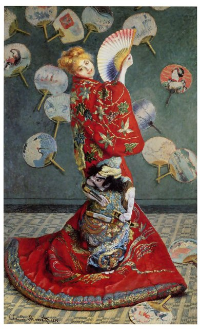
莫內參加第二次印象派畫展，展出《日本女人》（La Japonaise）等作品。這一年，妻子卡米耶染上肺結核。他也與藝術收藏家歐內斯特·奧什代（Ernest Hoschedé）及其妻子愛麗絲建立聯繫。

## 1877 | 聖拉扎爾車站
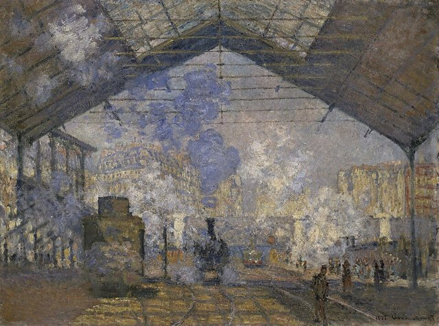
莫內以巴黎聖拉扎爾車站為題材，創作了多幅作品，描繪火車、蒸汽、玻璃屋頂與光線交織的現代都市景觀。這組作品顯示印象派不只畫田園風光，也能表現工業化的城市生活，他特別關注蒸汽與光線的視覺效果。

## 1878-03-17 | 次子米歇爾出生，搬到韋特伊
1878年3月17日，次子米歇爾出生。同年莫內全家離開阿讓特伊，搬到韋特伊（Vétheuil），與好友奧什代一家住在同一處，家庭關係與經濟狀況都很複雜。奧什代這年破產，後來逃往比利時。
莫內仍持續畫河流、村落與自然景觀。

## 1879-09-05 | 卡米耶去世
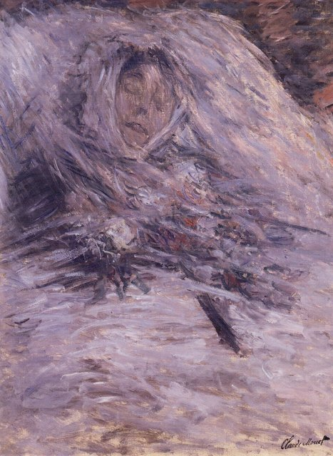
1879年9月5日，卡米耶因病逝世（維基百科記載死因為子宮頸癌），莫內深受打擊。他在她臨終前為她畫下《卡米耶安躺病榻》，此後也一段時間持續畫她，同時繼續以風景畫為主。
1880年春，他們從巴黎回到韋特伊，1881年與奧什代家遷往普瓦西，莫內不喜歡當地。

## 1881 | 旅行、冬景與杜朗–呂埃爾
1880年他以河面結冰為題材創作多幅作品。1881年起，杜朗–呂埃爾更穩定地購買莫內的作品，逐步改善他的經濟狀況。1882年他到諾曼第海岸畫迪耶普與普維爾一帶的景色。

## 1883-04 | 定居吉維尼
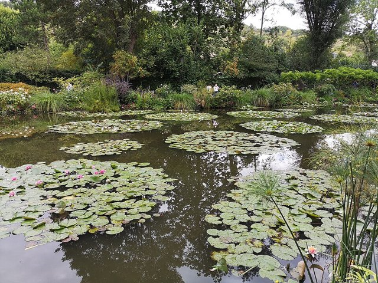
1883年4月，莫內在火車上看到吉維尼（Giverny）的風光，決定搬去；5月初他租下當地的房子，從此直到1926年逝世，大部分時間都住在這裡。
吉維尼的花園、河流、植物與池塘，逐漸成為他晚年創作的核心。愛麗絲·奧什代與她的孩子們也成為莫內家庭的一部分。1883年到1908年間，他還多次前往地中海沿岸、威尼斯與倫敦寫生。

## 1889 | 與羅丹聯展
莫內與雕塑家羅丹（Auguste Rodin）在巴黎共同舉辦展覽。1880年代後期，他持續在各地旅行寫生，畫諾曼第海岸、地中海沿岸與不同地區的自然景觀，藝術聲譽逐漸提升。

## 1890-11 | 買下吉維尼的房子
莫內買下吉維尼的房屋與土地，開始進一步改造花園，並著手建造睡蓮池。這座花園不是單純的居住環境，而是他親自設計、規劃的藝術創作空間。之後他又陸續蓋了溫室與第二個工作室。
1891年3月，奧什代因痛風去世，莫內出資為他辦喪事。

## 1891 | 乾草堆與白楊樹系列
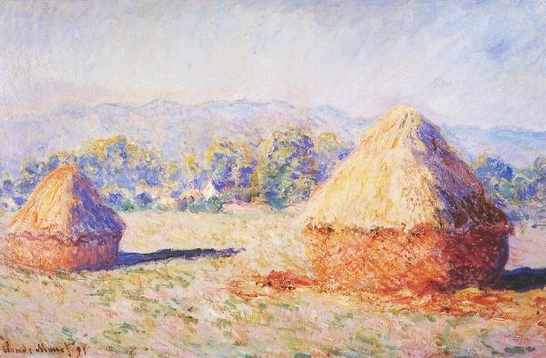
1890到1891年，莫內創作《乾草堆》（Haystacks）系列，在不同季節、時間與天候下反覆描繪同一組乾草堆；同時也畫《白楊樹》（Poplars）系列，利用成排樹木的垂直線條形成構圖的節奏。
他關注的是光線變化如何改變同一物體的視覺效果，這是他的系列畫成熟的標誌。

## 1892 | 魯昂大教堂系列與再婚
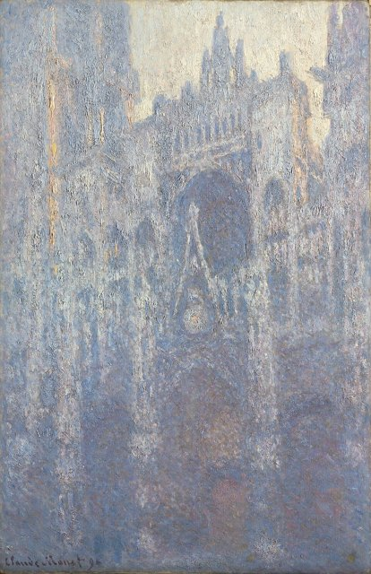
1892至1894年，莫內多次到魯昂，在不同時間、天候與季節描繪大教堂的正面。同一座石造建築在晨光、午後陽光與陰天下，呈現粉紅、金黃、藍紫等不同色彩，他在乎的是光線，而不只是建築。1895年，他從二十個不同角度所畫的大教堂作品，在杜朗–呂埃爾畫廊展出。
1892年，他與愛麗絲正式結婚，愛麗絲此後陪他度過吉維尼的重要歲月。

## 1899 | 日本橋與睡蓮池
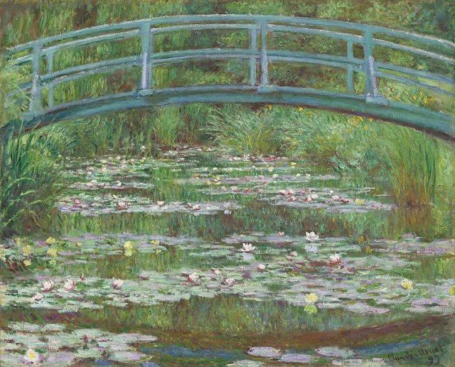
莫內持續擴建與整理吉維尼花園，特別重視水池、植物、橋梁與倒影的視覺關係。1899年前後，他開始集中描繪日本橋與睡蓮池，這個系列後來延續到1926年，是他晚年最重要的創作主題。

## 1904 | 泰晤士河系列
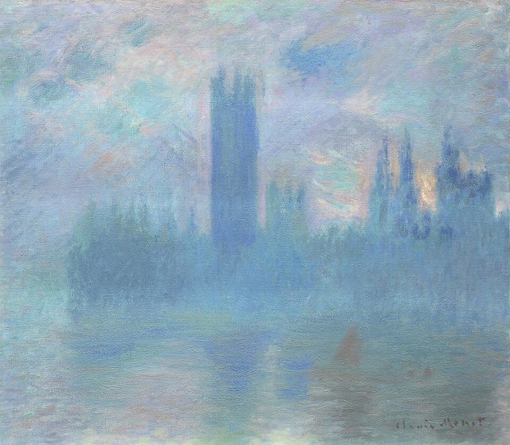
1899到1904年，莫內多次前往倫敦，描繪泰晤士河、查令十字橋、國會大廈與橋梁，特別關注倫敦的霧、煙塵、陽光與河面倒影。1904年，他展出一批以泰晤士河景觀為主題的作品。

## 1908 | 威尼斯之旅
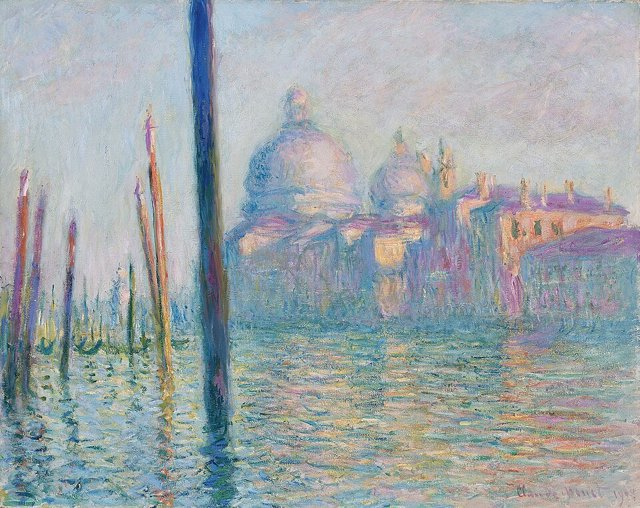
莫內到義大利威尼斯旅行，畫了大運河、聖喬治馬焦雷與總督宮等景色。威尼斯的光線、建築色彩與水面反射，成為他晚期重要的創作題材。

## 1909 | 睡蓮系列展覽
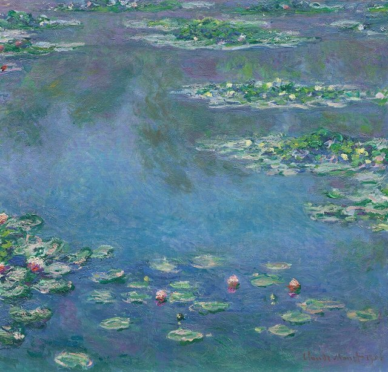
莫內在巴黎舉辦《睡蓮》系列展覽，顯示他已把睡蓮池視為持續研究的藝術主題。他逐漸弱化傳統的景物輪廓，把水面、倒影與植物融為一體。

## 1911 | 愛麗絲去世
愛麗絲在1911年去世，莫內深受打擊，創作活動一度受到影響。

## 1914 | 長子尚去世，投入大型睡蓮
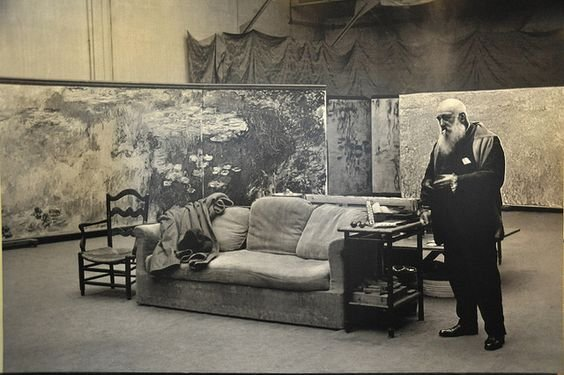
1914年，長子尚逝世，莫內的視力問題也逐漸加重。同年，他重新投入大型睡蓮畫作的創作，這批作品後來發展成巨幅的裝飾性壁畫，成為他晚年最重要的藝術計畫。
一戰期間，次子米歇爾從軍，莫內畫了垂柳系列，悼念陣亡將士。1915到1916年，他在吉維尼蓋了大型畫室，以處理巨幅畫布；畫作不再只是一般的架上油畫，而是考慮整個展覽空間與觀賞者的觀看經驗。

## 1918 | 承諾捐贈《睡蓮》給法國
一戰結束後，莫內決定把大型《睡蓮》作品捐給法國，希望它成為紀念和平的藝術呈現。1922年，他正式簽署捐贈文件，這批作品後來安排在巴黎橘園美術館（Musée de l'Orangerie）的特別展覽空間。

## 1923 | 白內障手術
莫內的視力問題已持續多年，被診斷為白內障，1923年接受手術（維基百科記載為兩次）。手術後視力有所改善，但仍面臨視覺與創作上的困難；手術也改變了他的色彩感受，睡蓮畫作變得更藍，他重畫了一部分作品。

## 1926-12-05 | 逝世於吉維尼
1926年12月5日，莫內因肺癌在吉維尼去世，享年86歲，安葬在吉維尼教堂的墓地，出席者約五十人。
他留下大量風景畫、系列畫與晚期的大型《睡蓮》。晚年的睡蓮逐漸弱化清晰的輪廓、固定視點與透視空間，水面與天空的界線有時變得模糊，常被視為現代抽象藝術的先驅之一，但莫內仍以自然景觀為創作基礎。

## 1927-05-17 | 橘園《睡蓮》揭幕
莫內逝世後，大型《睡蓮》裝飾畫在巴黎橘園美術館正式揭幕。作品依莫內的構想，安置在特別設計的橢圓形展廳，觀眾可以在環繞式的空間中觀看水面、睡蓮與倒影，感受近乎沉浸式的藝術經驗。

## 1966 | 吉維尼房屋捐贈與開放
1966年，次子米歇爾把吉維尼的房屋與花園捐贈給法國美術學院；1980年，莫內基金會完成復原，房屋與花園開放參觀。

## 2019-05-14 | 《乾草堆》拍出1.107億美元
2019年5月14日，莫內的《乾草堆》（Meules，1890）在紐約蘇富比以1.107億美元成交，創下他作品的拍賣紀錄。從1874年被嘲諷為「印象」的畫家，到作品成為市場上最昂貴的畫作之一，莫內完整呈現了十九世紀法國繪畫走向現代藝術的歷程。
