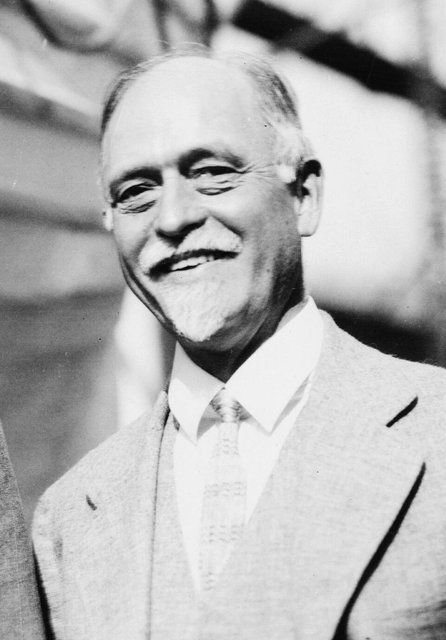
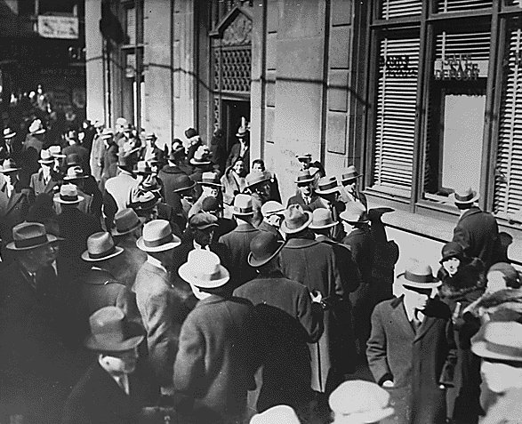
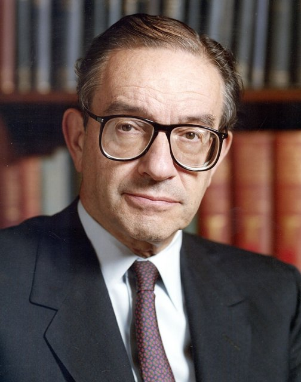

<!--
內容整理自本機筆記〈貨幣學派（Monetarism）〉（D:\Books\md\歷史\術語\經濟學\貨幣學派（Monetarism）.md；html 版在 D:\Books\html\4-1-1.經濟學派），並參考中文維基百科〈貨幣主義〉條目，以自己的話改寫。
時期依筆記「歷史發展總時間軸」的六個時期，合併為五段：貨幣數量論的源流、凱因斯時代、貨幣學派的崛起、政策實驗、融入現代貨幣政策。
處理方式：
- 1690年前後洛克的貨幣思想、1752年休謨的貨幣數量論、1810年代李嘉圖的通膨理論、1848年彌爾的古典貨幣理論寫進第一則事件。
- 筆記把1967年「提出自然失業率概念」與1968年「提出自然失業率假說」分列；傅利曼是在1967年12月的美國經濟學會會長演說中提出，1968年刊出〈貨幣政策的角色〉，這裡合為一則放在1968年。
- 英國柴契爾政府的貨幣主義政策：筆記放在1983年；依史實，柴契爾1979年上台後即以控制貨幣供給為核心，1980年公布「中期財政策略」，這裡依此寫在1980年。
- 筆記1984－1989年幾則「貨幣政策轉向彈性」「流通速度不穩定」「影響力下降」合為一則；1990年代以後的通膨目標制、2006年柏南克的演講與2012年聯準會公布2%目標寫進後兩則事件。
- 人名依 Books 原稿：傅利曼、安娜·史瓦茲、伏克爾、葛林斯潘、柏南克；人名用·分隔。
圖片來源（皆為 Wikimedia Commons 公有領域／CC0 作品，縮成最長邊 640px）：
- mo-friedman.jpg：Portrait of Milton Friedman (4x5 cropped).jpg（米爾頓·傅利曼）
- mo-fisher.jpg：Irvingfisher.jpg（歐文·費雪）
- mo-bankrun.jpg：Bank Run in Michigan, USA, February 1933.jpg（1933年2月密西根州的銀行擠兌）
- mo-greenspan.jpg：Alan Greenspan color photo portrait (cropped 2) (b).jpg（艾倫·葛林斯潘）
-->

# Periods
- 1911 ~ 1935 | 貨幣數量論的源流 | #868e96
  從休謨到費雪，貨幣數量增加推高物價的觀念一脈相傳；費雪以交易方程式把它數學化，劍橋學派發展現金餘額說，大蕭條則讓貨幣政策的角色成為爭論焦點。
- 1936 ~ 1955 | 凱因斯時代 | #1971c2
  《通論》出版後，財政政策成為主角，貨幣被認為在蕭條時作用有限；傅利曼在芝加哥大學默默累積研究。
- 1956 ~ 1978 | 貨幣學派的崛起 | #e67700
  傅利曼重新表述貨幣數量論，以《美國貨幣史》把大蕭條歸咎於聯準會，提出自然失業率與固定貨幣成長規則；停滯性通膨印證了他的預言，1976年獲諾貝爾獎。
- 1979 ~ 1989 | 政策實驗 | #c92a2a
  伏克爾的聯準會與柴契爾政府以控制貨幣供給對抗通膨，通膨被壓下，卻付出嚴重衰退的代價；貨幣流通速度變得不穩定，貨幣目標逐漸被放棄。
- 1990 ~ 2026 | 融入現代貨幣政策 | #5f3dc4
  央行改以利率與通膨目標為核心，但「通膨終究是貨幣現象」與規則優於權衡的觀念已成共識；金融海嘯與疫情後的貨幣擴張與通膨，讓貨幣數量的角色再度受到討論。

# Events

## 1911 | 費雪的交易方程式

貨幣數量與物價的關係有很長的思想史：洛克在17世紀末討論貨幣價值，1752年休謨指出貨幣增加只會等比例推高物價，李嘉圖在拿破崙戰爭時期把英國的通膨歸咎於紙幣發行過多，彌爾在1848年整理了古典的貨幣理論。1911年，耶魯大學的費雪出版《貨幣的購買力》，以交易方程式 MV＝PT（貨幣數量乘以流通速度，等於物價乘以交易量）把貨幣數量論數學化：如果流通速度與交易量大致穩定，物價就隨貨幣數量變動。同一時期，馬歇爾、皮古等劍橋學者從人們想持有多少現金的角度，發展出「現金餘額說」。

## 1923 | 戰後的惡性通膨
第一次世界大戰期間各國停止兌換黃金、大量印鈔，戰後德國的威瑪共和國爆發惡性通膨，1923年物價以天、甚至以小時計算上漲，一美元可以兌換超過四兆馬克。這成為貨幣數量失控的經典例證。1920年代各國陸續恢復金本位，貨幣政策應以匯率、物價還是景氣為目標，爭論不休。

## 1929 | 大蕭條與貨幣緊縮

股市崩盤後，美國在1930年至1933年間接連發生銀行擠兌，數千家銀行倒閉，貨幣供給減少約三分之一，物價大跌、失業飆升。當時的聯準會認為利率已經很低，貨幣政策夠寬鬆，沒有大規模挹注流動性。這段歷史日後成為傅利曼批判聯準會的核心證據。

## 1936 | 凱因斯革命
凱因斯出版《就業、利息和貨幣通論》，強調有效需求與財政政策，並指出在「流動性陷阱」中，增加貨幣也無法壓低利率、刺激投資。此後二十年凱因斯學派主導總體經濟學，貨幣常被認為「不重要」。詳見「凱因斯學派」時間軸。

## 1946 | 傅利曼到芝加哥大學任教
米爾頓·傅利曼回到母校芝加哥大學任教，此後三十年在這裡帶領「貨幣與銀行研討會」，培養了大批研究貨幣的學生，芝加哥大學成為反凱因斯陣營的重鎮。1957年他提出「恆常所得假說」：消費取決於長期的預期所得，而非當期所得，削弱了凱因斯消費函數與乘數效果的推論。

## 1956 | 重新表述貨幣數量論
傅利曼發表〈貨幣數量論：一個重新表述〉，把貨幣數量論改寫為「貨幣需求理論」：人們想持有的貨幣量是所得、利率等少數變數的穩定函數，因此貨幣供給的變動會可預測地影響名目所得。這篇論文被視為現代貨幣學派的起點。1960年他出版《貨幣穩定計畫》，主張以固定規則管理貨幣。

## 1963 | 《美國貨幣史》
傅利曼與安娜·史瓦茲出版《美國貨幣史，1867－1960》，以近百年的資料追蹤貨幣存量與景氣的關係，指出大蕭條之所以如此嚴重，是因為聯準會坐視貨幣供給大幅收縮，稱之為「大緊縮」。這部巨著改變了學界對大蕭條的理解，使貨幣學派與凱因斯學派的論戰全面展開。2002年，時任聯準會理事的柏南克在傅利曼九十歲生日的演講中說：「你們是對的，我們做錯了，我們很抱歉。」

## 1968 | 自然失業率與貨幣成長規則
傅利曼在1967年底的美國經濟學會會長演說（隔年刊出為〈貨幣政策的角色〉）中指出：菲利普斯曲線的取捨只是短期現象，人們會調整通膨預期，長期失業率會回到由勞動市場結構決定的「自然失業率」，政府若想長期把失業壓在自然率以下，只會換來愈來愈高的通膨。費爾普斯也獨立提出相同的論點。傅利曼主張央行放棄權衡的微調，改採固定貨幣成長率的規則，例如每年4%至5%。

## 1970 | 「通膨始終是貨幣現象」
傅利曼在倫敦的演講中說出名言：「通貨膨脹無論何時何地都是一種貨幣現象。」1971年美國停止美元兌換黃金，布列敦森林體系瓦解，各國貨幣失去黃金的約束；1973年石油危機後，西方陷入高通膨與高失業並存的停滯性通膨，正如自然失業率假說所預言，貨幣學派的影響力快速上升，許多國家的央行開始公布貨幣成長目標。

## 1976 | 傅利曼獲諾貝爾獎
傅利曼以消費分析、貨幣史與貨幣理論，以及證明穩定政策的複雜性，獲得諾貝爾經濟學獎。他同時是自由市場的積極倡議者，1980年與妻子蘿絲推出電視節目與暢銷書《選擇的自由》。1978年美國通膨持續惡化，1979年伊朗革命又引發第二次石油危機。

## 1979-10-06 | 伏克爾的貨幣政策轉向
八月出任聯準會主席的伏克爾，在十月六日週六的臨時記者會上宣布，聯準會改以控制銀行準備金與貨幣供給為操作目標，任由利率上下波動。聯邦資金利率隨後一度超過20%，美國經濟在1980年與1981年至1982年兩度陷入衰退，失業率升到約10.8%，農民開著拖拉機包圍聯準會抗議。通膨從1980年約14%降到1983年約3%。

## 1980 | 柴契爾的貨幣主義
英國柴契爾政府在1979年上台後，以控制貨幣供給（英鎊 M3）為核心對抗通膨，1980年公布「中期財政策略」，逐年訂定貨幣成長與財政赤字的目標，並大幅削減支出。通膨在幾年內明顯下降，但製造業衰退、失業超過三百萬人，1981年364位經濟學家聯名投書批評這項政策。

## 1982 | 放棄貨幣目標

金融創新與管制鬆綁使貨幣的定義與流通速度變得不穩定，貨幣數量與名目所得的關係不再可靠，聯準會在1982年秋天放棄以貨幣總量為主要操作目標，英國也在1980年代中期淡化貨幣目標。貨幣學派由政策主流轉為理論影響；1987年葛林斯潘接任聯準會主席，改以較具彈性的方式操作利率。

## 1990 | 通膨目標制
紐西蘭在1990年首先實施通膨目標制，由央行公開承諾一個通膨目標並為結果負責，加拿大、英國等國陸續跟進。貨幣學派「規則優於權衡」「央行要對通膨負責」的觀念被吸收進新的框架，但操作工具改為利率。1993年葛林斯潘在國會表示，貨幣總量已不再是可靠的政策指標；同年泰勒提出以通膨與產出缺口決定利率的「泰勒法則」。

## 2006-11-16 | 傅利曼逝世
傅利曼在舊金山去世，享年九十四歲。同年柏南克出任聯準會主席，在演講中回顧貨幣總量在政策中的歷史角色。2012年1月，聯準會首次正式公布2%的長期通膨目標。

## 2008 | 金融海嘯與量化寬鬆
金融海嘯後，聯準會把利率降到接近零，並大規模購買公債與房貸證券（量化寬鬆），資產負債表擴大數倍。主導這些政策的柏南克，本身就是研究大蕭條、深受傅利曼影響的學者，避免重演「大緊縮」是他的核心考量。但貨幣基數大增，通膨卻長期低於目標，顯示貨幣與物價的關係遠比簡單的數量論複雜。

## 2021 | 疫情後的通膨
疫情期間各國大規模印鈔與財政擴張，美國廣義貨幣 M2 在2020年至2021年增加約四成，2021年下半年起通膨大幅上升，2022年6月美國通膨一度達9.1%，聯準會隨後急速升息。貨幣數量在通膨中的角色再度受到重視，貨幣學派「通膨終究是貨幣現象」的論點重新被廣泛討論。
