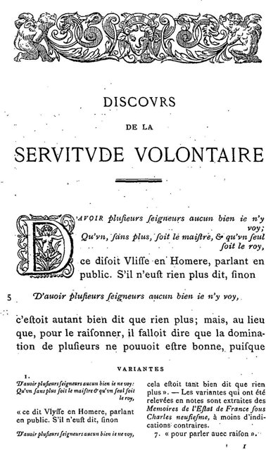
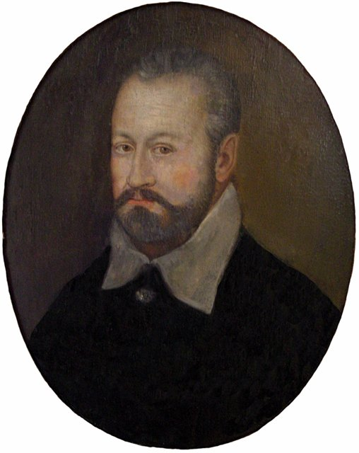
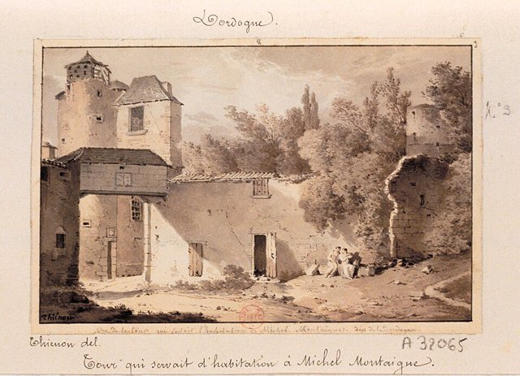
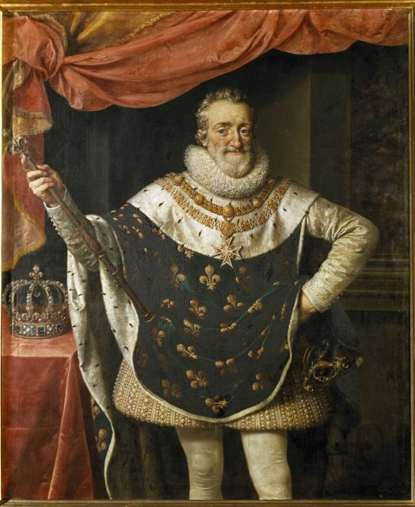
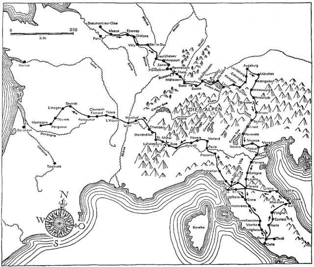
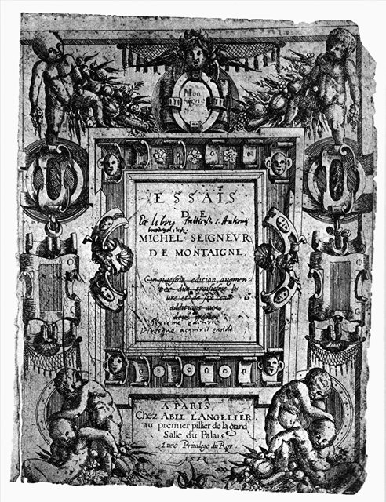
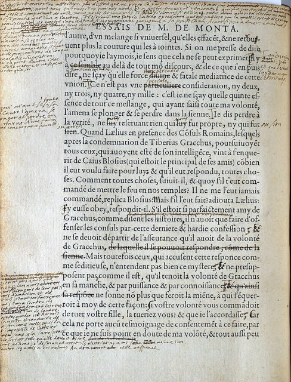

<!--
內容整理自本機筆記〈蒙田生平大事記（1533–1592）〉（圖表\蒙田生平大事記（1533–1592）.md）與中文維基百科「米歇爾·德·蒙田」條目（CC BY-SA 4.0），以台灣用語改寫摘要。
https://zh.wikipedia.org/zh-tw/米歇尔·德·蒙田
史料與日期說明：
- 中文維基百科條目篇幅很短，生平細節主要依筆記與一般公認的史實補充。
- 塞邦《自然神學》譯本：筆記寫1568年，維基百科寫1569年出版；他在1568年父親去世前後完成翻譯，1569年出版，此處分成「父親去世」與「出版譯本」兩則。
- 退隱：筆記寫「37歲左右」；他在書房牆上的拉丁文題詞註明，是在1571年2月28日、38歲生日當天退隱，此處依題詞。
- 進入司法界：筆記泛稱1550年代；維基百科寫1557年起任職波爾多最高法院。他1554年先在佩里格的稅務法院任職，1557年該法院併入波爾多最高法院，此處採1557年。
- 「我知道什麼？」：一般認為他在1576年鑄造一枚刻有天平與這句話的紀念章，此處以1576年為準。
- 1572年聖巴托羅繆大屠殺只作為宗教戰爭背景一筆帶過，不描述細節。
- 擔任納瓦拉的亨利的宮廷侍從、1585年波爾多瘟疫、1588年被短暫關進巴士底監獄、結識古爾內小姐、死因為扁桃腺周圍膿腫等細節，係依一般公認的史實補充。
- 1595年古爾內版《隨筆集》、1676年列入教廷禁書目錄、1774年發現《義大利旅行日記》手稿等身後事，併入最後一則事件。
圖片來源（皆為 Wikimedia Commons 公有領域／CC0 作品）：
- mon-cover.jpg：Montaigne-Dumonstier.jpg
- mon-boetie.jpg：LaBoétie001.jpg
- mon-1565.jpg：Montaigne vers 1565 - portrait anonyme.jpg
- mon-tower.jpg：Saint-Michel-de-Montaigne. Vue de la tour qui servait d'habitation de Michel Montaigne, dép. de la Dordogne - dessin - Thiénon - btv1b77418779.jpg
- mon-henri.jpg：Henri IV, roi de France - Frans Pourbus le Jeune.jpg
- mon-travel.jpg：Michel de Montaigne Italienreise.png
- mon-1588.jpg：Essais Titelblatt (1588).png
- mon-bordeaux.jpg：Montaigne Essais Manuscript.jpg
-->

# Periods
- 1533 ~ 1554 | 拉丁語中長大的少年 | #f08c00
  生於波爾多附近的蒙田城堡，父親讓他在只說拉丁語的環境中長大，再送進波爾多的吉耶納學院，之後學習法律。
- 1554 ~ 1571 | 法官生涯與摯友 | #1c7ed6
  在佩里格與波爾多的法院擔任法官十多年，結識一生摯友拉博埃西；摯友早逝、結婚、父親去世，接掌家族領地。
- 1571 ~ 1580 | 塔樓書房裡的隨筆 | #2f9e44
  38歲退隱到城堡塔樓的書房，在宗教戰爭的動盪中閱讀、思考，開始寫作《隨筆集》，並在1580年出版前兩卷。
- 1580 ~ 1592 | 旅行、市長與增訂 | #862e9c
  為治療腎結石遊歷德意志、瑞士與義大利，途中當選波爾多市長；卸任後在宗教戰爭的雙方之間調停，持續增訂《隨筆集》直到去世。

# Events

## 1533-02-28 | 出生@蒙田城堡
生於法國西南部佩里戈爾地區的蒙田城堡，靠近波爾多。家族原本經營魚與葡萄酒的國際貿易，到曾祖父時買下蒙田領地，躋身貴族。父親皮耶·埃凱姆曾在義大利從軍，深受文藝復興新教育理念的影響；他把剛出生的兒子送到附近村莊，由農民夫婦撫養，讓他從小親近平民。

## 1536 | 以拉丁語為母語 {label=約1536～1539年}
父親聘請一位不懂法語的德國家庭教師，規定家中所有人——包括父母與僕人——跟他說話時只能用拉丁語，因此拉丁語成了他真正的母語。父親還堅持用溫和的方式教育，據說每天早上都以音樂聲喚醒他，避免突然驚醒對孩子不好。

## 1539 | 吉耶納學院 {label=約1539～1546年}
6歲進入波爾多的吉耶納學院，這是當時法國最好的人文學校之一。他因拉丁語流利，常在拉丁文戲劇中擔任主角，但他後來在〈論兒童教育〉中批評學校只要學生背誦、不培養獨立判斷，主張「與其塞滿腦袋，不如造就好的頭腦」。之後他到土魯斯（一說巴黎）學習法律。

## 1557 | 波爾多最高法院法官
1554年他先在佩里格新設的稅務法院擔任法官，1557年該法院併入波爾多最高法院，他便在那裡任職，一做就是十三年。審理案件的經驗讓他看見法律的不確定與人類判斷的脆弱，日後成為《隨筆集》的重要素材。

## 1558 | 結識拉博埃西 {label=約1558～1559年}

在波爾多最高法院結識年長兩歲的同事拉博埃西——年輕時就寫出批判專制的《論自願為奴》的人文主義者。兩人一見如故，成為莫逆之交。多年後他在〈論友誼〉中解釋這份情誼：「因為是他，因為是我。」

## 1561 | 出入查理九世的宮廷 {label=1561～1563年}
多次前往巴黎與宮廷，見識法國的政治核心。1562年第一次宗教戰爭爆發，天主教與新教（胡格諾派）的內戰此後斷斷續續延續了三十多年，成為他一生的時代背景。他始終是天主教徒，但有幾位弟妹改信新教。

## 1563-08 | 拉博埃西去世
拉博埃西因病去世，年僅32歲。蒙田在他臨終前守在床邊，並在寫給父親的長信中記下他最後的日子。這份失落伴隨他一生；有學者認為，《隨筆集》正是他在失去唯一知己之後，轉而與讀者、也與自己對話的方式。

## 1565-09 | 與法蘭索瓦絲·德·拉夏塞涅結婚

與波爾多法官家族的女兒法蘭索瓦絲·德·拉夏塞涅結婚。兩人生了六個女兒，只有一個活到成年；他在書中提到孩子夭折時語氣平淡，讓後世讀者印象深刻。

## 1568-06 | 父親去世，繼承領地
父親去世，他身為長子繼承蒙田領地與莊園，成為一家之主，開始以「蒙田」為姓。在父親生前的請求下，他把西班牙神學家雷蒙·塞邦以拉丁文寫成、試圖用理性證明基督教真理的《自然神學》譯成法文。

## 1569 | 出版塞邦《自然神學》譯本
塞邦《自然神學》的法文譯本出版。翻譯這部書讓他反覆思考：人的理性真能證明信仰嗎？人的知識能力究竟有多大？這些問題後來發展成《隨筆集》中最長的一篇〈為雷蒙·塞邦辯護〉。

## 1571-02-28 | 38歲生日退隱

賣掉法官職位，在38歲生日當天退隱到城堡。他在塔樓書房的牆上用拉丁文寫下題詞，說自己「厭倦了宮廷與公職的奴役」，要回到「博學繆斯的懷抱」，在平靜中度過餘生。書房的天花板橫梁上，刻著五十多句古典與聖經的格言。同年他出版了拉博埃西的遺作，並獲頒聖米歇爾勳章。

## 1572 | 開始寫作《隨筆集》
開始寫作日後的《隨筆集》。法文 essai 原意是「嘗試、試驗」，他用這個詞表示：這些文章不是定論，而是對自己判斷力的一次次試驗。同年8月巴黎發生聖巴托羅繆大屠殺，宗教戰爭更加慘烈，他的文字始終主張寬容，反對以信仰之名施加殘酷。

## 1576 | 「我知道什麼？」
深入研讀古希臘懷疑論者塞克斯都·恩披里柯的著作，在書房橫梁刻上懷疑論的格言，並鑄造一枚紀念章，一面是平衡的天平，一面刻著他的座右銘「我知道什麼？」（Que sais-je?）。這不是主張什麼都不可知，而是提醒自己：在證據不足時不要妄下定論。

## 1577 | 納瓦拉國王的侍從

被新教領袖納瓦拉國王亨利（後來的法王亨利四世）任命為宮廷侍從。身為溫和的天主教徒，他得到天主教與新教雙方的信任，日後多次在國王亨利三世與納瓦拉的亨利之間居中斡旋。

## 1578 | 腎結石的折磨
開始受到腎結石的困擾，父親當年也死於同樣的病。此後劇烈的疼痛伴隨他一生，他在《隨筆集》中坦然記錄病痛，並藉此思考如何面對身體的衰敗與死亡——「研究哲學就是學習死亡」。

## 1580-03 | 出版《隨筆集》前兩卷
在波爾多出版《隨筆集》前兩卷，共94篇。他在〈致讀者〉中寫道：「我自己就是這本書的素材。」這是前所未有的寫法——作者毫不避諱地談論自己的習慣、身體、恐懼與矛盾，藉由觀察自己來探究普遍的人性。他親自把書呈獻給國王亨利三世，國王表示很喜歡，他回答：「那陛下一定也會喜歡我這個人，因為書就是我。」

## 1580-06 | 遊歷歐洲

為了尋找溫泉療法治療腎結石，也為了開闊眼界，他展開長達一年半的旅行，經過瑞士、德意志、奧地利，抵達義大利。在羅馬，教廷的審查官檢查了《隨筆集》，提出幾點意見但沒有查禁，他還獲頒羅馬榮譽公民。旅途中他口述與親筆寫下的《旅行日記》，直到將近兩百年後才被人發現出版。

## 1581-08 | 當選波爾多市長
人還在義大利，就得知自己被選為波爾多市長，國王亨利三世親自寫信要他立刻回去就任。他11月底回到波爾多，1583年連任，在天主教聯盟與新教勢力之間維持城市的秩序。1585年任期即將結束時，波爾多爆發嚴重的瘟疫，他沒有進城主持卸任，這個決定日後頗受爭議。

## 1588-06 | 《隨筆集》第三卷

在巴黎出版增訂版《隨筆集》，新增第三卷十三篇，前兩卷也補充了大量內容。同年7月，他被支持天主教聯盟的巴黎群眾關進巴士底監獄，當天就因太后凱薩琳·德·麥地奇出面而獲釋。在巴黎期間，他結識了熱愛《隨筆集》的年輕女作家古爾內小姐，收她為「義女」。

## 1590 | 支持亨利四世

納瓦拉的亨利已在前一年繼位為法王亨利四世，他寫信表示支持，並在信中勸新王以寬容贏得人心。晚年他留在城堡，在1588年版的書頁空白處密密麻麻地增補修訂，這部「波爾多本」至今仍保存在波爾多市立圖書館。

## 1592-09-13 | 逝世@蒙田城堡
因扁桃腺周圍膿腫在蒙田城堡去世，享年59歲；據說臨終前已無法說話，在床邊請神父舉行彌撒時安詳離世。1595年，古爾內小姐根據他的增訂整理出版身後版《隨筆集》。他的懷疑精神與自我書寫深深影響了培根、莎士比亞、笛卡兒與帕斯卡；1676年《隨筆集》曾被列入教廷禁書目錄，但終究成為歐洲文學的經典。尼采說：「這樣的人寫過書，真的讓人在這世上活下去的樂趣增加了。」
