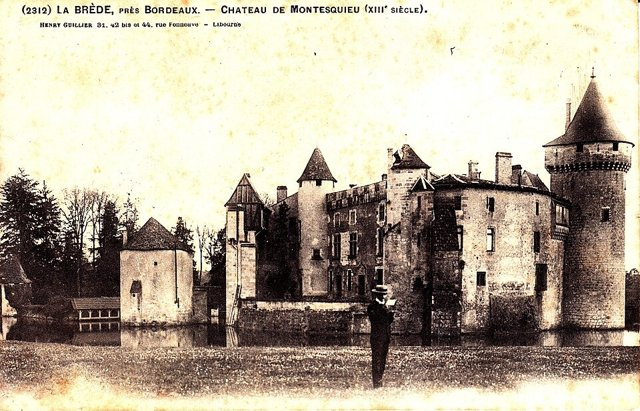
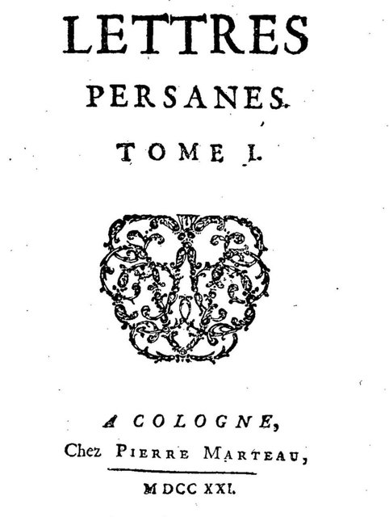
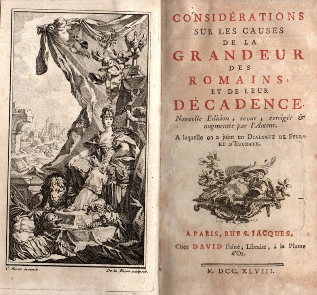
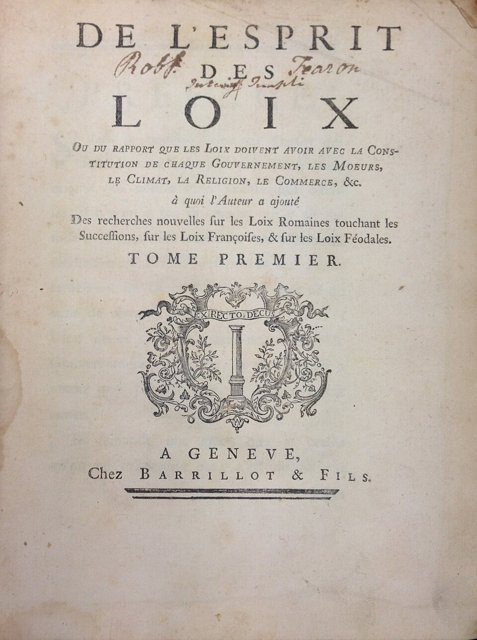

<!--
內容整理自本機筆記〈孟德斯鳩生平大事記（1689–1755）〉（圖表\孟德斯鳩生平大事記（1689–1755）.md）與中文維基百科「孟德斯鳩」條目（CC BY-SA 4.0），以台灣用語改寫摘要。
https://zh.wikipedia.org/zh-tw/孟德斯鸠
史料與日期說明：
- 中文維基百科條目篇幅很短，生平細節主要依筆記與一般公認的史實補充。
- 維基百科寫路易十五即位後「由母后攝政」；路易十五的母親早在1712年就已去世，實際攝政的是奧爾良公爵腓力二世，此處依此修正。
- 維基百科稱他1716年繼承「波爾多高等法院院長」；他繼承的是伯父的「庭長」（président à mortier）職位，並非首席院長，此處寫作庭長。
- 出售法官職位：筆記寫1725年，一般說法是1726年，此處採1726年。
- 法蘭西學術院：1727年底當選、1728年1月入院，此處採1728年1月。
- 妻子信奉新教（喀爾文派）、1716年加入波爾多科學院、1729–1731年旅居英國並當選皇家學會會員、加入共濟會、1751年列入教廷禁書目錄、為《百科全書》撰寫〈論品味〉、臨終時耶穌會神父索取手稿等細節，係依一般公認的史實補充。
- 對美國憲法與法國大革命的影響併入最後一則事件。
圖片來源（皆為 Wikimedia Commons 公有領域／CC0 作品）：
- mtq-cover.jpg：Charles Montesquieu.jpg
- mtq-labrede.jpg：La Brède - château de Montesquieu 2.jpg
- mtq-persanes.jpg：Lettres persanes - tome 1 - Cologne (1721).jpg
- mtq-labrede2.jpg：La Brède - château de Montesquieu 8.jpg
- mtq-romains.jpg：Montesquieu book Consideration sur les causes de la grandeur des Romains et de leur decadence.png
- mtq-esprit.jpg：Montesquieu, De l'Esprit des loix (1st ed, 1748, vol 1, title page).jpg
-->

# Periods
- 1689 ~ 1716 | 波爾多的貴族子弟 | #f08c00
  生於波爾多附近的拉布雷德城堡，在朱伊學院接受古典教育，攻讀法律；父親去世後繼承家業，娶了一位新教徒妻子。
- 1716 ~ 1728 | 法官與《波斯人信札》 | #c92a2a
  繼承伯父的男爵爵位與波爾多高等法院庭長職位，同時熱衷科學研究；匿名出版的《波斯人信札》使他一舉成名。
- 1728 ~ 1731 | 遊歷歐洲 | #2f9e44
  當選法蘭西學術院院士後，花了三年遊歷奧地利、匈牙利、義大利、德意志、荷蘭與英國，實地考察各國的政治制度與風俗。
- 1731 ~ 1755 | 拉布雷德的著述歲月 | #e67700
  回到故鄉經營葡萄園，花了近二十年寫成《論法的精神》，在讚譽與攻擊聲中度過晚年，最後病逝巴黎。

# Events

## 1689-01-18 | 出生@拉布雷德城堡

生於波爾多南方的拉布雷德城堡，本名夏爾·路易·德·塞孔達，家族是穿袍貴族（以司法職位起家的貴族）。據說父親特地請一名乞丐當他的教父，好讓他一輩子記得窮人也是他的兄弟。他出生的這一年，英國剛發生光榮革命、通過《權利法案》；法國則仍在路易十四的專制統治之下。

## 1700 | 朱伊學院 {label=1700～1705年}
11歲進入巴黎附近、由奧拉托利會神父主持的朱伊學院，學習拉丁文、歷史、文學與哲學。這所學校的教學較為開明，重視歷史與法語，培養了他從歷史案例比較政治的眼光。

## 1708 | 取得法律學位
在波爾多大學取得法律學位，成為律師，隨後到巴黎繼續研究法律與歷史，結識學者與文人。

## 1713-11 | 父親去世
父親去世，他返回拉布雷德管理家族的土地與葡萄園，繼承拉布雷德男爵的頭銜。

## 1715-04 | 與珍娜·德·拉蒂格結婚
與珍娜·德·拉蒂格結婚。她是新教（喀爾文派）信徒，在路易十四廢除《南特詔令》後的法國，新教徒處境艱難，這門婚事帶來了豐厚的嫁妝，也讓他對宗教迫害有切身的體會。兩人育有一子二女。同年9月，路易十四去世，五歲的路易十五即位，由奧爾良公爵攝政。

## 1716-04 | 繼承孟德斯鳩男爵與法院庭長
伯父去世，他繼承孟德斯鳩男爵的頭銜、財產，以及波爾多高等法院庭長的職位，從此以「孟德斯鳩」為人所知。法國的「高等法院」是負責審判與登錄王室法令的司法機構，並非民選國會。同年他加入波爾多科學院，發表關於回聲、腎上腺、物體透明度等研究，也關注政治與經濟問題。

## 1721 | 《波斯人信札》

在荷蘭匿名出版書信體小說《波斯人信札》，藉兩位到巴黎遊歷的波斯貴族之口，諷刺法國的專制王權、教會、貴族沙龍與社會風俗——例如把教宗形容成「一個老魔術師」。外國人的眼光讓讀者重新審視自己習以為常的事物。這本書在攝政時期的寬鬆氣氛下大受歡迎，一年內再版多次，他也成了巴黎沙龍的寵兒。

## 1726 | 出售法官職位
對法院的日常審判工作感到厭倦，加上希望專心研究與寫作，他把庭長職位的終身權利賣出，搬到巴黎，出入沙龍與學者圈。

## 1728-01 | 當選法蘭西學術院院士
經過一番波折——有人以《波斯人信札》批評宗教為由反對——終於入選法蘭西學術院，成為四十位「不朽者」之一，確立了他在法國文壇的地位。

## 1728-04 | 遊歷歐洲
展開為期三年的長途旅行，造訪維也納、匈牙利、威尼斯、羅馬、那不勒斯、德意志諸邦與荷蘭，沿途拜會王公、外交官與學者，在威尼斯還見到了因密西西比泡沫破產而流亡的金融家約翰·羅。他寫下大量旅行筆記，觀察各地的法律、風俗、氣候與經濟，作為日後比較政治的素材。

## 1729-11 | 旅居英國
跟隨英國的切斯特菲爾德伯爵渡海到英國，住了將近一年半。他參觀國會辯論、閱讀報紙、結識政界人物，當選皇家學會會員，也加入了共濟會。他驚訝於英國人能公開批評政府而不受懲罰，認定英國是當時世界上最自由的國家，並深入思考英國的國王、國會與法院之間如何相互牽制。

## 1731 | 返回拉布雷德

回到拉布雷德城堡，此後大多時間在家鄉寫作、整理旅行筆記，並親自經營葡萄園，他的葡萄酒甚至出口到英國。他的藏書室收藏數千冊書籍，成為他研究法律與歷史的基地。

## 1734 | 《羅馬盛衰原因論》

出版《羅馬盛衰原因論》，分析羅馬如何從一個小城邦崛起成為大帝國，又如何因過度擴張、公民美德衰退與權力集中而衰亡。他不把興衰歸於命運或天意，而是尋找背後的制度與社會原因，被視為歷史哲學的先驅之作。

## 1748-11 | 《論法的精神》

歷經近二十年的寫作，在幾近失明、靠秘書協助的情況下，於日內瓦匿名出版巨著《論法的精神》。他把政體分為共和、君主與專制三種，認為各自靠「美德」「榮譽」與「恐懼」維持；主張法律必須配合一國的氣候、地理、宗教、經濟與風俗。最著名的是他以英國為例提出的三權分立：立法、行政與司法權必須分屬不同機關，「以權力制止權力」，才能保障政治自由。他也將中國歸類為專制政體，深深影響了往後歐洲對中國的看法。全書兩年內再版二十多次。

## 1750 | 《論法的精神辯護》
耶穌會與詹森派的刊物猛烈攻擊《論法的精神》，指責他不夠虔誠、傾向自然神論，巴黎大學神學院也準備審查。他出版《論法的精神辯護》逐一回應，文筆機智，贏得許多讀者的支持。

## 1751-11 | 列入禁書目錄
羅馬教廷將《論法的精神》列入禁書目錄。不過這並未影響這本書在歐洲各國的流傳，俄國女皇凱薩琳二世後來在起草法典時，大段引用書中的內容。

## 1754 | 為《百科全書》撰稿
應狄德羅與達朗貝爾之邀，為《百科全書》撰寫〈論品味〉條目，但只完成了一部分，在他死後才刊出。這年他回到巴黎處理事務，準備日後回鄉養老。

## 1755-02-10 | 逝世@巴黎
在巴黎感染熱病，十幾天後去世，享年66歲。臨終前，一名耶穌會神父試圖索取他的手稿，要他公開修改作品，被在場的艾吉永公爵夫人擋下。啟蒙學者中只有狄德羅出席了他的葬禮。三十多年後，美國制憲者麥迪遜等人在《聯邦黨人文集》中稱他為「神諭」般的權威，三權分立寫進了1787年的《美國憲法》；法國大革命的《人權宣言》也宣稱：沒有權力分立的社會，就沒有憲法。
