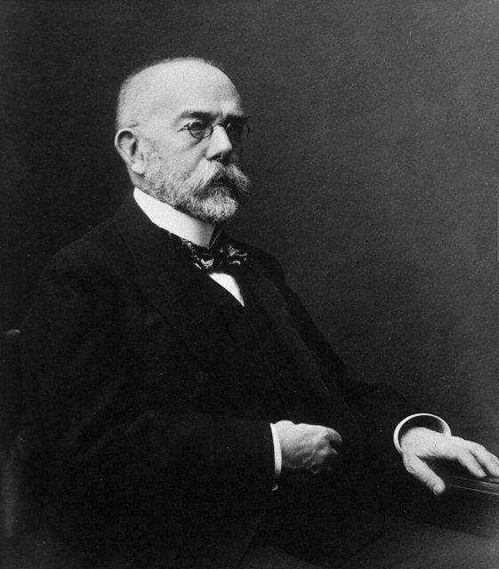
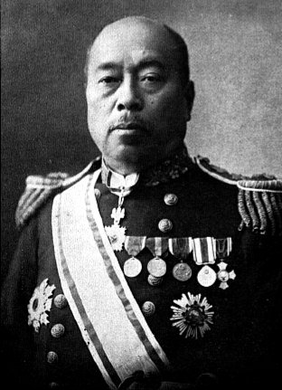
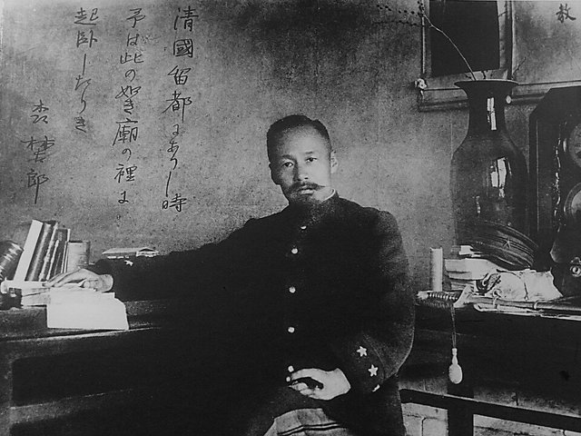
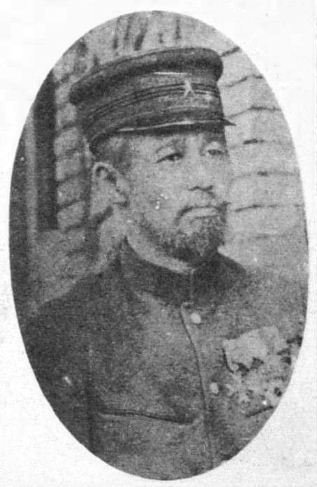
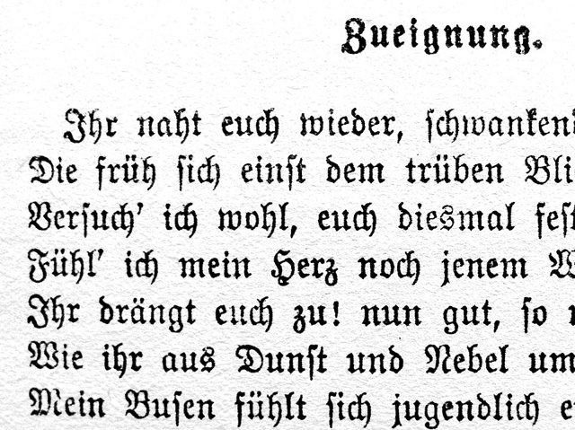
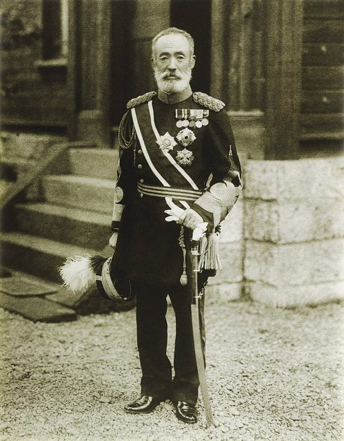

<!--
內容整理自 D:\Books\html\6-4.日本文學家\森鷗外.html（沒有對應的 md 筆記），並整合中文維基百科〈森鷗外〉條目，以自己的話改寫。
時期依生平歸納：津和野與求學、德國留學、軍醫與文壇、軍醫總監、晚年。
兩份資料出入與處理方式：
- 生卒：文久二年一月十九日（西曆1862年2月17日）生於石見國津和野；1922年7月9日去世。維基百科的導言寫7月9日、正文寫7月19日，一般記為7月9日，採7月9日。
- 大學畢業：維基百科寫1882年畢業並任陸軍軍醫副；一般記載是1881年7月畢業、12月任官，這裡寫1881年並說明。
- 德國留學：頁面與維基百科都寫1884年出發、留學四年；1888年回國。頁面說德國女子追隨他到橫濱，森家安排她返國，照頁面；這位女子是《舞姬》女主角愛麗絲的原型。
- 腳氣病論爭：頁面說森鷗外堅持細菌病原說、否定海軍高木兼寬的飲食改良，後來證實腳氣病是維生素B1缺乏；死亡人數各家說法不同，頁面採審慎寫法，這裡也不寫確切數字，只說日俄戰爭陸軍病患眾多。
- 頁面的「森林太郎與森鷗外的雙重身分」寫進時期說明；維基百科摘要很短，1899年小倉、1907年軍醫總監、1909年《性慾的生活》、1912年以後的歷史小說、1916年退役、1917年帝室博物館總長、遺言等依一般記載補充。
- 人名與其他時間軸一致：夏目漱石、樋口一葉、乃木希典、歌德。
圖片來源（皆為 Wikimedia Commons 公有領域／CC0 作品；註明「共用」者沿用其他時間軸已有的圖片）：
- mo-1916.jpg：Mori Ogai in the atelier of Sculptor Takeishi Kozaburo in 1916.jpg（森鷗外在雕刻家武石弘三郎的工作室，1916）
- mo-koch.jpg：Robert Koch NLM.jpg（羅伯特·科赫）
- mo-takaki.jpg：Takaki Kanehiro.jpg（海軍軍醫高木兼寬）
- mo-mukden.jpg：Mori Ōgai in Mukden 1905.jpg（1905年在奉天的森鷗外）
- mog-cover.jpg：Ogai Mori.jpg（身著軍裝的森鷗外）
- mo-faust.jpg：Goethe Faust Opening Fraktur 20052706 crop.jpg（歌德《浮士德》開頭的獻詩（德文原書））
- mo-nogi.jpg：Maresuke Nogi, 近世名士写真 其1 - Photo only.jpg（乃木希典）
-->

# Periods
- 1862-02-17 ~ 1884 | 津和野與求學 | #868e96
  生於津和野藩的藩醫世家，十歲隨父親上京，學習德語，十九歲從東京大學醫學部畢業，成為陸軍軍醫。
- 1884 ~ 1888 | 德國留學 | #1971c2
  以陸軍軍醫的身分到萊比錫、德勒斯登、慕尼黑與柏林學習衛生學與細菌學，也大量閱讀歐洲文學。
- 1888 ~ 1907 | 軍醫與文壇 | #364fc7
  回國後一面在陸軍任職，一面發表《舞姬》等小說、翻譯與評論，參與甲午、日俄兩場戰爭，並在腳氣病論爭中堅持錯誤的病原說。
- 1907 ~ 1916 | 軍醫總監 | #c92a2a
  升任陸軍軍醫總監，重返創作，乃木希典殉死後轉向歷史小說，寫出《雁》《阿部一族》《山椒大夫》《高瀨舟》。
- 1916 ~ 1922-07-09 | 晚年 | #495057
  退出軍職，任帝室博物館總長，寫作史傳，遺言要以「石見人森林太郎」的身分死去。

# Events

## 1862-02-17 | 出生於津和野
森鷗外生於石見國津和野（今島根縣津和野町），本名森林太郎，家族世代擔任津和野藩主龜井家的御典醫。他是長男，從小學習漢學與荷蘭語，被寄望繼承家業。

## 1872 | 隨父上京
明治維新後廢藩置縣，十歲的森林太郎隨父親到東京，進入私塾學習德語，為報考醫學校做準備。1874年，他謊報年齡進入東京醫學校預科（後來的東京大學醫學部）。

## 1881 | 大學畢業，成為陸軍軍醫
森林太郎從東京大學醫學部畢業，是當時最年輕的畢業生之一，同年年底任陸軍軍醫副，在東京陸軍病院服務（維基百科作1882年）。

## 1884 | 赴德留學

森鷗外奉陸軍之命赴德國留學，先後在萊比錫、德勒斯登、慕尼黑與柏林學習衛生學，在柏林師從細菌學家科赫。他深受當時德國細菌學的影響，相信腳氣病也是某種病原菌造成的傳染病；同時大量閱讀歐洲文學與哲學，受叔本華、哈特曼的思想影響。

## 1888 | 回國，德國戀人追到橫濱
留學四年後回國。不久，一名在柏林結識的德國女子搭船追到橫濱，森家擔心影響他的仕途與家族名聲，由家人出面勸她返回德國。1889年，他與海軍中將赤松則良的女兒登志子結婚，隔年長男出生後離婚。

## 1890 | 《舞姬》
森鷗外發表短篇小說《舞姬》，以典雅的文言寫一名日本留學生在柏林與舞女愛麗絲相戀，最後為了前途拋棄懷孕的戀人回國，被視為日本近代浪漫主義文學的起點，也被認為取材自他自己的經歷。同年又發表《泡沫記》，翻譯的詩集《於母影》也在前一年出版。

## 1892 | 翻譯《即興詩人》
森鷗外開始翻譯安徒生的《即興詩人》，前後花了將近十年，以優美的文言譯筆廣受讚譽。他也主持文藝雜誌《柵草紙》，與坪內逍遙展開「沒理想論爭」，討論文學是否應有理想。1893年起任陸軍軍醫學校校長。

## 1894 | 甲午戰爭與腳氣病

甲午戰爭爆發，森鷗外以軍醫身分到朝鮮與中國東北，戰後又被派到台灣。陸軍以白米為主食，腳氣病大量發生；海軍軍醫高木兼寬早在1884年就以改善伙食大幅減少腳氣病，森鷗外卻堅持細菌病原說，陸軍遲遲不改白米飯。

## 1899 | 調任小倉
森鷗外調任第十二師團軍醫部長，派駐九州的小倉，被他視為「左遷」。他在小倉學習法語與梵文，翻譯克勞塞維茨的《戰爭論》，1902年回到東京。

## 1904 | 日俄戰爭

森鷗外以第二軍軍醫部長的身分出征。陸軍在這場戰爭中有大量士兵罹患腳氣病，許多人因此死亡，後來證實腳氣病是缺乏維生素B1所致，他堅持的細菌病原說被證明錯誤，成為他一生最受爭議的地方。

## 1907 | 陸軍軍醫總監

森鷗外升任陸軍軍醫總監、陸軍省醫務局長，到達軍醫體系的頂點。同年他與文人組織歌會，重新活躍於文壇；1909年參與創刊文藝雜誌《昴》，發表的《性慾的生活》被當局查禁。

## 1911 | 《雁》

森鷗外開始連載中篇小說《雁》（至1913年），寫明治初年一名放高利貸者的小妾，對一位常從門前經過的醫學生暗生情愫，是他現代小說的代表作。他也翻譯歌德的《浮士德》，在1913年出版。

## 1912 | 乃木希典殉死，轉向歷史小說

明治天皇去世，大將乃木希典在大喪當天與妻子自殺殉死。森鷗外深受震撼，幾天內寫出《興津彌五右衛門的遺書》，此後轉向以江戶時代為題材的歷史小說，1913年發表《阿部一族》，1915年發表《山椒大夫》。

## 1916 | 《高瀨舟》，退役
森鷗外發表《高瀨舟》，寫押送罪人的差役與一位因幫助病重的弟弟解脫而被判刑的男子，觸及安樂死的問題。同年他辭去軍醫總監，退出軍職，並開始連載史傳《澀江抽齋》，以考證寫江戶時代的一位醫師學者。

## 1917 | 帝室博物館總長
森鷗外出任帝室博物館總長兼圖書頭，主持博物館與皇室圖書的事務，晚年仍持續考證與寫作史傳。

## 1922-07-09 | 逝世
森鷗外因腎病與肺結核在東京去世，享年60歲。他在遺言中拒絕一切官方榮典，要求墓碑上只刻「森林太郎墓」，說「我願以石見人森林太郎的身分死去」。他與夏目漱石並稱明治文學的兩大高峰，也曾公開讚揚樋口一葉的《青梅竹馬》。
