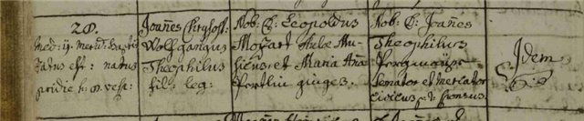
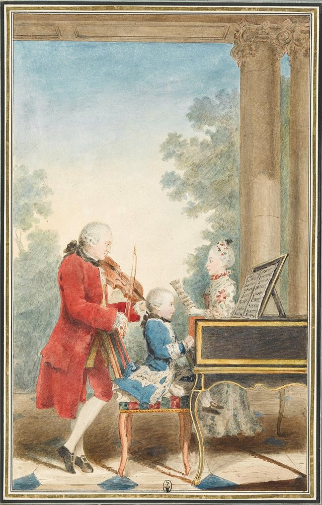
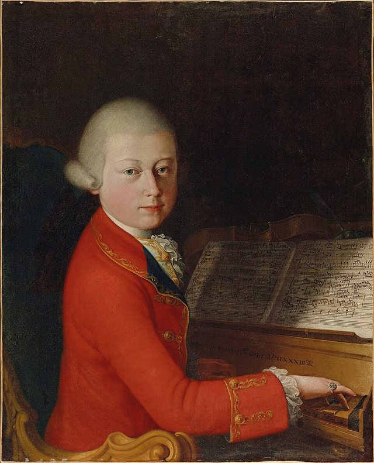
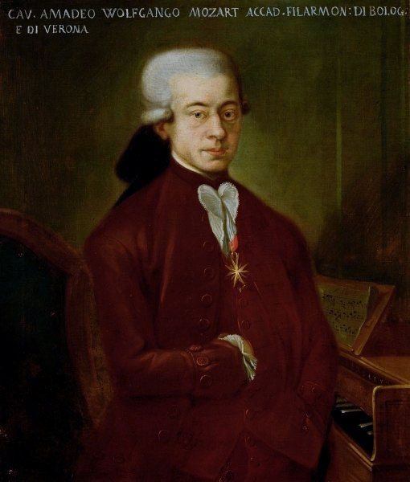
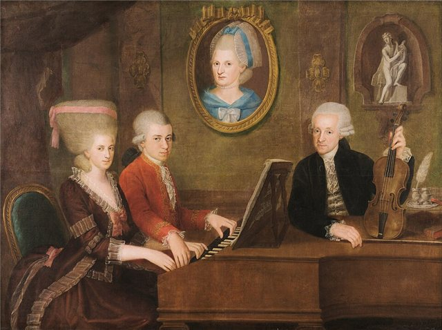
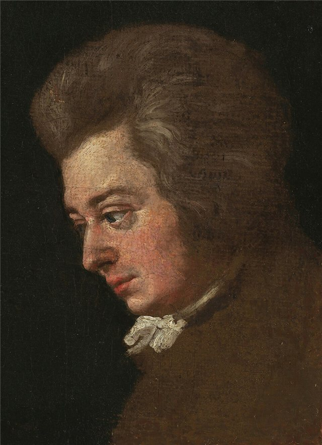
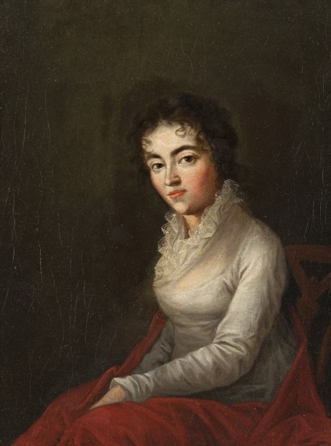
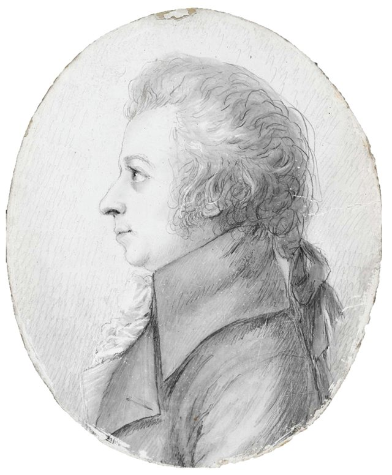
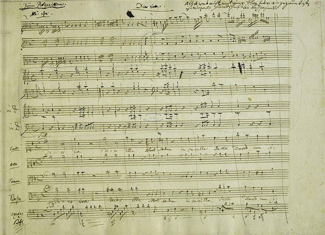

<!--
內容整理自中文維基百科「沃夫岡·阿瑪迪斯·莫札特」條目（CC BY-SA 4.0），並以台灣用語改寫摘要。
https://zh.wikipedia.org/zh-tw/沃夫岡·阿瑪迪斯·莫札特
圖片皆為 Wikimedia Commons 上的公有領域作品（封面：芭芭拉·克拉夫特 1819 年所繪肖像）。
-->

# Periods
- 1756 ~ 1762 | 童年@薩爾茲堡(Salzburg)
  父親李奧波德是薩爾茲堡宮廷樂團的小提琴手，也是莫札特唯一的老師。3歲的莫札特在姊姊南妮兒學琴時就展露天分，擁有絕對音感與驚人的記憶力，5歲開始學大鍵琴，接著是小提琴、管風琴與作曲。
- 1762 ~ 1773 | 神童巡演與義大利之旅
  父母帶著莫札特與姊姊以「神童」之姿巡迴歐洲各宮廷，足跡遍及慕尼黑、維也納、巴黎、倫敦與海牙。之後父親又三度帶他前往音樂重鎮義大利，學習對位法並承接歌劇委託。
- 1773 ~ 1777 | 薩爾茲堡宮廷樂師
  受聘於親王大主教柯羅雷多，創作交響曲、奏鳴曲、四重奏、彌撒曲與小夜曲。但年薪只有150弗羅林，薩爾茲堡又少有寫歌劇的機會，他越來越不滿，多次到外地求職未果。
- 1777 ~ 1779 | 曼海姆與巴黎求職之旅
  辭去薩爾茲堡職務，經慕尼黑、奧格斯堡、曼海姆前往巴黎謀職。在曼海姆愛上女高音阿羅伊齊亞·韋伯；在巴黎長期失業、負債，母親也在當地病逝，最後只能失意返鄉。
- 1779 ~ 1781 | 重返薩爾茲堡
  父親說服大主教重新聘用他，擔任宮廷管風琴師，但他對薩爾茲堡的不滿絲毫未減。
- 1781 ~ 1791 | 維也納時期@Wien
  與大主教決裂後定居維也納，成為獨立的鋼琴家與作曲家。前期以鋼琴協奏曲音樂會大受歡迎，後期轉向歌劇並完成最著名的作品；收入一度優渥，但生活奢侈，晚年財務困窘。

# Events

## 1756-01-27 | 出生@薩爾茲堡

出生於薩爾茲堡糧食街9號，是家中第七個孩子，但只有他和姊姊南妮兒長大成人。受洗名為約安內斯·克里索斯托穆斯·沃夫岡古斯·特奧菲盧斯·莫札特，成年後常自稱「沃夫岡·阿瑪德·莫札特」。

## 1762 | 首次巡演；寫出最早的作品
6歲時已寫出四首小步舞曲和一首快板，並隨家人到慕尼黑的巴伐利亞選侯宮廷演出，接著前往維也納與布拉格。

## 1763 ~ 1766 | 莫札特家族大旅行

長達三年半的巡演，經曼海姆、巴黎、倫敦、海牙，再取道蘇黎世與慕尼黑返鄉。旅途中結識許多音樂家，但也飽受舟車勞頓，父親與兩姊弟都曾在途中重病。

## 1764 | 倫敦結識J.C.巴赫；第一首交響曲
在倫敦遇見巴赫的么子約翰·克里斯蒂安·巴赫，對他日後的風格影響深遠。8歲的莫札特在他的啟發下寫出第一首交響曲（降E大調，K.16）。

## 1767 | 第一部歌劇《阿波羅與雅辛托斯》
11歲寫出的拉丁語喜劇，由薩爾茲堡大學附屬中學的學生演出。

## 1768 | 歌劇《巴斯蒂安與巴斯蒂妮》、《善意的謊言》
12歲時在維也納完成兩部歌劇，隔年獲大主教任命為樂團首席。

## 1769-12 | 首次義大利之旅

父親請了無薪假，帶他到義大利研習。在波隆納向馬蒂尼神父學習對位法。

## 1770 | 獲封金馬刺騎士；《本都王米特里達梯》首演

破例成為博洛尼亞愛樂學院會員（該學院通常只收20歲以上的成人），教宗克勉十四世冊封他為金馬刺騎士。同年在米蘭首演歌劇《本都王米特里達梯》，之後陸續接到更多歌劇委託。

## 1773-03-13 | 返回薩爾茲堡任宮廷樂師
與父親回到薩爾茲堡，受聘於新任親王大主教柯羅雷多。同年在維也納寫下早期的6首弦樂四重奏，可能受到海頓 Op. 20 的啟發。

## 1775 | 五首小提琴協奏曲
4月至12月間寫完全部五首小提琴協奏曲，此後再也沒有寫這個體裁。後三首（K.216、218、219）最受歡迎。

## 1777-09-23 | 辭職，啟程外出求職
辭去薩爾茲堡的職務，與母親一同出發，經慕尼黑、奧格斯堡到曼海姆，結識了曼海姆樂團的成員。

## 1778-06 | 《巴黎》交響曲首演
在巴黎求職期間寫下第31號交響曲《巴黎》，同一時期還有第8號鋼琴奏鳴曲。

## 1778-07-03 | 母親在巴黎病逝
失業超過半年、開始負債的莫札特，又遭逢母親病逝的打擊。

## 1779-01-15 | 失意返回薩爾茲堡

在慕尼黑重遇阿羅伊齊亞，她已是成功的歌手並另有所愛。求職無望的莫札特只好回到薩爾茲堡。

## 1781-01-29 | 歌劇《依多美尼歐》首演
受慕尼黑委託創作的歌劇《克里特之王依多美尼歐》首演，大獲成功。

## 1781-06 | 與大主教決裂，定居維也納
隨大主教到維也納期間，兩人矛盾達到頂點。莫札特堅持辭職，父親也反對，最後辭呈雖獲批准，卻是以極具侮辱性的方式。他決定留在維也納，以獨立音樂家身分謀生。

## 1781-12-24 | 與克萊門蒂的鋼琴比試
在宮廷舉辦的鋼琴競演中與克萊門蒂一較高下，從此奠定「維也納最優秀鋼琴家」的地位。

## 1782-07-16 | 歌劇《後宮誘逃》首演

應皇帝約瑟夫二世要求寫成的德語歌劇，首演轟動，隨後在各德語地區上演，確立了他作曲家的聲望。

## 1782-08-04 | 與康絲坦茲結婚

與韋伯家的小女兒康絲坦茲在聖史蒂芬大教堂成婚，父親的同意書在婚禮隔天才寄到。兩人生了6個孩子，只有兩個兒子長大成人。

## 1784-12-14 | 加入共濟會
很快升任會長。共濟會在他餘生扮演重要角色，他也為共濟會的各種場合寫了不少作品。

## 1785 | 《海頓四重奏》
把1782年起寫成的六首弦樂四重奏題獻給好友海頓。海頓聽過後對莫札特的父親說，他的兒子是自己所知道最偉大的作曲家。1782到1785年間，莫札特也幾乎每隔幾個月就推出一首新的鋼琴協奏曲，親自擔任獨奏。

## 1786-05-01 | 歌劇《費加洛婚禮》首演
與劇作家達·彭特首度合作，改編自博馬舍的劇本。因題材敏感一度被禁，修改後才在維也納首演。在布拉格的反應更熱烈，他因此寫下第38號交響曲《布拉格》獻給這座城市。

## 1787-05-28 | 父親李奧波德去世

## 1787-10 | 歌劇《唐·喬凡尼》布拉格首演
再度與達·彭特合作，為布拉格劇院而寫，首演反應熱烈，但隔年在維也納的演出就沒有同樣的成功。

## 1787-12 | 獲任宮廷室內樂作曲家
格魯克去世後，皇帝約瑟夫二世任命莫札特接任。這是兼職，年薪800弗羅林，只需為宮廷年度舞會寫舞曲，卻是他晚年重要的收入來源。

## 1788 | 最後三首交響曲
奧土戰爭爆發後貴族贊助減少，他搬到郊區節省開支，並開始向共濟會友人普赫貝格借錢。即使如此，他在6到8月間一口氣完成第39、40與41號《朱庇特》三首交響曲。

## 1789 | 萊比錫、德勒斯登、柏林之旅

為了增加收入展開長途旅行，隔年又前往法蘭克福、曼海姆等德意志城市。

## 1790-01-26 | 歌劇《女人皆如此》首演
與達·彭特合作的最後一部歌劇。同年2月約瑟夫二世駕崩，繼任的利奧波德二世不喜歡莫札特，好友海頓又遠赴倫敦，他的心情更加低落。

## 1791-09-06 | 歌劇《狄托的仁慈》首演
為利奧波德二世加冕而寫，必須在三週內完成。這一年他還寫下最後一首鋼琴協奏曲（第27號）與經文歌《聖體頌》。

## 1791-09-30 | 歌劇《魔笛》首演
應友人席卡內德之邀創作，由莫札特親自指揮首演，大受歡迎。此時他已身體不適。

## 1791-10 | A大調單簧管協奏曲
在《魔笛》首演後馬不停蹄完成，接著繼續寫作7月接下的匿名委託《安魂曲》。

## 1791-12-05 | 逝世@維也納

11月下旬起臥床不起，12月5日去世，年僅35歲，確切死因至今未有定論。《安魂曲》未能完成，由學生蘇斯邁爾續完。他依當時維也納的習俗安葬在郊區的聖馬克思墓園，並非電影或民間傳說中的草率埋葬。
