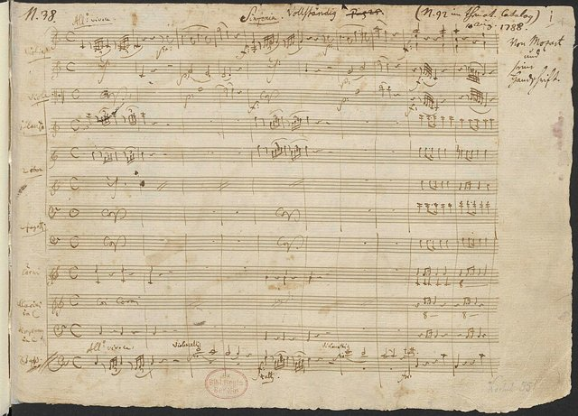
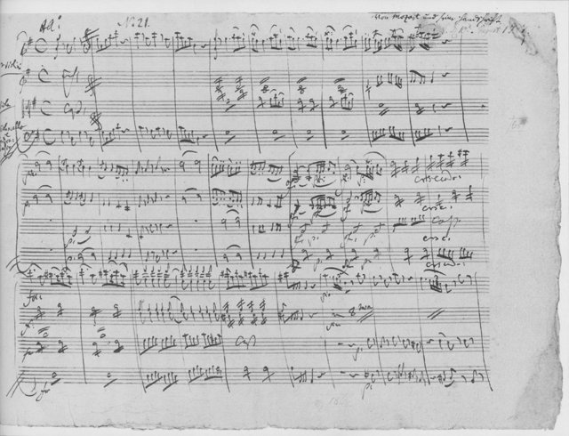
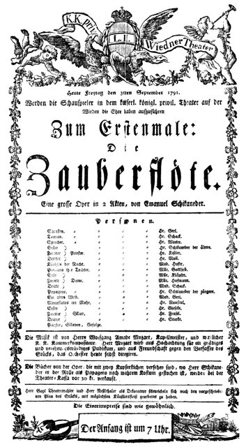

<!--
內容整理自本機筆記〈莫札特主要作品〉（D:\Books\md\音樂\莫札特主要作品.md，網頁版在知識圖譜的「9-2.音樂家作品」），做法比照「貝多芬主要作品」。
- 每首作品一則事件，日期採「創作時間」（多年創作的作品以區間呈現；「年代」以十年計、「世紀」以百年計，修訂或出版年份只寫在顯示文字裡），事件顏色依筆記的類別段落區分：交響曲、鋼琴協奏曲、小提琴、木管與其他協奏曲、鋼琴奏鳴曲與鋼琴獨奏曲、室內樂：弦樂四重奏、五重奏與小夜曲、歌劇、宗教音樂與大型合唱作品、藝術歌曲、詠嘆調與其他聲樂作品。
- 「約」、「前後」、修訂、出版等不是單純年份的寫法，以原文作為顯示文字。
- 作品編號是目錄編號，不等於創作順序，時間軸依創作時間排序。
- 筆記沒有分期，時期沿用「莫札特生平」時間軸的主要時期（重疊的細分時期不列）。
- 筆記「最值得優先聆聽」清單中的作品另註明順序。
- 以 follows 排在「莫札特生平」之後；生平事件見該時間軸。
圖片來源（皆為 Wikimedia Commons 公有領域作品，多為手稿、初版樂譜與首演海報；封面為1791年9月30日《魔笛》首演海報；註明「共用」者沿用生平時間軸的圖片）：
- mozartw-jupiter.jpg：First page Mozart k 551.jpg（《朱彼得》交響曲手稿首頁，1788）
- mozartw-nachtmusik.jpg：Mozart - Eine kleine Nachtmusik K.525 autograph.png（《小夜曲》手稿）
- mozartw-zauberfloete.jpg：Zauberflöte-Theaterzettel1791.jpg（1791年9月30日《魔笛》首演海報）
- mozart-1791-requiem.jpg（《安魂曲》手稿（與莫札特生平共用））
-->

# Periods
- 1756 ~ 1762 | 童年@薩爾茲堡(Salzburg)
  父親李奧波德是薩爾茲堡宮廷樂團的小提琴手，也是莫札特唯一的老師。3歲的莫札特在姊姊南妮兒學琴時就展露天分，擁有絕對音感與驚人的記憶力，5歲開始學大鍵琴，接著是小提琴、管風琴與作曲。
- 1762 ~ 1773 | 神童巡演與義大利之旅
  父母帶著莫札特與姊姊以「神童」之姿巡迴歐洲各宮廷，足跡遍及慕尼黑、維也納、巴黎、倫敦與海牙。之後父親又三度帶他前往音樂重鎮義大利，學習對位法並承接歌劇委託。
- 1773 ~ 1777 | 薩爾茲堡宮廷樂師
  受聘於親王大主教柯羅雷多，創作交響曲、奏鳴曲、四重奏、彌撒曲與小夜曲。但年薪只有150弗羅林，薩爾茲堡又少有寫歌劇的機會，他越來越不滿，多次到外地求職未果。
- 1777 ~ 1779 | 曼海姆與巴黎求職之旅
  辭去薩爾茲堡職務，經慕尼黑、奧格斯堡、曼海姆前往巴黎謀職。在曼海姆愛上女高音阿羅伊齊亞·韋伯；在巴黎長期失業、負債，母親也在當地病逝，最後只能失意返鄉。
- 1779 ~ 1781 | 重返薩爾茲堡
  父親說服大主教重新聘用他，擔任宮廷管風琴師，但他對薩爾茲堡的不滿絲毫未減。
- 1781 ~ 1791 | 維也納時期@Wien
  與大主教決裂後定居維也納，成為獨立的鋼琴家與作曲家。前期以鋼琴協奏曲音樂會大受歡迎，後期轉向歌劇並完成最著名的作品；收入一度優渥，但生活奢侈，晚年財務困窘。

# Events

## 1764 | K. 16 第一號交響曲，降 E 大調 {color=#c92a2a}
類別：交響曲（交響曲）。

## 1765 | K. 19 第四號交響曲，D 大調 {color=#c92a2a}
類別：交響曲（交響曲）。

## 1767 | K. 43 第六號交響曲，F 大調 {color=#c92a2a}
類別：交響曲（交響曲）。

## 1772 | K. 73 第九號交響曲，C 大調 {color=#c92a2a label="約1772"}
類別：交響曲（交響曲）。

## 1773 | K. 183 第二十五號交響曲，G 小調 {color=#c92a2a}
類別：交響曲（交響曲）。入門推薦聆聽第 12 首。

## 1774 | K. 201 第二十九號交響曲，A 大調 {color=#c92a2a}
類別：交響曲（交響曲）。

## 1778 | K. 297 第三十一號《巴黎》交響曲，D 大調 {color=#c92a2a}
類別：交響曲（交響曲）。

## 1779 | K. 318 第三十二號交響曲，G 大調 {color=#c92a2a}
類別：交響曲（交響曲）。

## 1780 | K. 338 第三十三號交響曲，降 B 大調 {color=#c92a2a}
類別：交響曲（交響曲）。

## 1782 | K. 385 第三十五號《哈夫納》交響曲，D 大調 {color=#c92a2a}
類別：交響曲（交響曲）。

## 1783 | K. 425 第三十六號《林茲》交響曲，C 大調 {color=#c92a2a}
類別：交響曲（交響曲）。

## 1786 | K. 504 第三十八號《布拉格》交響曲，D 大調 {color=#c92a2a}
類別：交響曲（交響曲）。

## 1788 | K. 543 第三十九號交響曲，降 E 大調 {color=#c92a2a}
類別：交響曲（交響曲）。

## 1788 | K. 550 第四十號交響曲，G 小調 {color=#c92a2a}
類別：交響曲（交響曲）。入門推薦聆聽第 1 首。

## 1788 | K. 551 第四十一號《朱彼得》交響曲，C 大調 {color=#c92a2a}

類別：交響曲（交響曲）。入門推薦聆聽第 2 首。

## 1773 | K. 175 第一號鋼琴協奏曲，D 大調 {color=#1971c2}
類別：鋼琴協奏曲（鋼琴協奏曲）。

## 1776 | K. 238 第六號鋼琴協奏曲，降 B 大調 {color=#1971c2}
類別：鋼琴協奏曲（鋼琴協奏曲）。

## 1776 | K. 246 第八號鋼琴協奏曲，C 大調 {color=#1971c2}
類別：鋼琴協奏曲（鋼琴協奏曲）。

## 1777 | K. 271 第九號《茱諾姆》協奏曲，降 E 大調 {color=#1971c2}
類別：鋼琴協奏曲（鋼琴協奏曲）。

## 1779 | K. 365 第十號雙鋼琴協奏曲，降 E 大調 {color=#1971c2}
類別：雙鋼琴協奏曲（鋼琴協奏曲）。

## 1782 ~ 1783 | K. 413 第十一號鋼琴協奏曲，F 大調 {color=#1971c2}
類別：鋼琴協奏曲（鋼琴協奏曲）。

## 1782 | K. 414 第十二號鋼琴協奏曲，A 大調 {color=#1971c2}
類別：鋼琴協奏曲（鋼琴協奏曲）。

## 1782 ~ 1783 | K. 415 第十三號鋼琴協奏曲，C 大調 {color=#1971c2}
類別：鋼琴協奏曲（鋼琴協奏曲）。

## 1784 | K. 450 第十五號鋼琴協奏曲，降 B 大調 {color=#1971c2}
類別：鋼琴協奏曲（鋼琴協奏曲）。

## 1785 | K. 466 第二十號鋼琴協奏曲，D 小調 {color=#1971c2}
類別：鋼琴協奏曲（鋼琴協奏曲）。入門推薦聆聽第 4 首。

## 1785 | K. 467 第二十一號鋼琴協奏曲，C 大調 {color=#1971c2}
類別：鋼琴協奏曲（鋼琴協奏曲）。入門推薦聆聽第 3 首。

## 1786 | K. 488 第二十三號鋼琴協奏曲，A 大調 {color=#1971c2}
類別：鋼琴協奏曲（鋼琴協奏曲）。

## 1786 | K. 491 第二十四號鋼琴協奏曲，C 小調 {color=#1971c2}
類別：鋼琴協奏曲（鋼琴協奏曲）。

## 1786 | K. 503 第二十五號鋼琴協奏曲，C 大調 {color=#1971c2}
類別：鋼琴協奏曲（鋼琴協奏曲）。

## 1788 | K. 537 第二十六號《加冕》協奏曲，D 大調 {color=#1971c2}
類別：鋼琴協奏曲（鋼琴協奏曲）。

## 1791 | K. 595 第二十七號鋼琴協奏曲，降 B 大調 {color=#1971c2}
類別：鋼琴協奏曲（鋼琴協奏曲）。

## 1773 | K. 207 第一號小提琴協奏曲，降 B 大調 {color=#e67700}
類別：小提琴協奏曲（小提琴、木管與其他協奏曲）。

## 1775 | K. 211 第二號小提琴協奏曲，D 大調 {color=#e67700}
類別：小提琴協奏曲（小提琴、木管與其他協奏曲）。

## 1775 | K. 216 第三號小提琴協奏曲，G 大調 {color=#e67700}
類別：小提琴協奏曲（小提琴、木管與其他協奏曲）。

## 1775 | K. 218 第四號小提琴協奏曲，D 大調 {color=#e67700}
類別：小提琴協奏曲（小提琴、木管與其他協奏曲）。

## 1775 | K. 219 第五號《土耳其》小提琴協奏曲，A 大調 {color=#e67700}
類別：小提琴協奏曲（小提琴、木管與其他協奏曲）。

## 1778 | K. 297b 長笛協奏曲，D 大調（作品歸屬與版本有爭議） {color=#e67700 label="約1778"}
類別：長笛協奏曲（小提琴、木管與其他協奏曲）。

## 1778 | K. 299 長笛與豎琴協奏曲，C 大調 {color=#e67700}
類別：雙重協奏曲（小提琴、木管與其他協奏曲）。

## 1778 | K. 313 第一號長笛協奏曲，G 大調 {color=#e67700}
類別：長笛協奏曲（小提琴、木管與其他協奏曲）。

## 1777 ~ 1778 | K. 314 第二號長笛協奏曲，D 大調 {color=#e67700 label="約1777–1778"}
類別：長笛協奏曲（小提琴、木管與其他協奏曲）。

## 1779 | K. 365 降 E 大調雙鋼琴協奏曲 {color=#e67700}
類別：雙鋼琴協奏曲（小提琴、木管與其他協奏曲）。

## 1779 | K. 364 降 E 大調交響協奏曲（小提琴、中提琴） {color=#e67700}
類別：交響協奏曲（小提琴、木管與其他協奏曲）。

## 1783 | K. 417 第二號法國號協奏曲，降 E 大調 {color=#e67700}
類別：法國號協奏曲（小提琴、木管與其他協奏曲）。

## 1787 | K. 447 第三號法國號協奏曲，降 E 大調 {color=#e67700 label="約1787"}
類別：法國號協奏曲（小提琴、木管與其他協奏曲）。

## 1786 | K. 495 第四號法國號協奏曲，降 E 大調 {color=#e67700}
類別：法國號協奏曲（小提琴、木管與其他協奏曲）。

## 1791 | K. 622 A 大調單簧管協奏曲 {color=#e67700}
類別：單簧管協奏曲（小提琴、木管與其他協奏曲）。入門推薦聆聽第 7 首。

## 1774 ~ 1775 | K. 279 C 大調鋼琴奏鳴曲 {color=#2f9e44}
類別：鋼琴奏鳴曲（鋼琴奏鳴曲與鋼琴獨奏曲）。

## 1774 ~ 1775 | K. 280 F 大調鋼琴奏鳴曲 {color=#2f9e44}
類別：鋼琴奏鳴曲（鋼琴奏鳴曲與鋼琴獨奏曲）。

## 1774 ~ 1775 | K. 281 降 B 大調鋼琴奏鳴曲 {color=#2f9e44}
類別：鋼琴奏鳴曲（鋼琴奏鳴曲與鋼琴獨奏曲）。

## 1774 ~ 1775 | K. 282 降 E 大調鋼琴奏鳴曲 {color=#2f9e44}
類別：鋼琴奏鳴曲（鋼琴奏鳴曲與鋼琴獨奏曲）。

## 1774 ~ 1775 | K. 283 G 大調鋼琴奏鳴曲 {color=#2f9e44}
類別：鋼琴奏鳴曲（鋼琴奏鳴曲與鋼琴獨奏曲）。

## 1778 | K. 310 A 小調鋼琴奏鳴曲 {color=#2f9e44}
類別：鋼琴奏鳴曲（鋼琴奏鳴曲與鋼琴獨奏曲）。

## 1783 | K. 330 C 大調鋼琴奏鳴曲 {color=#2f9e44 label="約1783"}
類別：鋼琴奏鳴曲（鋼琴奏鳴曲與鋼琴獨奏曲）。

## 1783 | K. 331 A 大調鋼琴奏鳴曲，第三樂章《土耳其進行曲》 {color=#2f9e44 label="約1783"}
類別：鋼琴奏鳴曲（鋼琴奏鳴曲與鋼琴獨奏曲）。入門推薦聆聽第 6 首。

## 1783 | K. 332 F 大調鋼琴奏鳴曲 {color=#2f9e44 label="約1783"}
類別：鋼琴奏鳴曲（鋼琴奏鳴曲與鋼琴獨奏曲）。

## 1783 | K. 333 降 B 大調鋼琴奏鳴曲 {color=#2f9e44 label="約1783"}
類別：鋼琴奏鳴曲（鋼琴奏鳴曲與鋼琴獨奏曲）。

## 1784 | K. 457 C 小調鋼琴奏鳴曲 {color=#2f9e44}
類別：鋼琴奏鳴曲（鋼琴奏鳴曲與鋼琴獨奏曲）。

## 1788 | K. 545 C 大調鋼琴奏鳴曲（常稱《簡易奏鳴曲》） {color=#2f9e44}
類別：鋼琴奏鳴曲（鋼琴奏鳴曲與鋼琴獨奏曲）。入門推薦聆聽第 14 首。

## 1789 | K. 570 降 B 大調鋼琴奏鳴曲 {color=#2f9e44}
類別：鋼琴奏鳴曲（鋼琴奏鳴曲與鋼琴獨奏曲）。

## 1789 | K. 576 D 大調鋼琴奏鳴曲 {color=#2f9e44}
類別：鋼琴奏鳴曲（鋼琴奏鳴曲與鋼琴獨奏曲）。

## 1782 | K. 397 D 小調幻想曲 {color=#2f9e44 label="約1782"}
類別：鋼琴幻想曲（鋼琴奏鳴曲與鋼琴獨奏曲）。

## 1785 | K. 475 C 小調幻想曲 {color=#2f9e44}
類別：鋼琴幻想曲（鋼琴奏鳴曲與鋼琴獨奏曲）。

## 1781 ~ 1782 | K. 265 《啊！媽媽，我要告訴你》主題變奏曲（常稱《小星星變奏曲》） {color=#2f9e44 label="約1781–1782"}
類別：鋼琴變奏曲（鋼琴奏鳴曲與鋼琴獨奏曲）。

## 1783 | K. 331 《土耳其進行曲》所在奏鳴曲 {color=#2f9e44 label="約1783"}
類別：鋼琴奏鳴曲（鋼琴奏鳴曲與鋼琴獨奏曲）。入門推薦聆聽第 6 首。

## 1772 | K. 136 D 大調嬉遊曲 {color=#862e9c}
類別：弦樂合奏／嬉遊曲（室內樂：弦樂四重奏、五重奏與小夜曲）。

## 1772 | K. 138 F 大調嬉遊曲 {color=#862e9c}
類別：弦樂合奏／嬉遊曲（室內樂：弦樂四重奏、五重奏與小夜曲）。

## 1777 ~ 1778 | K. 285 D 大調長笛四重奏 {color=#862e9c}
類別：長笛四重奏（室內樂：弦樂四重奏、五重奏與小夜曲）。

## 1782 | K. 387 G 大調弦樂四重奏 {color=#862e9c}
類別：弦樂四重奏（室內樂：弦樂四重奏、五重奏與小夜曲）。

## 1783 | K. 421 D 小調弦樂四重奏 {color=#862e9c}
類別：弦樂四重奏（室內樂：弦樂四重奏、五重奏與小夜曲）。

## 1784 | K. 458 降 B 大調《狩獵》四重奏 {color=#862e9c}
類別：弦樂四重奏（室內樂：弦樂四重奏、五重奏與小夜曲）。

## 1785 | K. 465 C 大調《不協和音》四重奏 {color=#862e9c}
類別：弦樂四重奏（室內樂：弦樂四重奏、五重奏與小夜曲）。入門推薦聆聽第 13 首。

## 1786 | K. 499 D 大調《霍夫邁斯特》四重奏 {color=#862e9c}
類別：弦樂四重奏（室內樂：弦樂四重奏、五重奏與小夜曲）。

## 1787 | K. 515 C 大調弦樂五重奏 {color=#862e9c}
類別：弦樂五重奏（室內樂：弦樂四重奏、五重奏與小夜曲）。

## 1787 | K. 516 G 小調弦樂五重奏 {color=#862e9c}
類別：弦樂五重奏（室內樂：弦樂四重奏、五重奏與小夜曲）。

## 1787 | K. 522 《音樂玩笑》F 大調 {color=#862e9c}
類別：室內樂／諷刺性作品（室內樂：弦樂四重奏、五重奏與小夜曲）。

## 1787 | K. 525 G 大調《小夜曲》（Eine kleine Nachtmusik） {color=#862e9c}

類別：弦樂小夜曲（室內樂：弦樂四重奏、五重奏與小夜曲）。入門推薦聆聽第 5 首。

## 1788 | K. 563 降 E 大調弦樂三重奏嬉遊曲 {color=#862e9c}
類別：弦樂三重奏（室內樂：弦樂四重奏、五重奏與小夜曲）。

## 1789 | K. 581 A 大調《克拉里奈特五重奏》 {color=#862e9c}
類別：單簧管五重奏（室內樂：弦樂四重奏、五重奏與小夜曲）。

## 1791 | K. 614 降 E 大調弦樂五重奏 {color=#862e9c}
類別：弦樂五重奏（室內樂：弦樂四重奏、五重奏與小夜曲）。

## 1767 | K. 35 《第一誡的責任》 {color=#0c8599}
類別：神聖歌劇（歌劇）。

## 1767 | K. 38 《巴斯蒂安與巴斯蒂安娜》 {color=#0c8599}
類別：德語歌唱劇（歌劇）。

## 1767 | K. 50 《阿波羅與雅欽托》 {color=#0c8599}
類別：拉丁語學院劇（歌劇）。

## 1770 | K. 87 《米特里達特，龐托王》 {color=#0c8599}
類別：義大利正歌劇（歌劇）。

## 1771 | K. 111 《阿斯卡尼奧在阿爾巴》 {color=#0c8599}
類別：慶典歌劇（歌劇）。

## 1774 ~ 1775 | K. 196 《假女園丁》 {color=#0c8599}
類別：義大利喜歌劇（歌劇）。

## 1775 | K. 208 《牧羊王》 {color=#0c8599}
類別：田園歌劇（歌劇）。

## 1779 ~ 1780 | K. 344 《扎伊德》 {color=#0c8599}
類別：德語歌唱劇（未完成）（歌劇）。

## 1780 ~ 1781 | K. 366 《伊多美紐》 {color=#0c8599}
類別：義大利正歌劇（歌劇）。

## 1781 ~ 1782 | K. 384 《後宮誘逃》 {color=#0c8599}
類別：德語歌唱劇（歌劇）。

## 1786 | K. 492 《費加洛婚禮》 {color=#0c8599}
類別：義大利喜歌劇（歌劇）。入門推薦聆聽第 8 首。

## 1787 | K. 527 《唐・喬望尼》 {color=#0c8599}
類別：歌劇／喜歌劇（歌劇）。入門推薦聆聽第 9 首。

## 1789 ~ 1790 | K. 588 《女人皆如此》 {color=#0c8599}
類別：義大利喜歌劇（歌劇）。

## 1791 | K. 620 《魔笛》 {color=#0c8599}

類別：德語歌唱劇（歌劇）。入門推薦聆聽第 10 首。

## 1791 | K. 621 《狄托的仁慈》 {color=#0c8599}
類別：義大利正歌劇（歌劇）。

## 1768 | K. 49 D 小調彌撒曲 {color=#5f3dc4}
類別：彌撒曲（宗教音樂與大型合唱作品）。

## 1768 | K. 139 《本篤會院彌撒》／《孤兒院彌撒》 {color=#5f3dc4}
類別：彌撒曲（宗教音樂與大型合唱作品）。

## 1774 | K. 192 C 大調彌撒曲 {color=#5f3dc4}
類別：彌撒曲（宗教音樂與大型合唱作品）。

## 1775 | K. 220 《麻雀彌撒》 {color=#5f3dc4}
類別：彌撒曲（宗教音樂與大型合唱作品）。

## 1779 | K. 317 《加冕彌撒》 {color=#5f3dc4}
類別：彌撒曲（宗教音樂與大型合唱作品）。

## 1780 | K. 337 C 大調彌撒曲 {color=#5f3dc4}
類別：彌撒曲（宗教音樂與大型合唱作品）。

## 1780 | K. 339 《晚禱》中的《主啊，讚美祢》 {color=#5f3dc4}
類別：晚禱、合唱（宗教音樂與大型合唱作品）。

## 1782 ~ 1783 | K. 427 C 小調彌撒曲 {color=#5f3dc4}
類別：大型彌撒曲（未完成）（宗教音樂與大型合唱作品）。

## 1785 | K. 469 《悔罪者的莊嚴晚禱》 {color=#5f3dc4}
類別：宗教合唱（宗教音樂與大型合唱作品）。

## 1791 | K. 618 《聖母頌》 {color=#5f3dc4}
類別：合唱作品（宗教音樂與大型合唱作品）。

## 1791 | K. 626 《安魂曲》D 小調 {color=#5f3dc4}

類別：安魂彌撒（未完成）（宗教音樂與大型合唱作品）。入門推薦聆聽第 11 首。

## 1775 | K. 208 《牧羊王》中的詠嘆調與合唱 {color=#a61e4d}
類別：舞台聲樂（藝術歌曲、詠嘆調與其他聲樂作品）。

## 1780 ~ 1781 | K. 366 《伊多美紐》中的詠嘆調 {color=#a61e4d}
類別：歌劇詠嘆調（藝術歌曲、詠嘆調與其他聲樂作品）。

## 1783 | K. 418 《你要知道》 {color=#a61e4d}
類別：音樂會詠嘆調（藝術歌曲、詠嘆調與其他聲樂作品）。

## 1783 | K. 419 《我心中的愛人》 {color=#a61e4d}
類別：音樂會詠嘆調（藝術歌曲、詠嘆調與其他聲樂作品）。

## 1786 | K. 505 《我要離開你》 {color=#a61e4d}
類別：女高音、鋼琴與管弦樂（藝術歌曲、詠嘆調與其他聲樂作品）。

## 1787 | K. 530 《紫羅蘭》 {color=#a61e4d}
類別：藝術歌曲（藝術歌曲、詠嘆調與其他聲樂作品）。

## 1788 | K. 538 《誰知道我多麼愛你》 {color=#a61e4d}
類別：音樂會詠嘆調（藝術歌曲、詠嘆調與其他聲樂作品）。

## 1791 | K. 596 《春天的渴望》 {color=#a61e4d}
類別：藝術歌曲（藝術歌曲、詠嘆調與其他聲樂作品）。

## 1791 | K. 617 《小小的紡紗女》 {color=#a61e4d}
類別：玻璃琴與室內樂（藝術歌曲、詠嘆調與其他聲樂作品）。
