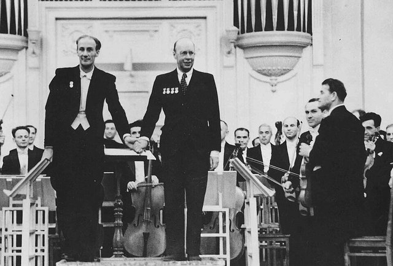

<!--
內容整理自中文維基百科「葉夫根尼·穆拉文斯基」與英文維基百科「Yevgeny Mravinsky」條目（CC BY-SA 4.0），並以台灣用語改寫摘要。
https://zh.wikipedia.org/zh-tw/叶夫根尼·穆拉文斯基
https://en.wikipedia.org/wiki/Yevgeny_Mravinsky
兩個條目都相當簡短。蕭士塔高維奇、普羅高菲夫各作品的首演日期，條目只列曲名，係依一般公認的史實補充。
兩者不一致處以英文條目為準（例如出任列寧格勒愛樂首席指揮的月份，中文條目作9月，英文條目作10月）。
圖片皆為 Wikimedia Commons 上的公有領域作品（封面：1938年的肖像）。
-->

# Periods
- 1903 ~ 1924 | 少年時期@聖彼得堡
  生於聖彼得堡，姑姑是著名女高音穆拉維娜。15歲喪父，進入馬林斯基劇院後台工作；先在大學讀生物學，後來才轉向音樂。
- 1924 ~ 1938 | 音樂學院與劇院指揮
  進入列寧格勒音樂學院，同時在芭蕾舞團擔任排練鋼琴師。1929年首次公開指揮，1930年代在基洛夫芭蕾舞團與莫斯科大劇院累積經驗。
- 1938 ~ 1988 | 列寧格勒愛樂的五十年@Leningrad
  贏得全蘇聯指揮大賽後出任列寧格勒愛樂首席指揮，直到去世，是20世紀任期最長的主要樂團首席指揮之一。首演了多首蕭士塔高維奇交響曲，把樂團打造成以紀律嚴謹聞名的世界級樂團。

# Events

## 1903-06-04 | 出生@聖彼得堡
生於當時俄羅斯帝國的首都聖彼得堡，一生大部分時間都在這座城市度過。姑姑是著名的女高音穆拉維娜。

## 1918 | 父親去世，進入馬林斯基劇院後台
父親亞歷山大去世，15歲的他開始在馬林斯基劇院後台工作，1923到1931年擔任芭蕾舞團的排練鋼琴師。

## 1924 | 進入列寧格勒音樂學院
原本在列寧格勒的大學讀生物學，後來靠著同父異母的姑姑、革命家柯倫泰向院長格拉祖諾夫與教育人民委員盧那察爾斯基推薦，以免學費的學生身分進入列寧格勒音樂學院。

## 1929 | 首次公開指揮
第一次站上指揮台公開演出。整個1930年代，他在基洛夫芭蕾舞團（原馬林斯基劇院）與莫斯科大劇院擔任指揮。

## 1931 | 首次指揮列寧格勒愛樂
初次客席指揮列寧格勒愛樂，之後幾年持續合作，與樂團逐漸建立默契。

## 1937-11-21 | 首演蕭士塔高維奇第五號交響曲
蕭士塔高維奇因《真理報》批判而陷入困境時，由34歲的他指揮列寧格勒愛樂首演第五號交響曲，演出非常成功，許多觀眾感動落淚。這是兩人長期合作的開始。

## 1938-09 | 贏得全蘇聯指揮大賽
在莫斯科舉行的全蘇聯指揮家比賽中奪得首獎。

## 1938-10 | 出任列寧格勒愛樂首席指揮
從此領導這個樂團直到去世，任期長達五十年。同年他開始灌錄唱片。

## 1939-11 | 首演蕭士塔高維奇第六號交響曲
在列寧格勒首演。

## 1941 | 隨樂團疏散到西伯利亞
二次大戰期間，他和樂團被疏散到西伯利亞。留在城裡的後備樂團與列寧格勒廣播交響樂團則經歷了長達872天的圍城，不少樂手在圍城中餓死或戰死。1942年在圍城中演出蕭士塔高維奇第七號交響曲的，是廣播樂團指揮艾利亞斯堡，而不是穆拉文斯基。

## 1943-11-04 | 首演蕭士塔高維奇第八號交響曲
這首悲劇色彩濃厚的交響曲由他在莫斯科首演，蕭士塔高維奇把它題獻給他。

## 1945-11 | 首演蕭士塔高維奇第九號交響曲
這首輕巧的「勝利交響曲」也是由他首演，後來讓作曲家遭到官方批評。

## 1946 | 首次出國巡演
到芬蘭巡演，並在捷克斯洛伐克的「布拉格之春」音樂節演出，展開他的國際生涯。

## 1947-10-11 | 首演普羅高菲夫第六號交響曲

在列寧格勒首演普羅高菲夫戰後寫成的第六號交響曲。不久後的1948年，蕭士塔高維奇與普羅高菲夫都在日丹諾夫批判中被點名。

## 1949-11 | 首演清唱劇《森林之歌》
首演蕭士塔高維奇在第二次譴責後寫的清唱劇《森林之歌》，這部歌頌史達林的作品幫助作曲家恢復了官方地位。

## 1953-12-17 | 首演蕭士塔高維奇第十號交響曲
史達林死後首演，成為新時代的代表作，與第五、第七號並列為作曲家最受歡迎的交響曲。

## 1954 | 蘇聯人民藝術家
獲頒「蘇聯人民藝術家」的稱號。

## 1955-10 | 首演第一號小提琴協奏曲
與小提琴家歐伊斯特拉赫首演蕭士塔高維奇在批判期間寫成、一直「藏在抽屜裡」的第一號小提琴協奏曲。

## 1956-06 | 西歐巡演；為DG錄製柴可夫斯基
率樂團巡演西德、東德、奧地利與瑞士。這段時期他也為德國唱片公司DG錄製柴可夫斯基的交響曲，先在維也納錄單聲道版，後來在倫敦錄立體聲版，成為傳世名盤。樂評形容他的柴可夫斯基：「列寧格勒愛樂就像一匹被主人意志勉強勒住的野馬，隨時可能狂奔起來，讓你分不清該興奮還是害怕。」

## 1959-10 | 首演第一號大提琴協奏曲
與大提琴家羅斯托波維奇首演蕭士塔高維奇的第一號大提琴協奏曲。

## 1960-09 | 唯一一次訪英
在愛丁堡音樂節與倫敦皇家節慶音樂廳演出，這是他和樂團唯一一次到英國。同年他與第三任妻子伊娜結婚。

## 1961 | 最後的錄音室錄音；首演第十二號交響曲
這一年後他不再進錄音室，此後發行的錄音都來自現場音樂會。10月他首演了蕭士塔高維奇獻給列寧的第十二號交響曲《1917年》。

## 1962 | 拒絕首演第十三號交響曲
妻子伊娜被診斷出癌症末期，他婉拒指揮蕭士塔高維奇第十三號交響曲「娘子谷」的首演。中文條目則認為是因為作品觸及政治敏感題材。這件事讓兩人的合作關係破裂，他後來也以準備時間不足為由，拒絕首演第二號大提琴協奏曲。

## 1963 | 列寧格勒音樂學院教授
成為列寧格勒音樂學院教授。

## 1964 | 第三任妻子伊娜去世
1967年他與第四任妻子亞歷山德拉結婚，兩人相伴到他去世。他一生結過四次婚。

## 1973 | 社會主義勞動英雄；首次訪日
獲頒「社會主義勞動英雄」稱號。5月首次率團訪問日本，之後又去了兩次。1970年代初他與蕭士塔高維奇修復了合作關係，在列寧格勒指揮了第十五號交響曲。

## 1984 | 最後的錄音與最後的海外巡演
4月一場蕭士塔高維奇第十二號交響曲的現場演出，成為他最後的錄音。同年率團到西德巡演，這是他最後一次出國。

## 1987-03-06 | 最後一場音樂會
指揮舒伯特第八號交響曲「未完成」與布拉姆斯第四號交響曲，這是他一生最後一場音樂會。他在台上總是神情樸素，動作簡潔清楚，常常不用指揮棒。

## 1988-01-19 | 逝世@列寧格勒
久病後在列寧格勒去世，享年84歲。在他領導下，列寧格勒愛樂以嚴謹的紀律、精確的合奏與厚實的弦樂聲響聞名，躋身世界一流樂團之列。
