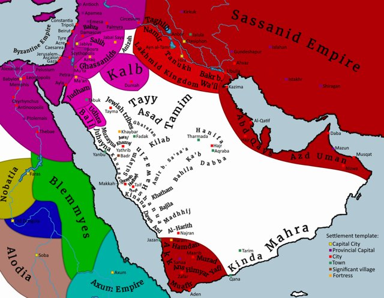
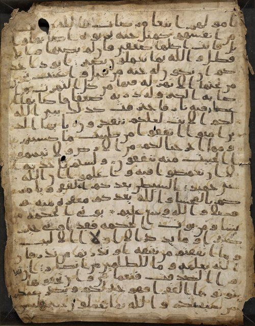
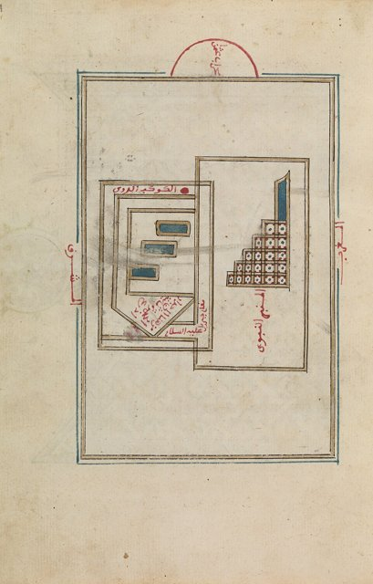
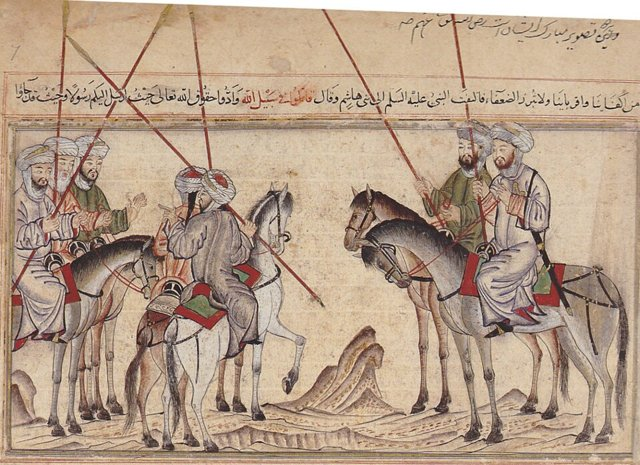
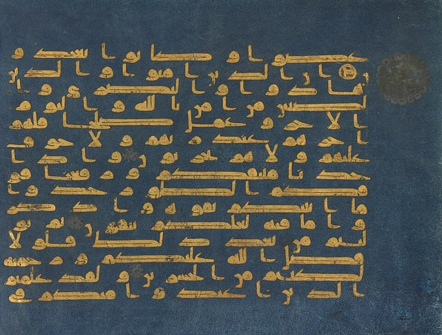

<!--
內容整理自 D:\Books\md\歷史\人物\思想家\穆罕默德生平大事記.md（Books 的人物頁為 D:\Books\html\2-6.西方宗教\穆罕默德(約570~632).html，另有〈伊斯蘭教〉總覽頁），並整合中文維基百科〈穆罕默德〉條目，以自己的話改寫。
時期依筆記的五個階段歸納：麥加出生與成長、婚姻與社會生活、接受啟示與麥加傳教、遷徙麥地那與建立共同體、統一阿拉伯半島與最後歲月。筆記的「重要人物」「五個歷史轉折」「與世界歷史的關係」（宗教、政治、《古蘭經》、伊斯蘭文明）「重要年代總表」寫進時期說明與相關事件，不另立事件。「穆罕默德二世」「穆罕默德·阿里」放入 notNames，避免人名索引把同名的其他人算成提到先知。
穆罕默德早年的生平主要來自後世的伊斯蘭傳記與傳統記載，筆記與維基百科都提醒史料對個別年份與細節有差異，這裡採通行的年代，並在有爭議的地方標「傳統」或「約」。
兩份資料出入與處理方式：
- 生卒：筆記寫約570年—632年；維基百科寫約570年—632年6月8日；這裡 born 採570（年份）、died 採632-06-08（筆記寫「632年6月8日左右」），網站自動算出的歲數是依這兩個日期推算，傳統說法享年約63歲（虛歲）。
- 出生與家族：筆記與維基百科同寫生於麥加的古萊氏部落哈希姆家族，傳統稱為「象年」（相傳葉門統治者阿卜拉哈率領象隊攻打麥加）；維基百科補充他的全名是艾布·卡西姆·穆罕默德·本·阿卜杜拉·本·阿卜杜勒·穆塔里布·本·哈希姆，過去有馬哈麻、馬合麻等異譯，中國穆斯林尊稱他為穆聖，這裡簡寫並列入 aliases。
- 早年：筆記寫父親阿卜杜拉在他出生前後去世、約576年六歲時母親阿米娜去世、約578年祖父阿卜杜勒·穆塔利卜去世，由叔父阿布·塔利卜照顧；傳統記載他曾由乳母哈利瑪撫養、牧羊、隨商隊經商，以誠信著稱而得到「艾敏」（可信賴者）的稱號，照此。維基百科補充他原本是阿拉伯的富商，照此。
- 婚姻：筆記寫約595年（約25歲）與富有的麥加商人寡婦赫蒂徹結婚，傳統說法她約40歲，但實際年齡有爭議，兩人育有數名子女（宰娜卜、魯蓋葉、烏姆·庫勒蘇姆、法蒂瑪與早夭的兒子卡西姆、阿卜杜拉），照此。
- 克爾白：筆記寫約605年參與重建克爾白，他提出由各部族共同抬起黑石、再由他安放的解決方式，照此。
- 啟示：筆記寫約610年在希拉山洞遇見天使吉卜利勒（加百列）接受啟示，妻子赫蒂徹最先給予支持；維基百科寫他在40歲時獲得真主的啟示，照此。
- 傳教：筆記寫約610–613年秘密傳教、約613年公開傳教、約615年部分信徒遷往阿比西尼亞、約616–619年哈希姆家族遭抵制、約619年「悲傷之年」（叔父與妻子相繼去世）、約620年「夜行與登霄」，照此，筆記說「夜行與登霄」是伊斯蘭傳統的記載。
- 阿克巴宣誓與希吉拉：筆記寫約621–622年麥地那（當時稱葉斯里卜）的部分居民與他立下承諾，622年遷往麥地那（希吉拉），成為伊斯蘭曆紀元的起點，照此。
- 麥地那：筆記寫約622–623年建立麥地那清真寺、制定麥地那憲章（具體形成方式與文本層次仍有學術討論），照此。
- 戰事：筆記寫624年白德爾之戰（穆斯林勝）、624年禮拜朝向由耶路撒冷改為麥加克爾白、625年吳侯德之戰（穆斯林遭受重大損失、穆罕默德受傷）、627年塹壕之戰、628年胡代比亞和約、629年穆塔之戰（與拜占庭及其阿拉伯盟軍交戰）、630年征服麥加與清除偶像、630年胡奈因之戰與圍攻塔伊夫與遠征塔布克、631年代表團之年，照此。維基百科對戰事的細節說得較少，這裡不再補充。
- 辭朝：筆記寫632年最後一次朝覲（辭朝）與辭朝演說：強調生命與財產的神聖性、禁止高利貸、男女權利義務與穆斯林之間的團結，照此。
- 逝世與繼承：筆記寫632年6月8日左右在麥地那逝世，葬於其住所（後來納入先知清真寺），阿布·伯克爾成為第一任哈里發；筆記補充歐麥爾、奧斯曼、阿里相繼成為第二至第四任哈里發，阿里是什葉派尊崇的人物，照此簡述。
- 《古蘭經》：筆記寫啟示主要發生於610年至632年間，其後經過收集、整理與編定；穆斯林相信是安拉透過天使吉卜利勒傳達給穆罕默德的啟示，照此。
- 人名與其他時間軸一致：耶穌（亞伯拉罕諸教的先知傳統）。
圖片來源（皆為 Wikimedia Commons 公有領域／CC0 作品；畫像、手抄本與雕像多為後世的作品，不代表事件當時的樣貌）：
- mh-cover.jpg：Wide shot of the Green Dome at The Prophet's Mosque (Al Masjid-e-Nabawi).jpg（麥地那先知清真寺的綠色圓頂）
- mh-map.jpg：Map of 600CE Arabia.png（公元600年前後的阿拉伯半島地圖）
- mh-sanaa.jpg：Sana'a1 Stanford '07 recto.jpg（早期的《古蘭經》手抄本殘葉（希賈茲體））
- mh-mosquems.jpg：Depiction of the Prophet's Mosque in Medina (CBL Ar 4223, f. 4a).jpg（先知清真寺的手抄本插圖）
- mh-badr.jpg：Battle of Badr.jpg（白德爾之戰的細密畫）
- mh-quran.jpg：Folio from the Blue Qur'an (CBL Is 1405A, f. 1b).jpg（《藍色古蘭經》的書頁）
-->

# Periods
- 570 ~ 594 | 出生與早年 | #868e96
  生於麥加的古萊氏哈希姆家族，在父母、祖父相繼去世後由叔父阿布·塔利卜撫養，以誠信聞名。
- 595 ~ 609 | 婚姻與商旅生活 | #2f9e44
  與赫蒂徹結婚，從事商業，參與克爾白黑石的調解，常到希拉山洞沉思靜修。
- 610 ~ 621 | 啟示與麥加傳教 | #1971c2
  在希拉山洞接受啟示，先秘密、後公開傳教，遭受迫害與抵制，經歷「悲傷之年」與夜行登霄。
- 622 ~ 629 | 遷徙麥地那與建立共同體 | #e8590c
  希吉拉遷往麥地那，建立清真寺與社群制度，經歷白德爾、吳侯德、塹壕之戰與胡代比亞和約。
- 630 ~ 632-06-08 | 統一阿拉伯半島與逝世 | #c92a2a
  進入麥加並清除偶像，各部族派代表歸附，完成辭朝後在麥地那逝世。

# Events

## 570 | 出生於麥加 {label="約570年（象年）"}

穆罕默德生於阿拉伯半島西部的麥加，屬於古萊氏部落中的哈希姆家族；傳統稱他出生的年份為「象年」，相傳葉門的統治者阿卜拉哈率領象隊攻打麥加。他的父親阿卜杜拉在他出生前後去世，因此他自幼喪父；傳統記載他曾由乳母哈利瑪撫養，在阿拉伯部族的生活環境中成長。

## 576 | 母親去世 {label="約576年（六歲）"}
穆罕默德約六歲時，母親阿米娜去世；約578年祖父阿卜杜勒·穆塔利卜去世，穆罕默德由叔父阿布·塔利卜照顧。青少年時期的他牧羊，也隨商隊從事貿易，因此熟悉阿拉伯半島的商業與部落社會，並因誠實可靠而得到「艾敏」（可信賴者）的稱號。

## 595 | 與赫蒂徹結婚 {label="約595年（約25歲）"}
穆罕默德與富有的麥加商人寡婦赫蒂徹結婚（傳統說她約40歲，實際年齡有史料爭議），兩人育有數名子女，包括女兒宰娜卜、魯蓋葉、烏姆·庫勒蘇姆、法蒂瑪，兒子卡西姆與阿卜杜拉兩人都早夭。

## 605 | 重建克爾白 {label="約605年"}
傳統記載，麥加的克爾白（Kaaba）受損而重建，各部族對於誰來安放黑石發生爭議，穆罕默德提出由各部族共同抬起黑石、再由他安放的解決方式，化解了衝突。

## 610 | 希拉山洞的啟示 {label="約610年"}

穆罕默德常到麥加附近的希拉山洞沉思靜修，對當時的多神信仰與社會不公有所反省；約610年（約40歲），傳統記載他在山洞中遇見天使吉卜利勒（加百列），接受來自安拉的啟示，這被視為伊斯蘭教誕生的起點。他起初對這次經驗感到震驚，妻子赫蒂徹給予支持，成為最早信奉他使命的人。啟示主要發生於610年至632年間，後來經過收集、整理與編定，成為《古蘭經》。

## 610 | 秘密傳教 {label="約610–613年"}
穆罕默德先向親友與熟識的人傳教，宣揚安拉唯一、反對偶像崇拜，並強調末日審判、道德責任與扶助弱者。約613年他開始在麥加公開宣講一神信仰，要求人們放棄偶像崇拜，接受唯一的真主。

## 613 | 受到麥加權貴反對 {label="約613–619年"}
麥加的部分貴族反對他的教導，原因包括宗教信仰的衝突、社會秩序的改變，以及克爾白的偶像崇拜與朝覲經濟可能受到影響。約615年，一些穆斯林為了躲避迫害遷往阿比西尼亞（今衣索比亞與厄利垂亞一帶），尋求基督教國王的庇護；約616至619年，麥加的部分部族對哈希姆家族實施社會與經濟上的抵制，穆罕默德及其支持者處境艱難。

## 619 | 悲傷之年 {label="約619年"}
叔父阿布·塔利卜與妻子赫蒂徹相繼去世，兩人是穆罕默德重要的保護者與支持者，這一年稱為「悲傷之年」，對他打擊甚大。約620年，伊斯蘭傳統記載他經歷「夜行」（Isra）與「登霄」（Mi'raj）：前往耶路撒冷並升至天界，成為伊斯蘭信仰的重要內容；之後他逐漸與麥加以外的部族接觸，尋找能保護穆斯林、接受其教導的社群。

## 621 | 阿克巴宣誓 {label="約621–622年"}
麥地那（當時稱葉斯里卜）的部分居民與穆罕默德立下承諾，表示願意接受伊斯蘭教並提供支持，為遷徙做好準備。

## 622 | 希吉拉

穆罕默德與信徒由麥加遷往葉斯里卜，這座城市後來改稱麥地那（Madina）；這次遷徙稱為「希吉拉」（Hijra），是伊斯蘭歷史的重大轉折，也是伊斯蘭曆紀元的起點。他成為麥地那穆斯林社群的宗教與政治領袖，開始建立以伊斯蘭信仰為核心的共同體（Ummah）；約622至623年他在麥地那建立清真寺，作為禮拜、教育、社會活動與公共事務的中心，並制定「麥地那憲章」，與麥地那的不同部族與部分猶太群體建立共同的規範，處理防衛、糾紛與社會秩序（文本的形成方式仍有學術討論）。集體禮拜、互助、施捨與共同防衛等制度也逐步形成。

## 624 | 白德爾之戰

穆斯林軍隊與麥加的古萊氏軍隊交戰，穆斯林取得勝利，大幅提升共同體的士氣與政治地位；同年，伊斯蘭傳統記載穆斯林的禮拜朝向由耶路撒冷改為麥加的克爾白，成為伊斯蘭宗教認同的重要標誌。

## 625 | 吳侯德之戰
麥加軍隊反攻麥地那，穆斯林遭受重大損失，穆罕默德也在戰鬥中受傷。

## 627 | 塹壕之戰
麥加與其盟軍聯合進攻麥地那，穆斯林採取挖掘壕溝的防禦策略，成功阻止了敵軍進入。

## 628 | 胡代比亞和約
穆罕默德與麥加的古萊氏達成停戰協議，雖然協議條件一度被部分穆斯林認為不利，但它為雙方的交流與伊斯蘭的傳播創造了空間。傳統記載他同年前後向拜占庭、波斯與其他地區的統治者發出書信，邀請他們接受伊斯蘭教。629年穆斯林根據和約前往麥加朝覲，宗教活動逐漸恢復；同年穆塔之戰中，穆斯林軍隊與拜占庭帝國及其阿拉伯盟軍在外約旦地區交戰，顯示伊斯蘭共同體開始與阿拉伯半島以外的大國勢力接觸。

## 630 | 進入麥加、清除偶像
麥加方面違反胡代比亞和約後，穆罕默德率軍進入麥加，大體上沒有激烈的戰鬥就被穆斯林控制；他下令清除克爾白內的偶像，把它確立為伊斯蘭一神信仰的中心，並對許多昔日的反對者採取寬赦的政策，促使麥加逐漸納入伊斯蘭共同體，更多阿拉伯部族與穆斯林建立聯盟或接受伊斯蘭教。

## 630 | 胡奈因與塔布克 {label="630年"}
穆罕默德率軍與哈瓦津等部族在胡奈因交戰，最終取得勝利，鞏固了麥加周邊的政治控制；穆斯林軍隊圍攻塔伊夫，沒有立即攻下，此後塔伊夫逐漸與穆斯林建立聯繫；穆罕默德又率軍向阿拉伯半島北部的塔布克進軍，傳統記載目標與拜占庭勢力有關，但沒有發生大規模的決戰。

## 631 | 代表團之年
越來越多的部族派遣代表前往麥地那，與穆罕默德建立政治、宗教與外交關係，這一年常被稱為「代表團之年」；穆斯林共同體的宗教儀式、施捨制度、飲食規範與社會倫理也逐步確立。

## 632 | 辭朝
穆罕默德前往麥加完成最後一次朝覲，稱為「辭朝」（Farewell Pilgrimage），並在阿拉法特等地發表重要的演說：強調生命與財產的神聖性、禁止高利貸、男女的權利與義務，以及穆斯林之間的團結。

## 632-06-08 | 逝世於麥地那

辭朝後，穆罕默德返回麥地那，健康逐漸惡化，6月8日前後在麥地那逝世，傳統認為享年約63歲，安葬於他的住所，後來該處被納入先知清真寺（Al-Masjid an-Nabawi）的建築群。他逝世後，共同體面臨領導權的問題，他的密友阿布·伯克爾成為第一任哈里發，之後歐麥爾、奧斯曼、阿里相繼擔任哈里發（阿里是穆罕默德的堂弟與女婿，也是什葉派尊崇的人物），伊斯蘭歷史進入新的階段，也使阿拉伯帝國得以擴張，後來形成橫跨西亞、北非與歐洲部分地區的伊斯蘭世界，並對哲學、數學、醫學、天文學、建築與國際貿易產生深遠的影響。
