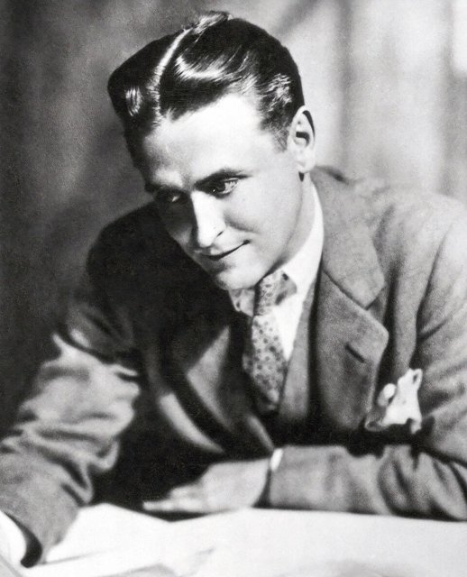
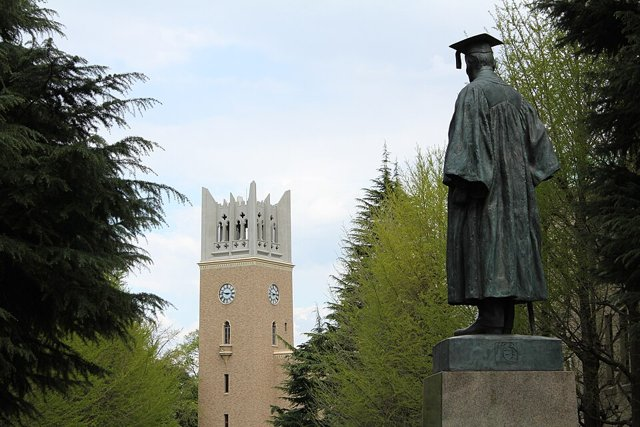
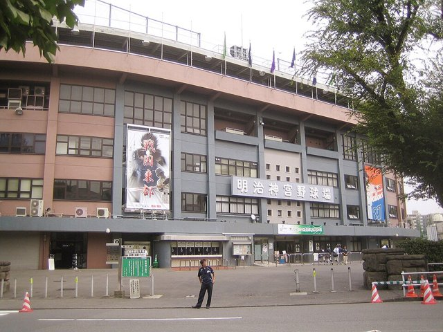
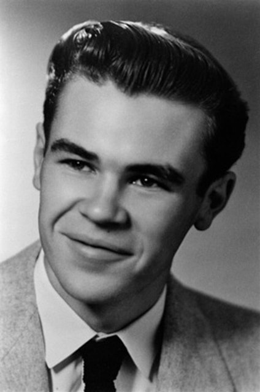
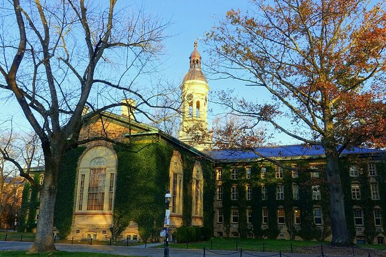
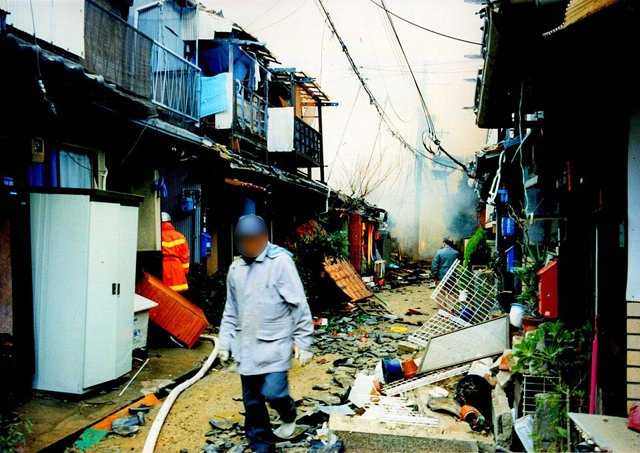

<!--
內容整理自 D:\Books\html\6-4.日本文學家\村上春樹.html（沒有對應的 md 筆記），並整合中文維基百科〈村上春樹〉條目，以自己的話改寫。
時期依生平歸納：神戶的少年時代、早稻田與爵士酒吧、作家出道、歐美旅居、回到日本之後。
兩份資料出入與處理方式：
- 生年：1949年1月12日生於京都，在兵庫縣的西宮、蘆屋長大，兩份一致。他仍在世，所以沒有 died，人物年表與 people.json 不會列出他（兩者只收有生卒年的人物）。
- 爵士酒吧：頁面寫1974年與妻子開設「Peter Cat」，維基百科補充1977年遷到千駄谷，照兩者。
- 神宮球場：頁面寫1978年在神宮球場看二壘安打時起念寫小說，照此；維基百科說寫作約花了六個月。
- 群像新人獎：頁面與維基百科都寫1979年，照此。
- 結束酒吧：頁面寫1982年前後，維基百科寫1981年賣掉酒吧、搬到船橋，採維基百科。長跑在1982年開始，依頁面與一般記載。
- 《挪威的森林》：頁面說1987年出版後暢銷、此後攜妻旅居歐美；維基百科寫1986年起在歐洲旅居三年、期間完成《挪威的森林》，1991年起旅居美國，1995年回日本，照維基百科的年份。
- 地下鐵沙林事件：維基百科說事件後他訪談受害者，一般記載在1997年出版《地下鐵事件》，照此。
- 耶路撒冷獎：維基百科寫2009年2月，演講「高牆與雞蛋」依一般記載補充。
- 《關於跑步，我說的其實是……》：頁面寫2007年，照此。
- 2018年新文學獎婉拒提名、2021年早稻田的村上春樹圖書館開館、2023年阿斯圖里亞斯親王獎，取自維基百科；2023年《城市與不確定的牆》依一般記載補充。
- 人名與其他時間軸一致：瑞蒙·卡佛、費茲傑羅（〈日本文學家總覽〉頁面提到他翻譯兩人的作品）、法蘭茲·卡夫卡（卡夫卡獎）。
圖片來源（皆為 Wikimedia Commons 公有領域／CC0 作品；註明「共用」者沿用其他時間軸已有的圖片）：
- mk-cover.jpg：Haruki Murakami 2018.jpg（村上春樹，2018年11月於厄瓜多爾）
- mk-fitz.jpg：F. Scott Fitzgerald (1929 photo portrait by Nickolas Muray) Cropped.jpg（費茲傑羅，1929）
- mk-waseda.jpg：Waseda University - Okuma Statue and Okuma Auditorium.JPG（早稻田大學大隈講堂與大隈重信像）
- mk-jingu.jpg：Meiji Jingu Stadium (entrance).jpg（明治神宮球場入口）
- mk-carver.jpg：Raymond Carver in 1956.jpg（瑞蒙·卡佛，1956）
- mk-princeton.jpg：Nassau Hall - Princeton University - Princeton, NJ - DSC00807.jpg（普林斯頓大學納蘇樓）
- mk-hanshin.jpg：Hanshin-Awaji earthquake 1995 Hyogo-ku Kobe city Hyogo prefecture 001.jpg（1995年1月阪神·淡路大地震後的神戶）
-->

# Periods
- 1949-01-12 ~ 1968 | 神戶的少年時代 | #868e96
  生於京都，在兵庫縣的西宮、蘆屋長大，父母都是國文教師，他卻沉迷美國的小說與爵士樂。
- 1968 ~ 1979 | 早稻田與爵士酒吧 | #1971c2
  在學運動盪中讀早稻田大學，與陽子結婚，開設爵士酒吧「Peter Cat」，在神宮球場起念寫小說。
- 1979 ~ 1986 | 作家出道 | #2f9e44
  以《聽風的歌》出道，賣掉酒吧專心寫作並開始長跑，以《世界末日與冷酷異境》獲谷崎潤一郎賞。
- 1986 ~ 1995 | 歐美旅居 | #e8590c
  旅居歐洲時寫出《挪威的森林》，暢銷後的名氣讓他離開日本，又到美國普林斯頓大學，寫作《發條鳥年代記》。
- 1995 ~ 2026 | 回到日本之後 | #f08c00
  阪神大地震與沙林毒氣事件後回國，轉向關注社會的暴力與傷痕，以《海邊的卡夫卡》《1Q84》成為世界性的作家。

# Events

## 1949-01-12 | 出生於京都
村上春樹生於京都市伏見區，不久隨家人搬到兵庫縣西宮市，之後在蘆屋長大。父母都是國文教師，家中常談日本古典文學，他卻偏愛外國文學，從小大量閱讀世界文學全集。

## 1964 | 迷上爵士樂

就讀神戶高中期間，村上聽了亞特·布雷基與爵士信使樂團的現場演奏後迷上爵士樂，省下午餐錢買唱片；他也在神戶的舊書店大量閱讀美國作家的英文平裝書，費茲傑羅與楚門·柯波帝都是他喜愛的作家。

## 1968 | 早稻田大學

村上進入早稻田大學第一文學部戲劇科。當時學生運動席捲日本各大學，校園長期停課，他很少上課，常到劇本博物館讀電影劇本。他在課堂上認識了高橋陽子，兩人在1971年結婚。

## 1974 | 開設爵士酒吧「Peter Cat」
村上與陽子借錢在東京國分寺開設爵士酒吧「Peter Cat」，白天賣咖啡、晚上賣酒，週末有現場演奏。1975年他以《美國電影中的旅行觀》為論文從早稻田畢業。1977年酒吧遷到千駄谷。

## 1978-04 | 神宮球場的頓悟

村上在神宮球場的外野看台看養樂多燕子隊的開幕戰，一名美國籍打者擊出二壘安打的那一瞬間，他突然想到「也許我可以寫小說」。此後他每晚在酒吧打烊後，在廚房的餐桌上寫作。

## 1979 | 《聽風的歌》出道
村上的第一部小說《聽風的歌》獲得《群像》新人文學獎，入圍芥川賞。他一邊經營酒吧，一邊在1980年寫出續作《1973年的彈珠玩具》。

## 1981 | 賣掉酒吧，專心寫作
村上夫婦賣掉酒吧，搬到千葉縣船橋，成為專職作家。1982年他發表《尋羊冒險記》，獲野間文藝新人獎，這部作品與前兩部合稱「老鼠三部曲」。為了維持寫長篇的體力，他開始長跑，此後幾乎每年參加馬拉松，也完成過超級馬拉松與鐵人三項。

## 1983 | 翻譯瑞蒙·卡佛

村上出版翻譯的瑞蒙·卡佛短篇集，此後持續翻譯卡佛、費茲傑羅、沙林傑、錢德勒等美國作家的作品，翻譯工作也形塑了他簡潔、帶有翻譯腔的文體。

## 1985 | 《世界末日與冷酷異境》
村上出版以兩條故事線交替推進的長篇《世界末日與冷酷異境》，獲谷崎潤一郎賞，是當時最年輕的得主之一。

## 1987 | 《挪威的森林》
村上在旅居歐洲期間寫成的《挪威的森林》出版，寫一名大學生在1960年代末與兩名女子之間的愛與死亡，在日本狂銷數百萬冊，引發「村上現象」。突如其來的名氣讓他在東京幾乎無法正常生活，他形容自己被孤立了，此後在歐洲與美國旅居多年。

## 1991 | 旅居美國

村上應邀到美國普林斯頓大學擔任訪問學者，之後在塔夫茨大學任教，在美國寫作《發條鳥年代記》三部曲（1994–1995），把諾門罕戰役等日本的戰爭暴力帶進作品，1996年獲讀賣文學賞。

## 1995 | 阪神大地震與沙林事件

1月，故鄉一帶發生阪神大地震；3月，奧姆真理教在東京地下鐵施放沙林毒氣。村上在這年回到日本，此後花了一年訪談六十多位受害者，1997年出版紀實作品《地下鐵事件》，作品的關注也從個人轉向社會的暴力與傷痕。

## 2002 | 《海邊的卡夫卡》
村上出版《海邊的卡夫卡》，寫一名離家出走的十五歲少年與一位能和貓說話的老人，英譯本在2005年獲選《紐約時報》年度十大好書。2006年他獲得捷克的法蘭茲·卡夫卡獎，從此每年秋天都被視為諾貝爾文學獎的熱門人選。

## 2007 | 《關於跑步，我說的其實是……》
村上出版以跑步為主題的回憶錄，談長跑與寫小說的共通之處：每天規律地寫一定的份量，就像每天跑一定的距離。

## 2009-02 | 耶路撒冷獎與「高牆與雞蛋」
村上獲得以色列的耶路撒冷獎，在加薩戰爭引發批評的情況下仍出席頒獎，以「在高大堅硬的牆與撞牆即破的雞蛋之間，我永遠站在雞蛋這一邊」為題發表演說。同年他出版長篇《1Q84》第一、二部（第三部在2010年），在日本再度引發搶購熱潮。

## 2017 | 《刺殺騎士團長》
村上出版長篇《刺殺騎士團長》，寫一名肖像畫家在山上的房子裡發現一幅日本畫，觸及南京大屠殺等歷史記憶。2018年瑞典文化界因諾貝爾文學獎停頒而另設「新文學獎」，他入圍後婉拒，表示希望專心寫作。

## 2021-10-01 | 村上春樹圖書館
早稻田大學國際文學館（通稱村上春樹圖書館）開館，收藏他捐贈的手稿、藏書、各國譯本與大量唱片。

## 2023 | 《城市與不確定的牆》
村上出版長篇《城市與不確定的牆》，重寫他1980年發表後一直沒有收入書中的中篇，同年獲西班牙的阿斯圖里亞斯親王文學獎。
