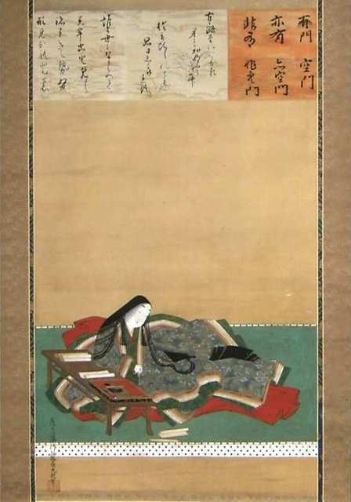
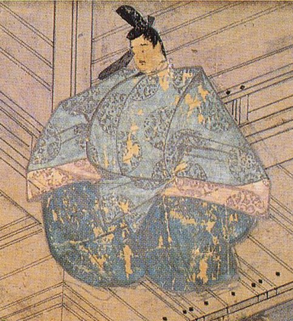
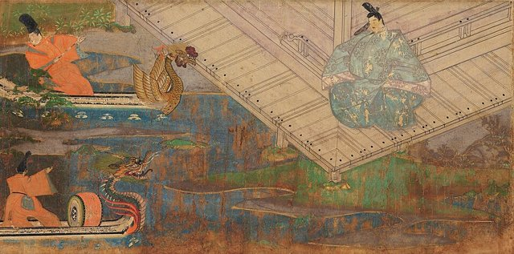
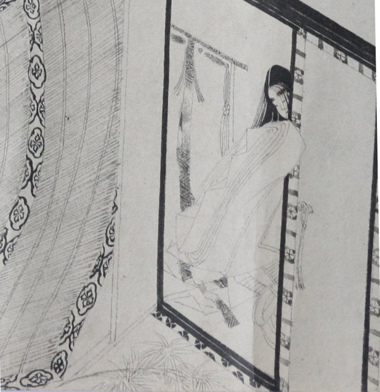
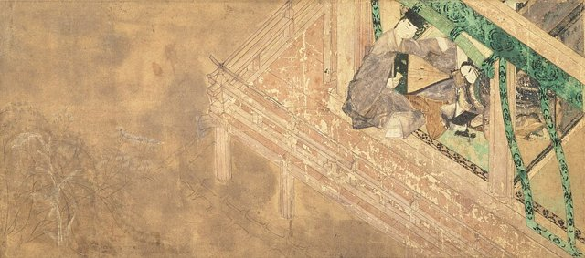

<!--
內容整理自 D:\Books\html\6-4.日本文學家\紫式部.html（沒有對應的 md 筆記），並整合中文維基百科〈紫式部〉條目，以自己的話改寫。
時期依生平歸納：少女時代、越前與婚姻、喪夫與創作、宮廷女官、隱退與身後。
兩份資料出入與處理方式：
- 生年：頁面寫約978年，維基百科寫約973年（天祿四年），並說明學界普遍認定973年；born 採973年，各事件的年齡只是約數。
- 卒年：頁面與維基百科多數說法都是約1014年；維基百科另記有學者認為她1025年甚至1031年仍在世，寫進最後一則事件。
- 喪夫：頁面寫約1001年，維基百科寫結婚約兩年、女兒出生後再兩年喪夫，藤原宣孝死於1001年（長保三年），兩份一致。
- 入宮：頁面與維基百科都寫約1005年（寬弘二年），也有一說是1006年，標成約數。
- 本名：維基百科說可能是《御堂關白記》1007年提到的「藤原香子」，只是推測，列為 aliases 以便比對，內文註明未定論。
- 稱號：頁面說「紫」取自《源氏物語》的紫之上；維基百科另記1008年藤原公任在宴會上問「若紫在嗎」的軼事，兩者合併。
- 與清少納言：頁面說兩人分屬定子、彰子兩個後宮陣營；維基百科補充定子在1001年、紫式部入宮前就已去世，兩人並未同時在宮中，照維基百科修正為「沒有同時在宮中」。
- 頁面的「宇治十帖作者爭議」寫進1008年事件。
- 人名與其他時間軸一致：藤原道長、清少納言（日本歷史時間軸已提到紫式部與《源氏物語》）。
圖片來源（皆為 Wikimedia Commons 公有領域／CC0 作品；註明「共用」者沿用其他時間軸已有的圖片）：
- mu-writing.jpg：Murasaki-Shikibu-composing-Genji-Monogatari.png（土佐光起所繪紫式部執筆《源氏物語》）
- mu-cover.jpg：Tosa Mitsuoki—Portrait of Murasaki Shikibu.jpg（土佐光起〈紫式部像〉）
- mu-michinaga.jpg：Fujiwara no Michinaga 2.jpg（藤原道長像）
- mu-diary.jpg：Murasaki Shikibu Nikki Emaki (Fujita Art Museum) 2.jpg（《紫式部日記繪詞》（藤田美術館藏））
- mu-sei.jpg：Sei Shonagon3.jpg（清少納言像（1921年複製））
- mu-genji.jpg：Genji emaki Yadorigi.JPG（《源氏物語繪卷》〈宿木〉）
-->

# Periods
- 973 ~ 996 | 學者之家的少女 | #868e96
  生於平安京的藤原氏旁支，父親藤原為時是漢學者與歌人；母親早逝，她在父親家中旁聽弟弟讀漢籍，學得當時女性少有的漢文素養。
- 996 ~ 1001 | 越前與婚姻 | #2f9e44
  隨出任越前守的父親到北陸，返京後嫁給年長許多的藤原宣孝，生下女兒賢子，婚後不久丈夫病逝。
- 1001 ~ 1005 | 喪夫與《源氏物語》 | #1971c2
  守寡期間開始寫作《源氏物語》，手稿在貴族間傳抄，作家的名聲逐漸傳開。
- 1005 ~ 1013 | 中宮彰子的女官 | #862e9c
  受藤原道長延攬入宮，服侍一條天皇的中宮彰子，為她講授漢詩，持續寫作《源氏物語》，並寫下《紫式部日記》。
- 1013 ~ 1014 | 隱退 | #495057
  一條天皇死後隨彰子離開宮廷，晚年事蹟不詳，一般認為約1014年去世。

# Events

## 973 | 出生於平安京 {label="約973年"}
紫式部約在這一年生於平安京，屬於藤原北家的旁支。曾祖父藤原兼輔是知名歌人，但這一支到她出生時只剩國司等級的中下層官職。父親藤原為時是受人敬重的漢學者，母親在她年幼時就去世了，她與弟弟藤原惟規在父親家中長大。
她的本名沒有流傳下來，「紫式部」是後人的稱呼；有學者依藤原道長日記《御堂關白記》1007年的記載，推測她的本名是「藤原香子」，但至今沒有定論。

## 980 | 旁聽漢學 {label="少女時代"}
平安時代的女性一般不學朝廷使用的漢文，紫式部卻在一旁聽弟弟讀漢籍，學得比弟弟還快。父親感嘆她要是男孩子該有多好。這份漢學素養日後讓她能在宮中為中宮講授白居易的詩，也讓《源氏物語》處處可見中國典籍的影子。

## 996 | 隨父赴越前
父親被任命為越前守（今福井縣一帶），紫式部隨父親赴任。當時貴族女性很少遠行，這是她一生中少數離開京都的經歷。

## 998 | 嫁給藤原宣孝 {label="約998年"}
紫式部返回京都，嫁給父親的友人、年長她二十多歲的遠房親戚藤原宣孝。宣孝當時已有好幾位妻子，依平安時代的習慣，夫妻通常分居。999年（長保元年），女兒藤原賢子出生，賢子日後也成為歌人，人稱「大貳三位」。

## 1001 | 丈夫病逝

結婚約兩年後，藤原宣孝在疫病流行中去世。守寡的紫式部一般被認為在這段時期開始寫作《源氏物語》，以光源氏的戀愛與榮枯，寫出貴族社會的愛欲、無常與「物哀」之情。手稿在貴族之間流傳，她的才名也隨之傳開。

## 1005 | 入宮服侍中宮彰子 {label="約1005年"}

權傾一時的藤原道長把女兒彰子嫁給一條天皇，為了讓彰子的後宮更有文采，延攬有才名的女性入宮。紫式部因此成為中宮彰子的女官（女房），私下為彰子講授白居易的《新樂府》。
「式部」取自她父兄曾任的式部省官職，這是宮中女官依男性親屬官銜取名的習慣。

## 1008 | 《紫式部日記》與《源氏物語》的流傳

紫式部在日記中記錄了彰子生下皇子的盛大慶典，以及宮廷生活的見聞與心境。這一年的宴會上，歌人藤原公任問「若紫在這裡嗎？」，可見《源氏物語》已在宮中傳開；後人稱她「紫」，一說就來自書中的女主角紫之上。
《源氏物語》全書五十四帖，最後的「宇治十帖」在風格上與前面不同，有學者懷疑出自別人之手（如她的女兒賢子），也有人認為只是作者晚年風格改變，至今沒有定論。

## 1010 | 評論清少納言

《紫式部日記》在這一年前後寫成，其中批評清少納言自以為是、到處賣弄漢學，其實學問並不深。清少納言曾服侍一條天皇的皇后定子，定子是彰子的對手，但她在1001年就已去世，兩人並沒有同時在宮中。清少納言的隨筆《枕草子》與《源氏物語》，後來被並稱為平安女性假名文學的雙璧。

## 1011 | 隨彰子離開宮廷
一條天皇去世，彰子離開宮廷，移居琵琶湖畔的藤原氏宅邸，紫式部很可能隨她同行。同一年前後，她的弟弟藤原惟規去世。1013年的記錄中，她仍陪伴在已成為皇太后的彰子身邊。

## 1014 | 去世 {label="約1014年"}

多數學者認為紫式部約在這一年去世，也有學者認為她至少活到1025年甚至1031年。《源氏物語》在她死後一個世紀內就成為日本文學的經典，12世紀出現《源氏物語繪卷》，20世紀被譯成英文等多種語言，直到今天仍是日本古典文學的代表；近代作家谷崎潤一郎也曾三度把它譯成現代日語。
