<!--
內容整理自本機筆記《音樂史》（D:\Books\md\歷史\文化史\音樂史，網頁版在知識圖譜的「9-1.音樂史」）。
- 34個年份檔各成一則事件，說明採用該檔的「案件摘要」（-0300古希臘音樂理論的段落名稱是「案件現場」），並附上 README 年表中的「關鍵推動力」；結尾以「→ 對外連結」連到知識圖譜上的完整案件卷宗（在新分頁開啟）。
- 時期依 README「案件總覽」的六段。README 各段沒有標註年代範圍，這裡以下一段第一個事件的年代為界：上古與中世紀至1550年、文藝復興與巴洛克至1750年（巴赫逝世）、古典與浪漫至1899年、二十世紀前半至1950年、二十世紀後半至2000年。
- -0300古希臘音樂理論沒有列在 README 年表中，沒有「關鍵推動力」。
- 巴赫、韓德爾、莫札特、貝多芬、威爾第、華格納、蓋希文等作曲家另有各自的人物時間軸（音樂家分頁）。
圖片來源（皆為 Wikimedia Commons 公有領域／CC0 作品；註明「共用」者沿用作曲家時間軸已有的圖片）：
- mus-cover.jpg：Jan Vermeer van Delft 014.jpg（維梅爾〈音樂課〉，約1662–1665）
- mus-pythagoras.jpg：Gaffurio Pythagoras.png（加富里烏斯《音樂理論》中以鐘、弦、管實驗音程的畢達哥拉斯，1492）
- mus-vase.jpg：Terracotta neck-pelike (wine jar) MET DT255056.jpg（雅典陶瓶上的七弦琴樂師，約前500年）
- mus-gregory.jpg：Pope St Gregory the Great Dictating Chants from Antiphonary of Hartker of Monastery of St Gall, circa 1000 (35810435992).jpg（聖加侖修道院《哈特克輪唱集》中口述聖歌的教宗額我略，約1000年）
- mus-guido.jpg：Guidonian hand.jpg（記憶唱名的「圭多之手」）
- mus-perotin.jpg：Pérotin - Viderunt omnes.jpg（佩羅坦《萬民皆已看見》的抄本，13世紀）
- mus-machaut.jpg：Œuvres poétiques de Guillaume de Machaut - BNF Fr1586 f51.jpg（馬秀詩樂作品抄本，約1355）
- mus-palestrina.jpg：Giovanni Palestrina and Pope Julius III.jpg（帕勒斯提那向教宗儒略三世獻上彌撒曲，1554年版畫）
- mus-orfeo.jpg：Frontispiece of L'Orfeo.jpg（《奧菲歐》1609年總譜初版書名頁）
- bach-cover.jpg（巴赫像（與巴赫時間軸共用））
- bach-1717-kothen.jpg（巴赫寫作《布蘭登堡協奏曲》時任職的柯騰宮廷（與巴赫時間軸共用））
- handel-1742-dublin.jpg（《彌賽亞》首演地都柏林（與韓德爾時間軸共用））
- mozart-cover.jpg（莫札特像（與莫札特時間軸共用））
- beethoven-cover.jpg（貝多芬像（與貝多芬時間軸共用））
- beethoven-1824-ninth.jpg（第九號交響曲（與貝多芬時間軸共用））
- berlioz-1838-paganini.jpg（安格爾所繪帕格尼尼素描（與白遼士時間軸共用））
- verdi-cover.jpg（威爾第像（與威爾第時間軸共用））
- wagner-1876-festspielhaus.jpg（拜魯特節慶劇院（與華格納時間軸共用））
- mus-mapleleaf.jpg：Maple Leaf Rag 1st ed.jpg（《楓葉拉格》1899年初版樂譜封面）
- stravinsky-1913-rite.jpg（《春之祭》（與史特拉汶斯基時間軸共用））
- mus-crazyblues.jpg：Crazy Blues - DPLA - ad49e549d2b243a86c57698ee340deb8 (page 10).jpg（1920年《瘋狂藍調》樂譜）
- schoenberg-cover.jpg（荀白克像（與荀白克時間軸共用））
- gershwin-1924-rhapsody.jpg（《藍色狂想曲》（與蓋希文時間軸共用））
- mus-elvis.jpg：Elvis Presley Love Me Tender Publicity Photo, 1956.jpg（貓王1956年的宣傳照）
- mus-beatles.jpg：The Beatles arrive at JFK Airport.jpg（1964年2月披頭四抵達紐約甘迺迪機場）
- mus-cd.jpg：Compact-disc in de handel, Bestanddeelnr 932-5170.jpg（1983年荷蘭商店中展示的CD唱機）
-->

# Periods
- -1400 ~ 1550 | 上古與中世紀：聲音的規範化 | #b08900
  從烏加利特泥版上最早的記譜、畢達哥拉斯以數學解釋音程，到額我略聖歌統一教會的歌唱、圭多發明記譜法與唱名、巴黎聖母院樂派的複音音樂與「新藝術」，最後以佩特魯奇的印刷樂譜讓音樂得以大量複製。
- 1550 ~ 1750 | 文藝復興與巴洛克：歌劇與調性的誕生 | #862e9c
  帕勒斯提那的彌撒回應特倫托會議，蒙台威爾第的《奧菲歐》讓歌劇成熟；巴哈與韓德爾同年誕生，《布蘭登堡協奏曲》與《彌賽亞》代表巴洛克的高峰。
- 1750 ~ 1899 | 古典與浪漫：音樂走向公眾 | #1971c2
  音樂從宮廷與教會走進公開音樂會與市民歌劇院：莫札特的《費加洛婚禮》、貝多芬的交響曲、帕格尼尼的炫技、威爾第的《茶花女》，到華格納的拜魯特音樂節。
- 1899 ~ 1950 | 二十世紀前半：革命與跨界 | #c92a2a
  拉格時代與藍調錄音帶出美國黑人音樂，《春之祭》首演暴動、荀白克的十二音列法挑戰調性，蓋希文讓爵士與古典跨界，電吉他問世。
- 1950 ~ 2000 | 二十世紀後半：錄音與大眾文化 | #e67700
  貓王錄下搖滾、《Kind of Blue》開創調式爵士、披頭四席捲全球、胡士托音樂節與龐克革命；CD 讓音樂數位化，Napster 與 MP3 撼動整個唱片工業。
- 2000 ~ 2026 | 當代：串流與演算法 | #0c8599
  Spotify 等串流平台以訂閱經濟取代唱片銷售，生成式 AI 開始能創作音樂，也引發版權爭議。

# Events

## -1400 | Hurrian頌歌
1950 年代，考古學家在敘利亞海邊的古城烏加利特（Ugarit，今 Ras Shamra）清理出土泥版時，編號 **H6** 的一塊泥版被鑑定為**人類已知最早的音樂記譜**——《Hurrian 頌歌第六首》（Hurrian Hymn to Nikkal），約公元前 1400 年。泥版上同時刻著向月神女神 Nikkal 致敬的胡里語歌詞，以及一串阿卡德語音樂術語。**三千四百年前，就有人把「聲音如何進行」寫了下來。**

關鍵推動力：胡里人祭儀、楔形文字泥版

[→ 對外連結：前 1400 - Hurrian 頌歌：最古老的樂譜失蹤案](https://chad-liu.github.io/books/html/9-1.音樂史/-1400-Hurrian頌歌.html)

## -550 | Pythagoras音程
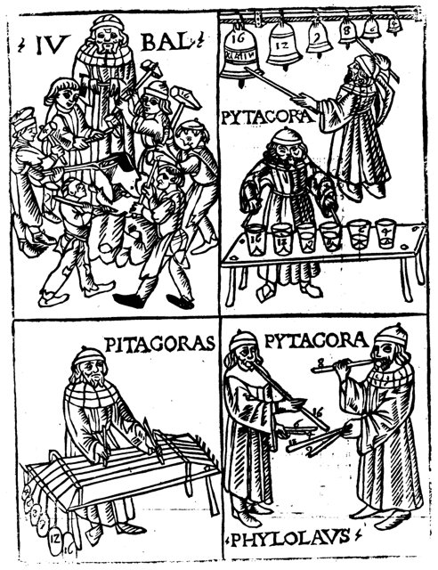
約公元前 550 年，克羅頓的**畢達哥拉斯學派**用一把單弦琴（monochord）完成了一樁改變文明史的案件：證明**音程就是數的比例**。八度是 2:1、五度是 3:2、四度是 4:3。從此音樂不再只是祭典的聲音，而成為**「數的科學」**——這是音樂史上第一次「理論立案」。

關鍵推動力：畢達哥拉斯學派、單弦琴

[→ 對外連結：前 550 - 畢達哥拉斯音程：把音樂變成數學的偵查檔案](https://chad-liu.github.io/books/html/9-1.音樂史/-0550-Pythagoras音程.html)

## -300 | 古希臘音樂理論
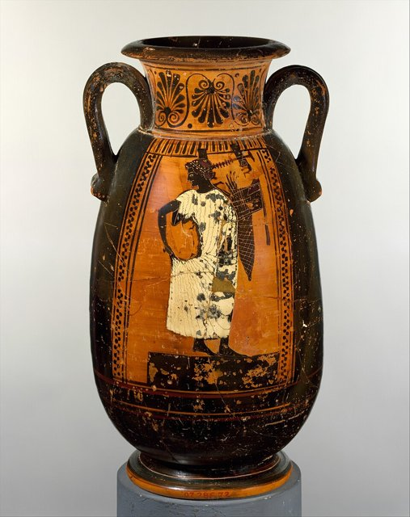
證物一：單弦琴（monochord）實驗——弦長比 2:1 得八度、3:2 得五度、4:3 得四度。證物二：畢達哥拉斯學派的宇宙論——天體距離依同樣比例，故有「諸天和聲」（harmonia mundi）。證物三：到了前 4–前 3 世紀，亞里斯多塞諾斯（Aristoxenus）寫出《和聲學》，系統整理音階、調式與旋律倫理學——**音樂理論作為一門學科的判決書在此落款**。

[→ 對外連結：古希臘音樂理論](https://chad-liu.github.io/books/html/9-1.音樂史/-0300-古希臘音樂理論.html)

## 590 | 額我略聖歌
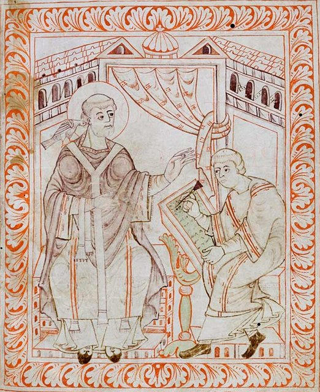
約公元 590 年起，教宗**額我略一世**（Gregory the Great）推動了西方教會史上規模最大的音樂統一運動：以羅馬儀式的聖歌（後世稱 **Gregorian chant**）為標準，整併各地分歧的歌調。傳說聖靈化作鴿子向他口授歌調——偵探的結論：**那隻鴿子是政治宣傳，真正的推手是教廷的行政機器。**

關鍵推動力：教宗額我略一世、基督教會

[→ 對外連結：590 - 額我略聖歌：教會音樂統一運動的偵查檔案](https://chad-liu.github.io/books/html/9-1.音樂史/0590-額我略聖歌.html)

## 1025 | Guido記譜法
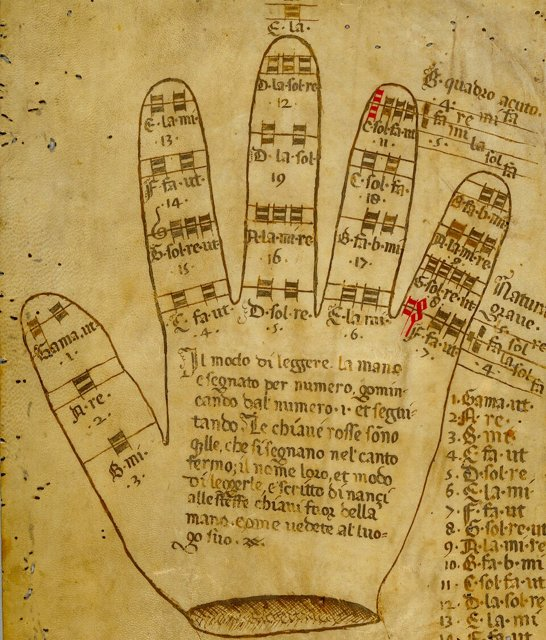
約 1025 年，本篤會修士**桂多·達賴佐**（Guido d'Arezzo）出版《微論》（Micrologus），發明了**譜線記譜**與 **do-re-mi 唱名法**。他自己宣稱：原本需要十年的音樂訓練，如今一兩年即可完成。**這是音樂史上第一樁「教育效率革命」案件**——五線譜的一切，從這裡開始。

關鍵推動力：本篤會修道院、教會音樂教育

[→ 對外連結：Guido 記譜法：音樂學習十年的縮短案](https://chad-liu.github.io/books/html/9-1.音樂史/1025-Guido記譜法.html)

## 1150 | 聖母院樂派
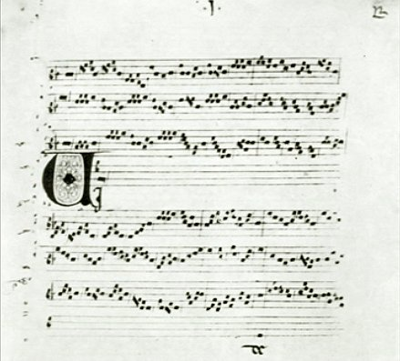
1150–1250 年間，巴黎**聖母院樂派**（Notre Dame school）以 **Léonin** 與 **Pérotin** 為首，建造了複音音樂的第一座「大教堂」：多聲部 organum 在哥德式石造巨構中迴盪，節奏第一次被系統化記錄，四聲部作品在 1198 年的聖母院首演。**這是西方音樂第一次「多聲部立案」。**

關鍵推動力：巴黎主教座堂、哥德建築

[→ 對外連結：聖母院樂派：複音音樂大教堂的偵查檔案](https://chad-liu.github.io/books/html/9-1.音樂史/1150-聖母院樂派.html)

## 1322 | ArsNova新藝術
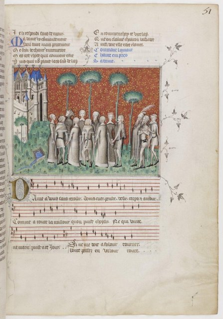
約 1322 年，法國作曲家—詩人—數學家**維特里**（Philippe de Vitry）發表《新藝術》（Ars Nova），主張以新的節奏記譜掙脫舊時代束縛。**教宗若望二十二世 1324 年發詔書譴責這種「新藝術」**——但弔詭的是，教廷自己的音樂家照用不誤。**這是音樂史上第一樁「官方明文禁止、業界照常營業」的案件。**

關鍵推動力：教宗 若望二十二世爭議、法國宮廷

[→ 對外連結：Ars Nova 新藝術：節奏自由化的偵查檔案](https://chad-liu.github.io/books/html/9-1.音樂史/1322-ArsNova新藝術.html)

## 1501 | Petrucci印刷樂譜
1501 年，威尼斯出版商**奧塔維亞諾·佩特魯奇**（Ottaviano Petrucci）出版《Harmonice Musices Odhecaton》——史上第一本**活字印刷的複音樂譜集**，收錄 100 首世俗歌曲。**音樂從教堂與宮廷的專屬品，變成可販賣、可攜帶、可跨境的商品。** 這是音樂工業的創業第一天。

關鍵推動力：威尼斯出版業、印刷術

[→ 對外連結：Petrucci 印刷樂譜：音樂工業誕生的偵查檔案](https://chad-liu.github.io/books/html/9-1.音樂史/1501-Petrucci印刷樂譜.html)

## 1562 | Palestrina彌撒

1562 年前後，**帕勒斯替那**（Giovanni Pierluigi da Palestrina）完成《教宗馬爾切魯斯彌撒》（Missa Papae Marcelli）。傳說在特倫托會議整頓教會音樂、複音音樂即將被禁的關鍵時刻，這部作品以極致的清晰與優雅**說服了教廷：複音可以救，不必禁**。後世稱 Palestrina「救了複音音樂」。**這是音樂史上最著名的「作品當辯護律師」案件——但傳說與史實之間，有一道必須核查的縫。**

關鍵推動力：特倫托會議、教廷

[→ 對外連結：Palestrina 彌撒：複音音樂救贖案的偵查檔案](https://chad-liu.github.io/books/html/9-1.音樂史/1562-Palestrina彌撒.html)

## 1607 | 奧菲歐
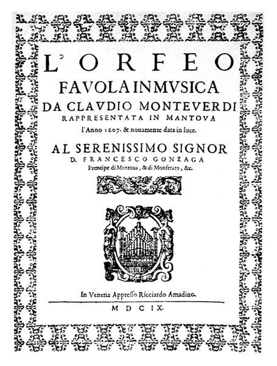
1607 年 2 月 24 日，**Monteverdi**（Claudio Monteverdi）的《奧菲歐》（L'Orfeo）在**曼圖亞貢札加公爵宮廷**首演——史上最早的歌劇傑作。在此之前，歌劇只是佛羅倫斯沙龍裡的實驗品；在此之後，歌劇成為一門延續四百年的藝術與產業。**這是音樂史上「實驗變正典」的經典案件。**

關鍵推動力：佛羅倫斯 Camerata、曼圖亞宮廷

[→ 對外連結：奧菲歐：歌劇誕生案的偵查檔案](https://chad-liu.github.io/books/html/9-1.音樂史/1607-奧菲歐.html)

## 1685 | 巴哈韓德爾誕生
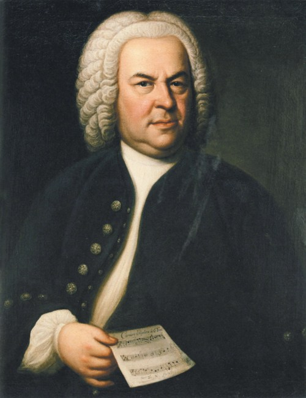
1685 年，德意志中部在同年誕生了兩位音樂巨人：**Johann Sebastian Bach**（3 月 21 日，Eisenach）與 **George Frideric Handel**（2 月 23 日，Halle）。兩人相距不到一百公里，卻終生未曾見面。**這是一樁「同源異路」的案件：相同的起點，兩條完全相反的職業路線，共同把巴洛克音樂推上巔峰。**

關鍵推動力：路德宗教會、宮廷音樂體制

[→ 對外連結：巴哈與韓德爾誕生：巴洛克雙峰的偵查檔案](https://chad-liu.github.io/books/html/9-1.音樂史/1685-巴哈韓德爾誕生.html)

## 1721 | 布蘭登堡協奏曲

1721 年 3 月 24 日，Bach 在 Köthen 完成六首協奏曲的精緻手稿，呈獻給布蘭登堡-施韋特（Brandenburg-Schwedt）侯爵 **Christian Ludwig**。侯爵收下手稿，**沒有回信、沒有酬謝、沒有演出**——樂譜在圖書館裡沉默了一百三十年。**這是一樁「史上最偉大落選作品」的案件：獻禮失敗，作品卻成為協奏曲的教科書。**

關鍵推動力：布蘭登侯爵委託、柯騰宮廷

[→ 對外連結：布蘭登堡協奏曲：一封石沉大海的求職信](https://chad-liu.github.io/books/html/9-1.音樂史/1721-布蘭登堡協奏曲.html)

## 1742 | 彌賽亞首演

1742 年 4 月 13 日，Handel 的神劇《彌賽亞》（Messiah）在**都柏林**的 Fishamble Street 音樂廳首演。宣傳海報懇請女士們**卸下裙撐**，好讓七百個座位容納更多聽眾。首演為三個慈善機構募款，轟動成功。**這是一樁「絕處逢生」的案件：一個破產的歌劇經理，在倫敦之外的城市，用一部宗教作品翻轉了自己的命運。**

關鍵推動力：慈善音樂會、都柏林市民

[→ 對外連結：彌賽亞首演：慈善音樂會的奇蹟](https://chad-liu.github.io/books/html/9-1.音樂史/1742-彌賽亞首演.html)

## 1786 | 費加洛婚禮
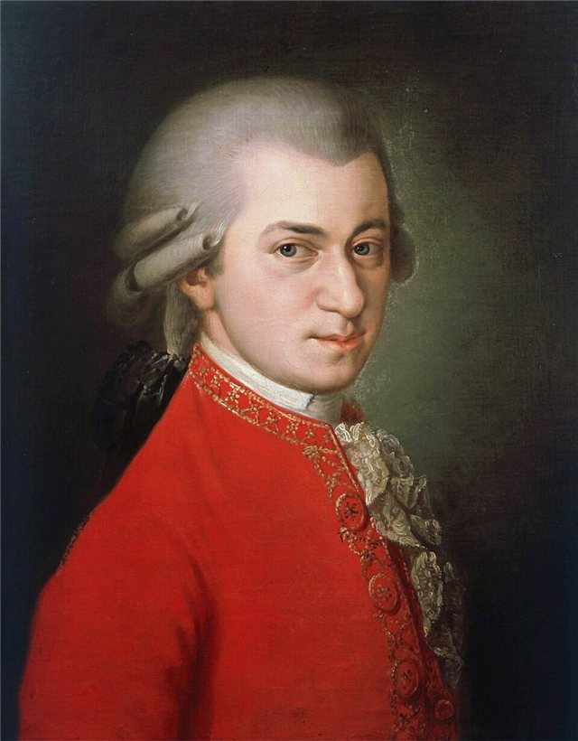
1786 年 5 月 1 日，Mozart 的喜歌劇《費加洛婚禮》（Le nozze di Figaro）在**維也納宮廷劇院（Burgtheater）**首演：Da Ponte 編劇、Mozart 作曲、皇帝 **Joseph II** 親自批准。舞台上，僕人 Figaro 智取主人伯爵——**這是一樁「階級反轉」的案件：一部在維也納原被禁演的煽動劇，被刪改、被譜曲，最後成為歌劇藝術的巔峰。**

關鍵推動力：啟蒙思想、維也納宮廷歌劇

[→ 對外連結：費加洛婚禮：僕人當主角的階級反轉](https://chad-liu.github.io/books/html/9-1.音樂史/1786-費加洛婚禮.html)

## 1808 | 命運交響曲
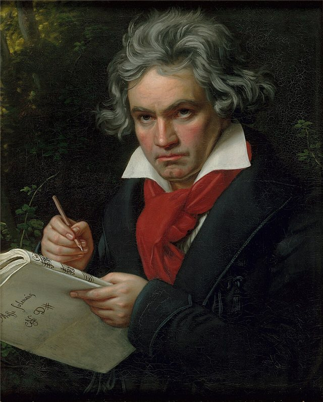
1808 年 12 月 22 日，Beethoven 在**維也納河畔劇院（Theater an der Wien）**舉辦自辦的訂閱音樂會（Akademie），同場首演**第五交響曲（命運）**與**第六交響曲（田園）**，外加第四號鋼琴協奏曲、《合唱幻想曲》等。節目長達四小時、劇院冰冷、排練不足、樂手中途出錯。**這是一樁「混亂首演卻定調一個世紀」的案件：當晚沒有人意識到，交響曲從娛樂變成了命運的戲劇。**

關鍵推動力：貝多芬、維也納訂閱音樂會

[→ 對外連結：命運交響曲：四小時混亂中誕生的哲學](https://chad-liu.github.io/books/html/9-1.音樂史/1808-命運交響曲.html)

## 1824 | 第九交響曲

1824 年 5 月 7 日，Beethoven 的**第九交響曲（含《歡樂頌》）**在維也納 **Kärntnertortheater** 首演。此時 Beethoven 已**完全失聾**，坐在指揮旁指示節奏；終曲結束時他背對觀眾，聽不見席間爆發的掌聲，女中音 **Caroline Unger** 扶他轉身，他才「看見」了歡呼。**這是一樁「越界者」的案件：交響曲第一次加入人聲與合唱，全聾的建築師在無聲中完成了音樂史的極限。**

關鍵推動力：維也納愛國委員會、聽障的作曲家

[→ 對外連結：第九交響曲：全聾作曲家與歡樂頌](https://chad-liu.github.io/books/html/9-1.音樂史/1824-第九交響曲.html)

## 1828 | Paganini炫技

1828 年 3 月，義大利小提琴家 **Niccolò Paganini** 在維也納首次登台，一舉轟動，隨即展開三年橫掃歐洲的巡演（維也納、柏林、巴黎、倫敦……）。觀眾為之瘋狂，報紙為之恐慌，傳言他**與魔鬼簽約**。**這是一樁「僕從變明星」的案件：一位曾在宮廷穿制服的樂師，靠技術與神話，發明了現代演奏家明星制度。**

關鍵推動力：維也納/巴黎音樂會市場、媒體

[→ 對外連結：帕格尼尼炫技：明星演奏家時代的誕生](https://chad-liu.github.io/books/html/9-1.音樂史/1828-Paganini炫技.html)

## 1853 | 茶花女
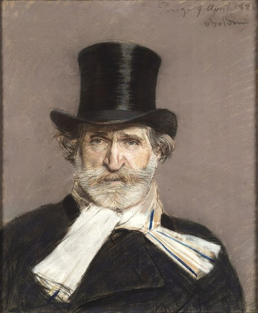
1853 年 3 月 6 日，**Verdi**《茶花女》（La traviata）在威尼斯鳳凰劇院（Teatro La Fenice）首演——**慘敗**。觀眾竊笑、媒體冷嘲。但一年後同劇院復排，票房與口碑全面翻盤，此後它成為全球上演率最高的歌劇之一。**偵探的問題：一部作品如何在十二個月內從醜聞變成正典？答案是：首演的失敗，敗在場景，不在音樂。**

關鍵推動力：威尼斯鳳凰劇院、市民歌劇

[→ 對外連結：茶花女：交際花登上宮廷劇院的偵查檔案](https://chad-liu.github.io/books/html/9-1.音樂史/1853-茶花女.html)

## 1876 | 拜魯特音樂節

1876 年 8 月 13 日，**Wagner** 的拜魯特節慶劇院（Bayreuth Festspielhaus）開幕，連演四晚首演《尼貝龍的指環》全四劇（前後共約 15 小時）。德意志諸邦的國王、貴族、音樂家齊聚小鎮——包括 Brahms、Grieg、Saint-Saëns、柴可夫斯基。**這是音樂史上第一次：一座劇院為單一作曲家而建，一種藝術以「節慶朝聖」的形式制度化。**

關鍵推動力：華格納、巴伐利亞國王路德維希二世

[→ 對外連結：拜魯特音樂節：一間為一個人而建的劇院](https://chad-liu.github.io/books/html/9-1.音樂史/1876-拜魯特音樂節.html)

## 1899 | 楓葉拉格
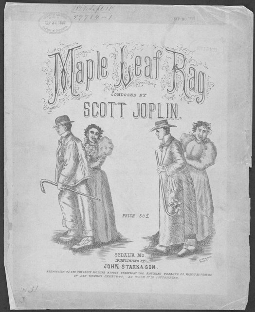
1899 年，密蘇里州小鎮 Sedalia 的非裔作曲家 **Scott Joplin** 與白人出版商 **John Stark** 合作出版《楓葉拉格》（Maple Leaf Rag）——史上第一首真正爆紅的拉格泰姆（Ragtime）樂譜，據傳累積銷售達百萬張（銷量在數十年間緩慢累積）。**這樁案子的關鍵：非洲裔的切分節奏，第一次透過出版業的機器，進入全美家庭的客廳。**

關鍵推動力：美國黑人音樂、密蘇里出版

[→ 對外連結：楓葉拉格：一頁樂譜引爆的美國音樂革命](https://chad-liu.github.io/books/html/9-1.音樂史/1899-楓葉拉格.html)

## 1913 | 春之祭

1913 年 5 月 29 日，巴黎香榭麗舍劇院首演 **Stravinsky** 的《春之祭》（Le Sacre du printemps）：開演數分鐘內，觀眾席爆發音樂史上最著名的暴動——噓聲、口哨、鬥毆聲蓋過樂團，樂手在噪音中勉強奏完全曲。**偵探結論：這不是意外，是一樁多引信爆破案——音樂、舞蹈、階級三條引線同時被點燃。**

關鍵推動力：Stravinsky、Diaghilev、前衛

[→ 對外連結：春之祭：巴黎劇場暴動的偵查檔案](https://chad-liu.github.io/books/html/9-1.音樂史/1913-春之祭.html)

## 1920 | 瘋狂藍調
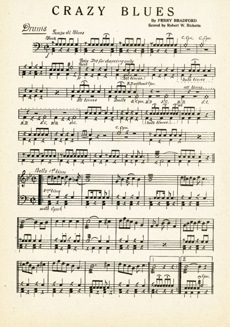
1920 年，非裔歌舞藝人 **Mamie Smith** 為紐約 Okeh 唱片公司錄製《Crazy Blues》——**史上第一張由黑人歌手演唱的藍調唱片**。三個月售出七萬五千張，震撼整個唱片業。**這樁案子的關鍵：它用銷售數字證明了一個此前被所有人否認的市場——黑人聽眾，存在，而且巨大。**

關鍵推動力：種族唱片市場、Okeh 唱片

[→ 對外連結：瘋狂藍調：第一張藍調唱片的偵查檔案](https://chad-liu.github.io/books/html/9-1.音樂史/1920-瘋狂藍調.html)

## 1923 | 十二音列法
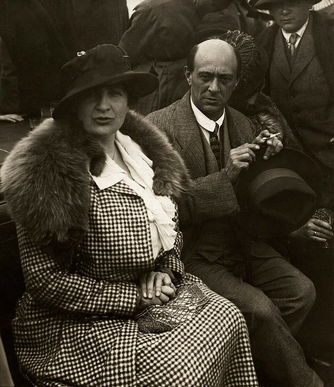
1923 年，維也納作曲家 **Schönberg**（Arnold Schönberg／Schoenberg）公開發表「十二音列作曲法」（twelve-tone technique）——用一條排定順序的十二個半音，作為組織全部音高材料的唯一法則。**這是音樂史上最激進的一次立法：作曲家自任立法者，以一條序列規則取代三百年的調性和聲。**

關鍵推動力：維也納第二學派、無調性危機

[→ 對外連結：十二音列法：用數學重建音樂的偵查檔案](https://chad-liu.github.io/books/html/9-1.音樂史/1923-十二音列法.html)

## 1924 | 藍色狂想曲

1924 年 2 月 12 日，紐約 Aeolian Hall，**Gershwin**（George Gershwin）的《藍色狂想曲》（Rhapsody in Blue）首演——**Paul Whiteman** 的「現代音樂」實驗音樂會壓軸曲。單簧管一聲上滑音劃破古典音樂廳的莊嚴，全場起立。**這樁案子的關鍵：流行歌曲作家用五週趕工的作品，宣告爵士與古典的聯姻，並成為美國音樂的正典。**

關鍵推動力：爵士與古典跨界、Whiteman 樂團

[→ 對外連結：藍色狂想曲：爵士與古典的跨界宣言](https://chad-liu.github.io/books/html/9-1.音樂史/1924-藍色狂想曲.html)

## 1931 | 電吉他誕生
1931 年，洛杉磯的發明家 **George Beauchamp** 與 **Adolph Rickenbacker** 做出「**Frying Pan**」（煎鍋）——最早的商業化電吉他：鋁製圓盤琴身、電磁拾音器、接上擴大機與揚聲器。1932 年正式投產。**這樁案子的關鍵：吉他被銅管樂團淹沒了三十年，一群工程師用無線電技術救了它——並在三十年後引爆搖滾革命。**

關鍵推動力：Rickenbacker、廣播與大樂團時代

[→ 對外連結：電吉他誕生：把樂團裡的配角變成主角](https://chad-liu.github.io/books/html/9-1.音樂史/1931-電吉他誕生.html)

## 1954 | 貓王SunRecords

1954 年 7 月 5 日夜裡，孟菲斯。19 歲的卡車司機 **Elvis Presley** 在錄音室的排練空檔隨手彈起 Arthur Crudup 的藍調曲《That's All Right》，**Sam Phillips** 衝出控制室：「你們在幹什麼？把它錄下來！」當晚，DJ **Dewey Phillips** 在 WHBQ 電台首播，聽眾熱線打爆——請求重播了十幾次。**這不是預謀，而是一場精心佈局後的意外：炸彈是 Phillips 埋了四年的，引信卻是 Elvis 自己點燃的。**

關鍵推動力：Sam Phillips、孟菲斯黑人/白人音樂交界

[→ 對外連結：貓王 Sun Records：搖滾樂誕生的偵查檔案](https://chad-liu.github.io/books/html/9-1.音樂史/1954-貓王SunRecords.html)

## 1959 | KindOfBlue
1959 年 3 月 2 日與 4 月 22 日，紐約哥倫比亞 30 街錄音室。**Miles Davis** 帶領七人黃金陣容錄下《**Kind of Blue**》：幾乎沒有排練、幾乎全是一 take、樂手進錄音室時只拿到幾張寫著「音階」的草圖。結果：爵士史上最暢銷的專輯、調式爵士（modal jazz）的憲法文件。**這是一樁以「減法」完成的犯罪——Miles 殺死的不是別人，正是和弦進行本身。**

關鍵推動力：哥倫比亞唱片、現代爵士巔峰

[→ 對外連結：Kind of Blue：調式爵士的偵查檔案](https://chad-liu.github.io/books/html/9-1.音樂史/1959-KindOfBlue.html)

## 1963 | 披頭四
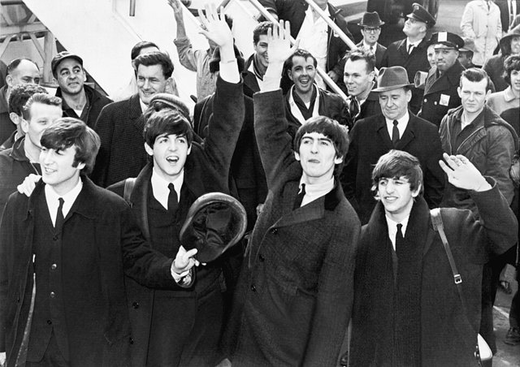
1963 年，英國。四個利物浦青年組成的 **The Beatles** 在一年內發行《**Please Please Me**》（3 月，**一天之內錄完**整張專輯）與《**With The Beatles**》（11 月），單曲連續攻佔排行榜，全國少女尖叫到警察必須封鎖場館——媒體發明了「**Beatlemania**」這個字。**這不是偶然的流行，而是一樁組織精密的引爆案：Epstein 佈線、Martin 裝彈、電視點火。**

關鍵推動力：Parlophone、Merseybeat、電視

[→ 對外連結：披頭四：Beatlemania 的偵查檔案](https://chad-liu.github.io/books/html/9-1.音樂史/1963-披頭四.html)

## 1969 | Woodstock
1969 年 8 月 15-18 日，紐約州 Bethel 的乳牛場。**40 萬人**湧入一個為 5 萬人設計的場地：高速公路癱瘓、雨中泥濘、食物短缺，卻奇蹟般地只發生零星暴力——官方記錄僅兩起意外死亡與零起暴動。「**三天和平與音樂**」成為反文化的最高圖騰。**這是一樁商業計畫失控後的意外奇蹟：出資者想辦音樂節賺錢，歷史卻給了他們一場無法複製的烏托邦。**

關鍵推動力：反文化運動、青年市場

[→ 對外連結：Woodstock：四十萬人的偵查檔案](https://chad-liu.github.io/books/html/9-1.音樂史/1969-Woodstock.html)

## 1976 | 龐克革命
1976-77 年，倫敦。**Sex Pistols** 以《**Anarchy in the UK**》（1976 年 11 月）與《**God Save the Queen**》（1977）把無政府主義唱進主流，在女王銀禧年（Silver Jubilee）遭 BBC 全面禁播，卻照樣賣上排行榜。三個和弦、兩分鐘、一件皮夾克——**這是一樁策展出來的革命：Malcolm McLaren 佈局引爆，但燃料是整個英國的失業與憤怒。**

關鍵推動力：英國階級憤怒、獨立廠牌

[→ 對外連結：龐克革命：三個和弦的偵查檔案](https://chad-liu.github.io/books/html/9-1.音樂史/1976-龐克革命.html)

## 1982 | CD誕生

1982 年 10 月，日本。**Sony** 與 **Philips** 聯手推出 **CD**（Compact Disc）與第一部播放機 CDP-101：12 公分的光碟、44.1kHz/16bit 的數位音訊、「完美的永恆音響」。類比時代（黑膠的磨損、卡帶的嘶聲）開始倒數。**這是一樁兩家公司合謀三十年的標準化犯罪：兇器是雷射與半導體，動機是整個音樂載體市場的霸權。**

關鍵推動力：數位音訊、家電工業

[→ 對外連結：CD 誕生：數位音訊的偵查檔案](https://chad-liu.github.io/books/html/9-1.音樂史/1982-CD誕生.html)

## 1999 | NapsterMP3
1999 年 6 月，波士頓。18 歲的 **Shawn Fanning** 發布 **Napster**：一個讓任何人在網路上免費抓取任何歌曲的軟體。一年內用戶破千萬、兩年內破 8,000 萬；唱片銷售開始崩盤；2001 年法院下令關閉。**這是一樁技術鏈條與法律炸彈同時引爆的案件：Fanning 只寫了程式，但整個時代的寬頻、MP3 與 CD 都是他的共犯。**

關鍵推動力：P2P 網路、音樂工業地震

[→ 對外連結：Napster 與 MP3：音樂工業地震的偵查檔案](https://chad-liu.github.io/books/html/9-1.音樂史/1999-NapsterMP3.html)

## 2015 | 串流霸權
2015 年，全球錄音產業報告出爐：**串流（streaming）營收正式超越下載**，成為數位音樂的最大收入來源。**Spotify** 時代的經濟法則確立：訂閱費按播放次數分成、playlist 取代電台、**播放量即影響力**。**這是一樁以「授權」完成的和平演變：Spotify 吸收了 Napster 的革命（見 `1999-NapsterMP3`），卻把戰利品還給了唱片公司。**

關鍵推動力：Spotify、訂閱經濟

[→ 對外連結：串流霸權：播放量經濟的偵查檔案](https://chad-liu.github.io/books/html/9-1.音樂史/2015-串流霸權.html)

## 2023 | AI音樂生成
2023 年起，**Suno**、**Udio** 等生成式 AI 服務爆發：輸入一句文字，幾秒後輸出完整歌曲——人聲、歌詞、編曲、混音一次到位。任何人都能「寫」一首歌。**這是一樁訓練資料來源成謎的案件：模型的燃料是數十年的人類錄音，而帳單至今沒有人付。**

關鍵推動力：生成式 AI、版權爭議

[→ 對外連結：AI 音樂生成：音與數終極回歸的偵查檔案](https://chad-liu.github.io/books/html/9-1.音樂史/2023-AI音樂生成.html)
