<!--
內容整理自中文維基百科「莫傑斯特·穆索斯基」與英文維基百科「Modest Mussorgsky」條目（CC BY-SA 4.0），並以台灣用語改寫摘要。
https://zh.wikipedia.org/zh-tw/莫杰斯特·穆索尔斯基
https://en.wikipedia.org/wiki/Modest_Mussorgsky
中文條目較簡略，生平細節主要參考英文條目。日期採新曆。
哈特曼去世與畫展的年份、列賓肖像的繪製日期、《霍萬斯基之亂》首演、《荒山之夜》林姆斯基－高沙可夫版首演、《鮑里斯·戈杜諾夫》巴黎演出、拉威爾配器版年份，係依一般公認的史實補充。
圖片皆為 Wikimedia Commons 上的公有領域作品（封面：1876年的照片）。
-->

# Periods
- 1839 ~ 1849 | 童年@卡列沃
  生於普斯科夫省卡列沃村的地主貴族家庭，6歲跟母親學鋼琴，9歲就能為親友演奏菲爾德的協奏曲與李斯特的作品。
- 1849 ~ 1858 | 軍校與近衛軍
  10歲到聖彼得堡求學，13歲進入近衛軍士官學校，畢業後加入沙皇近衛軍最精銳的普列奧布拉任斯基團。結識鮑羅定、達爾戈梅日斯基與巴拉基列夫，開始真正的音樂生涯。
- 1858 ~ 1868 | 摸索與寫實主義
  辭去軍職專心音樂，卻因農奴解放家道中落，只能當低階公務員維生。在「公社」裡吸收寫實主義思想，寫出《荒山之夜》與一系列描寫市井小民的歌曲。
- 1868 ~ 1874 | 《鮑里斯·戈杜諾夫》與創作巔峰
  受達爾戈梅日斯基《石客》啟發，追求貼近說話語調的寫法，完成歌劇《鮑里斯·戈杜諾夫》。1874年首演受到觀眾歡迎，同年寫下《展覽會之畫》。
- 1874 ~ 1881 | 酗酒與衰落
  五人組逐漸瓦解，好友接連去世，他陷入酗酒，公職岌岌可危。《霍萬斯基之亂》與《索羅欽集市》都沒能完成，42歲死於醫院。
- 1881 ~ 1940 | 身後的流傳
  遺作大多由林姆斯基－高沙可夫整理、改寫後才為世人所知；拉威爾的《展覽會之畫》配器版與迪士尼《幻想曲》更讓他的音樂家喻戶曉。

# Events

## 1839-03-21 | 出生@卡列沃
生於聖彼得堡以南約400公里、普斯科夫省的卡列沃村，是富有地主家庭的小兒子。家族據說是留里克王朝的後裔；不過他的祖母原本是祖父莊園裡的農奴。他的姓氏源自祖先的綽號「穆索爾加」（希臘文「作樂者」之意），因為和俄文「垃圾」（músor）同字根，他後來常戲稱自己是「垃圾居民」。

## 1845 | 跟母親學鋼琴
6歲開始跟受過訓練的鋼琴家母親學琴，進步神速，三年後就能為親友演奏菲爾德的協奏曲和李斯特的作品。

## 1849 | 到聖彼得堡求學
10歲時和哥哥一起被帶到聖彼得堡，進入以德語授課的名校聖彼得學校，並跟鋼琴家格克學琴。父母搬到首都，是希望兩個兒子延續家族從軍的傳統。

## 1852 | 進入近衛軍士官學校
13歲進入近衛軍士官學校。學校風氣嚴酷，校長蘇特戈夫甚至以學生休假回來喝醉香檳為榮，他日後的酗酒很可能就從這裡開始。同年，父親出資出版了他的第一首作品，鋼琴曲《旗手波卡舞曲》。他的鋼琴技巧在同學間很受歡迎，常為大家彈舞曲並即興演奏；他也在宗教老師的鼓勵下研究俄國宗教音樂。

## 1856 | 加入近衛軍；結識鮑羅定

從士官學校畢業，依家族傳統加入沙皇近衛軍中最精銳的普列奧布拉任斯基團。10月他在軍醫院值勤時認識了22歲的軍醫鮑羅定。鮑羅定回憶，當時的他制服筆挺、指甲修得整整齊齊，說話夾雜法文，有點紈褲子弟的味道，在鋼琴前彈《遊唱詩人》、《茶花女》的片段，女士們圍著他喊「迷人！」

## 1857 | 結識達爾戈梅日斯基與巴拉基列夫
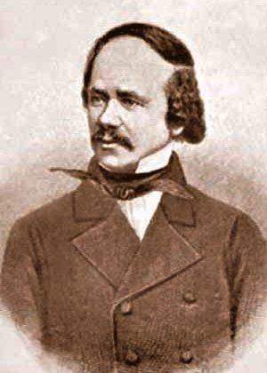
冬天他被引見給當時葛令卡之後最重要的俄國作曲家達爾戈梅日斯基，成為他家沙龍的常客，樂評家斯塔索夫說他在那裡開始了「真正的音樂生涯」。他也在這裡認識了斯塔索夫、同為軍官的居伊，以及巴拉基列夫。巴拉基列夫不懂和聲理論，便和他四手聯彈貝多芬的交響曲以及舒曼、舒伯特、葛令卡的作品，一起分析曲式。在此之前，他只懂鋼琴音樂。

## 1858 | 辭去軍職
跟巴拉基列夫學習幾個月後，他辭去軍職，決心全心投入音樂。這段時間他也經歷了一場痛苦的精神危機，他在信中提到「神秘主義與對上帝的犬儒想法」，確切原因至今不明。

## 1859 | 莫斯科之行
協助一位前歌手在莊園上演葛令卡的歌劇《為沙皇獻身》，獲得寶貴的劇場經驗。這年他到莫斯科一遊，回來後宣稱熱愛「一切俄國的東西」，立志成為俄國人民的作曲家。

## 1861 | 農奴解放，家道中落
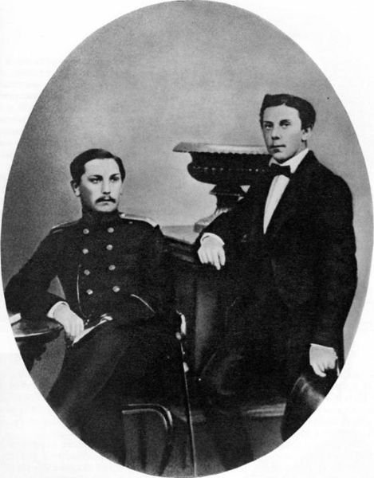
俄國廢除農奴制，家族失去了一半的莊園，他不得不花很多時間待在卡列沃，試圖挽救家計卻徒勞無功。1860年底到1863年間，他幾乎沒寫出什麼重要作品。

## 1863 | 公務員與「公社」
回到聖彼得堡，在內政部當低階公務員維生，和另外五個年輕人同住在一個「公社」裡，熱烈討論車爾尼雪夫斯基等人的激進思想。他愈來愈擁抱藝術寫實主義：描寫生活「真實的樣子」、關注社會底層，並拒絕重複、對稱的音樂形式。這一年他也開始寫歌劇《薩朗波》，寫了三年後失去興趣。同年他第一次在信中把姓氏拼成加了「g」的Musorgsky，可能是哥哥想避開「垃圾」的聯想。

## 1865 | 母親去世，第一次酗酒危機
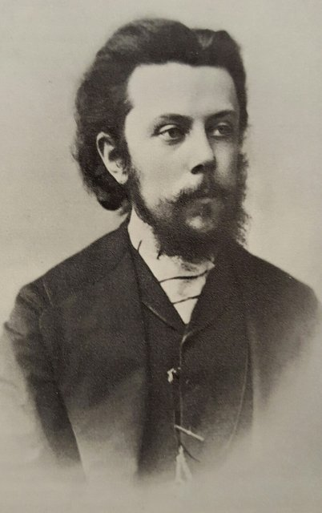
母親去世讓他深受打擊，第一次嚴重酗酒，只好離開公社搬去和哥哥同住。不過他正要寫出第一批寫實主義歌曲，如〈戈帕克〉和〈親愛的薩維什娜〉（1866年），隔年成為他最早正式出版的作品之一。

## 1867 | 《荒山之夜》；「強力集團」
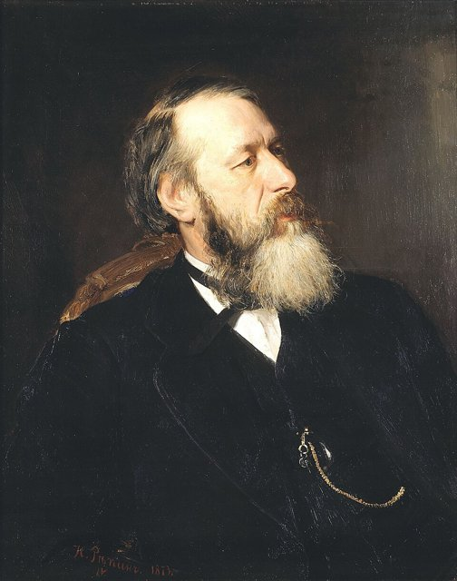
完成交響詩《荒山之夜》的原始管弦樂版，巴拉基列夫卻批評它、拒絕指揮，結果他生前從未聽過這首曲子演出。這一年斯塔索夫在樂評中首次提出「強力集團」（俄國五人組）的稱呼；五人組裡他的綽號是「幽默」，巴拉基列夫是「力量」，林姆斯基－高沙可夫是「真誠」。同年他在公職中被列為「編制外」人員，名義上仍在職卻領不到薪水。

## 1868 | 歌劇《婚事》的實驗
受到達爾戈梅日斯基《石客》「一字不改照原文譜曲」的啟發，他迅速把果戈里的劇本《婚事》前11場譜成音樂，目標是讓音樂完全模仿日常對話的自然語調。寫完第一幕後他就放棄了，這種寫法卻成為他日後聲樂作品的重要特色。

## 1869 | 完成《鮑里斯·戈杜諾夫》第一版
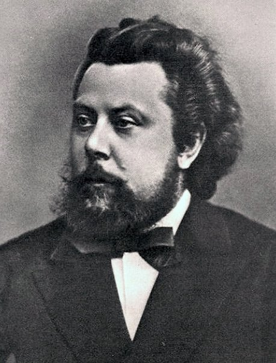
29歲時有人建議他以鮑里斯·戈杜諾夫的故事寫歌劇，他根據普希金的劇本與卡拉姆津的史書自行編寫劇本。年初他回到公職，在林業部門工作，同年底就完成了這部大型歌劇的總譜。

## 1871 | 歌劇被退件
皇家劇院拒絕上演《鮑里斯·戈杜諾夫》，原因似乎是缺少「首席女伶」的角色。他著手修改、擴充成第二版，修改幅度遠超過劇院的要求。年底他和林姆斯基－高沙可夫同住一間公寓，兩人輪流使用鋼琴：早上他彈琴作曲，中午他去上班，換林姆斯基用。

## 1872 | 第二版完成；聲樂組曲《育兒室》
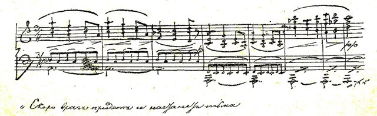
第二版《鮑里斯·戈杜諾夫》大約在5月被劇院接受，1873年先在馬林斯基劇院上演了三個片段，獲得好評。這一年他也完成了從孩子的眼光描寫童年的聲樂組曲《育兒室》，並參與了五人組合寫的歌劇芭蕾《姆拉達》計畫，這個計畫最後無疾而終。

## 1874-02-08 | 《鮑里斯·戈杜諾夫》首演
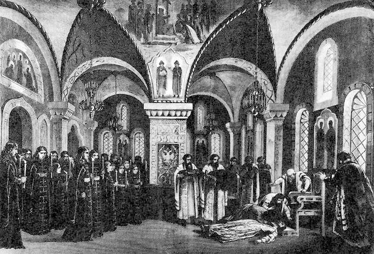
在馬林斯基劇院首演，雖然樂評不佳、只演了十幾場，觀眾卻反應熱烈，成為他事業的巔峰。這時他已開始寫下一部歌劇《霍萬斯基之亂》。

## 1874-06 | 《展覽會之畫》
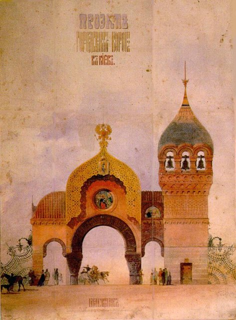
好友、建築師兼畫家哈特曼前一年驟逝，他在哈特曼的遺作展後，以三週左右的時間寫下鋼琴組曲《展覽會之畫》，用〈漫步〉串起一幅幅畫作，最後以〈基輔城門〉壯麗作結，是他最富想像力、最常演出的作品。同年他也寫了聲樂組曲《暗無天日》，歌詞來自表親兼室友戈列尼謝夫－庫圖佐夫的詩，並開始寫另一部果戈里題材的歌劇《索羅欽集市》。

## 1875 | 五人組瓦解
巴拉基列夫圈子逐漸解散，他特別憤恨，寫信給斯塔索夫說「強力集團已墮落成沒有靈魂的叛徒」。好友哈特曼已死，室友戈列尼謝夫－庫圖佐夫又搬走結婚，他常整天泡在名聲不好的「小雅羅斯拉維茨」酒館。當時酗酒被許多反體制的知識分子視為一種姿態，有人說：「熱愛平民的俄國才子，不可能不喝酒。」

## 1877 | 《死之歌舞》
聲樂組曲《死之歌舞》的四首歌，是他晚年最有力的作品；歌詞同樣出自戈列尼謝夫－庫圖佐夫。同年他也為詩人阿列克謝·托爾斯泰的詩譜寫了一系列歌曲，把抒情的旋律與朗誦般的唱法結合在一起。

## 1879 | 南俄巡迴演出
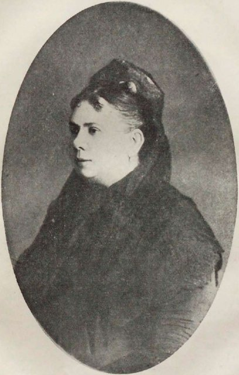
他經常「生病」缺勤，公職岌岌可危，所幸轉調到國家監察部門後，愛好音樂的上司對他非常寬容，甚至准他請假三個月，為女低音列昂諾娃擔任鋼琴伴奏，到烏克蘭、克里米亞、頓河與窩瓦河沿岸12個城市巡迴演出。

## 1880 | 被政府解職
他終於被免除公職。朋友們知道他生活困頓，一群人出資贊助他完成《霍萬斯基之亂》，另一群人則贊助他完成《索羅欽集市》，但兩部歌劇都沒能完成；《霍萬斯基之亂》只差兩段沒寫，以鋼琴譜的形式幾乎完稿。他晚年也在列昂諾娃開設的音樂學校教音樂理論。

## 1881-03 | 列賓畫下最後的肖像
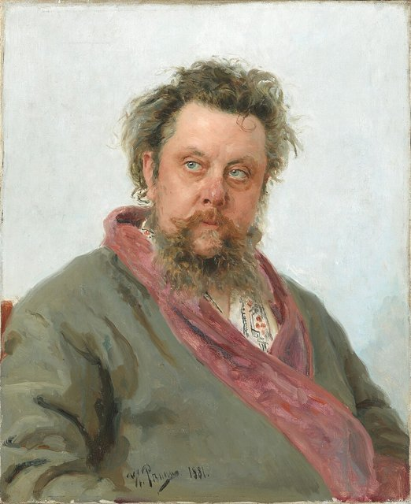
年初他絕望地對朋友說「只剩乞討一條路了」，接著接連四次癲癇發作，並出現酒精戒斷的譫妄症狀，被送進醫院。他在醫院裡一度好轉，畫家列賓趁這段期間為他畫了那幅著名的紅鼻子肖像，這也是他生命最後幾天的模樣。

## 1881-03-28 | 逝世@聖彼得堡
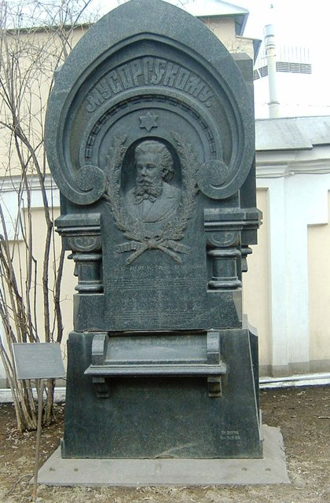
在42歲生日後一週去世，安葬在聖彼得堡亞歷山大·涅夫斯基修道院的季赫溫公墓。他留下許多未完成或未配器的作品，由林姆斯基－高沙可夫、格拉祖諾夫等人補完。

## 1886 | 林姆斯基－高沙可夫整理遺作
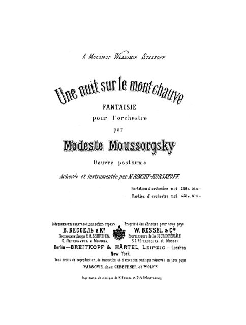
林姆斯基－高沙可夫補完並配器的《霍萬斯基之亂》在聖彼得堡由業餘團體首演；他改編的《荒山之夜》也在這一年由別利亞耶夫贊助的俄國交響音樂會首演，成為今天最常聽到的版本。林姆斯基認為穆索斯基的原譜充滿「荒謬、不連貫的和聲」，必須修飾才能演出；利亞多夫則說：「要修正穆索斯基的不規則很容易，問題是一修正，音樂的性格與原創性就消失了。」

## 1888 | 沙皇劃掉《鮑里斯·戈杜諾夫》
五人組被沙皇與宮廷視為激進分子，沙皇亞歷山大三世親自把《鮑里斯·戈杜諾夫》從皇家歌劇院的預定劇目中劃掉。

## 1896 | 林姆斯基－高沙可夫版《鮑里斯》
林姆斯基－高沙可夫重新配器《鮑里斯·戈杜諾夫》，1908年再度修訂。學者認為原始版本較陰暗、精簡，卻也較粗糙；後來蕭士塔高維奇也做了兩個版本。

## 1908 | 《鮑里斯》在巴黎轟動
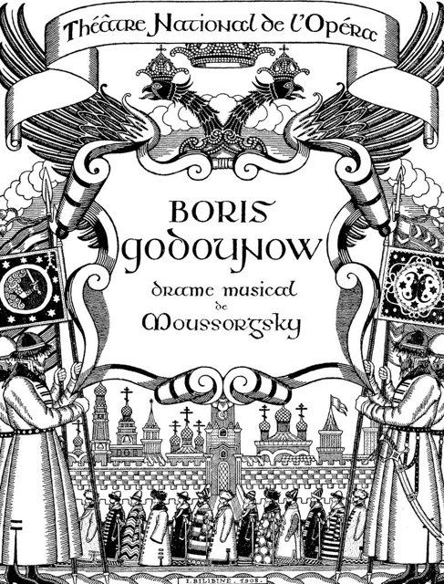
狄亞基列夫在巴黎推出由男低音夏里亞平主演的《鮑里斯·戈杜諾夫》，徹底改變了西方對他的看法。在這之前，1905年的《牛津音樂史》還說他的風格在西方人耳中「野蠻而醜陋」。

## 1922 | 拉威爾的《展覽會之畫》配器版
指揮家庫塞維茲基委託拉威爾把《展覽會之畫》改編成管弦樂，這個版本色彩繽紛，成為這部作品最廣為人知的形式。

## 1940 | 迪士尼《幻想曲》
《荒山之夜》在迪士尼動畫電影《幻想曲》中搭配魔王切爾諾伯格召喚惡靈的畫面，再接上舒伯特的〈聖母頌〉，讓這首曲子廣為大眾所知。後來蕭士塔高維奇的晚期交響曲與普羅高菲夫的歌劇也都深受他的影響。
