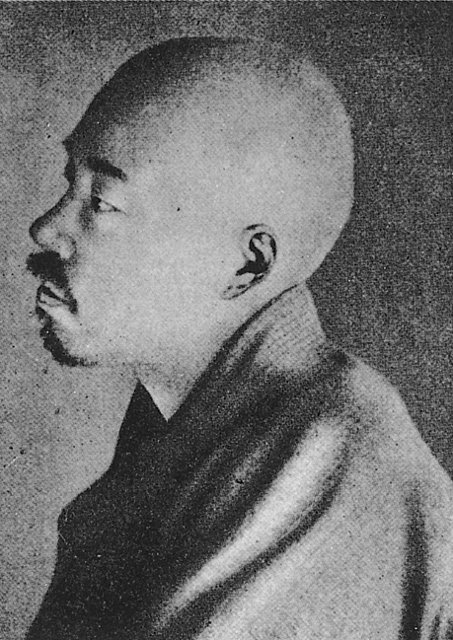
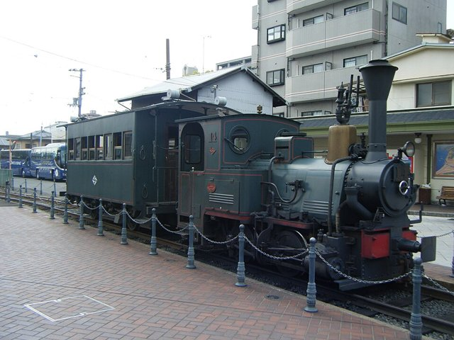
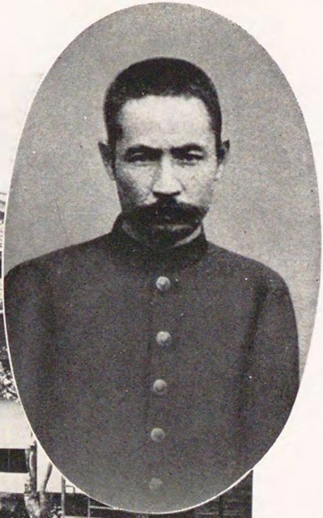
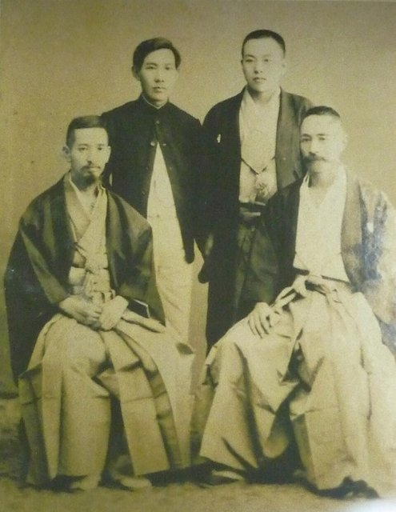
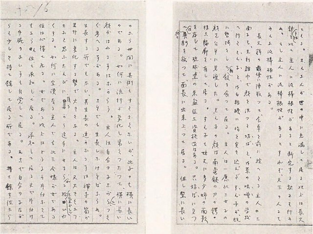
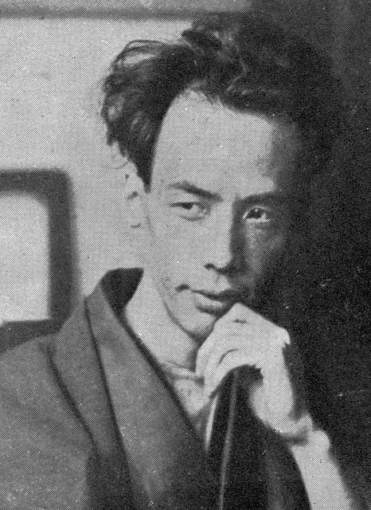

<!--
內容整理自 D:\Books\html\6-4.日本文學家\夏目漱石.html（沒有對應的 md 筆記），並整合中文維基百科〈夏目漱石〉條目，以自己的話改寫。
時期依生平歸納：童年與求學、松山與熊本、倫敦留學、作家誕生、朝日新聞的專業作家、晚年。
兩份資料出入與處理方式：
- 生卒：慶應三年一月五日（西曆1867年2月9日）生於江戶牛込；1916年12月9日因胃潰瘍去世，兩份一致，享年49歲。
- 倫敦留學：維基百科寫「1899年10月28日」抵達倫敦，與頁面的1900年及一般記載不符；他是1900年9月從橫濱出發、10月28日抵達倫敦，採1900年。1902年12月啟程返國，1903年1月抵達日本，兩份一致。
- 頁面寫1907年辭去教職加入朝日新聞社、1910年「修善寺大患」、1916年《明暗》未完，與維基百科一致；修善寺大患的日期依一般記載的8月24日。
- 頁面說「則天去私」是晚年理念，寫進最後一則事件。
- 1916年《鼻》受漱石讚賞、提攜芥川龍之介，取自〈日本文學家總覽〉頁面。
- 1984年千圓紙鈔，取自維基百科與頁面。
- 筆名「漱石」取自「漱石枕流」的典故，1889年起使用，依一般記載補充。
- 人名與其他時間軸一致：正岡子規、芥川龍之介、森鷗外。
圖片來源（皆為 Wikimedia Commons 公有領域／CC0 作品；註明「共用」者沿用其他時間軸已有的圖片）：
- na-cover.jpg：Natsume Soseki photo.jpg（夏目漱石，1912年小川一真攝）
- na-shiki.jpg：Masaoka Shiki.jpg（正岡子規）
- na-dogo.jpg：Dogo Onsen Station 03.jpg（松山道後溫泉站前的「少爺列車」，《少爺》的舞台）
- na-kumamoto.jpg：Natsume Soseki as a professor of Fifth Higher School.jpg（第五高等學校教授時期的夏目漱石）
- na-london.jpg：Farewell photo for Natsume Soseki before his departure for London.jpg（赴英前的送別合影）
- na-neko.jpg：Manuscripts of "I Am a Cat".jpg（《我是貓》手稿）
- ak-cover.jpg：Akutagawa Ryunosuke photo.jpg（芥川龍之介（與芥川龍之介生平時間軸共用））
-->

# Periods
- 1867-02-09 ~ 1895 | 童年與求學 | #868e96
  生於江戶的名主之家，兩歲被送去當養子，九歲回到生家；在第一高等中學結識正岡子規，進入帝國大學主修英國文學。
- 1895 ~ 1900 | 松山與熊本 | #2f9e44
  離開東京，到愛媛松山與熊本第五高等學校任教，結婚成家。
- 1900 ~ 1903 | 倫敦留學 | #1971c2
  文部省派他到倫敦研究英語教育與英國文學，在孤獨與經濟拮据中陷入嚴重的神經衰弱。
- 1903 ~ 1907 | 作家誕生 | #e8590c
  回國後在帝國大學講授英國文學，以《我是貓》《少爺》《草枕》一舉成名。
- 1907 ~ 1916-12-09 | 朝日新聞的專業作家 | #0b7285
  辭去教職加入朝日新聞社，連載《三四郎》《從此以後》《門》《心》；修善寺大患後身體每況愈下，主持文學沙龍提攜後進，在《明暗》未完時去世。

# Events

## 1867-02-09 | 出生於江戶
夏目漱石生於江戶牛込馬場下（今東京都新宿區喜久井町），本名夏目金之助，父親夏目小兵衛是地方的名主。他是家中的么子，出生時父母年紀已大，被視為多餘的孩子，一出生就被送去寄養。

## 1868 | 送作養子
兩歲的金之助被送給鹽原昌之助夫婦當養子。養父母後來失和離婚，他在1876年前後回到夏目家，但直到1888年才恢復夏目的戶籍。這段童年經歷後來寫進了自傳性小說《道草》。

## 1889 | 結識正岡子規，取號「漱石」

在第一高等中學就讀期間，夏目結識了俳人正岡子規，兩人成為終身好友。他在評點子規的文集時第一次使用「漱石」這個筆名，取自「漱石枕流」的典故，意思是固執、不服輸。

## 1890 | 進入帝國大學英文科
夏目進入帝國大學（今東京大學）英文科，1893年畢業，是該科早期少數的日本籍畢業生。他雖然精通英語，卻常懷疑自己是否真的理解英國文學，這份不安日後成為他思考「日本人如何面對西方文化」的起點。

## 1895 | 松山中學教師

夏目到愛媛縣松山中學任英語教師，與回鄉養病的正岡子規同住，跟他學作俳句。這段經歷後來成為《少爺》的素材。

## 1896 | 熊本第五高等學校，結婚

夏目轉任熊本的第五高等學校教授，同年與貴族院書記官長中根重一的長女鏡子結婚。

## 1900 | 公費赴英留學

夏目被文部省選派到英國留學兩年，研究英語教育，10月28日抵達倫敦。當時他已經33歲、有家室，公費並不寬裕，他多次搬家，最後住在倫敦南部的寄宿公寓，終日足不出戶埋首書堆。他對英國社會格格不入，陷入嚴重的神經衰弱，同儕甚至向國內報告「夏目發瘋了」，文部省一度考慮提早召他回國。

## 1903 | 回國任教
夏目在1902年底離開倫敦，1903年1月回到日本，接替小泉八雲在東京帝國大學講授英國文學，同時在第一高等學校任教。他根據留學時的研究寫成《文學論》，但神經衰弱並未好轉。

## 1905 | 《我是貓》

在高濱虛子的勸說下，夏目在俳句雜誌《杜鵑》上發表《我是貓》，以一隻沒有名字的貓的眼光，諷刺知識分子與明治社會，大受歡迎，原本預定的一回連載延長成長篇。開頭「我是貓，還沒有名字」至今仍是日本最有名的小說開場白之一。

## 1906 | 《少爺》與《草枕》
夏目接連發表以松山為背景、寫一個魯莽正直青年教師的《少爺》，以及追求「非人情」超脫境界的《草枕》。他每週四在家中接待學生與年輕作家，形成「木曜會」，寺田寅彥、森田草平、鈴木三重吉等人都是常客。

## 1907 | 加入朝日新聞社
夏目辭去東京帝國大學與第一高等學校的教職，以專屬作家的身分加入朝日新聞社，此後的長篇小說都在《朝日新聞》上連載，第一部是《虞美人草》。放棄帝大教授的身分去當報社作家，在當時引起很大的轟動。

## 1908 | 《三四郎》
夏目連載《三四郎》，寫一名從熊本到東京念大學的青年，在都市與新女性之間的迷惘，與隔年的《從此以後》、1910年的《門》合稱「前期三部曲」。

## 1910-08-24 | 修善寺大患
夏目因胃潰瘍到伊豆的修善寺溫泉療養，8月24日大量吐血，一度失去意識約三十分鐘，瀕臨死亡。這次經歷讓他對生死有了新的體悟，此後作品更加關注人的利己心與孤獨。

## 1911 | 拒絕博士學位
文部省要授予他文學博士的稱號，夏目以「只想以夏目某某的身分活下去」為由拒絕，引起與文部省的爭執。

## 1914 | 《心》
夏目連載《心》，寫一名年輕人與他稱為「先生」的長者，以及先生年輕時因背叛友人而一生自責的遺書，是他最廣為閱讀的作品，也與1912年的《過了春分時節》、1912至1913年的《行人》合稱「後期三部曲」。1915年他又發表自傳性的《道草》。

## 1916-02 | 讚賞芥川龍之介的《鼻》

還是帝大學生的芥川龍之介在同人雜誌上發表短篇小說《鼻》，夏目寫信大加讚賞，認為只要再寫二、三十篇這樣的作品，就能在文壇獨樹一格，芥川因此一舉成名。

## 1916-12-09 | 病逝
夏目在連載長篇小說《明暗》期間胃潰瘍再度惡化，12月9日去世，享年49歲，《明暗》成為未完的遺作。他晚年提出「則天去私」，主張捨棄狹隘的自我、順應更大的天理，但沒有來得及完整闡述。

## 1984-11 | 千圓紙鈔
夏目漱石的肖像印上新版一千日圓紙鈔，自1984年11月發行，使用到2004年才由野口英世取代，他也因此成為日本人最熟悉的作家面孔之一。
