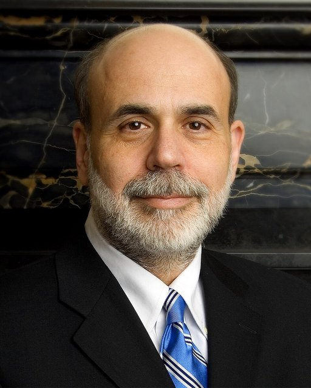
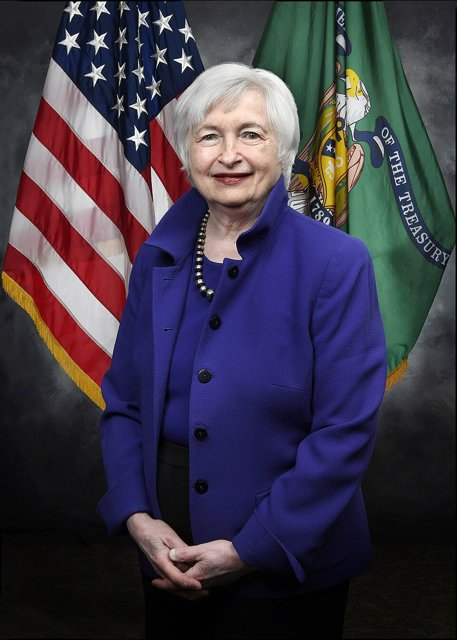

<!--
內容整理自本機筆記〈新凱因斯學派（New Keynesian Economics）〉（D:\Books\md\歷史\術語\經濟學\新凱因斯學派（New Keynesian Economics）.md；html 版在 D:\Books\html\4-1-1.經濟學派），以自己的話改寫。中文維基百科〈新凱恩斯主義經濟學〉條目只有一兩句，只用來核對名稱。
時期依原稿「歷史發展總時間軸」的九個階段，合併為五段：凱因斯革命與新古典宏觀的挑戰、理論奠基、學派成形與新綜合、貨幣政策理論的成熟、金融海嘯後。
處理方式：
- 1936年《通論》到1976年盧卡斯批判的前史寫進第一則事件，詳見「凱因斯學派」「新興古典學派」時間軸。
- 重要論文依原稿的參考資料與通行的學術史：1977年費雪與費爾普斯—泰勒的契約模型、1983年卡爾沃的定價模型、1985年曼昆與艾克羅夫—葉倫的菜單成本、1987年布蘭查德—清瀧、1991年曼昆與大衛·羅默合編《新凱因斯經濟學》、1993年泰勒法則、1999年金融加速器、2003年伍德福《利息與價格》。
- 2001年艾克羅夫與史迪格里茲（以資訊不對稱）獲諾貝爾獎、2022年柏南克獲諾貝爾獎，依此補上。
- 2021年以後的通膨與供給衝擊，寫進最後一則事件。
- 人名依 Books 原稿與台灣慣用譯名：曼昆、艾克羅夫、葉倫、史迪格里茲、泰勒、伍德福、加利、柏南克；人名用·分隔。
圖片來源（皆為 Wikimedia Commons 公有領域／CC0 作品，縮成最長邊 640px）：
- nke-eccles.jpg：Eccles Building (26088200676).jpg（華盛頓的聯準會總部埃克爾斯大樓）
- nke-bernanke.jpg：Ben Bernanke official portrait.jpg（柏南克的聯準會主席官方肖像）
- nke-yellen.jpg：Secretary Janet Yellen portrait.jpg（珍妮特·葉倫（財政部長官方肖像））
-->

# Periods
- 1936 ~ 1976 | 從凱因斯革命到理性預期 | #868e96
  凱因斯主義在戰後主導政策，1970年代的停滯性通膨與盧卡斯批判卻使它失去理論的基礎；新一代凱因斯學者決定接受理性預期，重新說明市場為何不能立即出清。
- 1977 ~ 1990 | 理論奠基 | #1098ad
  交錯契約、菜單成本、效率工資、信用配給與壟斷性競爭，從企業與家庭的最適化行為推導出價格與工資的僵固，貨幣政策因此能影響產出。
- 1991 ~ 2000 | 學派成形與新綜合 | #1971c2
  《新凱因斯經濟學》的出版確立學派名稱；泰勒法則與新凱因斯 DSGE 模型結合新興古典的方法，形成「新的新古典綜合」。
- 2001 ~ 2007 | 貨幣政策理論的成熟 | #2f9e44
  伍德福的《利息與價格》集其大成，通膨目標制與前瞻指引成為各國央行的標準框架，「大穩健」時期被視為理論的成功。
- 2008 ~ 2026 | 金融海嘯之後 | #5f3dc4
  利率降到零、量化寬鬆與前瞻指引成為新工具，金融摩擦與異質性家庭（HANK）被納入模型；疫情後的通膨與供給衝擊再度考驗新凱因斯模型。

# Events

## 1936 | 凱因斯革命的前史
凱因斯在1936年的《通論》中指出，貨幣工資僵固會使經濟長期停在非自願失業，但他沒有說明工資與價格為什麼僵固。戰後的新古典綜合派以菲利普斯曲線處理通膨與失業，1970年代的停滯性通膨、傅利曼的自然失業率與1976年的盧卡斯批判，卻使傳統凱因斯模型失去可信度。新凱因斯學派的任務，就是在理性預期與個體基礎的要求下，重新解釋為什麼需求與貨幣政策會影響產出。

## 1977 | 交錯契約
史丹利·費雪與費爾普斯—泰勒分別發表論文，指出現實中的工資契約往往一次訂定數年，而且不同產業的契約在不同時間簽訂、交錯存在。即使人們有理性預期，已簽定的契約也無法立即調整，因此貨幣政策在短期內能夠影響產出，駁斥了政策無效命題。1980年泰勒又提出交錯工資的動態模型。

## 1981 | 信用配給
史迪格里茲與魏斯發表〈不完全資訊市場中的信用配給〉，指出銀行無法分辨借款人的風險，提高利率反而會趕走安全的借款人、吸引高風險者，因此銀行寧可在一定利率下限量放款，信用市場不會自動出清。資訊不對稱成為新凱因斯學派解釋市場失靈的重要工具。

## 1983 | 卡爾沃定價
卡爾沃提出一個簡潔的模型：每一期只有隨機一部分的廠商能調整價格，其餘維持原價。這個「卡爾沃定價」便於數學處理，後來成為新凱因斯菲利普斯曲線與 DSGE 模型的標準設定。1982年羅騰伯格也以價格調整成本提出類似的模型。

## 1984 | 效率工資
夏皮洛與史迪格里茲發表〈作為勞工紀律手段的均衡失業〉：企業無法完全監督員工，於是支付高於市場行情的「效率工資」，讓員工珍惜工作、不敢偷懶，結果勞動市場長期存在非自願失業。效率工資理論解釋了實質工資為何不會下降到消除失業的水準。

## 1985 | 菜單成本
曼昆發表〈小菜單成本與大景氣循環〉，艾克羅夫與葉倫同年發表〈近乎理性的景氣循環模型〉：廠商改價格要付出印製新菜單、通知客戶等小成本，在壟斷性競爭下，不改價格對個別廠商的損失很小，對整體經濟卻可能造成很大的產出波動。1987年布蘭查德與清瀧以壟斷性競爭說明總需求變動的外部效果，1988年鮑爾、曼昆與大衛·羅默以跨國資料驗證新凱因斯理論的預測。

## 1991 | 《新凱因斯經濟學》
曼昆與大衛·羅默合編兩卷本《新凱因斯經濟學》，收錄這十多年的重要論文，學派的名稱正式確立。新凱因斯學派並不是單一理論，而是一群共享「價格與工資有僵固性、市場不完全競爭、貨幣在短期非中立」等觀點的研究。

## 1993 | 泰勒法則
史丹佛大學的泰勒發表〈實務中的權衡與政策規則〉，指出聯準會的利率決策大致可以用一條簡單規則描述：當通膨高於目標、或產出高於潛在水準時提高利率，反之降低利率。泰勒法則成為評估與溝通貨幣政策的標準工具，也調和了「規則」與「權衡」的爭論。

## 1997 | 新的新古典綜合
古德弗蘭德與金恩把新凱因斯的價格僵固性與實質景氣循環的動態均衡架構結合，稱為「新的新古典綜合」；1999年克拉里達、加利與格特勒發表〈貨幣政策的科學〉，整理出以新凱因斯 IS 曲線、新凱因斯菲利普斯曲線與利率規則構成的「三方程式模型」。同年柏南克、格特勒與吉爾克里斯特提出「金融加速器」，說明企業資產負債表如何放大景氣衝擊。

## 2001 | 艾克羅夫與史迪格里茲獲諾貝爾獎
艾克羅夫、史迪格里茲與史賓斯以資訊不對稱市場的分析同獲諾貝爾經濟學獎，艾克羅夫的「檸檬市場」、史迪格里茲的信用配給與效率工資，都是新凱因斯學派的重要基礎。

## 2003 | 伍德福《利息與價格》
哥倫比亞大學的伍德福出版《利息與價格：貨幣政策理論的基礎》，以完整的新凱因斯架構分析最適貨幣政策，強調央行管理大眾預期與「前瞻指引」的重要性，被視為新凱因斯貨幣理論的集大成之作。斯梅茨與沃特斯在同年估計出的中型 DSGE 模型，以及2005年克里斯蒂亞諾、艾肯鮑姆與埃文斯的模型，被各國央行廣泛採用。

## 2006 | 「大穩健」與柏南克

研究大蕭條的柏南克出任聯準會主席。1980年代中期至2007年，主要國家的通膨與產出波動明顯降低，被稱為「大穩健」，許多人把它歸功於以新凱因斯理論為基礎的通膨目標制與可信的貨幣政策。2008年加利出版《貨幣政策、通膨與景氣循環》，成為標準的研究所教科書。

## 2008 | 金融海嘯與量化寬鬆

金融海嘯使利率迅速降到接近零，傳統的利率工具失效。柏南克領導的聯準會實施量化寬鬆與前瞻指引，2012年正式公布2%的通膨目標，2014年由同屬新凱因斯學派的葉倫接任主席。主流 DSGE 模型未能預見危機的批評，促使研究者把金融中介、銀行擠兌與零利率下限納入模型。

## 2018 | HANK 模型
卡普蘭、莫爾與維奧蘭特發表〈根據 HANK 的貨幣政策〉，把家庭的所得與財富差異放進新凱因斯模型：許多家庭手頭現金有限，對所得變化反應強烈，貨幣政策主要透過影響就業與所得、而非利率直接改變消費。異質性代理人新凱因斯（HANK）模型成為總體經濟學的新核心，政策的分配效果也因此受到重視。

## 2020 | 疫情與通膨
疫情期間各國以大規模財政紓困與零利率支撐經濟，2020年8月聯準會改採「彈性平均通膨目標」，容許通膨暫時高於2%。2021年至2022年通膨大幅攀升，各國央行急速升息，傳統新凱因斯模型對供給衝擊、供應鏈瓶頸與通膨預期的處理再度受到檢討。2022年柏南克與戴蒙德、迪布維格以銀行與金融危機的研究獲得諾貝爾經濟學獎。
