<!--
內容整理自 D:\Books\md\歷史\人物\科學家\牛頓生平大事記.md（網頁版為 D:\Books\html\8-2.科學家\牛頓生平大事記.html），並整合中文維基百科〈艾薩克·牛頓〉條目，以自己的話改寫。
時期依筆記的六個階段歸納：出生與早年、劍橋求學、奇蹟之年、劍橋教授與《原理》、公共事務、晚年與逝世。筆記的「重要著作與科學貢獻總表」「與其他科學家的關係」「歷史地位」「關鍵年份速覽」寫進時期說明與相關事件，不另立事件。
兩份資料出入與處理方式：
- 生卒：筆記與維基百科都說明儒略曆1642年12月25日＝格里曆1643年1月4日出生，儒略曆1727年3月20日＝格里曆3月31日逝世；books 的資料夾與頁面標題寫「1642–1727」。這裡 born／died 採格里曆（1643-01-04、1727-03-31），與人名索引原本的補充名單（1643–1727）一致，事件的年齡因此是以格里曆起算；儒略曆的日期寫進事件內文。
- 返鄉務農：筆記寫約1659年被母親要求回家管農場；維基百科寫1659年10月回到伍爾索普，照此補月份。進入劍橋：筆記寫1661年，維基百科寫1661年6月。
- 微積分與二項式：維基百科寫1665年發現廣義二項式定理並開始發展微積分，與筆記的「1665—1666年發展流數法」一致；萊布尼茲部分，維基百科補充牛頓在1693年以前幾乎沒有發表，1704年才給出完整敘述，萊布尼茲已在1684年發表，1699年皇家學會成員指控萊布尼茲剽竊，爭論在萊布尼茲1716年去世後才暫時停止；英國堅持使用牛頓的符號到1820年，寫進1699年事件。
- 蘋果故事：維基百科說牛頓的友人斯蒂克利記錄了1726年4月15日的談話，牛頓回憶蘋果下落使他想到引力；頁面提醒牛頓早年的重力想法與1687年的完整理論之間隔了很長的發展，這裡把蘋果故事寫在「奇蹟之年」事件，並註明出處與年代。
- 反射望遠鏡：筆記寫1668年製作；維基百科寫1671年向皇家學會展示，照兩者合併：1668年製作、1671年展示（寫進1672年的皇家學會事件）。
- 皇家學會：筆記寫1672年獲選會員並提交光學論文，與維基百科一致；1703年當選會長並任職到1727年，維基百科補充同年也成為法國科學院的會員。
- 《原理》：筆記寫1687年出版；維基百科寫1687年7月5日，在哈雷的鼓勵與支持下出版，照此。
- 國會：筆記寫1689年當選；維基百科寫兩度擔任劍橋選區的議員（1689–1690、1701–1702），照此。
- 1692—1693年的低潮：筆記提醒不宜用現代診斷解釋；維基百科補充他與瑞士數學家丟勒（法蒂奧）的親密友誼在1693年破裂，並說1970年代頭髮的化學分析發現水銀含量偏高，可能與鍊金術有關，這裡只寫友誼破裂與提醒，水銀一事不收。
- 鑄幣廠：筆記寫1696年出任監理（維基百科：經財政大臣孟塔古提攜，遷到倫敦），1699年升任廠長；維基百科補充他以太平紳士身分審理偽幣犯，1699年有死刑執行（查洛納3月23日被處刑），以及1717年的鑄幣法讓英鎊由銀本位轉向金本位，一併寫進鑄幣廠事件。
- 爵士：維基百科說1705年安妮女王冊封，他是第二位獲此榮譽的英國科學家，第一位是培根。
- 逝世：筆記寫在倫敦一帶逝世、葬於西敏寺，維基百科寫在倫敦睡夢中辭世，享壽84歲，照兩者。
圖片來源（皆為 Wikimedia Commons 公有領域／CC0 作品；繪畫、版畫與插圖多為後世作品，不代表事件當時的樣貌）：
- nw-cover.jpg：Portrait of Sir Isaac Newton, 1689.jpg（內勒所繪牛頓像，1689）
- nw-trinity.jpg：Trinity College Great Court Willis 1886.jpg（劍橋三一學院的大庭院（威利斯繪，1886））
- nw-plague.jpg：Great plague of london-1665.jpg（1665年倫敦大瘟疫（版畫））
- nw-prism.jpg：Diagram of experiment with prisms that led Newton to conclude light is a mixture of differently refrangible rays; with surrounding text LCCN92518608.jpg（牛頓說明稜鏡實驗的圖（《光學》））
- nw-barrow.jpg：Isaac Barrow by Mary Beale.jpg（艾薩克·巴羅（瑪麗·比爾繪））
- nw-hooke.jpg：Robert Hooke portrait.jpg（羅伯特·胡克（版畫））
- nw-halley.jpg：Edmond Halley 072.jpg（愛德蒙·哈雷）
- nw-principia.jpg：Newton - Principia (1687), title, p. 5, cropped.jpg（《自然哲學的數學原理》初版書名頁，1687）
- nw-leibniz.jpg：Gottfried Wilhelm Leibniz, Bernhard Christoph Francke.jpg（法蘭克所繪萊布尼茲，約1695）
- nw-royalsociety.jpg：John Vanderbank (1694-1739) - Isaac Newton (1642–1727) - RS.9254 - Royal Society.jpg（范德班克所繪牛頓像（皇家學會藏））
- nw-opticks.jpg：Queries title page.jpg（《光學》第三卷〈疑問〉書頁）
- nw-anne.jpg：Closterman, John - Queen Anne - NPG 215.jpg（克洛斯特曼所繪安妮女王）
- nw-tomb.jpg：Isaac Newton grave in Westminster Abbey.jpg（牛頓在西敏寺的墓碑）
-->

# Periods
- 1643-01-04 ~ 1661 | 出生與早年 | #868e96
  生於林肯郡伍爾索普的農莊，出生前父親已去世，母親再嫁後由外祖母照顧；在格蘭瑟姆文法學校求學，對機械與模型著迷。
- 1661 ~ 1665 | 劍橋求學 | #2f9e44
  進入劍橋三一學院，課程仍以亞里斯多德為主，他自學笛卡兒、伽利略、克卜勒與沃利斯的新數學與自然哲學。
- 1665 ~ 1667 | 奇蹟之年 | #e8590c
  瘟疫使劍橋關閉，他回到伍爾索普獨立思考，發展流數法（微積分）、白光與顏色的光學實驗，以及重力與月球運動的最初想法。
- 1667 ~ 1687 | 劍橋教授與《原理》 | #364fc7
  成為三一學院院士與盧卡斯教授，製作反射望遠鏡、與胡克爭論光學；1684年哈雷來訪，促成《自然哲學的數學原理》。
- 1687 ~ 1703 | 公共事務 | #c92a2a
  成為議員，一度身心耗弱，後來離開劍橋出任皇家鑄幣廠監理與廠長，處理貨幣改鑄與偽幣。
- 1703 ~ 1727-03-31 | 皇家學會會長與晚年 | #495057
  擔任皇家學會會長，出版《光學》，受封爵士，修訂《原理》，與萊布尼茲爭論微積分的發明權，在倫敦逝世，葬於西敏寺。

# Events

## 1643-01-04 | 出生於伍爾索普
艾薩克·牛頓在儒略曆1642年12月25日（格里曆1643年1月4日）出生於英格蘭林肯郡伍爾索普的莊園。父親（同名艾薩克）在他出生前不久就去世，母親漢娜·艾斯科獨自照顧體弱的嬰兒。
牛頓出生時正是科學革命的重要時期：哥白尼的日心說、克卜勒的行星運動定律與伽利略的力學研究，正在動搖傳統的自然哲學，他日後的成就就是在這些成果的基礎上，建立統一的數學與物理理論。

## 1645 | 母親再婚 {label="約1645年"}
母親嫁給牧師巴納巴斯·史密斯，牛頓留在伍爾索普，由外祖母一帶的親屬照顧，直到繼父去世母親才回來。傳記作者常把他日後的孤僻、謹慎與強烈的獨立性連到這段童年，但不宜簡單歸因。

## 1655 | 進入格蘭瑟姆文法學校 {label="約1655年"}
牛頓進入格蘭瑟姆的國王學校，學習拉丁文與古典文學，寄宿在藥劑師克拉克家中。傳記常提到他年輕時製作風車模型、日晷與機械玩具，反映了他動手實驗與觀察的傾向，不過部分童年逸事的細節來自後來的傳記。

## 1659-10 | 被要求返鄉管理農場
母親再度守寡，希望牛頓回家務農，他在1659年10月離開學校回到伍爾索普，卻對農事毫無興趣。親友與老師發現他更適合讀書，支持他重回學校。

## 1661-06 | 進入劍橋三一學院
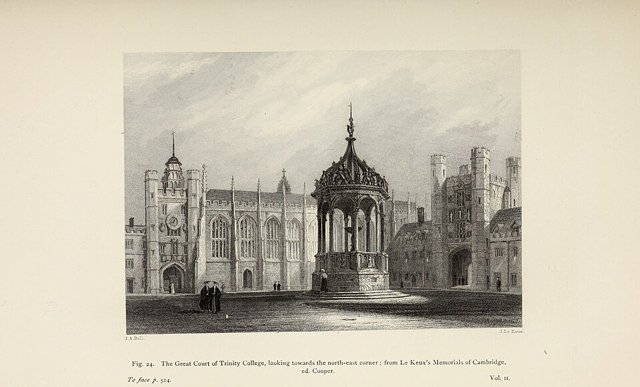
牛頓進入劍橋大學三一學院。當時的課程仍受亞里斯多德哲學與經院學術影響，他除了正式課程，也自行研讀笛卡兒的自然哲學、伽利略與克卜勒的著作，並開始思考如何用數學解釋自然現象。1664年他接觸約翰·沃利斯等人的數學著作，逐步發展以無窮級數處理數學問題的方法。

## 1665 | 學位，瘟疫使劍橋關閉
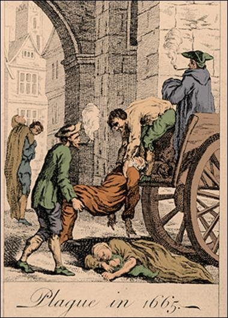
牛頓取得劍橋文學士學位，同年1665年他發現了廣義二項式定理。倫敦大瘟疫蔓延，劍橋大學關閉，他回到伍爾索普的老家。這段脫離校園、能長時間獨立思考的歲月，成為他科學生涯最重要的時期。

## 1666 | 奇蹟之年 {label="1665–1666年"}
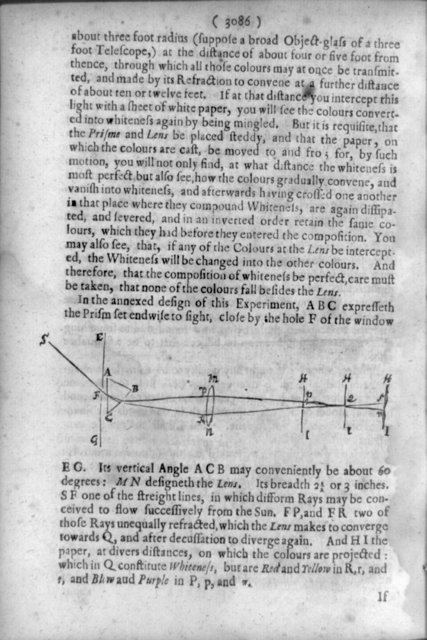
這段時期常被稱為牛頓的「奇蹟之年」，不過重大成果並不是一年之內完成，而是許多想法在這幾年間形成、之後又經過長時間的發展。他發展出處理連續變化的「流數法」，也就是後來的微積分；用三稜鏡做光學實驗，認為白光是不同顏色光的混合；並開始思考月球為什麼不會掉到地球上，是否與蘋果下落由同一種力支配。
牛頓晚年回憶（友人斯蒂克利記錄了1726年4月15日的談話）蘋果下落使他想到引力，但他早年的重力想法與1687年的完整理論之間，還隔著很長的發展。

## 1667 | 返回劍橋，成為三一學院院士
牛頓回到劍橋，獲選為三一學院院士，有了穩定的研究環境。

## 1668 | 製作反射式望遠鏡
牛頓製作出有實用價值的反射式望遠鏡：以曲面鏡反射聚光，避開折射式望遠鏡的色差問題。他的設計對後來的反射式天文望遠鏡有重要影響，也顯示他不只提出理論，還親手製作儀器。

## 1669 | 盧卡斯數學教授
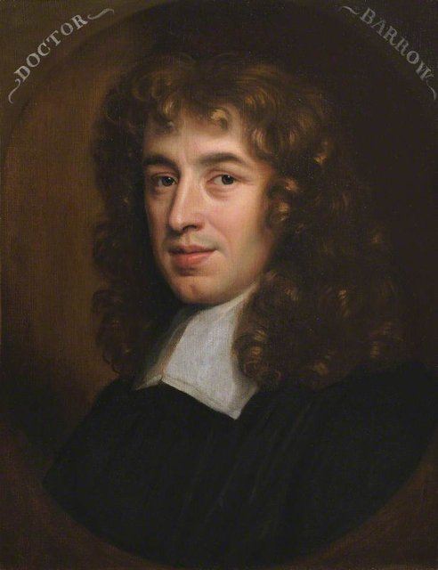
牛頓接替曾經指導他的艾薩克·巴羅，成為劍橋大學的盧卡斯數學教授，代表他的數學能力已受到學術界的高度肯定。1670至1672年他負責講授光學。

## 1672 | 皇家學會與光學爭論
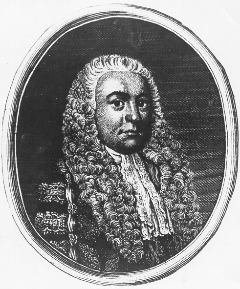
牛頓向皇家學會展示反射望遠鏡（1671年），並在1672年獲選為會員，提交關於光與顏色的論文。他的白光理論並沒有得到所有人認同，羅伯特·胡克等人提出質疑，引發激烈的爭論；對批評相當敏感的牛頓，此後一度不願公開發表研究。這場爭論也顯示，科學理論需要實驗證據、公開論證與學術社群的檢驗。

## 1679 ~ 1680 | 與胡克討論天體運動
牛頓在1679年重回力學研究，與胡克通信討論行星如何受到朝向中心的力吸引、軌道如何形成，並和弗蘭斯蒂德討論天文問題。牛頓後來對這些問題作出完整的數學推導，但他與胡克對貢獻歸屬的爭議始終存在；他的成就應放在當時歐洲科學家共同研究天體運動的背景下理解。

## 1684 | 哈雷拜訪牛頓
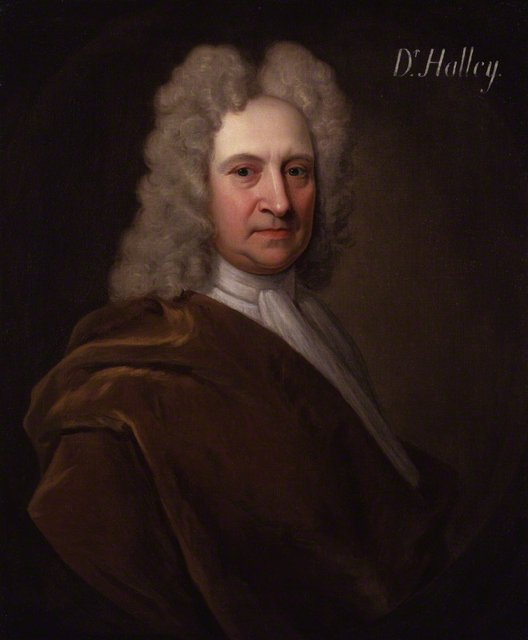
天文學家愛德蒙·哈雷到劍橋拜訪牛頓，問如果行星受到與距離平方成反比的力吸引，軌道會是什麼形狀。牛頓回答是橢圓，哈雷請他整理證明。這次拜訪促使牛頓重新投入力學研究，成為《原理》誕生的契機。1684至1686年他集中整理慣性、力與加速度、作用與反作用、中心力與軌道，以及重力與行星運動的數學關係。

## 1687-07-05 | 《自然哲學的數學原理》
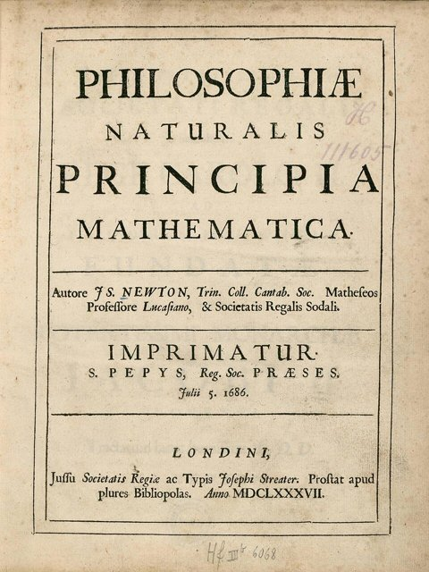
在哈雷的鼓勵與資助下，牛頓出版《自然哲學的數學原理》（簡稱《原理》）。書中系統提出運動三定律（慣性定律、F＝ma、作用力與反作用力），以及萬有引力定律（引力與質量乘積成正比、與距離平方成反比）。
最具革命性的是它把蘋果落地、月球繞地球、行星繞太陽與彗星的軌道，放進同一套數學框架，完成物理學史上首次重大的理論統一，也成為經典力學的基礎。

## 1689 | 當選國會議員
牛頓當選代表劍橋大學的議員（1689–1690年，1701–1702年又當選一次），與輝格黨關係密切，不過他並不是以政治活動為主要成就的人。

## 1692 | 健康與研究的低潮 {label="1692–1693年前後"}
1690年代初，牛頓經歷了一段身心狀況不佳的時期，文獻記載他情緒不穩、失眠，並與友人關係緊張，與瑞士數學家丟勒的親密友誼在1693年破裂。這段經歷的醫學解釋，後世仍有不同看法，不宜直接用現代診斷來定論。此後他逐漸把精力投入行政事務，也寫了許多解釋聖經與研究煉金術的手稿。

## 1696 | 出任皇家鑄幣廠監理
經財政大臣查爾斯·孟塔古的提攜，牛頓離開劍橋，到倫敦出任皇家鑄幣廠監理。當時英國面臨貨幣成色與偽幣問題，他積極參與貨幣改鑄與管理，並以太平紳士的身分審理偽幣犯（1699年3月23日，偽幣犯查洛納被處死）。1699年他升任廠長，此後職業重心由大學轉向政府行政；1717年的鑄幣法讓英鎊事實上由銀本位轉向金本位。

## 1699 | 微積分優先權之爭
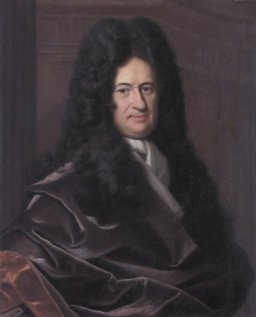
牛頓比萊布尼茲早幾年得出自己的方法，但在1693年以前幾乎沒有發表，1704年才給出完整敘述，而萊布尼茲在1684年就發表了完整的敘述。1699年初，皇家學會的成員指控萊布尼茲剽竊牛頓的成果，引發激烈的「牛頓—萊布尼茲微積分之爭」，直到萊布尼茲1716年去世後才暫時停止。兩人創造了不同的符號，歐洲大陸全面採用萊布尼茲的符號，英國則堅持使用牛頓的符號，直到1820年才全面改用。

## 1701 | 辭去盧卡斯教授
牛頓辭去盧卡斯數學教授的職位，結束以劍橋為中心的學術生活，但不代表他停止研究，只是工作重心已經轉移。

## 1703 | 當選皇家學會會長
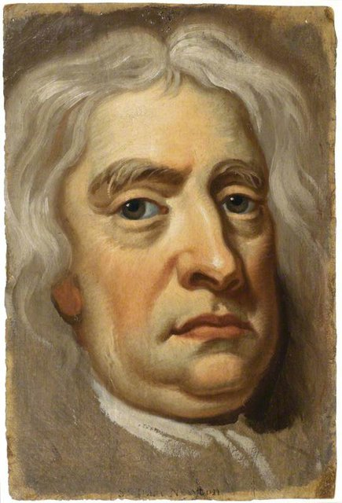
牛頓當選英國皇家學會會長，並同時成為法國科學院的會員，擔任會長到1727年去世。他在任內也曾與其他學者發生衝突，顯示科學成就與人際關係並不總是一致。

## 1704 | 《光學》
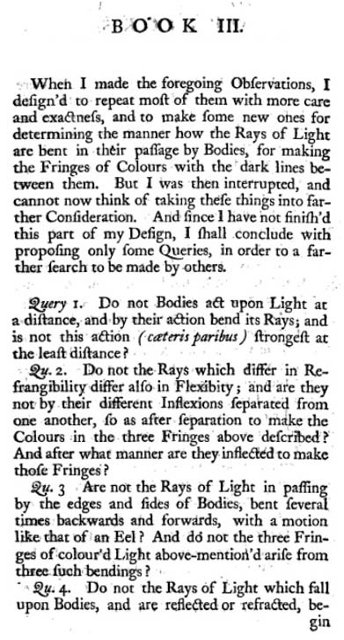
牛頓出版《光學》，整理多年對白光與顏色、色散、反射與折射的研究，詳述光的粒子理論。與主要用數學推導的《原理》不同，《光學》特別顯示他對實驗與觀察的重視，書中也附有微積分的完整說明。

## 1705 | 受封爵士
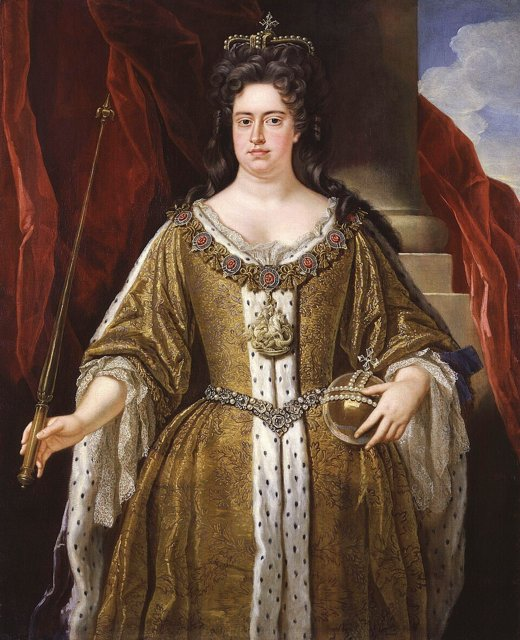
安妮女王授予牛頓爵士頭銜，他是第二位獲此榮譽的英國科學家，第一位是培根。這項榮譽顯示他已經超出單純的大學學者，成為英國具有重要社會聲望的人物。

## 1713 | 《原理》第二版
牛頓出版《原理》的第二版，修訂部分內容並進一步整理他的力學理論。1717至1718年前後他持續修訂《光學》，也投入大量時間研究聖經、宗教史與煉金術，這些工作雖然不全屬於現代科學的範疇，卻是理解他完整思想世界的重要部分。

## 1727-03-31 | 逝世於倫敦
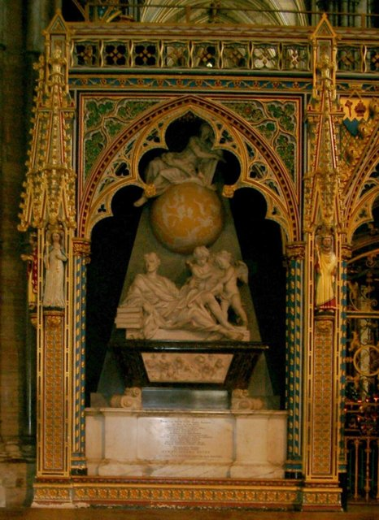
牛頓在儒略曆1727年3月20日（格里曆3月31日）於倫敦睡夢中辭世，享壽84歲，葬於西敏寺。他的墓葬規格反映英國社會對他的高度肯定。牛頓去世後，他的力學理論持續影響18世紀的科學發展，成為工程學與經典物理學的基礎；直到20世紀初，才由愛因斯坦的相對論修正了他對時間、空間與重力的看法。
