<!--
內容整理自本機筆記〈尼采生平大事記（1844–1900）〉（圖表\尼采生平大事記（1844–1900）.md）與中文維基百科「弗里德里希·尼采」條目（CC BY-SA 4.0），以台灣用語改寫摘要。
https://zh.wikipedia.org/zh-tw/弗里德里希·尼采
人名與地名依本專案華格納時間軸統一為「科西瑪」、「拜魯特」、「特里布申」。
兩份資料的處理：
- 巴塞爾大學的職位：維基百科寫1869年任「副教授」（特聘教授），隔年升為正教授；筆記寫「教授」，此處兩者並列。萊比錫大學隨後免試授予他博士學位，係依一般公認的史實補充。
- 「權力意志」：筆記與維基百科都提醒，以《權力意志》為名出版的書是妹妹伊莉莎白在他死後彙編的筆記，並非尼采定稿的著作，學界多認為它不能代表尼采的真正思想。
- 發瘋的原因：傳統上認為是梅毒，近年研究多有質疑，也有遺傳性腦血管疾病（CADASIL）等說法，此處依維基百科並陳。
- 杜林抱馬痛哭的故事是廣為流傳的說法，實際經過已無從查證。
- 為了讓年齡計算精確，生日（10月15日）前後的事件補上月份，例如1869年2月獲聘巴塞爾大學（24歲）。1869年在萊比錫免試獲頒博士、1888年布蘭德斯在哥本哈根開設尼采講座的時間、1900年死因為肺炎併發中風等細節，係依一般公認的史實與維基百科補充。
- 圖片皆為 Wikimedia Commons 上的公有領域作品（封面：1882年攝影師漢斯·辛格拍攝的尼采）。普夫達中學配1861年的照片、巴塞爾教授配1872年在巴塞爾拍攝的照片、拜魯特事件配約1875年的照片、萊比錫事件配叔本華像、1881年事件配他寫於錫爾斯－瑪利亞的「永恆輪迴」筆記、1882年事件配他與露·莎樂美、保羅·雷的合照、1888年事件配《瞧，這個人》手稿、1893年事件配1894年的伊莉莎白、逝世事件配漢斯·奧爾德所繪的病中尼采像。
-->

# Periods
- 1844-10-15 ~ 1864 | 童年與普夫達中學 | #8d6e63
  生於薩克森的牧師家庭，五歲喪父，在瑙姆堡由女性長輩撫養長大，後進入以古典教育嚴格聞名的普夫達中學，喜愛詩歌與音樂。
- 1864 ~ 1869 | 波昂與萊比錫大學 | #2b8a3e
  先在波昂學神學與古典語文學，隨即放棄信仰；轉往萊比錫追隨名師里奇爾，發現叔本華的哲學，並結識華格納。
- 1869 ~ 1879 | 巴塞爾教授 | #1864ab
  24歲即任巴塞爾大學古典語文學教授，與華格納夫婦往來密切，出版《悲劇的誕生》與《不合時宜的考察》；拜魯特音樂節後與華格納漸行漸遠，健康日益惡化。
- 1879 ~ 1889 | 漂泊的孤獨哲學家 | #c92a2a
  因病辭去教職，靠退休金在瑞士與義大利之間遷居寫作，幾乎每年出版一本書：從《人性的，太人性的》到《查拉圖斯特拉如是說》，再到1888年爆發式完成的五部作品，生前讀者卻寥寥無幾。
- 1889 ~ 1900-08-25 | 精神崩潰與晚年 | #495057
  在杜林精神崩潰後再也沒有恢復，先由母親、再由妹妹伊莉莎白照顧，在魏瑪去世；此時他的名聲才開始在歐洲迅速擴大。

# Events

## 1844-10-15 | 出生@勒肯
生於普魯士薩克森省萊比錫附近的勒肯村，父親卡爾·路德維希是路德宗牧師。他出生當天正好是國王腓特烈·威廉四世的49歲生日，父母因此以國王的名字為他命名，後來他放棄了「威廉」這個名字。1846年妹妹伊莉莎白出生。

## 1849 | 父親去世
父親因腦軟化症去世，兩年後弟弟路德維希·約瑟夫也夭折。1850年全家搬到薩勒河畔的瑙姆堡，與祖母和兩位未婚的姑姑同住，他在一個幾乎全是女性的家庭中長大。小時候他想像父親一樣當牧師，常為同伴朗誦聖經，被稱為「小牧師」。

## 1858 | 普夫達中學
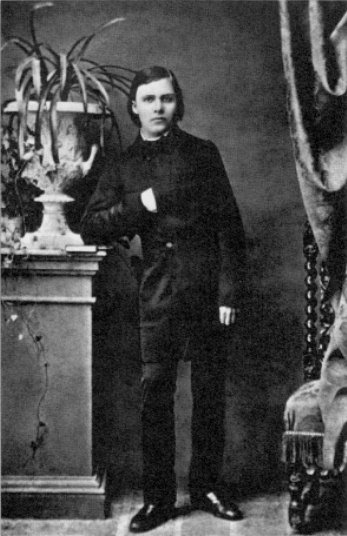
14歲進入以古典教育和嚴格訓練聞名的普夫達中學，接受希臘、羅馬古典文學的訓練，這是他第一次接觸到與家中基督教教育截然不同的世界。他在這裡寫詩、作曲，也結識了日後的好友杜森與格爾斯多夫。

## 1864 | 波昂大學：失去信仰
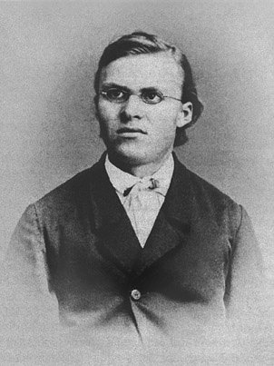
從普夫達中學畢業，進入波昂大學攻讀神學與古典語文學。讀了神學家大衛·史特勞斯的《耶穌傳》後深受震撼，一個學期後就放棄了基督教信仰，不再研讀神學，讓母親非常傷心。

## 1865 | 萊比錫與叔本華
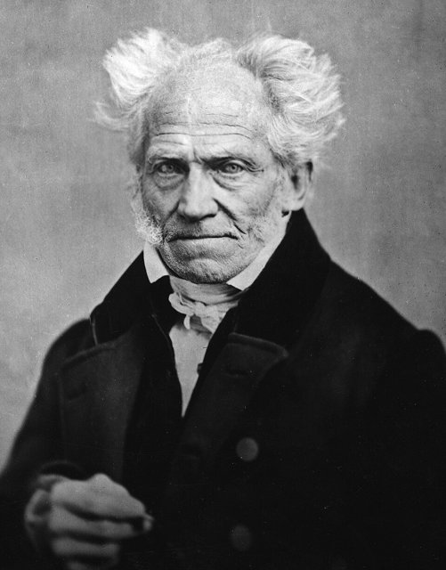
追隨古典語文學名師里奇爾轉往萊比錫大學，結識終生好友羅德。他在舊書店偶然買到叔本華的《作為意志和表象的世界》，一口氣讀完，深深著迷於叔本華悲觀的意志哲學，從此對哲學的興趣超越了語文學。

## 1867 | 從軍與墜馬
自願到瑙姆堡的砲兵部隊服役，隔年3月因騎馬時胸部嚴重受傷而退役。

## 1868-11-08 | 結識華格納
在萊比錫與他崇拜的作曲家華格納初次見面，兩人暢談叔本華，一見如故。此後他經常到瑞士琉森湖畔的特里布申拜訪華格納與科西瑪，被他們視為家中的一份子。

## 1869-02 | 24歲任巴塞爾大學教授
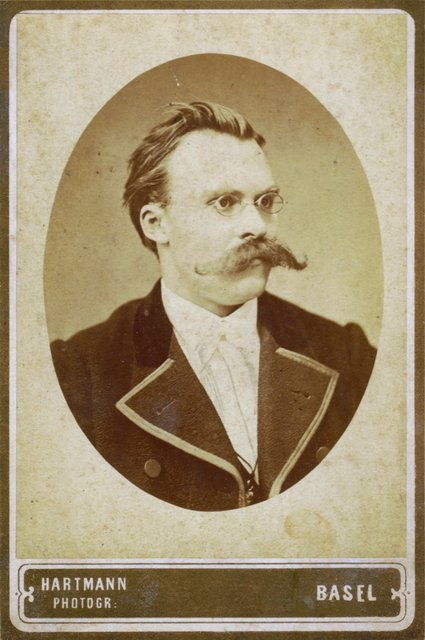
在里奇爾大力推薦下，還沒取得博士學位、也沒有教師資格，就獲聘為瑞士巴塞爾大學的古典語文學特聘教授，隔年升為正教授；萊比錫大學隨即免試授予他博士學位。他以「荷馬與古典語文學」發表就職演說，並放棄普魯士國籍，此後終生沒有國籍。他在巴塞爾結識了終生好友神學家奧韋爾貝克，也常去旁聽歷史學家布克哈特的課。

## 1870-08 | 普法戰爭醫護兵
普法戰爭爆發，他以醫護兵身分到前線服務，目睹戰爭的毀滅，並染上痢疾與白喉，健康從此受到影響。

## 1872-01 | 《悲劇的誕生》
出版第一部著作《悲劇的誕生：源於音樂的靈魂》，以日神阿波羅（秩序、形式、美的外表）與酒神戴奧尼索斯（醉狂、非理性、與萬物合一）兩種力量解釋希臘悲劇，並寄望華格納的音樂劇能讓德國文化重生。這本書不用嚴謹的語文學論證，遭到語文學家維拉莫維茨猛烈抨擊，連恩師里奇爾也失望不已，他在學界因此被孤立，課堂一度只剩兩名外系學生。

## 1873-08 | 《不合時宜的考察》
1873到1876年陸續發表四篇長文：批判神學家史特勞斯的〈大衛·史特勞斯：自白者和作家〉、主張歷史應服務於生命的〈歷史對生命的利與弊〉、〈教育家叔本華〉，以及〈理察·華格納在拜魯特〉，合稱《不合時宜的考察》，挑戰當時自滿的德國文化。

## 1876-08 | 拜魯特音樂節的幻滅
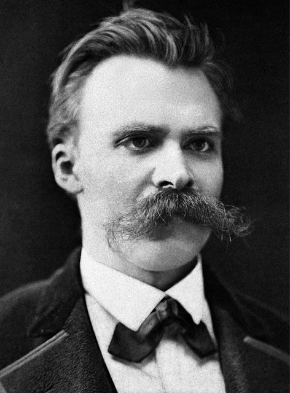
出席第一屆拜魯特音樂節，卻對演出的浮誇、觀眾的庸俗與華格納的民族主義大失所望，提前離開，從此與華格納漸行漸遠。同年道德學家保羅·雷對他影響很大，他的思想開始擺脫早期的悲觀與浪漫。

## 1878-05 | 《人性的，太人性的》
以格言體出版《人性的，太人性的：獻給自由精神的書》，以冷靜的心理分析拆解形上學、宗教與道德，正式告別叔本華與華格納的哲學。華格納此時寄來《帕西法爾》劇本，兩人的書與劇本「交錯而過」，象徵友誼的終結。

## 1879-06 | 因病辭去教職
長期的嚴重近視、劇烈偏頭痛與胃病讓他無法正常教學，只好辭去巴塞爾大學的教職，此後靠大學的退休金與朋友的資助生活，開始以自由作家的身分四處漂泊：夏天多在瑞士的錫爾斯－瑪利亞，冬天在義大利的熱那亞、杜林與法國的尼斯。他的學生加斯特自願擔任他的秘書，幫他謄寫手稿。

## 1881-07 | 《朝霞》；永恆輪迴的靈感
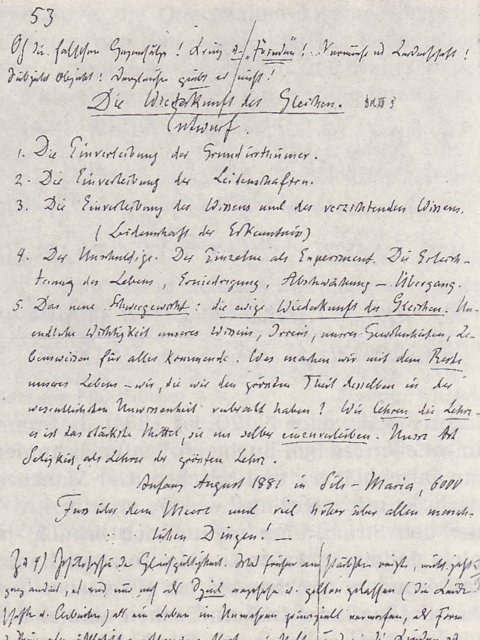
出版《朝霞》，追問道德偏見的起源。這年8月，他在錫爾斯－瑪利亞的湖畔散步時，突然想到「永恆輪迴」的思想，他說那是在「超越人與時間六千呎之上」的時刻。

## 1882-08 | 《快樂的科學》；露·莎樂美
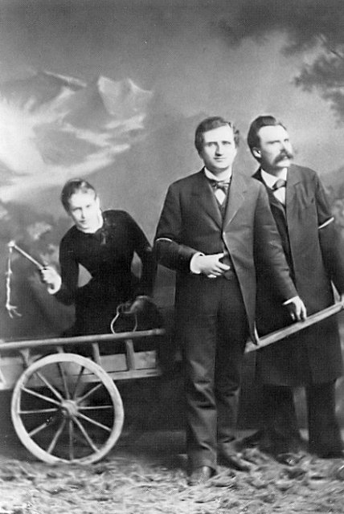
出版《快樂的科學》，書中藉「瘋子」之口宣告：「上帝死了！……是我們殺了祂！」意指傳統基督教信仰與形上學權威已失去支配力，歐洲面臨價值失去根據的危機；書中也首次提出永恆輪迴。同年他透過朋友結識才華洋溢的俄國女作家露·莎樂美，深深愛上她並求婚，但遭到拒絕；他、莎樂美與保羅·雷三人的友誼也在年底破裂，妹妹伊莉莎白的從中挑撥也是原因之一。他陷入痛苦，一度萌生輕生念頭。

## 1883-02 | 《查拉圖斯特拉如是說》
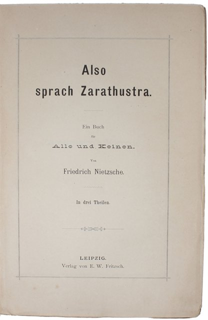
失戀後躲到義大利利古里亞海岸，據說只花了十天就寫出《查拉圖斯特拉如是說》第一部，1883到1885年陸續完成四部。他借古波斯先知查拉圖斯特拉之口，提出「超人」——超越既有價值與自身限制、能創造新價值的人——以及永恆輪迴與自我超越。這部書幾乎沒人買，第四部他只自費印了40本送給朋友。

## 1886-08 | 《善惡的彼岸》；與反猶主義決裂
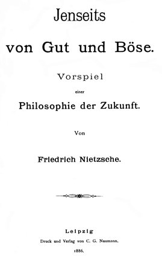
自費出版《善惡的彼岸》，批判傳統哲學的預設與既有的道德價值，並為舊作重寫序言再版。他因出版商施梅茨納的反猶立場而斷絕合作，寫道自己的著作被「完全埋在反猶太的垃圾堆中」。同年妹妹伊莉莎白嫁給反猶主義者福斯特，前往巴拉圭建立「純種德意志人」的殖民地，被他大加嘲諷。

## 1887 | 《道德系譜學》
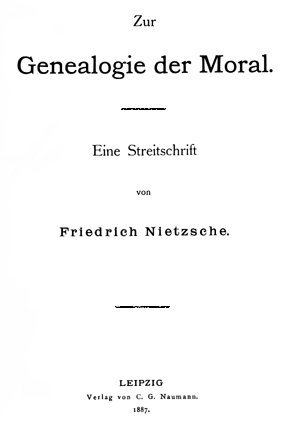
出版《道德系譜學》，追問善惡觀念從何而來、服務了誰：他區分讚頌生命的「主人道德」與出於「怨恨」的「奴隸道德」，指出「好與壞」如何被翻轉成「善與惡」。

## 1888 | 創作爆發的最後一年
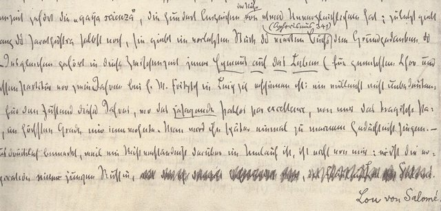
健康稍有好轉，他在杜林度過創作最旺盛的一年，接連完成《華格納事件》、《偶像的黃昏》、《反基督》、自傳《瞧，這個人》與《尼采反對華格納》。他在《瞧，這個人》裡寫道：「聽我說啊！我是這樣一個人，千萬不要把我與別人混淆。」同年丹麥文學家布蘭德斯在哥本哈根大學開設講座介紹他的哲學，他的名聲開始萌芽。

## 1889-01-03 | 杜林精神崩潰
在杜林街頭精神崩潰。廣為流傳的說法是：他在卡洛·阿爾貝托廣場看見車夫鞭打一匹馬，衝上前抱住馬的脖子痛哭，隨即昏倒在地。接下來幾天他寄出一些署名「戴奧尼索斯」或「被釘十字架者」的「瘋狂信件」給布克哈特、科西瑪等人。好友奧韋爾貝克趕到杜林把他帶回巴塞爾的精神病院，後來轉往耶拿的療養院。他再也沒有恢復獨立生活與寫作的能力。

## 1890-05 | 母親照護
母親把他從療養院接回瑙姆堡的家中照顧。《偶像的黃昏》已在1889年1月出版，他的名聲開始第一波復甦，但他本人已無法知曉。

## 1893-09 | 妹妹接管遺稿
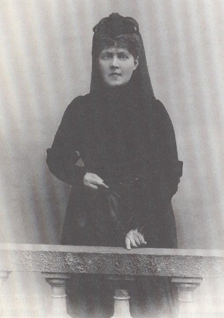
巴拉圭殖民計畫失敗、丈夫自殺後，妹妹伊莉莎白回到德國，逐步掌控他的著作與手稿的出版，成立「尼采檔案館」，排擠了奧韋爾貝克。1897年母親去世後，她把尼采帶到魏瑪照顧，並安排訪客前來探望已無法正常溝通的哥哥。

## 1900-08-25 | 逝世@魏瑪
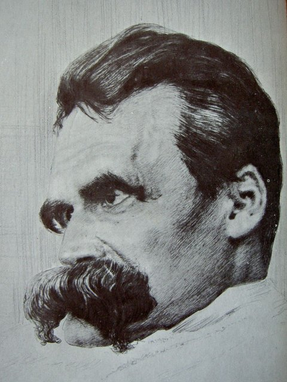
在魏瑪去世，享年55歲，一般認為死於中風後併發的肺炎，安葬於故鄉勒肯的教堂墓園、父親墓旁。他精神失常的原因，過去常歸於梅毒，近年研究則提出遺傳性腦血管疾病等其他可能。他死後，伊莉莎白把他的筆記彙編、竄改成《權力意志》出版，並讓他的思想與德國民族主義、日後的納粹扯上關係；學界多認為這本書不能代表尼采本人的思想。他的著作後來深刻影響了存在主義（海德格、沙特）、精神分析（佛洛伊德）、傅柯的系譜學、後現代思想與現代文學。
