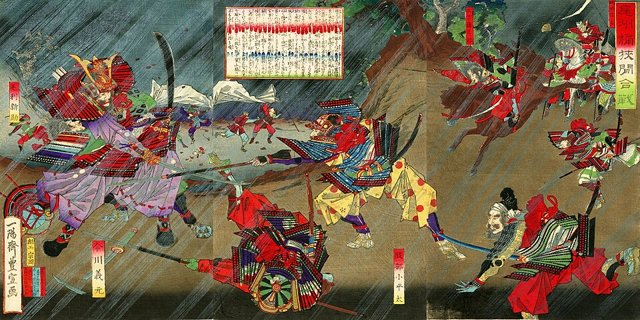
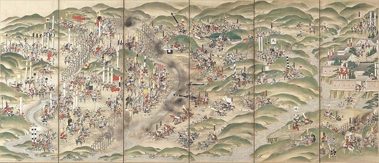
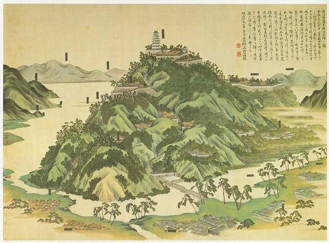
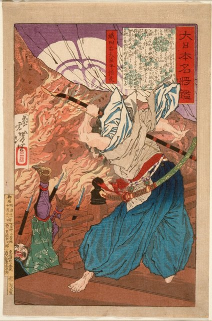

<!--
內容整理自 D:\Books\html\1-3-1.日本歷史人物\織田信長(1534~1582).html（沒有對應的 md 筆記），並整合中文維基百科〈織田信長〉條目，以自己的話改寫。
時期依頁面的七個階段：出生與繼承家業、平定尾張與桶狹間、征服美濃、進入京都與足利義昭決裂、擴張霸權與長篠之戰、對抗石山本願寺、本能寺之變。
兩份資料出入與處理方式：
- 出生：頁面與維基百科都作天文三年五月（西曆1534年6月23日），維基百科另記一說為7月9日，採6月23日。去世：天正十年六月二日（1582年6月21日），實歲48歲（虛歲49；維基百科信息框作47歲）。
- 濃姬：頁面寫1549年，維基百科作1548或1549年，寫1549年。
- 父親信秀去世：頁面寫1551年，維基百科正文作1552年3月（信息框以1551年為任期起點），兩說並存，寫在1551年並註明。
- 稻生之戰：頁面寫1556年（弘治二年八月），照頁面；維基百科摘要作弘治元年，與一般記載不符，不採用。弟弟信勝被殺：頁面寫1557年，維基百科摘要作1558年，一般記為弘治三年十一月（西曆1557年底），照頁面。
- 統一尾張：頁面寫1559年基本確立；維基百科補充1559年2月上洛拜見將軍足利義輝，1565年擊敗犬山的織田信清才完成統一，這裡分成兩則。
- 桶狹間之戰：和曆永祿三年五月十九日，西曆1560年6月12日，採西曆。
- 1567年攻下稻葉山城、改名岐阜、11月起用「天下布武」印；1568年9月奉足利義昭上洛；1570年金崎撤退與姊川之戰；1571年9月火燒比叡山；1573年7月驅逐義昭；1574年長島一向一揆；1575年5月21日長篠之戰（和曆）；1576年興建安土城、任內大臣；1580年石山本願寺和議；1581年京都御馬揃；1582年甲州征伐，日期依維基百科補上。
- 長篠之戰的日期：維基百科給的5月21日是和曆，換算西曆為1575年6月29日，採西曆。
- 樂市樂座：頁面列為改革之一但沒有年份，維基百科摘要也未見，只在安土城的事件說明。
- 本能寺之變的動機（怨恨、野心、陰謀、多重因素），頁面列出各說並強調未有定論，照此寫法。
- 頁面的「政治與經濟改革」「戰國三英傑比較」「歷史評價」寫進時期說明與相關事件，不另立事件。
- 人名與其他時間軸一致：今川義元、德川家康、齋藤道三、足利義昭、淺井長政、朝倉義景、武田信玄、武田勝賴、上杉謙信、羽柴秀吉（豐臣秀吉）、明智光秀、柴田勝家。
圖片來源（皆為 Wikimedia Commons 公有領域／CC0 作品；註明「共用」者沿用其他時間軸已有的圖片）：
- on-cover.jpg：Oda Nobunaga Portrait Sanpoji Temple c1582-1586.jpg（織田信長像，三寶寺藏，約1582–1586）
- on-okehazama.jpg：Bishū Okehazama-gassen.jpg（歌川豐宣〈尾州桶狹間合戰〉）
- on-nagashino.jpg：Battle of Nagashino.jpg（〈長篠合戰圖屏風〉）
- on-azuchi.jpg：近江国蒲生郡安土城之.jpg（〈近江國蒲生郡安土城之圖〉）
- on-honnoji.jpg：Oda Udaijin Taira no Nobunaga in Flames at the Temple Honnoji LACMA M.84.31.116.jpg（月岡芳年〈織田右大臣平信長於本能寺炎中〉，洛杉磯郡立美術館藏）
-->

# Periods
- 1534-06-23 ~ 1551 | 出生與繼承家業 | #868e96
  生於尾張，父親織田信秀是尾張的有力武將；少年行徑放蕩，被稱為「尾張的大傻瓜」，娶齋藤道三之女濃姬。
- 1551 ~ 1560-06-12 | 平定尾張 | #e8590c
  父親死後繼承家督，在家族內鬥中擊敗並殺死弟弟信勝，逐步掌握尾張。
- 1560-06-12 ~ 1568 | 桶狹間與征服美濃 | #2f9e44
  桶狹間奇襲今川義元，一戰成名；與德川家康結盟，攻下稻葉山城改名岐阜，開始使用「天下布武」印。
- 1568 ~ 1575 | 上洛與突破包圍網 | #1971c2
  擁立足利義昭上洛，又與淺井、朝倉、一向宗與武田信玄組成的包圍網苦戰；火燒比叡山，驅逐義昭，室町幕府滅亡。
- 1575 ~ 1582-06-21 | 霸權擴張與本能寺之變 | #c92a2a
  長篠之戰大破武田軍，興建安土城，石山本願寺退出，甲州征伐滅武田；在接近統一之際，於本能寺遭明智光秀叛變身亡。

# Events

## 1534-06-23 | 出生於尾張
織田信長生於尾張國的勝幡城（一說那古野城），幼名吉法師，父親織田信秀，母親土田御前。織田氏是尾張的重要武士家族，但內部分成多個支系，彼此爭權。

## 1546 | 元服
信長在古渡城元服，稱織田三郎信長，開始承擔家族的政治與軍事事務。

## 1549 | 迎娶濃姬
信長與美濃大名齋藤道三之女濃姬結婚（一說1548年），改善織田與齋藤兩家的關係；戰國大名常以聯姻降低兩國衝突的風險。

## 1551 | 父親去世，繼承家督
織田信秀去世（維基百科正文作1552年3月），信長繼承家族領導權。他的繼承地位並非毫無爭議，部分家臣不滿他放蕩不羈的作風，被稱為「尾張的大傻瓜」。1553年，輔佐他的宿老平手政秀自盡；同年他與岳父齋藤道三在聖德寺會面。

## 1556 | 稻生之戰
弟弟織田信勝（又名信行）在部分家臣支持下挑戰信長的領導權，雙方在稻生交戰，信長獲勝，暫時穩住地位。同年，岳父齋藤道三在長良川之戰中戰死。

## 1557 | 殺弟信勝
信勝再度涉入謀反，信長在清洲城誘殺了他，反映戰國時代大名繼承的殘酷。

## 1559 | 掌握尾張，上洛拜見將軍
信長逐步擊敗尾張國內的主要對手，整合家臣團，2月上洛拜見將軍足利義輝；1565年擊敗犬山的織田信清後，完成尾張的統一。

## 1560-06-12 | 桶狹間之戰

駿河、遠江、三河的大名今川義元率大軍進入尾張。信長掌握敵軍部署後，選擇有利時機突襲今川本陣，今川義元在戰鬥中被殺，今川軍隨即潰散。
這是改變戰國格局的一戰：今川家威望重挫，信長聲望大增，東海道的勢力平衡改變，原本附屬今川的德川家康也得以自立。

## 1562 | 清洲同盟
桶狹間之戰後，德川家康脫離今川氏，與信長結成同盟，這是戰國時代最重要、維持最久的聯盟之一，讓信長可以放心向西、向北擴張。1563年，他把據點遷到有利於攻略美濃的小牧山城。

## 1567 | 攻下稻葉山城，改名岐阜
信長攻下美濃齋藤氏的據點稻葉山城，把井之口改名岐阜，作為新的政治與軍事中心。11月起，他開始使用刻有「天下布武」的印章，表達以武力重建天下秩序的志向。

## 1568 | 擁立足利義昭上洛
前將軍足利義輝遇害後，弟弟足利義昭尋求大名協助。信長支持義昭，9月率軍進入京都，義昭成為室町幕府第十五代將軍。信長藉此取得介入中央政治的名義，兩人卻因權力分配逐漸產生矛盾。

## 1570 | 金崎撤退與姊川之戰
4月，信長出兵越前攻打朝倉氏，妹夫、北近江大名淺井長政倒戈與朝倉聯手，信長險遭夾擊，被迫撤退；殿後的木下秀吉（後來的豐臣秀吉）與德川家康的事蹟成為後世傳記的題材。6月，織田、德川聯軍在近江姊川擊敗淺井、朝倉聯軍，但兩家並未就此滅亡。

## 1571 | 火燒比叡山
比叡山延曆寺是京都東北的宗教重鎮，擁有經濟與政治勢力，並與淺井、朝倉合作。9月，信長下令攻擊寺院與周邊聚落，造成大量傷亡與建築毀損。這是他最受爭議的行動之一，也顯示他對擁有武力的宗教勢力毫不妥協。

## 1573 | 驅逐義昭，滅淺井朝倉
足利義昭聯合武田信玄等反信長勢力，1572年信玄西上，在三方原擊敗德川軍。1573年信玄病逝，包圍網瓦解；7月，信長在槙島城擊敗義昭，將他逐出京都，室町幕府至此實際滅亡。8至9月，他攻滅越前的朝倉義景，淺井長政也在小谷城自盡。

## 1574 | 平定長島一向一揆
伊勢長島一帶的一向宗信徒與地方武裝長期抵抗，信長多次出兵，1574年發動大規模攻勢，將其鎮壓，投降的門徒仍遭射殺。一向一揆不只是宗教運動，也牽涉地方社會、武士勢力與政治控制權。

## 1575-06-29 | 長篠之戰

武田勝賴進攻德川方的長篠城，信長與家康聯合救援，在設樂原利用地形、馬防柵等防禦工事、大量火繩槍與步兵協同作戰，武田軍遭到重創，許多重要將領戰死（和曆天正三年五月二十一日）。
同年，信長把織田家督傳給長子信忠，自己仍掌握重要的戰略與政治決策。

## 1576 | 興建安土城

信長在琵琶湖東岸的近江安土興建安土城，地理上便於聯繫京都、岐阜與日本中部；城郭不只是軍事設施，也是展示權力、接待重要人物與處理政務的中心，城下町吸引商人與工匠聚集。同年他任內大臣。
他推行「樂市樂座」，減少市場交易的限制、調整傳統商業組織的特權，並整頓或廢除關所，降低人員與商品通行的障礙。

## 1577 | 手取川之戰與中國攻略
上杉謙信在手取川擊敗織田軍，顯示信長仍面對有實力的地方強權；松永久秀等人相繼叛離。信長派羽柴秀吉進攻播磨、但馬與中國地方的毛利氏，秀吉逐漸成為織田政權最重要的將領。1578年，九鬼嘉隆的織田水軍在第二次木津川口之戰擊敗毛利水軍，切斷了石山本願寺的海上補給。

## 1580 | 石山本願寺和議
與石山本願寺長達十年的戰爭結束，本願寺與織田政權和議，退出攝津石山，這場長期牽制信長大量兵力的戰爭終於落幕。1581年，信長在京都舉行大規模閱兵「京都御馬揃」，展示軍事實力，也帶有政治宣示的意義。

## 1582 | 甲州征伐，武田氏滅亡
織田、德川等軍從多個方向進攻武田領地，武田家臣與地方勢力紛紛倒戈，武田勝賴兵敗自盡，信玄建立的武田氏覆亡。

## 1582-06-21 | 本能寺之變

信長停留在京都本能寺，準備繼續用兵：羽柴秀吉在中國地方與毛利氏交戰，柴田勝家在北陸，明智光秀奉命支援秀吉。天正十年六月二日，光秀率軍突然轉向京都包圍本能寺，信長身邊兵力有限，抵抗後自盡，享年48歲（虛歲49）；長子信忠也在二條御所戰死。
光秀的動機有怨恨、奪權野心、背後有人策動等說法，未有定論。秀吉得知死訊後迅速與毛利議和，「中國大返還」急行軍回師，在山崎之戰擊敗光秀。信長打破舊秩序、開啟統一進程，秀吉接續完成大部分的統一，家康最後把成果轉化為長期的幕府體制。
