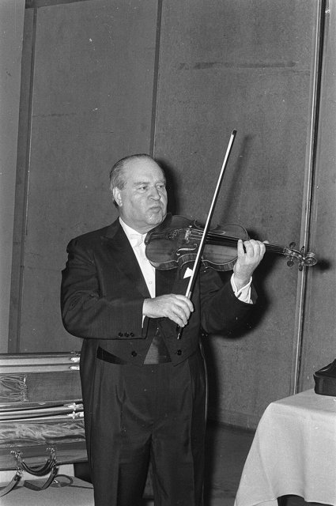

<!--
內容整理自本機筆記〈大衛·歐伊斯特拉夫（David Oistrakh）生平大事記〉（D:\Books\md\音樂\表演家\大衛・歐伊斯特拉夫（David Oistrakh）生平大事記.md），以自己的話改寫。
時期依筆記的九個階段歸納為六段。
處理方式：
- 譯名：筆記作「蕭士塔高維契」「普羅科菲夫」，這裡統一為其他時間軸已用的「蕭士塔高維奇」「普羅高菲夫」；「米爾斯坦」在其他時間軸與本人時間軸作「密爾斯坦」，這裡用密爾斯坦。
- 筆記對1943年普羅高菲夫《第一號小提琴奏鳴曲》的標題與內文有出入（作品創作於1938–1946年，並無1943年的特定事件），這裡改為「1943 ~ 1946」並依筆記只寫與鋼琴家奧博林合作。
- 筆記標題寫1951年在紐約的演出計畫「逐漸受到關注」，內文說美國的大規模公開演出尚未實現，這裡併入1950年代初的西方聲譽，不另立事件。
- 蕭士塔高維奇《第一號小提琴協奏曲》1948年完成、1955年才首演，兩個年份分別列出。
- 筆記的「演奏風格分析」「代表作品」「與海飛茲、密爾斯坦的比較」「五大貢獻」寫進時期說明與最後一則事件，不另立事件。
- 人名用·分隔（筆記作・）。
圖片（Wikimedia Commons 公有領域或 CC0）：
- ois-cover.jpg：David Oistrach 1956.jpg（歐伊斯特拉夫訪問荷蘭，1956年3月9日）
- ois-1972.jpg：David Oistrach als gastdirigent van het Concertgebouworkest, Bestanddeelnr 925-6733.jpg（歐伊斯特拉夫客席指揮皇家音樂廳管弦樂團，阿姆斯特丹荷蘭藝術節，1972年6月17日）
-->

# Periods
- 1908 ~ 1922 | 敖德薩的童年@敖德薩 | #868e96
  生於黑海之濱的敖德薩，出身猶太家庭；約五歲起跟著斯托利亞爾斯基學琴，六歲首次公開演出，發展穩健，不靠神童式的轟動成名。
- 1923 ~ 1933 | 蘇聯國內成名 | #1971c2
  進入敖德薩音樂學院、畢業演出就選了普羅高菲夫的協奏曲；在列寧格勒、莫斯科演出，1930年與1933年先後拿下全烏克蘭與全蘇聯比賽的首獎。
- 1934 ~ 1938 | 莫斯科與國際比賽 | #2f9e44
  受聘於莫斯科音樂學院；1935年華沙維尼亞夫斯基比賽第二名，1937年在布魯塞爾的伊薩伊比賽奪冠，開啟國際生涯，作曲家開始為他寫作協奏曲。
- 1939 ~ 1954 | 戰爭與戰後的國際聲望 | #e8590c
  戰時為前線士兵與工廠工人演出；戰後與蕭士塔高維奇、普羅高菲夫、哈查圖量等作曲家密切合作，從1949年起逐步在西歐演出，成為蘇聯文化的重要代表。
- 1955 ~ 1966 | 進軍西方與指揮 | #c92a2a
  1955年首次赴美、同年首演蕭士塔高維奇《第一號小提琴協奏曲》；1960年獲列寧獎，開始積極指揮，1964年心臟病發作。
- 1967 ~ 1974 | 晚年與逝世 | #5f3dc4
  1967年蕭士塔高維奇題獻《第二號小提琴協奏曲》，兼顧獨奏、指揮、教學與錄音；1974年10月在阿姆斯特丹因心臟病發作去世。

# Events

## 1908-09-30 | 出生@敖德薩
生於敖德薩，當時屬於俄羅斯帝國，今日是烏克蘭的重要港口。敖德薩是黑海沿岸的文化與商業中心，民族與文化背景多元；他出身猶太家庭，成長環境與東歐猶太文化、俄羅斯古典音樂傳統關係密切。他日後以蘇聯音樂家的身分享譽國際，出生地、國籍、民族背景與藝術傳統卻不一定完全重合。

## 1913 | 師從斯托利亞爾斯基
約五歲開始學小提琴，老師是彼得·斯托利亞爾斯基，二十世紀初重要的小提琴教育家，學生還有後來成名的密爾斯坦。斯托利亞爾斯基的教學重視基本功、聽覺訓練、技巧養成與音樂表現。與以神童式炫技迅速成名的小提琴家相比，歐伊斯特拉夫的發展較為穩健，而是靠長期訓練、持續演出與成熟的理解，逐步建立風格。

## 1914 | 首次公開演出
年僅六歲首次公開演出，開始從家庭與私人學習進入公開演奏的領域。真正決定他日後成就的，不是早年的登台，而是此後多年持續接受專業訓練，逐步掌握更廣的曲目並累積舞台經驗。1910年代末到1920年代初，他仍繼續跟著斯托利亞爾斯基學習，更重視聲音的完整、旋律的歌唱性，以及技巧與音樂內容的平衡。

## 1923 | 進入敖德薩音樂學院
進入敖德薩音樂學院，仍在斯托利亞爾斯基的指導下學小提琴，也接受音樂理論等訓練，從有天賦的年輕演奏者成長為受過完整專業教育的音樂家。理解作品的和聲、形式、風格與歷史背景，對他日後演奏巴赫、貝多芬、布拉姆斯與二十世紀作曲家都很重要。

## 1926 | 畢業，演奏普羅高菲夫協奏曲
自敖德薩音樂學院畢業，畢業演出演奏普羅高菲夫的《D大調第一號小提琴協奏曲》。這首作品風格鮮明現代，旋律與管弦樂色彩不同於傳統浪漫派協奏曲，對技巧、音色控制與音樂理解都有要求；他選擇演奏它，顯示他不只熟悉傳統曲目，也願意接觸當代音樂。畢業後他開始積極展開職業演出，逐步進入蘇聯音樂界的核心圈子。

## 1927 | 葛拉祖諾夫親自指揮
在基輔演奏亞歷山大·葛拉祖諾夫的《小提琴協奏曲》，由作曲家親自指揮。能直接與作品的創作者合作，是理解風格與創作意圖的難得機會；葛拉祖諾夫是俄羅斯晚期浪漫派的重要作曲家，協奏曲融合抒情、技巧與俄羅斯音樂色彩，這次合作也讓他更深入地接觸俄羅斯音樂傳統。

## 1928 | 列寧格勒首次亮相
在列寧格勒演奏柴可夫斯基的《D大調小提琴協奏曲》。這首協奏曲對技巧、耐力、音樂表情與舞台掌控力要求都很高，他能演奏它，表示已具備進軍大城市舞台的能力。1929年他在莫斯科登台，並沒有立刻成為全國知名人物，而是經歷一段持續累積實力、逐漸受重視的過程。

## 1930 | 全烏克蘭比賽首獎，結婚
在全烏克蘭小提琴比賽中獲得首獎，提高了他在蘇聯音樂界的能見度。同年與同樣受過專業訓練的鋼琴家塔瑪拉·羅塔列娃結婚。1931年他們的兒子伊戈爾出生，伊戈爾日後也成為知名的小提琴家、跟著父親學習，父子後來多次同台，形成二十世紀小提琴史上的一段傳承。

## 1933 | 全蘇聯比賽首獎
在全蘇聯小提琴比賽中獲得首獎，代表他已在全國範圍內受到肯定。從1920年代末到1930年代初，他完成了從地方性演奏家到全蘇聯重要小提琴家的轉變，也為1937年的國際比賽奠定基礎。

## 1934 | 莫斯科音樂學院任教
受聘於莫斯科音樂學院任教，不只代表他受到蘇聯音樂教育體系的肯定，也讓他開始把部分精力投入教學。他重視音準、運弓、音色、節奏與樂句，也重視演奏者對作品結構的掌握，莫斯科音樂學院成了他長期教學與研究的基地，他後來培養出多位知名演奏家，成為蘇聯小提琴學派的重要教育家。

## 1935 | 維尼亞夫斯基比賽第二名
參加在華沙舉行、以小提琴家兼作曲家維尼亞夫斯基命名的國際小提琴比賽，獲得第二名。雖然沒拿到第一，卻累積了與各國演奏者競爭的經驗，讓他更接近國際舞台；兩年後他在布魯塞爾取得重大突破。

## 1937 | 伊薩伊國際小提琴比賽首獎
在比利時布魯塞爾的尤金·伊薩伊國際小提琴比賽中獲得首獎，這個比賽後來成為伊莉莎白女王國際音樂比賽的前身。這使他從蘇聯國內的重要小提琴家躍升為受國際關注的演奏家。當時歐洲的小提琴家個個技巧精湛，他能脫穎而出，除了技術，也靠音色、音樂理解與整體的成熟：不依賴誇張的外在動作，而以厚實的聲音、穩定的節奏與內斂的表達建立獨特的形象。這項勝利正式開啟了他的國際生涯。

## 1938 | 米亞斯科夫斯基的協奏曲
俄羅斯作曲家尼古拉·米亞斯科夫斯基創作《D小調小提琴協奏曲》，題獻給歐伊斯特拉夫。作曲家把協奏曲題獻給演奏家，通常表示相信對方能理解並呈現作品的藝術特色；此後多位蘇聯作曲家陸續為他創作或題獻小提琴作品，成為他藝術生涯的一項重要特色。1939年他升任莫斯科音樂學院教授，同時是國際得獎者、活躍的演奏家與教育者。

## 1940 | 哈查圖量《D小調小提琴協奏曲》
亞美尼亞裔蘇聯作曲家阿拉姆·哈查圖量完成《D小調小提琴協奏曲》，後來成為二十世紀的重要協奏曲之一。歐伊斯特拉夫是它的重要詮釋者：作品節奏鮮明、旋律豐富、帶有民族色彩，對技巧、節奏感與表現力要求很高。他的演奏讓西方聽眾認識蘇聯作曲家，也讓這些作品進入國際小提琴曲目的核心。

## 1941-06 | 蘇德戰爭爆發
納粹德國入侵蘇聯，蘇德戰爭全面爆發，音樂家被要求參與支援前線、鼓舞軍心與維持士氣的活動。1941年至1945年間，他沒有停止演奏，為前線士兵、工廠工人與其他戰時群體演出，條件艱困：寒冷、交通困難、設備不足，還隨時有軍事危險。音樂不只是藝術欣賞，也成為鼓舞士氣、維持精神生活與表達共同情感的媒介。

## 1943 | 與奧博林演奏普羅高菲夫奏鳴曲 {label=1943–1946年}
普羅高菲夫的《F小調第一號小提琴奏鳴曲》Op. 80創作於1938年至1946年間，是二十世紀小提琴奏鳴曲的重要作品。歐伊斯特拉夫與鋼琴家列夫·奧博林合作演奏，建立重要的室內樂關係。這首奏鳴曲語言與浪漫派不同，帶有緊張的和聲、陰鬱的氣氛與複雜的節奏，需要高度的合奏默契與對結構的理解，也顯示他的成就不限於協奏曲，還包括奏鳴曲與室內樂。

## 1945 | 與梅紐因會面
小提琴家耶胡迪·梅紐因到莫斯科與他會面，兩人後來建立友誼，也有音樂上的合作。歐伊斯特拉夫主要生活在蘇聯，梅紐因則活躍於西方樂壇，在冷戰全面形成之前後，東西方的文化交流受到政治環境限制，音樂家之間的友誼與合作讓不同國家的藝術家有了互相理解的機會。

## 1946 | 列寧勳章
獲頒蘇聯重要的國家級獎章列寧勳章。戰後的他不只是知名演奏家，也成為蘇聯文化成就的代表人物之一，音樂活動逐漸有了文化外交的意義。

## 1948 | 蕭士塔高維奇完成《第一號小提琴協奏曲》
德米特里·蕭士塔高維奇完成《A小調第一號小提琴協奏曲》Op. 77，與歐伊斯特拉夫緊密相連。作品情感深沉、結構複雜、技巧艱深，不只是炫技型協奏曲，也有強烈的戲劇性與內在張力。作品完成時，蘇聯正處於嚴格的文化政策之下，蕭士塔高維奇等作曲家受到政治批評，協奏曲無法立即首演，要到1955年才由歐伊斯特拉夫首演。這段歷史顯示蘇聯音樂家的活動常受政治環境影響，他與作曲家的合作也必須在這樣的制度下進行。

## 1949 | 在赫爾辛基演出
在芬蘭赫爾辛基演出，被視為他戰後國際活動的起點。戰後的政治環境與蘇聯對國民出境的管理，讓蘇聯音樂家無法像西方演奏家那樣自由安排巡演，他的海外演出常受國家文化政策與外交安排左右，逐漸成為代表蘇聯出國演出的重要音樂家。1950年代初，他的唱片與聲譽傳到西方，但因冷戰的政治限制，在美國的大規模公開演出一時還無法實現；他的錄音讓西方聽眾認識一種不同於部分西方小提琴家的風格：音色厚實、技巧穩健、表達內斂，卻有深刻的情感力量。

## 1950 | 莫斯科音樂學院小提琴系主任
擔任莫斯科音樂學院的小提琴系主任，教育上的影響力進一步擴大，不只指導個別學生，也參與整體的小提琴教育與人才培養。他的學生後來包括奧列格·卡岡、吉頓·克萊曼、維克多·特列季亞科夫等，各自形成不同的風格：他並不要求學生複製同一種演奏方式，而是幫助他們建立穩固的技術與獨立的音樂理解。

## 1953 | 巴黎、倫敦與普羅高菲夫的葬禮
在巴黎與倫敦的演出逐步打開西歐的市場。同年3月普羅高菲夫去世，據記載，歐伊斯特拉夫在作曲家的葬禮上演奏了《F小調第一號小提琴奏鳴曲》的部分樂章。這象徵他不只是演奏普羅高菲夫作品的人，也是與他的音樂世界關係密切的重要詮釋者。

## 1954 | 蘇聯人民藝術家
獲封「蘇聯人民藝術家」，這是蘇聯表演藝術領域的重要榮譽，代表他在國家文化體系中的地位達到新高度。不過他的聲望不只來自官方肯定，國際演出、錄音、與作曲家的合作和教育成就，共同構成了他的藝術地位。

## 1955 | 首次赴美，首演蕭士塔高維奇協奏曲
這是他國際事業的另一個重要轉折：首次到美國演出，在紐約卡內基音樂廳登台，美國觀眾對這位蘇聯小提琴家早已充滿期待，演出獲得熱烈反應，他也與美國重要樂團合作，真正進入世界主要的古典音樂市場。這些演出既是藝術上的交流，也成為冷戰時期文化外交的一部分，但他能獲得國際樂壇尊敬，最根本的原因仍是演奏水準、音樂理解與對各種風格的掌握。同年，他在列寧格勒首演蕭士塔高維奇《A小調第一號小提琴協奏曲》，由葉夫根尼·穆拉文斯基指揮列寧格勒愛樂；作品深沉嚴肅，有複雜的技巧與強烈的情感張力，成為他最具代表性的曲目之一。1950年代後半，他持續在歐美演出，曲目涵蓋巴洛克、古典、浪漫與二十世紀，形成技術成熟、音色深厚、詮釋穩健、音樂修養很高的國際形象。

## 1960 | 列寧獎
獲得列寧獎，反映他在小提琴演奏、音樂教育與蘇聯音樂文化發展上的成就。同年起，他逐漸擴大與國際樂壇的合作，也更常以指揮家的身分參與音樂活動。

## 1961 | 積極指揮 {label=約1961年起}

開始積極從事指揮。長期與樂團合作，讓他對管弦樂的音響、樂句安排、節奏與整體結構有深入的理解；從獨奏家轉向指揮，改變了他參與音樂的方式：獨奏家只要呈現自己的聲部，指揮則要掌握整體的結構，協調各聲部的平衡與方向。他在晚年逐步拓展指揮活動，顯示他不滿足於單一的演奏角色。1960年代他與克里夫蘭管弦樂團及指揮家喬治·塞爾展開重要的合作；塞爾以精確嚴謹的樂團訓練與清晰的結構聞名，這類合作留下的錄音，也成為後世研究二十世紀小提琴演奏的重要材料。

## 1964 | 第一次心臟病
第一次心臟病發作。當時他的演出、錄音、教學與旅行仍然十分繁忙，雖然健康受到影響，他仍持續從事音樂活動，這顯示他對演奏事業的高度投入，也說明長期密集的演出生活可能對音樂家的身體造成沉重負擔。1965年他仍持續演出與錄音，唱片曲目涵蓋大量協奏曲、奏鳴曲、室內樂與獨奏作品；1966年再度獲頒列寧勳章。

## 1967 | 蕭士塔高維奇《第二號小提琴協奏曲》
蕭士塔高維奇創作《C小調第二號小提琴協奏曲》Op. 129，題獻給歐伊斯特拉夫，作品首演由他擔任獨奏，作曲家本人也參與了演出相關活動。這部協奏曲與第一號氣質不同，音樂語言深沉內省、結構緊密，有高難度的技巧要求，後來成為二十世紀的重要曲目之一，也是兩人長期合作的重要成果。

## 1968 | 蕭士塔高維奇《小提琴奏鳴曲》
蕭士塔高維奇完成《G大調小提琴奏鳴曲》Op. 134，作品與歐伊斯特拉夫關係密切。奏鳴曲語言複雜，包含沉思、緊張與戲劇性的不同層次，不像傳統浪漫派奏鳴曲總以鮮明旋律與情緒起伏為中心，更重視音樂材料的發展與深層的結構。他對蕭士塔高維奇作品的詮釋，使他成為理解這位作曲家的重要演奏者之一。

## 1972 | 薩爾斯堡音樂節
在薩爾斯堡音樂節演出，以獨奏家與指揮家的身分參與。這是歐洲最重要的古典音樂節之一，顯示他即使進入晚年，仍受到國際音樂界的高度重視。1960年代末到1970年代初，他兼顧演奏協奏曲與獨奏作品、室內樂合作、管弦樂指揮、在莫斯科音樂學院教學與錄製經典及當代作品；健康已不如早年，1973年他仍繼續演奏、錄音與指揮。

## 1974-10-24 | 逝世@阿姆斯特丹
在荷蘭的阿姆斯特丹因心臟病發作去世，享年66歲，當時他仍活躍於演奏、指揮與教學，還有許多計畫。他安葬於莫斯科的新聖女公墓。他的演奏以溫暖、厚實、富於歌唱性的音色著稱，技巧穩健精確卻不刻意炫耀，詮釋兼具理性的結構與深刻的情感，節奏穩定而有方向感；他與蕭士塔高維奇、普羅高菲夫、哈查圖量與米亞斯科夫斯基的合作，使許多二十世紀作品得到重要的演出與錄音。他的學生包括卡岡、克萊曼、特列季亞科夫與兒子伊戈爾，既保留蘇聯小提琴學派的特點，也留給不同世代發展個人風格的空間。與海飛茲高度精確、集中而極具控制力相比，他展現的是溫暖厚實的音色、寬廣的音樂線條與深沉的情感力量，兩者並無高下，只是說明二十世紀的小提琴藝術為何有如此豐富的面貌。
