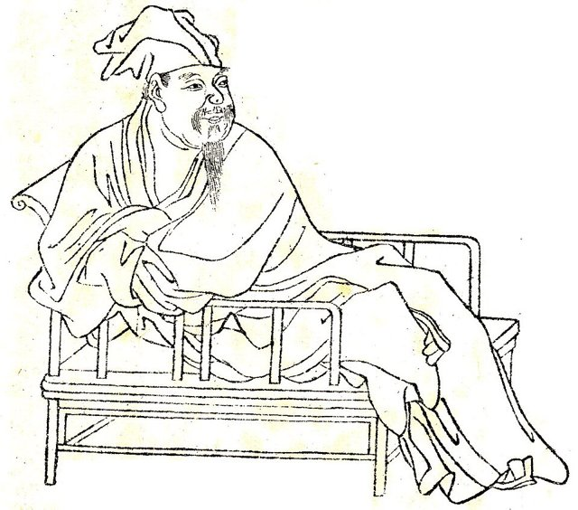
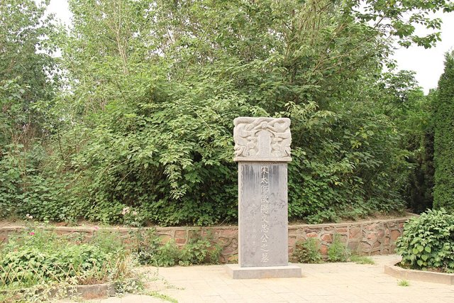

<!--
內容整理自 D:\Books\md\歷史\人物\中國\歐陽修生平大事記.md（Books 的人物頁為 D:\Books\html\1-2-1.中國歷史人物\歐陽修(1007~1072).html），並整合中文維基百科〈歐陽脩〉條目，以自己的話改寫。
時期依筆記的「人生重要階段」歸納：童年清寒與求學、洛陽交遊與貶夷陵、慶曆新政與滁州、文壇領袖與修史、晚年。筆記的「主要思想與文學主張」「重要文學作品」「與北宋文壇人物的關係」「唐宋古文八大家」「名句」「歷史地位」寫進時期說明與相關事件，不另立事件。「歐陽修紀念館」放入 notNames。
兩份資料出入與處理方式：
- 譯名：維基百科頁名作「歐陽脩」（名一作修），books 與筆記作「歐陽修」，標題採「歐陽修生平」，「歐陽脩」列入 aliases。
- 生卒：筆記只寫1007年與1072年；維基百科寫1007年8月6日—1072年9月22日，這裡 born、died 採維基百科的完整日期。享年：筆記寫「約66歲」（虛歲），維基百科寫「年六十五」，網站自動計算為65歲，與維基百科一致。出生地：筆記與維基百科同寫綿州（今四川綿陽），籍貫吉州廬陵（今江西吉安）。
- 父親與母親：筆記寫1010年（約四歲）父親歐陽觀去世，由母親鄭氏撫養，母親以荻草在沙地上教他寫字，成為「畫荻教子」的典故；維基百科補充四歲喪父後隨母親前往隨州，投靠叔父歐陽曄，因無錢買紙筆，母親用蘆葦杆在灰土上教他認字；十歲時偶然得到韓愈的文集，讀後大為嘆服，苦心鑽研，照此。
- 科舉：筆記寫1023年（約17歲）參加科舉未中、1029年（約23歲）在隨州參加發解試取得赴京資格、1030年進士及第；維基百科寫天聖元年（1023年）在隨州解試因文章沒有押韻而落第，天聖四年（1026年）通過解試，隔年省試落第，把作品送呈學者胥偃，大受賞識，入胥偃門下，天聖七年（1029年）以國子監推薦舉人的身分參加國子監解試，高中第一名；天聖八年（1030年）省試第一，同年殿試名列甲科第14名，胥偃把女兒嫁給他；筆記說1029年在「隨州」發解試，與維基百科的「國子監解試」不同，這裡採維基百科。
- 洛陽：筆記寫1031年任西京留守推官；維基百科寫天聖八年（1030年）5月任命為西京洛陽留守推官，兩者差一年，這裡寫1030–1031年；在洛陽與梅堯臣、尹洙等文人交往，形成重要的文學圈（兩者一致）。
- 1034年：筆記寫召試學士院，任館閣校勘；維基百科補充同年寫成《洛陽牡丹記》，是現存最早專記花卉的花譜，影響宋代其他士人爭相撰寫花譜，照此。
- 貶夷陵：筆記寫1036年因支持范仲淹、批評政事，貶夷陵縣令，1040年召回朝廷；照此。維基百科補充景祐三年至皇祐五年（1036–1053年）這18年間，他私下編纂《五代史記》74卷（後稱《新五代史》），1036年與尹洙在洛陽合作寫作《十國志》並商議寫成五代史，1047年尹洙去世，由歐陽修獨自完成，照此。
- 慶曆新政：筆記寫1043年范仲淹等推動慶曆新政，歐陽修參與、1045年新政受挫；維基百科補充1043年呂夷簡告退仍干預國事，歐陽修任諫官加以批評，與蔡襄上疏請起用韓琦、范仲淹，范仲淹任參知政事後上「十事疏」，歐陽修撰寫其中「精貢舉」一項，主張先考策論再考詩賦，遭夏竦等政敵批評，照此。
- 張甥案與滁州：筆記寫1049年任滁州知州、寫下《醉翁亭記》；維基百科寫慶曆五年（1045年）政敵楊日嚴、夏竦以「張甥案」告發歐陽修（他的外甥女張氏出嫁後被揭發通姦，拷問時供出未嫁時與歐陽修亂倫），官員兩度審理都判定並無其事，另以挪用外甥女嫁妝的罪名貶滁州，慶曆六年（1046年）建醉翁亭，慶曆八年（1048年）改任揚州知州（興建平山堂），皇祐元年（1049年）改潁州知州，筆記的「1049年任滁州知州」與維基百科的「1045年貶滁州」不同，這裡採維基百科（1045–1048年在滁州），《醉翁亭記》寫於慶曆六年（1046年）。學者認為「張甥案」並非全無原因，貶滁州「算是從輕發落」（維基百科）。
- 《新唐書》：筆記寫1054年參與編修、1060年完成進呈；維基百科寫嘉祐四年（1059年）任史館修撰、嘉祐五年（1060年）上呈《新唐書》，陞為樞密副使，他負責撰紀、志與表，列傳由宋祁完成，照此。
- 貢舉：筆記與維基百科同寫1057年（嘉祐二年）主持貢舉，錄取蘇軾、蘇轍、曾鞏，改變取士的標準；維基百科補充起初士人猛烈反對他主張的文體，他不顧批評，堅決倡導，照此。
- 參知政事：筆記寫1061年任參知政事；維基百科同，並補充嘉祐五年（1060年）起到治平三年（1066年）與韓琦、富弼一同主政，嘉祐八年（1063年）仁宗駕崩，遺命歐陽修與韓琦輔佐英宗，他支持英宗追尊生父濮王趙允讓為「皇考」，引發「濮議」之爭，大多數大臣如司馬光、呂公著等反對，照此。
- 《集古錄》：筆記寫晚年編寫；維基百科補充1045年他調到真定府後開始有系統地收集碑銘拓片，共得一千多件、其中六成出於唐代，嘉祐七年（1062年）編成《集古錄》，並為四百多件拓片寫跋尾，編成《集古錄跋尾》10卷，他是金石學的開山始祖，照此。
- 熙寧變法：筆記寫1069年王安石推動熙寧變法、歐陽修對部分新法有所保留；維基百科寫熙寧二年（1069年）歐陽修不贊同也不實施，熙寧三年（1070年）神宗有意再起用他，王安石反對，他自己也堅決推辭，改任蔡州知州，照此。
- 致仕：筆記寫1071年以太子少師致仕、居於潁州，1072年逝世，追贈太子太師，諡「文忠」；維基百科補充晚年多病，身患眼疾與齒疾，晚年自號「六一居士」，「六一」指書一萬卷、金石佚文一千卷、棋一局、琴一張、酒一壺，加上「吾一老翁」，晚年最後的著作是《歸田錄》與《六一詩話》，照此。
- 身後：維基百科補充王安石說「天下之無賢不肖，且猶為涕泣而歔欷」，蘇洵父子把他推為孔孟荀揚韓愈之後第一人，南宋周必大編《歐陽文忠公集》153卷，日本江戶時代漢學家把他的文章推為漢文模範，照此簡述。
- 人名與其他時間軸一致：韓愈、蘇軾（Data 標題為蘇東坡）；范仲淹、梅堯臣、尹洙、蘇轍、曾鞏、王安石、宋祁沒有獨立時間軸。
圖片來源（皆為 Wikimedia Commons 公有領域／CC0 作品；畫像、手抄本與雕像多為後世的作品，不代表事件當時的樣貌）：
- ox-cover.jpg：宋参政欧阳文忠公修.jpg（歐陽修像（《宋參政歐陽文忠公修》））
- ox-drawing.jpg：Ouyang Xiu.jpg（歐陽修像（線描））
- ox-tomb.jpg：Tomb of Ouyang Xiu - 10318310225.jpg（河南新鄭的歐陽修墓）
-->

# Periods
- 1007-08-06 ~ 1029 | 童年清寒與求學 | #868e96
  生於綿州，四歲喪父，隨母親到隨州投靠叔父，母親以荻草在沙地教他識字，少年時得到韓愈的文集而心嚮往之，三次應試才通過。
- 1030 ~ 1042 | 洛陽交遊與貶夷陵 | #2f9e44
  進士及第，任洛陽留守推官，與梅堯臣、尹洙結成文學圈，因支持范仲淹被貶夷陵，開始私撰五代史。
- 1043 ~ 1056 | 慶曆新政與外放 | #e8590c
  任諫官、參與慶曆新政，因「張甥案」被貶滁州，寫下《醉翁亭記》，歷任揚州、潁州。
- 1057 ~ 1068 | 文壇領袖與執政 | #1971c2
  主持貢舉改變文風，完成《新唐書》，任樞密副使、參知政事，編成《集古錄》。
- 1069 ~ 1072-09-22 | 晚年與逝世 | #495057
  對熙寧變法有所保留，辭去職務，致仕居潁州，自號六一居士，65歲逝世。

# Events

## 1007-08-06 | 出生於綿州
歐陽修字永叔，生於綿州（今四川綿陽），籍貫吉州廬陵（今江西吉安）；父親歐陽觀擔任判官、推官等小官，母親鄭氏。他歷仕仁宗、英宗、神宗三朝，後來官至翰林學士、樞密副使、參知政事，是北宋文壇的領袖。

## 1010 | 父親去世與畫荻教子 {label="約1010年（四歲）"}
歐陽修四歲時父親去世，母親鄭氏帶他到隨州，投靠叔父歐陽曄，家境清寒，沒有錢買紙筆，母親用蘆葦桿（荻草）在沙地或灰土上教他認字，成為「畫荻教子」的典故。他十歲時偶然得到韓愈的文集，讀後大為嘆服，苦心鑽研，但他不主張模仿韓愈的怪異險僻，認為文章應該自然地寫作。

## 1023 | 科舉受挫 {label="1023–1027年"}
歐陽修在隨州參加解試，因文章沒有押韻而落第；1026年通過解試，隔年到禮部參加省試落第，把作品送給學者胥偃，大受賞識，進入胥偃門下，胥偃上京赴任時送他到京城。

## 1029 | 國子監解試第一
胥偃讓歐陽修以國子監推薦舉人的身分參加國子監解試，高中第一名；1030年省試第一，殿試名列甲科第14名，進士及第，胥偃把女兒嫁給他。

## 1030 | 任洛陽留守推官 {label="1030–1031年"}
歐陽修於1030年5月被任命為西京洛陽留守推官，正式進入仕途，在洛陽與梅堯臣、尹洙等文人交往，共同提倡古文、反對浮華的文風，形成重要的文學交流圈。1034年他寫成《洛陽牡丹記》，論述牡丹的品種與培植，與洛陽人賞花的盛況，是現存最早專記花卉的花譜；同年召試學士院，任館閣校勘，進入中央的文學與史學機構。

## 1036 | 貶夷陵與私撰五代史
歐陽修因支持范仲淹的改革主張、批評政事（〈與高司諫書〉等書信直率而有力），被貶為夷陵縣令；同年他與尹洙在洛陽合作寫作《十國志》，並商議寫成五代史，此後歷時18年（1036–1053年）私下編纂《五代史記》74卷，後稱《新五代史》，1047年尹洙去世後由他獨力完成。1040年他被召回朝廷，在館閣參與文書工作，逐步恢復中央任職。

## 1043 | 慶曆新政
歐陽修任諫官，激烈批評呂夷簡干預國事，與蔡襄上疏請起用韓琦、范仲淹；范仲淹任參知政事後上「十事疏」推行改革，歐陽修與富弼、余靖、蔡襄等人參與，並撰寫其中「精貢舉」一項，批評科舉只重平仄聲調、背誦與華而不實的文章，主張先考策論（政論），再考詩賦。以夏竦為首的政敵加以批評，1045年新政受挫。

## 1045 | 張甥案、貶滁州
政敵楊日嚴與夏竦以「張甥案」告發歐陽修（他有一位沒有血緣關係的外甥女，出嫁後被揭發通姦，拷問時供出未嫁時與歐陽修亂倫），使他下獄；歐陽修始終不承認，官員兩度審理都判定並無其事，另以挪用外甥女嫁妝的罪名，把他貶到滁州。同年他在真定府（今河北）開始有系統地收集碑銘拓片。

## 1046 | 《醉翁亭記》
歐陽修在滁州建醉翁亭，寫下《醉翁亭記》（全文用了21個「也」字），他以「醉翁」自號：「醉翁之意不在酒，在乎山水之間也」「人知從太守遊而樂，而不知太守之樂其樂也」，表達地方官與百姓共享快樂的「與民同樂」的理想，是中國史上最著名的散文之一；同年他還寫下《豐樂亭記》。1048年他改任揚州知州，在城外興建平山堂；1049年改任潁州知州。

## 1053 | 《新五代史》完成
歐陽修完成《五代史記》（《新五代史》），打通五代，同編入一部本紀，採春秋筆法與《史記》的體例，增加了〈死節傳〉〈死事傳〉〈一行傳〉〈唐六臣傳〉〈義兒傳〉〈伶官傳〉等，論贊以「嗚呼」起辭，抒發感慨與褒貶，他的〈伶官傳序〉說「憂勞可以興國，逸豫可以亡身」。這部書與《新唐書》同被列入二十四史。

## 1054 | 參與編修《新唐書》 {label="1054–1060年"}
歐陽修奉命參與編修《新唐書》，與宋祁等共同進行，他負責撰寫紀、志與表（〈宰相世系表〉保存了唐代世家大族的系譜），列傳由宋祁完成；1059年他任史館修撰，主張史館應該獨立，不受君主支配，1060年《新唐書》完成進呈，他升任樞密副使。《新唐書》文筆較《舊唐書》活潑，但刪去了唐代的駢體詔令與部分史料，後來司馬光編《資治通鑑》，唐代的部分幾乎全用《舊唐書》。

## 1057 | 主持貢舉

歐陽修主持禮部貢舉（嘉祐二年），主張提倡平實自然的文風，改變科舉取士的標準，重視古文的體裁與議論的內容，錄取蘇軾、蘇轍與曾鞏等人才，對北宋文壇影響重大；起初士人猛烈反對他所主張的文體，他不顧批評，堅決倡導。1058年他任翰林學士等職，文壇領袖的地位更加確立；他的提攜使呂公著、司馬光、王安石等人也受益，「名卿賢士，出修門下者甚眾」。

## 1061 | 任參知政事
歐陽修任參知政事（副相），進入北宋中央的決策核心，整頓行政效率；1060至1066年與韓琦、富弼一同主政，是他生平第一次肩負執政重任，也是北宋中期政治最平靜的時期。1063年仁宗駕崩，遺命歐陽修與韓琦輔佐英宗，他支持英宗追尊生父濮王為「皇考」，引發「濮議」之爭，司馬光、呂公著等大多數大臣反對。

## 1062 | 《集古錄》
歐陽修編成《集古錄》，收集一千多件碑銘拓片（約六成出於唐代），並為四百多件拓片寫跋尾，編成《集古錄跋尾》十卷，指出拓片的史學價值，可以考正史事、校正史籍的闕漏，是中國金石學的開山之作，也影響士大夫開始留意碑銘與青銅器。他在經學上也開創自由討論的風氣，不依注疏，並提出《易經》十翼全都不是孔子所作。

## 1069 | 王安石變法
王安石推動熙寧變法，歐陽修對部分新法有所保留，不贊同也不實施；1070年神宗有意再起用他，王安石反對，他自己也堅決推辭，改任蔡州知州，逐漸淡出政治核心。歐陽修的政見由激烈轉為溫和，主張緩進而非激烈的改革，與王安石有所不同。

## 1071 | 致仕、居潁州 {label="1071年（六十五歲）"}
歐陽修晚年多病，身患眼疾與齒疾，手足不便，獲准以觀文殿學士、太子少師致仕，隱居潁州；他自號「六一居士」，「六一」指藏書一萬卷、金石佚文一千卷、琴一張、棋一局、酒一壺，再加上「吾一老翁」。他晚年最後的著作是筆記體的《歸田錄》與《六一詩話》。

## 1072-09-22 | 逝世於潁州

歐陽修在潁州逝世，享年65歲，追贈太子太師，諡號「文忠」，後世稱歐陽文忠公，墓在河南新鄭。王安石在祭文中說：「天下之無賢不肖，且猶為涕泣而歔欷」。他被視為北宋中期士大夫精神的代表，是詩歌、散文、史學、經學與金石學各方面都有開創性貢獻的全才，「一代儒宗」，使宋代學風一變；他與韓愈、柳宗元、蘇洵、蘇軾、蘇轍、王安石、曾鞏並稱唐宋古文八大家，在古文運動中承接唐代的韓愈，下啟蘇軾等人。
