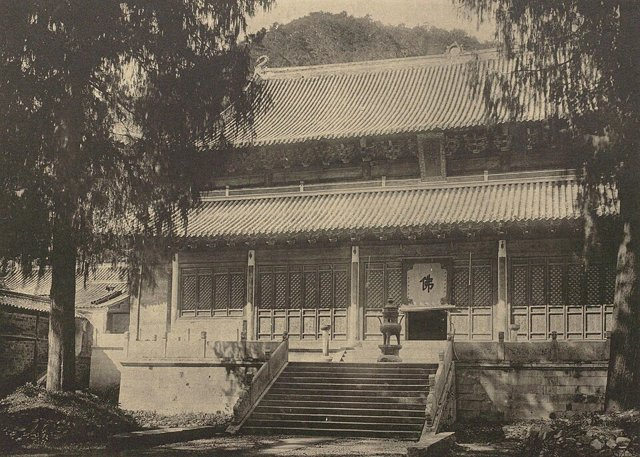
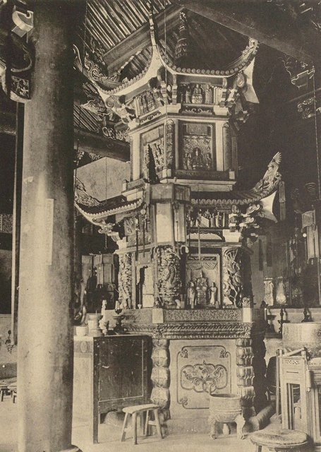
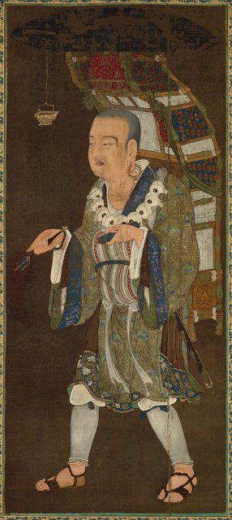
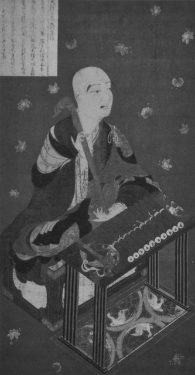
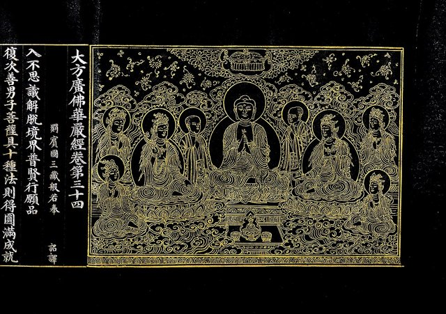
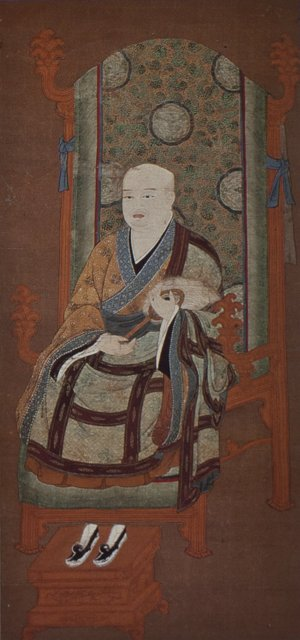
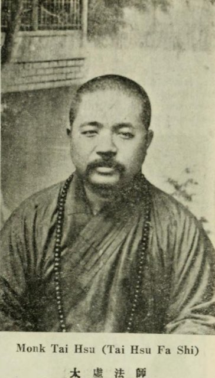

<!--
內容整理自 D:\Books\md\歷史\東方歷史\佛教判教.md（Books 頁面為 D:\Books\html\1-2.中國歷史\佛教判教.html），並整合中文維基百科〈教判〉條目，以自己的話改寫。
時期依筆記的章節歸納：南北朝判教的興起、隋代天台宗、唐代各宗的判教、宋以後的傳承、近現代的重新整理。筆記的「五時八教」「五教十宗」「三時教判」表格與「判教體系比較」「歷史意義」寫進相關事件與時期說明，不另立事件。
很早的背景（印度大乘經典中的三乘歸一乘、頓漸、三時、五味等分類萌芽，部派佛教對了義、不了義的討論，以及2–3世紀佛教傳入中國）寫進第一則事件的內文，不另立事件。
兩份資料出入與處理方式：
- 年代：筆記多半只寫「約5世紀初」「7世紀後半」等，事件日期取該段時間的大約年份，並用 label 標出原本的寫法。
- 印度淵源：筆記列《法華經》《楞伽經》《解深密經》《大般涅槃經》《大智度論》的分類思想；維基百科補充部派時代大眾部與說一切有部對「佛所說經是否皆了義」的爭論，龍樹的四悉檀與無著的四意趣，照此。
- 天台：筆記稱「五時八教」；維基百科稱「五味八教」或「五時八教」，並說明乳、酪、生酥、熟酥、醍醐五味分別對應華嚴、阿含、方等、般若、法華涅槃，照此並列。
- 吉藏：筆記沒有；維基百科寫三論宗吉藏立聲聞、菩薩二藏與根本、枝末、攝末歸本三法輪，照此補一則（吉藏549–623）。
- 法相宗：筆記寫三時教判由窺基在「唐代中期」整理；維基百科寫三時教判由玄奘所立，弟子窺基發展為「三教八宗」（有教、空教、中道教，與我法俱有宗等八宗）。窺基生卒為632–682，這裡把窺基的判教寫在7世紀後半，三時教判寫在玄奘645年回國之後。
- 華嚴十宗：筆記列十宗名稱；維基百科補充前七宗取自窺基的八宗，後三宗（真德不空、相想俱絕、圓明具德）分屬終教、頓教、圓教，照此。
- 拉薩法諍與藏傳：筆記沒有；維基百科寫赤松德贊時在桑耶寺發生的頓漸之爭（蓮花戒代表漸教、摩訶衍代表頓教），以及寧瑪派的九乘判教，照此補一則，年代用一般所說的約792–794年。
- 日本：筆記只寫13世紀的日蓮；維基百科補充空海的顯密二教判與十住心判、親鸞的二雙四重、日蓮宗的五綱，這裡把空海獨立為一則（830年撰《十住心論》），親鸞與日蓮合為一則。
- 太虛：筆記寫「1921年：太虛大師提出大乘三系思想的前期背景」；維基百科寫太虛判大乘不共法為法性空慧、法相唯識、法界圓覺三宗，出自〈我怎樣判攝一切佛法〉（《海潮音》二十一卷十期，約1940年），這裡寫成1921年起醞釀、1940年發表。
- 印順：筆記寫1941年前後提出性空唯名、虛妄唯識、真常唯心三系；維基百科同，並補充他判印度佛教為五期，照此。
- 筆記提醒：傳統判教（解釋教義層次與究竟意義）不等於現代佛教史（研究經典形成與思想演變），五時並不是經典實際成立的順序，這點寫進最後一則與時期說明。
- 人名與其他時間軸一致：釋迦牟尼（Buddha）、玄奘（Xuanzang）；鳩摩羅什、智顗、法藏、宗密等沒有獨立時間軸。人名分隔號依慣例用「·」。
圖片來源（皆為 Wikimedia Commons 公有領域／CC0 作品，縮成最長邊 640px）：
- pj-cover.jpg：Sramana Zhiyi.jpeg（智顗像，天台宗的實際創立者）
- pj-guoqing.jpg：Tiantai Guoqing Temple (Mahavira Hall).jpg（天台山國清寺大雄寶殿，關野貞1918年攝）
- pj-pagoda.jpg：Tiantai Zhenjue Temple (True-Body Pagoda of Master Zhizhe).jpg（天台山真覺寺智者大師真身塔，常盤大定1922年攝）
- pj-xuanzang.jpg：Xuanzang w.jpg（玄奘取經圖，日本鎌倉時代）
- pj-fazang.jpg：Kōzō Daishi (Todaiji).jpg（華嚴宗三祖法藏像，日本東大寺藏，13世紀）
- pj-avatamsaka.jpg：Transcription of Avatamsaka Sutra (The Flower Garland Sutra), Zhou Version, in Silver and Gold on Indigo Paper, Volume 34. Goryeo Dynastry, 1337.jpg（高麗1337年的金銀字《華嚴經》（周本）寫經）
- pj-zongmi.jpg：Kegon Patriarchs - Shūmitsu (Todaiji).jpg（圭峰宗密像，日本東大寺藏，15世紀）
- pj-taixu.jpg：Taixu3.jpg（太虛法師）
-->

# Periods
- 401 ~ 574 | 南北朝判教的興起 | #868e96
  鳩摩羅什大量譯出大乘經論後，經典間的差異成為難題，慧觀、竺道生等人開始為佛陀的教法分類，南北朝各家判教盛行，後世以「南三北七」概括。
- 575 ~ 617 | 隋代天台宗與三論宗 | #e8590c
  智顗以《法華經》為核心，整合南北朝的判教，建立五時八教；吉藏則立二藏三轉法輪。
- 618 ~ 906 | 唐代各宗的判教 | #1971c2
  宗派林立，各宗依自己的核心經典建立判教：法相宗三時教、華嚴宗五教十宗，宗密更把儒、道納入比較。
- 960 ~ 1700 | 宋以後的傳承 | #2f9e44
  宋代天台宗的山家山外之爭、日本的日蓮與親鸞、明末蕅益智旭的《教觀綱宗》，繼續詮釋與整理既有的判教。
- 1921 ~ 1950 | 近現代的重新整理 | #7048e8
  太虛與印順改從思想史的角度，把大乘佛教分為三系，不再依照佛陀說法的次第。

# Events

## 401 | 鳩摩羅什到長安 {label="401年（約4世紀末至5世紀初）"}
判教的背景來自印度：佛教經典是在不同時代陸續形成的，部派佛教時期就有人爭論佛所說的經是否都是「了義」，大眾部認為佛所說皆為了義，說一切有部則認為也有需要另加解釋的不了義經；大乘經典中，《法華經》說聲聞、緣覺、菩薩三乘終歸一佛乘，《楞伽經》分頓、漸，《解深密經》分有、空、中道三時，《大般涅槃經》以乳、酪、生酥、熟酥、醍醐五味比喻教法逐步深入，龍樹立四悉檀、無著立四意趣，都已經有分類教法的想法。2至3世紀起，禪法、般若、阿含與大乘經典陸續由印度與西域傳入中國，各經對空、有、涅槃與菩薩道的說法不盡相同。鳩摩羅什（344–413）到長安後譯出大量大乘經論，使般若、中觀、法華、維摩詰等思想廣泛流傳，他和弟子對經典差異的討論，成為中國判教的重要背景。

## 420 | 慧觀的二教五時 {label="約5世紀初"}
鳩摩羅什的弟子慧觀把佛陀的教法分為頓教與漸教：頓教以《華嚴經》為代表，直接宣說深廣的大乘佛法；漸教則是其他依眾生根機逐步引導的經典，再依說法先後分為五時。這是中國早期判教的代表，把經典內容和佛陀教化眾生的次第結合起來。

## 430 | 竺道生的四法輪 {label="約5世紀初"}
竺道生（約355–434）把佛陀的教法分為善淨法輪、方便法輪、真實法輪與無餘法輪，強調教法由方便逐步走向究竟，反映南朝佛教思想家想建立完整佛法體系的努力。

## 500 | 南三北七 {label="5至6世紀"}
南北朝時期判教盛行：南方多以頓、漸與經典的教化次第為主，北方則出現三教、四宗、五時等不同分類，各家對《華嚴經》《法華經》《涅槃經》與般若經的地位看法不一。後世用「南三北七」概括南方三家、北方七家的代表學說，但它並不是十種內容固定的學說，而是對當時眾多判教主張的統稱；這股風氣為隋代天台宗的系統化工作奠定了基礎。

## 538 | 智顗出生
智顗（538–597）生於南朝梁，後來師從南嶽慧思，深入研究《法華經》與禪觀，繼承南北朝的判教傳統，進一步把經典、教理與修行方法整合起來。

## 560 | 從學慧思 {label="約560年代"}
智顗在慧思門下學習禪法與《法華經》，逐漸形成以《法華經》為核心的思想；他不只研究經典的義理，也重視止觀實踐，形成天台宗「教觀並重」的特色。

## 575 | 入天台山

智顗到浙江天台山弘法，逐步建立以《法華經》為中心的教學與修行體系，後世尊他為天台宗的實際創立者，稱「智者大師」。

## 593 | 講《法華玄義》
智顗在荊州玉泉寺講說《法華玄義》，有系統地闡述《法華經》的思想與它在佛經中的地位，以「五時八教」統攝佛陀一生的教法。五時依說法先後分為：華嚴時（《華嚴經》）、阿含時（又稱鹿苑時，四阿含）、方等時（《維摩詰經》《勝鬘經》等）、般若時（般若經）與法華涅槃時（《法華經》《涅槃經》），分別對應乳、酪、生酥、熟酥、醍醐五味。八教則分為兩組：依說法的方式分為頓、漸、秘密、不定的「化儀四教」，依說法的內容分為藏、通、別、圓的「化法四教」。

## 594 | 講《法華文句》與《摩訶止觀》
智顗進一步逐段解釋《法華經》的經文，把經文、教義與修行實踐結合起來，奠定天台宗解釋《法華經》的基礎；他的弟子灌頂把這些講述整理成書，與《法華玄義》合稱「天台三大部」。

## 597 | 智顗圓寂

智顗在天台山圓寂，享年約60歲。弟子與後代的天台學者繼續整理、傳承他的思想，五時八教成為中國佛教最具代表性的判教體系之一。

## 600 | 吉藏的二藏三轉法輪 {label="隋代（吉藏549–623）"}
三論宗的吉藏立聲聞藏與菩薩藏二藏，又在二藏中分出根本法輪（《華嚴經》）、枝末法輪（其他大小乘經）與攝末歸本法輪（《法華經》）三轉法輪，是隋代與天台並立的另一種判教。

## 629 | 玄奘西行求法

玄奘離開長安前往印度，主要目的之一是深入研究當時印度盛行的瑜伽行派與唯識思想；他在那爛陀寺跟隨戒賢等論師學習。

## 645 | 玄奘回長安與三時教判
玄奘帶回大量梵文佛典，主持大規模的譯經事業。他依據《解深密經》立「三時教判」：第一時「有教」是阿含類經典，說因果、業報與諸法；第二時「空教」是般若類經典，闡明諸法性空；第三時「中道教」是《解深密經》等，以唯識與三性說明非有非空的中道。法相宗認為第三時教最完整，既不把「空」理解為一切皆無，也不執著諸法有固定的自性。

## 670 | 窺基的三教八宗 {label="7世紀後半（窺基632–682）"}
玄奘的弟子窺基把三時教判發展為「三教八宗」：三教是阿含「我空法有」的有教、般若與三論「諸法皆空」的空教，以及《華嚴》《解深密》《法華》等「非有非無」的中道教；八宗從我法俱有宗（犢子部）、法有我無宗（說一切有部）一路排到勝義皆空宗（般若與《中論》）和應理圓實宗（唯識中道），把印度部派與大乘的學說都放進一個次第。

## 643 | 法藏出生

華嚴宗三祖法藏（643–712）出生，後來師從智儼，深入研究《華嚴經》，成為華嚴宗思想體系的主要建立者。

## 690 | 華嚴宗的五教十宗 {label="7世紀後半"}

法藏以《華嚴經》為核心，探討法界緣起、事事無礙與一多相即，在《華嚴經探玄記》中提出「五教十宗」。五教是小乘教、大乘始教（法相與空性）、大乘終教（如來藏與佛性）、大乘頓教（離言絕相、頓悟真理）與一乘圓教（以《華嚴經》為代表，法界圓融無礙）。十宗的前七宗取自窺基的八宗，後三宗真德不空宗、相想俱絕宗、圓明具德宗分屬終教、頓教與圓教，從對「我」與「法」的認識，逐步推進到空性、真如與圓融無礙。

## 712 | 法藏逝世
法藏逝世，華嚴宗的五教十宗體系逐漸確立，對中國佛教哲學與東亞佛教影響深遠。

## 780 | 澄觀深化華嚴判教 {label="8世紀後半（澄觀738–839）"}
華嚴宗的澄觀著《華嚴經疏》《華嚴經隨疏演義鈔》，繼承法藏的五教，進一步整理小、始、終、頓、圓五教的思想，強調教理與觀行的結合，深化華嚴宗對法界緣起的理解，也影響了後來宗密對佛教與中國傳統思想的統合。

## 792 | 拉薩法諍 {label="約792–794年"}
吐蕃贊普赤松德贊時，在桑耶寺舉行一場頓漸之爭：師承寂護、來自印度那爛陀寺的蓮花戒代表漸教，來自敦煌、屬禪門北宗的漢僧摩訶衍代表頓教，反映大乘教法中頓、漸法門的爭論。後來藏傳佛教寧瑪派把佛法判為九乘（顯教三乘、外密三乘、內密三乘），其他各派則主張密續分為事、行、瑜伽、無上瑜伽四部。

## 830 | 宗密的三教六層與空海的十住心 {label="9世紀前半"}

宗密（780–841）承接澄觀的華嚴思想，也深入研究禪宗，他在《原人論》中不只分類佛教內部的經典，還把儒家、道家納入比較：儒道是「迷執之教」，人天教、小乘教、大乘法相教、大乘破相教是「偏淺之教」，一乘顯性教是「直顯真源教」，把判教擴大為不同思想傳統之間的比較與會通。同一時期，日本真言宗的空海立顯教、密教二教判，830年奉命撰《十住心論》，以十種心的層次判攝世間思想與佛教各宗。

## 1000 | 宋代天台的山家山外之爭 {label="10至11世紀"}
晚唐五代以後，天台、華嚴、法相各自傳承自己的判教，禪宗則強調直指人心、見性成佛，對經教與禪法的關係另有看法。宋代天台宗復興，出現山家、山外之爭，爭論真心與妄心、佛性與觀心的方法；知禮（960–1028）等人重新闡釋智顗的教觀，五時八教成為討論佛性、心性與修行的理論基礎。

## 1260 | 日本的親鸞與日蓮 {label="13世紀"}
日本淨土真宗的親鸞立「二雙四重」判教；日蓮（1222–1282）深入研究天台的五時八教，把《法華經》視為佛陀教法的究竟，主張以它作為修行與弘法的核心，使天台判教在日本佛教中產生深遠的影響。

## 1640 | 蕅益智旭《教觀綱宗》 {label="17世紀（蕅益智旭1599–1655）"}
明末的蕅益智旭重新整理五時八教與天台的教觀架構，著《教觀綱宗》，成為後世研習天台判教的入門書；他的思想也有融通天台、禪宗與淨土的特色。

## 1940 | 太虛的大乘三宗 {label="1921年起醞釀，約1940年發表"}

致力於近代佛教改革的太虛（1890–1947）從佛教哲學與思想分類的角度整理大乘佛法：他判印度佛教為三期，又把佛法分為五乘共法、三乘共法與大乘不共法，再把大乘不共法分為法性空慧宗、法相唯識宗與法界圓覺宗三宗，見於〈我怎樣判攝一切佛法〉（《海潮音》）。

## 1941 | 印順的大乘三系 {label="1941年前後"}
印順（1906–2005）在《印度之佛教》等著作中，從印度佛教思想史的角度把大乘分為三系：性空唯名論（緣起性空）、虛妄唯識論（識與所認識對象的關係）、真常唯心論（如來藏與佛性），並把印度佛教分為五期。他不沿用傳統判教的佛陀說法次第，而重視經典形成與思想演變的歷史脈絡。傳統判教重在解釋各經教義的層次與究竟意義，現代佛教史則研究經典的形成、翻譯與傳播，例如天台的五時並不是經典實際成立的順序，兩者目的不同，不宜混為一談。
