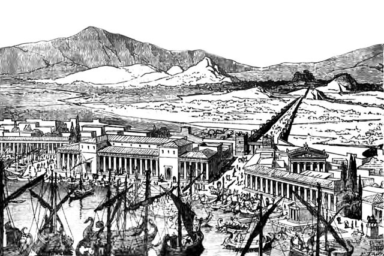
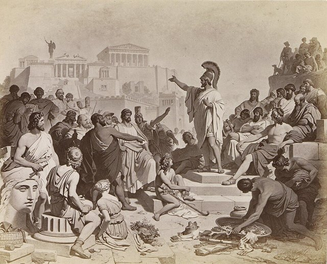
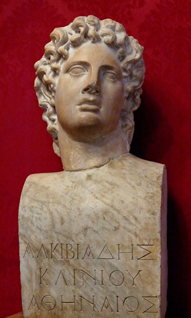
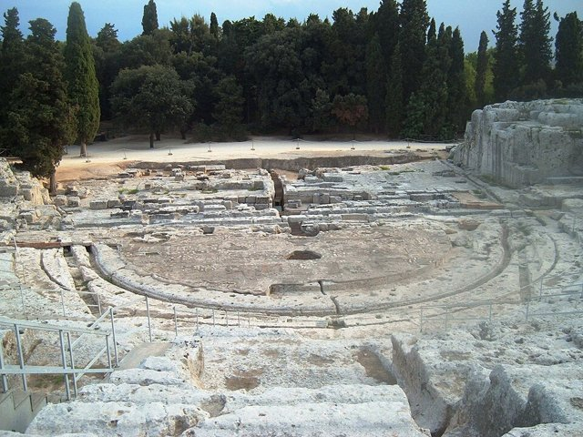
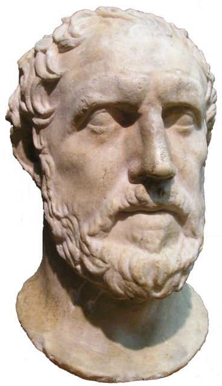
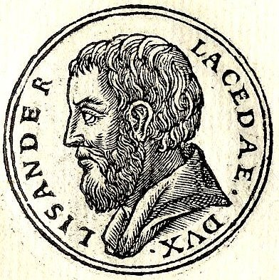
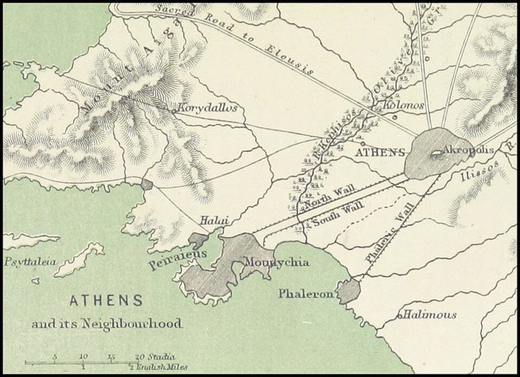

<!--
內容整理自 D:\Books\html\1-1.西方歷史\伯羅奔尼撒戰爭大事記.html（沒有對應的 md 筆記；同資料夾另有概說頁〈伯羅奔尼撒戰爭〉），並整合中文維基百科〈伯羅奔尼撒戰爭〉〈提洛同盟〉〈波希戰爭〉條目，以自己的話改寫。
時期依頁面的四個階段歸納：阿基達穆斯戰爭（前431—前421年）、尼西阿斯和約後的權力競爭（前421—前415年）、西西里遠征（前415—前413年）、德凱利亞戰爭（前413—前404年）；前面另加戰爭背景，最後加投降後的雅典。頁面的「三大階段比較」「主要人物」「歷史影響」「評價」與總結寫進時期說明與相關事件，不另立事件。
兩份資料出入與處理方式：
- 戰爭的前奏：維基百科寫前462—前458年修築連接雅典與比雷埃夫斯港的長牆，前460年米加臘退出伯羅奔尼撒聯盟投靠雅典，衝突一直持續到前446年（第一次伯羅奔尼撒戰爭），前446年簽訂三十年和約，雙方互相承認對方的同盟、衝突由裁判處理，「中立」城邦被排除在和約之外而後來成為大錯；頁面只寫前433—432年的科西拉與波提狄亞事件、麥加拉法令與前432年斯巴達的決議。這裡兩者都寫成事件。維基百科〈提洛同盟〉寫前446年雅典失去優卑亞島（科羅尼亞之戰），一併提及。
- 戰爭年份：頁面與維基百科都寫前431—前404年；〈希臘史〉時間軸把戰爭爆發寫在前432年，這裡以戰爭正式開打的前431年為準，前432年的斯巴達決議寫在背景事件中。
- 戰爭起因：頁面把麥加拉法令（雅典對斯巴達盟友麥加拉的貿易禁令）列為起因之一，維基百科的導言沒有細節，照頁面，年份依一般記載寫在前432年左右。
- 瘟疫與伯里克利：頁面寫前430年瘟疫、前429年伯里克利死於瘟疫，與維基百科一致；人名維基百科作伯里克利，這裡照頁面作伯里克里斯。
- 前425年：頁面寫雅典在派洛斯建立據點與斯法克特里亞戰役；細節（斯巴達重裝步兵投降）依一般記載補充。
- 前424—前422年：頁面寫布拉西達斯進軍色雷斯、德利昂戰役雅典敗於底比斯、安菲波利斯戰役，克里昂與布拉西達斯雙雙戰死（一般記載）；尼西阿斯和約前421年簽訂，頁面提醒它沒有真正解決權力競爭。
- 米洛斯：頁面寫前416年雅典征服中立的米洛斯並視為雅典帝國統治方式的代表；「米洛斯對話」出自修昔底德，依一般記載補充，只說出自修昔底德的敘述。
- 西西里遠征：頁面寫前415年出發（尼西阿斯反對、阿爾西比亞德主戰）、赫爾墨斯神像遭破壞、前414年圍攻敘拉古、前413年慘敗；吉利波斯協助敘拉古的年份取自頁面的人物介紹。
- 德凱利亞：頁面寫前413年斯巴達在阿爾西比亞德建議下占領；波斯介入與前411年雅典「四百人」寡頭政變取自頁面，維基百科〈波希戰爭〉補充波斯在前411年與斯巴達訂立共同防禦條約、條件是波斯完全控制伊奧尼亞，照此。
- 後期：基齊庫斯海戰（前410年）、阿爾西比亞德返回雅典（前407年）、阿吉紐西群島海戰（前406年，事後將領被審判）、羊河口海戰（前405年，呂山德突襲）、前404年投降與三十僭主，皆取自頁面；前403年色拉敘布洛斯恢復民主依一般記載補充（頁面只在人物介紹提到他）。
- 修昔底德與色諾芬：維基百科說修昔底德的《伯羅奔尼撒戰爭史》寫到前411年冬天，色諾芬的《希臘史》接續，這裡寫進前411年的事件。
- 提洛同盟的結局：維基百科寫前404年提洛同盟戰敗而解散，前377年雅典另組第二次海上同盟，照此寫進前404年事件。
- 人名與其他時間軸一致：伯里克利（頁面作伯里克里斯）、蘇格拉底、色諾芬。
圖片來源（皆為 Wikimedia Commons 公有領域／CC0 作品；繪畫與雕塑的年代多為後世作品，不代表事件當時的樣貌）：
- pel-cover.jpg：Bust Pericles Chiaramonti.jpg（伯里克里斯半身像（羅馬時代複製品，梵蒂岡基亞拉蒙蒂博物館））
- pel-longwalls.jpg：The Piraeus and the Long Walls of Athens.jpg（雅典長牆與比雷埃夫斯港（復原圖））
- pel-funeral.jpg：PericlesFuneralOrationRijksmuseum.jpg（伯里克里斯發表陣亡將士的葬禮演說（版畫，荷蘭國立博物館藏））
- pel-plague.jpg：La peste d’Athènes. François Perrier.jpg（佩里耶〈雅典的瘟疫〉）
- pel-parthenon.jpg：Acropolis Parthenon Athens Greece.jpg（雅典衛城與帕德嫩神廟）
- pel-nicias.jpg：Joachim von Sandrart (1606-1688) - Nicias of Athens.jpg（尼西阿斯（桑德拉特版畫））
- pel-alcibiades.jpg：Bust Alcibiades Musei Capitolini MC1160.jpg（阿爾西比亞德半身像（卡比托利歐博物館））
- pel-socrates.jpg：Alcibades being taught by Socrates, François-André Vincent.jpg（文森〈蘇格拉底教導阿爾西比亞德〉（後世畫作））
- pel-syracuse.jpg：Teatro greco di Siracusa.JPG（敘拉古的希臘劇場遺址）
- pel-thucydides.jpg：Thucydides-bust-cutout ROM.jpg（修昔底德半身像）
- pel-lysander.jpg：Lysander-Sparta.jpg（呂山德（版畫））
- pel-walls404.jpg：Athens and the Long walls to Piraeus and Phaleron.jpg（雅典、長牆與比雷埃夫斯、法勒隆港（地圖））
-->

# Periods
- -462 ~ -433 | 戰爭的前奏 | #868e96
  波希戰爭後，雅典把提洛同盟變成海上帝國，修築長牆、與斯巴達陣營打了「第一次伯羅奔尼撒戰爭」；前446年三十年和約，雙方互相承認對方的同盟，但科西拉、波提狄亞與麥加拉的問題一個個浮上檯面。
- -432 ~ -421 | 阿基達穆斯戰爭 | #e8590c
  又稱「十年戰爭」：斯巴達的陸軍年年入侵阿提卡，雅典則以海軍襲擊伯羅奔尼撒沿岸；瘟疫與伯里克里斯之死後，雙方在派洛斯、安菲波利斯交手，最後簽訂尼西阿斯和約。
- -421 ~ -415 | 不穩定的和平 | #f08c00
  名義上的和平下，盟邦之間的衝突仍然持續，阿爾西比亞德崛起，雅典在米洛斯顯露帝國的強硬。
- -415 ~ -413 | 西西里遠征 | #c92a2a
  雅典出兵西西里圍攻敘拉古，結果遠征軍全軍覆沒，是整場戰爭的轉折點。
- -413 ~ -404 | 德凱利亞戰爭 | #7048e8
  斯巴達占領德凱利亞，雅典的盟邦動搖，波斯出錢支持斯巴達，雅典雖然一度在基齊庫斯海戰反擊，最後在羊河口海戰喪失艦隊而投降。
- -404 ~ -403 | 戰後的雅典 | #495057
  斯巴達成為希臘的霸主，雅典在斯巴達支持下建立三十僭主的寡頭政權，隨即又由色拉敘布洛斯恢復民主。

# Events

## -462 ~ -458 | 雅典修築長牆 {label="前462–前458年"}

雅典為了維持城市與比雷埃夫斯港之間的聯繫，修築一道約六公里的「長牆」，使雅典即使被陸軍包圍，也能透過海運得到物資。這是雅典重視海權與貿易的象徵，也讓斯巴達更加警戒。

## -460 ~ -446 | 第一次伯羅奔尼撒戰爭 {label="前460–前446年"}
米加臘在前460年退出伯羅奔尼撒聯盟、投靠雅典，雅典與斯巴達陣營之間爆發持續十多年的衝突，一般被看作伯羅奔尼撒戰爭的前奏。前446年，雅典失去優卑亞島後雙方打成平手，簽訂為期三十年的和約，約定互相尊重對方的同盟，衝突由裁判來裁決；「中立」的城邦被排除在和約之外，後來證明是一個大錯誤。

## -433 | 科西拉事件
雅典與科林斯在科西拉（今克基拉島）的問題上發生衝突，雅典出兵支持科西拉，與斯巴達的重要盟友科林斯的艦隊對峙，雙方的敵意進一步加深。前432年左右的波提狄亞事件更使雅典與科林斯正面衝突。

## -432 | 麥加拉法令與斯巴達的決議 {label="前432年左右"}
雅典對斯巴達的盟友麥加拉採取經濟制裁，限制它進入雅典與雅典控制的市場，加劇了外交危機。前432年，斯巴達及其盟友經過討論，認定雅典違反了和約，戰爭的風險迅速升高。伯羅奔尼撒戰爭並不是由某一次外交衝突引起，而是雅典勢力擴張，與斯巴達及其盟友擔心權力平衡被打破長期累積的結果。

## -431 | 戰爭爆發

前431年春天，斯巴達的盟友底比斯企圖奪取普拉提亞；夏天，斯巴達國王阿基達穆斯二世率領伯羅奔尼撒同盟軍入侵阿提卡。伯里克里斯主張放棄農村、讓居民退入長牆之內，不與斯巴達的陸軍正面作戰，並以艦隊襲擊伯羅奔尼撒半島沿岸。雅典避免陸戰、斯巴達避免海戰，成為戰爭初期的基本模式。前431至前430年的冬天，伯里克里斯為第一年的陣亡者發表葬禮演說，修昔底德記錄下這篇歌頌雅典民主的演說。

## -430 | 雅典大瘟疫

擁擠的雅典城爆發嚴重的瘟疫，死了大量居民，社會秩序受到嚴重破壞。瘟疫與戰爭的痛苦使公民對伯里克里斯的政策不滿，他一度被罷免並被罰款。

## -429 | 伯里克里斯去世

伯里克里斯也死於瘟疫。雅典失去長期掌握政治方向的人物，此後的政治領袖如克里昂、尼西阿斯更依賴民意與黨派，政策也更搖擺不定。

## -428 ~ -427 | 米提利尼起義與普拉提亞陷落 {label="前428–前427年"}
萊斯博斯島的米提利尼起兵反抗雅典，前427年投降；普拉提亞長期受到斯巴達與底比斯的軍事壓力，也在前427年陷落。這些事件顯示雅典對盟邦的控制越來越嚴，盟邦想要脫離也越來越困難。

## -425 | 派洛斯與斯法克特里亞
雅典將軍德摩斯梯尼等人在西北希臘展開行動後，前425年在伯羅奔尼撒西南的派洛斯建立據點，並把一批斯巴達人困在斯法克特里亞島，迫使他們投降。這場出人意料的勝利使雅典在談判中占了上風，也震動了一向以不投降聞名的斯巴達。

## -424 | 布拉西達斯北上與德利昂戰役
斯巴達將軍布拉西達斯率軍北上，進入色雷斯與雅典有重要利益的地區，攻下安菲波利斯一帶；同年雅典在波奧提亞的德利昂戰役中敗於底比斯及其盟軍。

## -422 | 安菲波利斯戰役
雅典將軍克里昂率軍試圖奪回安菲波利斯，與布拉西達斯交戰，兩人都在這場戰役中戰死。雙方主戰的領袖相繼死亡，使和平談判更容易進行。

## -421 | 尼西阿斯和約

雅典與斯巴達簽訂尼西阿斯和約，同意停止主要的敵對行動，結束戰爭的第一階段（十年戰爭）。但和約並沒有真正解決雅典與斯巴達的權力競爭，盟邦對條款也不滿意，雙方名義上和平，區域衝突與政治角力仍持續。

## -420 | 阿爾西比亞德崛起

出身名門、富有魅力的阿爾西比亞德成為雅典的重要政治人物，主張對斯巴達強硬，並與阿爾戈斯等城邦結盟，使雅典與斯巴達的關係再度緊張。

## -418 | 曼提尼亞戰役
斯巴達與阿爾戈斯及其盟友在曼提尼亞附近爆發重要戰役，斯巴達取得勝利，證明其陸軍仍然具有高度的戰鬥力，也挫敗了雅典在伯羅奔尼撒半島建立反斯巴達同盟的企圖。

## -416 | 雅典征服米洛斯
愛琴海上的小島城邦米洛斯原本希望保持中立，不願服從雅典，雅典出兵包圍，最終攻陷，男子被殺、婦孺被賣為奴。修昔底德記錄了雅典使者與米洛斯人的「米洛斯對話」，被視為雅典帝國強權政治的代表：強者做它能做的，弱者承受它必須承受的。

## -415 | 雅典決定遠征西西里

雅典決定派遣大軍遠征西西里，名義上是援助盟邦，實際上是想取得西西里的農業資源、港口與貿易網絡。尼西阿斯認為規模太大、可能危及本土安全而反對，阿爾西比亞德則極力主張出兵。出發前夕，雅典城內發生赫爾墨斯神像遭破壞的事件，阿爾西比亞德被指控與此有關，在遠征途中被召回受審，轉而投奔斯巴達。

## -414 | 圍攻敘拉古

雅典軍隊抵達西西里後圍攻敘拉古，但補給線太長、難以補充人員與物資，進展不如預期。斯巴達派將軍吉利波斯前往協助敘拉古，他的介入成為雅典遠征失敗的重要因素之一。

## -413 | 西西里遠征全軍覆沒
敘拉古加強海軍作戰，利用港口的地形限制雅典艦隊；雅典艦隊遭到重創後，陸軍也無法順利撤離，遠征軍幾乎被消滅，尼西阿斯等將領被處死。雅典損失大量艦艇與有經驗的士兵，軍事威信與財政都受到重創，這是整場戰爭的轉折點。
同年，斯巴達在阿爾西比亞德的建議下占領阿提卡北部的德凱利亞，建立長期的軍事據點，持續破壞雅典周邊的農業，使雅典難以正常利用附近的土地，戰爭進入第四階段（德凱利亞戰爭）。

## -412 | 盟邦動搖，波斯介入
西西里遠征失敗後，雅典的盟邦開始反抗，愛琴海的局勢動搖；波斯帝國長期關注愛琴海與小亞細亞沿岸，前411年與斯巴達訂立共同防禦的條約，把波斯的財政資源與斯巴達及其盟友的海軍力量結合，代價是波斯完全控制愛奧尼亞。

## -411 | 四百人寡頭政變

雅典發生政變，部分寡頭派人士推翻民主政治，建立由「四百人」主導的寡頭政權，不久又被推翻、恢復民主。修昔底德的《伯羅奔尼撒戰爭史》只寫到前411年的冬天，色諾芬後來寫作《希臘史》接續他未完的工作。

## -410 | 基齊庫斯海戰
雅典艦隊在基齊庫斯附近擊敗斯巴達艦隊，使雅典重新獲得重要的海上勝利，一度恢復對海峽航線與糧食運輸的掌握。前409至前407年間，雅典持續在愛琴海與海峽地區展開行動，試圖恢復海上霸權。

## -407 | 阿爾西比亞德返回雅典
經過流亡與政治波折後，阿爾西比亞德重新獲得雅典部分人士的支持，返回雅典。同年，波斯王子居魯士開始在小亞細亞與斯巴達方面密切合作，他的財政支援有助於斯巴達將領呂山德維持海軍。

## -406 | 阿吉紐西群島海戰
雅典與斯巴達在阿吉紐西群島附近爆發重要的海戰，雅典取得勝利，但戰後未能及時救援落水的士兵與船員，指揮官因此被指控並遭到審判，多名將領被處死，使雅典失去經驗豐富的指揮官。

## -405 | 羊河口海戰

斯巴達將領呂山德突襲停泊在羊河口一帶的雅典艦隊，雅典的主要艦隊幾乎被全部消滅。雅典失去保護海上交通與維持糧食運輸的主要力量，戰爭的結局已無懸念。

## -404 | 雅典投降

斯巴達與盟友對雅典進行海陸封鎖，前404年雅典向斯巴達及其盟友投降，接受拆毀長牆、交出艦隊等限制性條件，提洛同盟隨之解散。雅典的海上帝國瓦解，斯巴達成為希臘世界最有優勢的城邦，卻無法長期統一希臘；前377年雅典另外組成第二次海上同盟。
投降後，雅典在斯巴達的支持下建立由寡頭派掌握的「三十僭主」政權，以恐怖手段統治。

## -403 | 恢復民主
色拉敘布洛斯等民主派人士起兵推翻三十僭主，雅典恢復民主政治。持續近三十年的戰爭耗盡了希臘世界大量的人力與財富，希臘城邦體系持續衰弱，前4世紀中葉馬其頓國王腓力二世開始改革軍事與政治、擴張對希臘城邦的影響，為亞歷山大的崛起創造了條件。
