<!--
內容整理自本機筆記《畢卡索生平大事記（1881－1973）》（D:\Books\md\藝術\畢卡索生平大事記（1881－1973）.md，網頁版為 D:\Books\html\9-2.藝術家\畢卡索(1881~1973，Pablo Picasso).html），並整合中文維基百科〈巴勃羅·畢卡索〉條目，以自己的話改寫。
時期依筆記的七個階段，配合風格轉變歸納：早年、藍色時期、玫瑰（粉紅色）時期、立體主義、古典與超現實探索（1914–1936）、內戰與格爾尼卡、南法與戰後、晚年、身後。
兩份資料出入與處理方式：
- 筆記以年代為主，維基百科補上部分月日（出生1881-10-25、長子保羅1921-02-04、女兒瑪雅1935-09-05、克洛德1947-05-15、帕洛瑪1949-04-19、逝世1973-04-08），其餘年份照筆記。
- 父親任教與遷居拉科魯尼亞：維基百科寫1891年全家遷往，筆記寫1892年接受訓練，兩者並存，以1891年遷居、1892年進美術學校的寫法合併。妹妹康奇塔1895年病逝、全家同年搬到巴塞隆納，兩份一致；筆記寫進隆哈美術學校（1895–1897），維基百科只寫1897年進馬德里的聖費爾南多皇家美術學院，兩者並存。
- 首次到巴黎：筆記寫1900年；維基百科同樣寫1900年旅行，並說他在巴黎認識詩人馬克斯·雅各布，這裡併入1900年的事件。藍色時期起點：筆記與維基百科都寫1901–1904年，以1901年好友卡薩赫馬斯自殺為起點。
- 玫瑰時期：筆記寫1904／1905–1906年，維基百科把1904年視為藍色與玫瑰時期之間的過渡期，這裡以1904年遇見費南德·奧利維耶、搬進洗衣船為玫瑰時期起點，並在說明中註明。
- 非洲（黑人）時期：維基百科正文寫1907–1924年，導覽模板寫1907–1909年，兩者不一致，這裡不採用，只在《亞維儂的少女》事件說明非洲雕刻與伊比利亞雕塑的影響。
- 立體主義時期：筆記的分析立體主義約1909–1912、綜合立體主義約1912–1914；維基百科只列立體主義1910–1919，採筆記。
- 與奧爾嘉結婚：筆記寫1918年，維基百科寫1918年夏；1955年奧爾嘉病逝（維基百科）。與賈桂琳·羅克結婚，兩者都寫1961年。
- 逝世時的年齡：維基百科信息框寫91歲，正文寫92歲，以出生1881年10月、逝世1973年4月計算是91歲，採91歲。
- 筆記沒有、維基百科有的事件：1915年伊娃·谷維（筆記作伊娃·古埃爾）去世、1946年起的陶藝與瓦洛里斯、1962年列寧和平獎、1986年賈桂琳自殺、2004年《拿著煙斗的男孩》以1.04億美元成交；1990年梵谷《加歇醫師肖像》8,250萬美元的紀錄是前一個價格。後兩則（1986、2004）與生平關聯較弱但保留，供比較。
- 筆記沒有、常見史實補充的日期：格爾尼卡轟炸1937年4月26日、畫成在5至6月、1937年7月在巴黎萬國博覽會西班牙館展出；1939年紐約現代藝術博物館回顧展；1944年10月加入法國共產黨；1963年3月巴塞隆納畢卡索博物館開館。筆記沒有的細節以「約」或只寫年，不勉強加日期。
- 筆記附的「藍色與粉紅色時期差異」「《格爾尼卡》為什麼成為反戰象徵」「風格演變表」「十大代表作品」「五大貢獻」「藝術史定位」寫進時期說明與相關事件，不另立事件；「延伸閱讀」的連結與最後建議製作互動 HTML 的段落沒有轉錄。
- 譯名：Pablo Picasso 依筆記作「畢卡索」，亞維儂（筆記作「亞維儂」，維基百科作「亞維農」）採「亞維儂」，布拉克、費南德·奧利維耶（維基百科作奧利弗）、馬克斯·雅各布、史坦與其他時間軸一致；人名用·分隔（筆記作・）；「畢加索」另列為 aliases。
圖片來源（皆為 Wikimedia Commons 公有領域／CC0 作品）：
- pi-cover.jpg：Portrait de Picasso, 1908.jpg（畢卡索，1908年在蒙馬特畫室）
- pi-birth.jpg：Málaga - Plaza de la Merced, Museo Casa Natal Picasso 1.jpg（馬拉加梅爾塞德廣場的畢卡索出生地故居博物館）
- pi-maxjacob.jpg：Portrait de Max Jacob, D.8463.jpg（馬克斯·雅各布肖像（法國國家圖書館藏））
- pi-casagemas.jpg：Ambroise Vollard, standing in front of Picasso's Evocación. El entierro de Casagemas.jpg（沃拉爾站在畢卡索《卡薩赫馬斯的葬禮》前，約1901）
- pi-bateau.jpg：Le Bateau-Lavoir, circa 1910.jpg（蒙馬特的洗衣船，約1910）
- pi-braque.jpg：Georges Braque, 1908, photograph published in Gelett Burgess, The Wild Men of Paris, Architectural Record, May 1910.jpg（喬治·布拉克，1908年的照片）
- pi-kahnweiler.jpg：Picasso Portrait of Daniel-Henry Kahnweiler 1910.jpg（畢卡索〈卡恩韋勒肖像〉，1910（分析立體主義））
- pi-olga.jpg：Olga Khokhlova in Picasso's Montrouge studio, spring 1918.jpg（奧爾嘉在畢卡索蒙魯日畫室，1918年春）
- pi-expo.jpg：Paris expo 1937.jpg（1937年巴黎萬國博覽會）
- pi-gilot.jpg：Francoise Gilot et Picasso FF oct 1952.jpg（法蘭絲·吉洛與畢卡索，1952年10月）
- pi-vallauris.jpg：Rosanjin visitis Picasso in Vallauris (1954).png（畢卡索在瓦洛里斯，1954）
- pi-meninas.jpg：Las Meninas 01.jpg（委拉斯開茲《宮娥》（畢卡索1957年變奏的原作），普拉多博物館）
- pi-1.jpg：Pablo picasso 1.jpg（晚年的畢卡索（拍攝時間不詳））
-->

# Periods
- 1881-10-25 ~ 1901 | 童年與西班牙學畫 | #868e96
  生於馬拉加，父親是畫家兼美術教師，十三歲全家遷到巴塞隆納；十五歲前後就接受學院派的完整訓練，也在「四隻貓」咖啡館接觸現代藝術，1900年第一次到巴黎。
- 1901 ~ 1904 | 藍色時期 | #1971c2
  好友卡薩赫馬斯自殺後，畫面轉成藍與藍綠色調，畫貧窮、孤獨、疾病與社會邊緣人物，《老吉他手》《生命》是代表。
- 1904 ~ 1907 | 玫瑰時期 | #e8590c
  定居巴黎蒙馬特，結識費南德·奧利維耶，色調轉為粉紅與赭紅，常畫馬戲團藝人與小丑，1906年受伊比利亞雕塑啟發，簡化人物形體。
- 1907 ~ 1914 | 立體主義 | #5c940d
  《亞維儂的少女》之後與布拉克共同發展分析立體主義與綜合立體主義，拼貼成為現代藝術的重要創新。
- 1914 ~ 1936 | 古典、劇場與超現實 | #f08c00
  一戰後為俄羅斯芭蕾舞團設計舞台與服裝，與奧爾嘉結婚，畫風在立體主義、新古典與超現實影響之間來回，也投入雕塑與詩。
- 1936 ~ 1945 | 西班牙內戰與《格爾尼卡》 | #c92a2a
  公開支持共和派，畫下《格爾尼卡》與《哭泣的女人》，二戰期間留在被占領的巴黎，1944年加入法國共產黨。
- 1945 ~ 1961 | 南法與戰後多媒材創作 | #0c8599
  移居南法，在瓦洛里斯投入陶藝，和平鴿成為象徵；畫《韓國大屠殺》《宮娥》變奏，為聯合國教科文組織繪製壁畫。
- 1961 ~ 1973-04-08 | 穆然的晚年 | #862e9c
  與賈桂琳結婚、定居穆然，九十歲仍持續畫畫、版畫、陶藝，1973年4月去世。
- 1973-04-08 ~ 2004 | 身後 | #495057
  遺產與作品繼續在全世界被展出與研究，市場價格屢創紀錄。

# Events

## 1881-10-25 | 出生於西班牙馬拉加
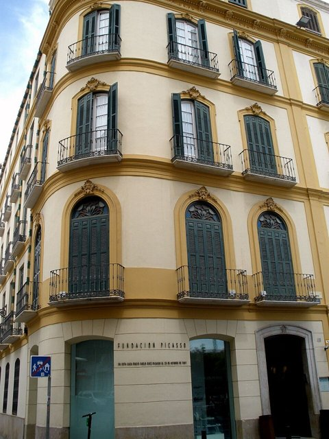
畢卡索出生在西班牙南部的馬拉加（Málaga）梅爾塞德廣場，全名巴勃羅·魯伊斯·畢卡索（Pablo Ruiz Picasso）。父親何塞·魯伊斯·布拉斯科（José Ruiz Blasco）是畫家，也是美術學校的教師；母親瑪莉亞·畢卡索·羅培茲，他是家中長子。
他在父親的鼓勵下，七、八歲就開始畫畫，從小就在藝術家庭裡長大。

## 1891 | 遷居拉科魯尼亞
父親到拉科魯尼亞的美術學校任教，全家搬到當地，約住了四年。1892年，畢卡索開始在這所學校接受較正式的繪畫訓練。相傳父親看到他的畫之後，發誓從此不再畫畫。

## 1895 | 妹妹去世，遷居巴塞隆納
七歲的妹妹康奇塔（Conchita）因白喉去世，對畢卡索造成深刻的影響；同年，全家搬到巴塞隆納。巴塞隆納成為他接觸現代藝術的重要起點。
1895到1897年，他進入隆哈美術學校（La Lonja），掌握學院派的素描、人物畫與傳統技法。

## 1897 | 馬德里的聖費爾南多皇家美術學院
十五、六歲的畢卡索獨自到馬德里，進入聖費爾南多皇家美術學院，但很快就不再上課，轉到普拉多美術館臨摹與研究大師作品。同年他創作了《科學與慈善》（Science and Charity），早期作品仍具有寫實與學院派的特色。
1896年的《第一次聖餐》與1898年到霍爾塔鄉間的旅行，讓他接觸西班牙的鄉村生活與自然景觀，也影響了日後的造形探索。

## 1899 | 「四隻貓」咖啡館
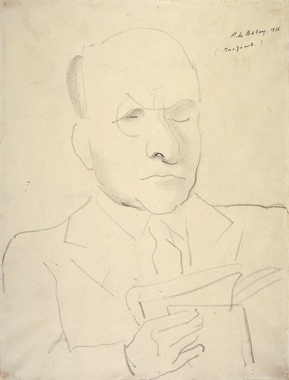
畢卡索回到巴塞隆納，開始出入前衛藝術家聚集的「四隻貓」咖啡館（Els Quatre Gats），接觸現代藝術、文學與波希米亞文化。1900年，他首次前往巴黎，接觸當時歐洲藝術中心的展覽、畫廊與藝術家，並結識詩人馬克斯·雅各布（Max Jacob）。

## 1901 | 卡薩赫馬斯之死與藍色時期
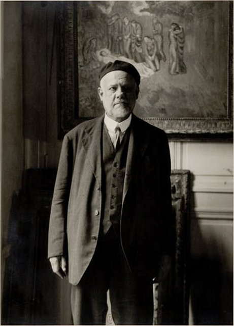
1901年，畢卡索的摯友卡洛斯·卡薩赫馬斯（Carlos Casagemas）自殺身亡，他深受打擊，畫了多幅卡薩赫馬斯的肖像與《卡薩赫馬斯之死》，藍色時期（1901–1904）也由此展開。同年他開始在畫上簽名「Picasso」，並在雜誌《青年藝術》工作，是他第一次參與的刊物。
藍色時期的畫以藍與藍綠為主調，描繪貧窮、孤獨、悲傷、疾病與社會邊緣人物，如乞丐、盲人與妓女。1902年他在巴黎展出藍色時期作品，開始建立個人的藝術風格。

## 1903 | 《生命》與《老吉他手》
畢卡索畫了《生命》（La Vie，現藏克里夫蘭美術館）與《老吉他手》（The Old Guitarist），以冷色調與瘦削的人物，把孤獨與精神困境轉化為畫面主題；同年完成的還有《盲人的晚餐》與《賽樂絲汀娜》。
這兩個時期顯示畢卡索不只是技法出色的畫家，也開始把個人經驗、社會觀察與情緒融入藝術。

## 1904 | 洗衣船與玫瑰時期
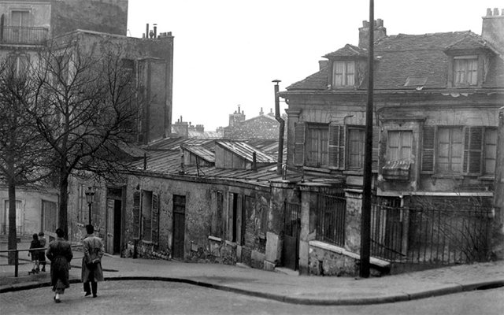
畢卡索定居巴黎蒙馬特，住進洗衣船（Bateau-Lavoir）畫室，遇見模特兒費南德·奧利維耶（Fernande Olivier），兩人相戀。
1904到1906年，他的色調從藍色轉向粉紅、赭紅與暖色，常畫馬戲團藝人、小丑與流浪藝人，稱為玫瑰（粉紅色）時期；1904年被視為藍色與玫瑰時期之間的過渡期。情緒轉為柔和、含蓄，帶有淡淡的憂傷。

## 1905 | 《雜技演員一家》與史坦兄妹
畢卡索創作《雜技演員一家》（Family of Saltimbanques）與《拿著煙斗的男孩》，結識美國收藏家格特魯德·史坦（Gertrude Stein）及她的哥哥李奧·史坦，他們成為早期重要的支持者。藝術風格逐漸由悲苦走向含蓄、抒情與內省。
後來這幅畫在拍賣市場上創下紀錄（見2004年）。

## 1906 | 戈索爾與伊比利亞雕塑
畢卡索在西班牙戈索爾（Gósol）停留，受到古代伊比利亞雕塑等藝術形式的啟發，他開始簡化人物形體；這年他也第一次看到非洲雕刻，深受震撼。這些都在為立體主義的突破做準備。

## 1907 | 《亞維儂的少女》與布拉克
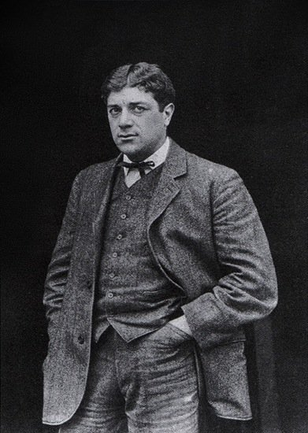
畢卡索完成《亞維儂的少女》（Les Demoiselles d'Avignon），被視為現代藝術史的關鍵轉折：人物形體被簡化、扭曲並分解，空間不再服從傳統透視，呈現一個不再依自然主義的視覺世界。
他也在這一年與法國畫家喬治·布拉克（Georges Braque）開始交往，兩人的共同探索成為立體主義形成的重要基礎。立體主義的核心不是把東西畫成幾何圖形，而是重新思考：一個物體是否只能從單一角度呈現？繪畫是否一定要模仿肉眼所見的世界？

## 1909 | 分析立體主義 {label="1909–1912年"}
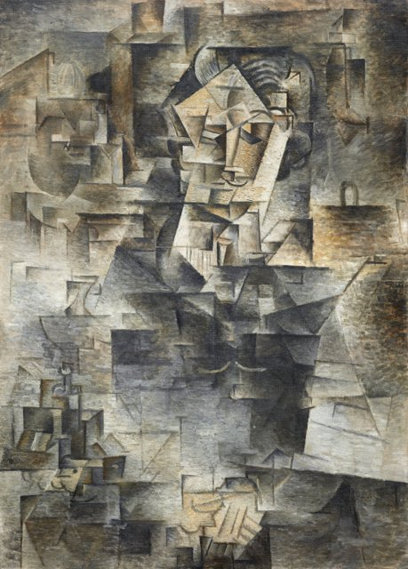
1909年，畢卡索創作《費南德·奧利維耶頭像》，把人物形體切分成多個幾何面，進一步突破單一視點的傳統。1909到1912年，他與布拉克發展分析立體主義（Analytical Cubism）：把人與物拆成細碎的幾何面，用不同角度的視覺資訊重組形象。
1911年起，兩人的作品開始加入字母、文字等元素，繪畫不再只是模仿外部世界，也成為分析視覺與形體的實驗。

## 1912 | 拼貼與綜合立體主義
1912年，畢卡索創作《藤椅上的靜物》（Still Life with Chair Caning），開始運用剪貼技法，拼貼藝術（Collage）成為現代藝術的重要創新之一。1912到1914年，他與布拉克發展綜合立體主義（Synthetic Cubism）：用剪貼的紙張、印刷文字與圖案，加上較簡化的形狀，重新組合物體。
1914年第一次世界大戰爆發，布拉克等法國藝術家受到戰爭影響，原有的合作環境改變，畢卡索逐漸探索更多元的藝術形式。

## 1915 | 伊娃·谷維去世
畢卡索的伴侶伊娃·谷維（Eva Gouel，筆記作伊娃·古埃爾）病逝，私人生活的變故深深影響了他的創作情緒。

## 1916 | 俄羅斯芭蕾舞團與《遊行》
畢卡索開始為謝爾蓋·達基列夫的俄羅斯芭蕾舞團（Ballets Russes）設計舞台與服裝，把藝術實踐延伸到劇場。1917年，他到羅馬參與芭蕾舞劇《遊行》（Parade）的製作，在那裡結識芭蕾舞者奧爾嘉·科克洛娃（Olga Khokhlova）。
他也在這個時期接觸古典藝術與劇場文化，1919年持續在立體主義與較傳統的具象畫風之間探索，顯示他並不受單一藝術流派限制。

## 1918 | 與奧爾嘉結婚
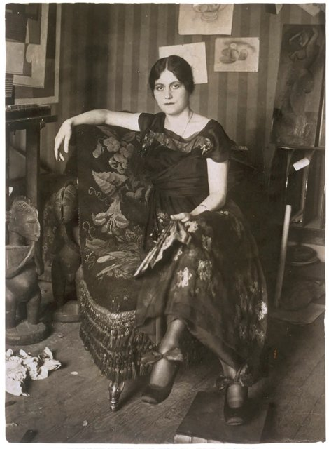
1918年夏，畢卡索與奧爾嘉結婚，到比亞里茨附近度蜜月。1921年2月4日，長子保羅出生。同年他創作《三樂師》（Three Musicians），以鮮明的色塊與幾何構成，把立體主義推向更具裝飾性的形式。

## 1925 | 超現實主義的影響
1924到1925年，畢卡索與超現實主義藝術圈有所交流，作品出現更扭曲、夢幻與心理性的形象，如《三舞者》（Three Dancers）。1927年，他結識瑪麗–泰蕾絲·華特（Marie-Thérèse Walter），她成為此後多年重要的模特兒與靈感來源。
1928到1931年，他持續探索雕塑，發展以金屬結構組合形體的作品；1932年在巴黎舉辦大型回顧展，顯示他已成為國際藝術界的重要人物。

## 1935 | 生活變化與寫詩
1935年9月5日，女兒瑪雅（Maya）出生，生母是瑪麗–泰蕾絲·華特。這一年他的生活與感情關係出現重大變化，也開始大量寫詩，創作不再局限於繪畫，進一步延伸到文學。
畢卡索的藝術並不是立體主義之後就停止變化：他一方面繼續使用立體主義的造形方法，一方面也能畫出古典、寫實的人物，並參與雕塑、劇場與文學創作。

## 1936 | 西班牙內戰爆發
1936年7月，西班牙爆發內戰，畢卡索公開支持共和派，並被任命為馬德里普拉多博物館的名譽館長。他創作了版畫《佛朗哥的夢與謊言》批評佛朗哥政府，藝術與政治、戰爭及社會責任的關係日益密切。

## 1937 | 《格爾尼卡》與《哭泣的女人》
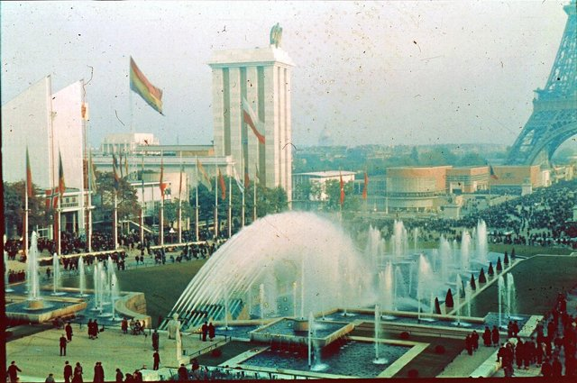
1937年4月，德國與義大利的空軍轟炸了巴斯克地區的小城格爾尼卡（Guernica）。畢卡索以同名巨幅畫作回應，1937年在巴黎萬國博覽會的西班牙館展出，讓國際觀眾透過藝術關注西班牙內戰與平民遭受的暴力。
《格爾尼卡》是黑、白、灰色調的大幅畫作，畫中有受傷的馬、倒地的人、哭泣的母親與混亂的肢體。畢卡索沒有採用傳統戰爭英雄畫的形式，而把平民受難與恐怖經驗放在中心。這幅畫現藏馬德里的索菲亞王后國家藝術中心博物館。
同一年他也創作《哭泣的女人》（Weeping Woman）系列，以扭曲的面孔與強烈的色彩表現痛苦，延續對戰爭悲劇的藝術回應。

## 1939 | 母親去世與《格爾尼卡》赴美
1939年，畢卡索的母親去世，第二次世界大戰爆發。同年，《格爾尼卡》在美國展出（紐約現代藝術博物館的畢卡索回顧展），進一步引起國際關注，作品的反戰象徵逐漸超越西班牙內戰本身。

## 1940 | 留在被占領的巴黎
德軍占領巴黎期間，畢卡索選擇留在巴黎繼續工作。因為反抗佛朗哥與法西斯主義，他沒有回到西班牙，二戰期間主要居住在巴黎，在戰爭與占領的環境中維持創作。

## 1944 | 加入法國共產黨
1944年盟軍解放巴黎後，畢卡索加入法國共產黨，並寫文章說明原因。他的政治立場與公共形象更加鮮明。1945年第二次世界大戰結束，他持續以繪畫、雕塑與版畫回應人類的處境。

## 1946 | 南法與陶藝
畢卡索在法國南部的安提布等地工作，持續畫畫、雕塑與各種實驗，南法的生活環境為他帶來新的題材與靈感。1948年起他移居瓦洛里斯（Vallauris），逐步投入陶藝，陶瓷成為他晚年重要的創作媒介之一。
1947年5月15日，兒子克洛德（Claude）出生，母親是法蘭絲·吉洛（Françoise Gilot）。

## 1949 | 和平鴿與女兒帕洛瑪
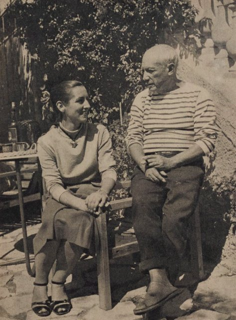
1949年4月19日，女兒帕洛瑪（Paloma）出生，母親同樣是法蘭絲·吉洛。同年，他畫的和平鴿被選為國際和平會議的海報，逐漸成為和平運動的重要視覺象徵。

## 1951 | 《韓國大屠殺》
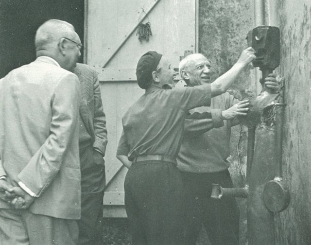
畢卡索創作《韓國大屠殺》（Massacre in Korea），反對美國與聯合國軍介入韓戰，用繪畫回應戰爭的暴力。1952年，他在瓦洛里斯裝飾一座廢棄的教堂，創作與和平主題相關的作品；1962年，他獲頒列寧和平獎。

## 1953 | 結識賈桂琳·羅克
畢卡索結識賈桂琳·羅克（Jacqueline Roque），她後來成為他晚年生活與創作的重要伴侶。1955年，他在法國南部坎城附近購置拉加利福尼亞別墅（La Californie），同年妻子奧爾嘉病逝；導演克魯佐拍攝紀錄片《畢卡索的神祕》（Le Mystère Picasso），讓觀眾看到他創作過程中的變化與實驗。

## 1957 | 《宮娥》變奏
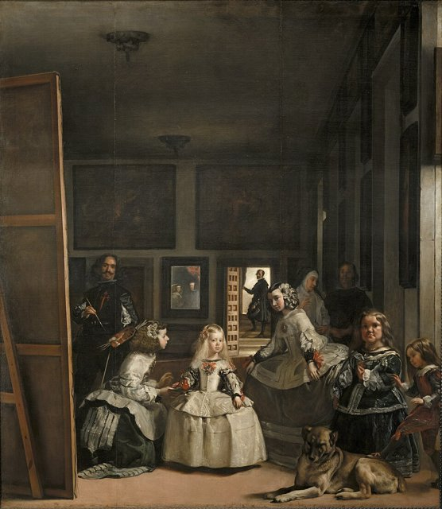
畢卡索創作了一系列以委拉斯開茲《宮娥》（Las Meninas）為靈感的變奏作品，透過重新詮釋西方藝術經典，展現個人風格與藝術史的對話。
1958年，他為巴黎聯合國教科文組織總部創作大型壁畫《伊卡洛斯的墜落》（The Fall of Icarus），藝術進一步進入國際公共空間。

## 1961 | 與賈桂琳結婚，定居穆然
畢卡索與賈桂琳·羅克結婚，並移居法國穆然（Mougins）附近的住處，生活逐漸遠離巴黎藝術圈的日常活動。1960年代，他持續創作繪畫、雕塑、陶藝、版畫與素描，晚年作品更強調自由、速度、直接性與對藝術傳統的重新詮釋。

## 1963 | 巴塞隆納畢卡索博物館開館
巴塞隆納畢卡索博物館正式開館，他的早年創作經歷得到更完整的公共展示。

## 1971 | 羅浮宮為九十歲生日展出
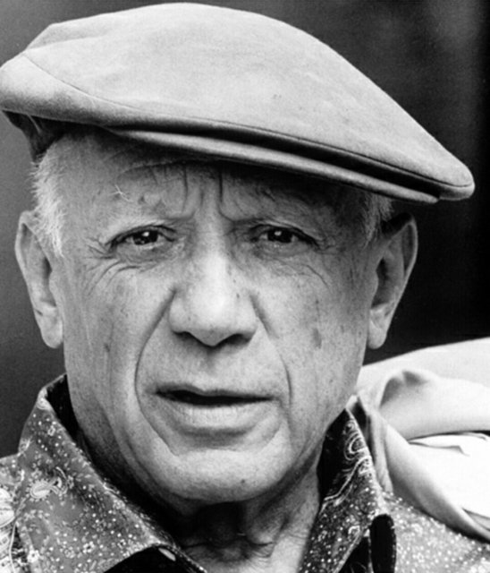
1971年，為了慶祝他九十歲生日，部分作品在巴黎羅浮宮展出。畢卡索成為極少數在世時就獲得羅浮宮如此重要展示的現代藝術家之一。他九十歲高齡仍持續創作，晚年作品不一定追求傳統意義上的精緻與寫實，而是更強調筆觸、形體、情緒與個人的自由表達。

## 1973-04-08 | 逝世於穆然
1973年4月8日，畢卡索在法國穆然去世，死因為心力衰竭和肺水腫，享年91歲。他留下數量龐大、媒材多樣、影響深遠的作品。
他的貢獻可以歸納為：與布拉克共同開創立體主義，推動拼貼藝術，證明藝術風格可以不斷轉變，讓藝術回應政治與戰爭，也拓展了藝術媒材的範圍。

## 1986 | 賈桂琳去世
1986年，賈桂琳·羅克以手槍自殺，享年60歲。她在畢卡索晚年的生活與創作中扮演重要角色，畢卡索去世後，作品持續在全世界被展出、研究與典藏。

## 2004-05 | 《拿著煙斗的男孩》拍出1.04億美元
2004年5月，畢卡索1905年的玫瑰時期作品《拿著煙斗的男孩》（Garçon à la pipe）以1.04億美元成交，超越1990年梵谷《加歇醫師肖像》8,250萬美元的紀錄，成為當時最昂貴的畫作。
