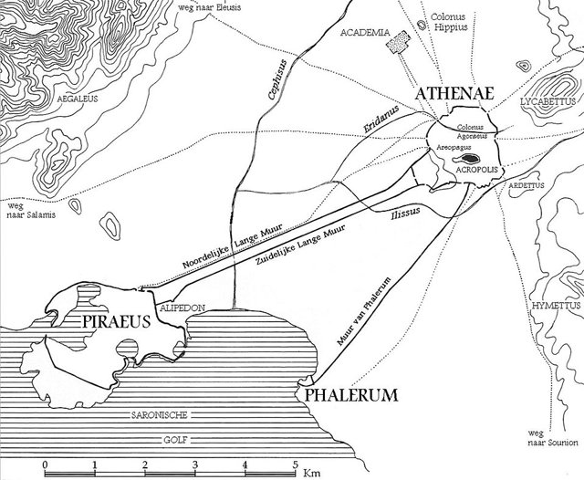
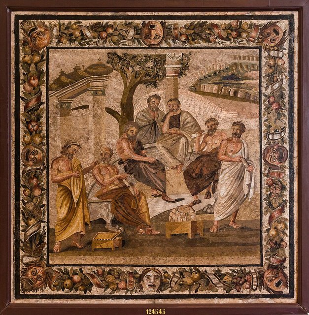
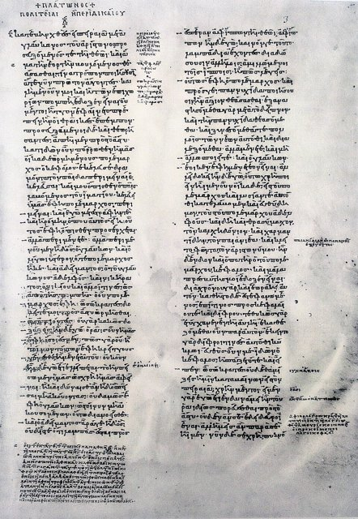
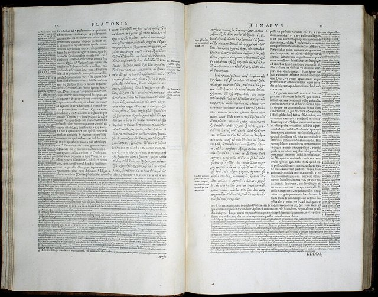

<!--
內容整理自本機筆記〈柏拉圖生平大事記（約前427–前347年）〉（圖表\柏拉圖生平大事記（約前 427–前 347 年）.md）與中文維基百科「柏拉圖」條目（CC BY-SA 4.0），以台灣用語改寫摘要。
https://zh.wikipedia.org/zh-tw/柏拉图
史料與日期說明：
- 生年有前428／427年等說法，維基百科條目開頭寫前429年，但同條目又說前399年時他28歲；時間軸採一般常用的前427年，使前399年為28歲、前387年創立學院時約40歲、去世時約80歲，與古代傳記的說法一致。各事件年齡都只是約略值。
- 古代傳記（主要是第歐根尼·拉爾修）與署名柏拉圖的《第七封信》是旅行與西西里經歷的主要來源；《第七封信》的真偽仍有爭議，賣身為奴、燒掉悲劇稿件、學院門口「不懂幾何者不得入內」等故事屬於傳說，文中已標明。
- 筆記把第一次西西里之行（約前388年）排在創立學院（約前387年）之後；一般說法是先遊歷西西里、回雅典後才創立學院，此處依此順序排列。
- 對話錄的寫作年代沒有定論，早／中／晚期的分期與《理想國》約前375年的年代都只是學界常見的推估。
- 前366年後兩度重返敘拉古、狄翁攻佔敘拉古（前357年）與遇刺（前354年）、外甥斯珀西波斯繼任學院領導、學院於529年被查士丁尼關閉等細節，係依一般公認的史實補充。
- 為避免遠在九百年後的事件壓縮橫向檢視，學院被關閉的年代併入「創立學院」的說明。
圖片來源（皆為 Wikimedia Commons 公有領域／CC0 作品）：
- pla-cover.jpg：Plato Silanion Musei Capitolini MC1377.png
- pla-born.jpg：AtheneOudheid.JPG
- pla-academy.jpg：MANNapoli 124545 plato's academy mosaic.jpg
- pla-republic.jpg：Politeia beginning. Codex Parisinus graecus 1807.jpg
- pla-timaeus.jpg：Timaeus stephanus pages 32 33.jpg
- pla-death.jpg：Sanzio 01 Plato Aristotle.jpg
- soc-symposium.jpg：Anselm Feuerbach - Das Gastmahl. Nach Platon (zweite Fassung) - Google Art Project.jpg（與蘇格拉底時間軸共用）
-->

# Periods
- -427 ~ -399 | 戰爭中的青年與蘇格拉底門下 | #1098ad
  生於伯羅奔尼撒戰爭初期的雅典貴族家庭，原本可能走上政治或文學之路，二十歲左右追隨蘇格拉底，親眼目睹雅典戰敗、三十僭主與老師受審處死。
- -399 ~ -387 | 師死後的遊歷 | #74b816
  對雅典政治失望，離開故鄉四處遊歷，據說到過麥加拉、北非、南義大利與西西里，接觸畢達哥拉斯學派的數學與哲學。
- -387 ~ -367 | 創立學院與成熟的對話錄 | #1c7ed6
  回到雅典創立學院，教學、研究並寫出《會飲篇》《斐多篇》《理想國》等代表作，發展出理念論與哲學家治國的構想。
- -367 ~ -347 | 西西里的政治嘗試與晚年 | #7048e8
  兩度前往敘拉古，希望把哲學理想付諸政治，卻捲入宮廷鬥爭而失敗；晚年回到學院，寫下更抽象的形上學對話與重視法律制度的《法律篇》。

# Events

## -427 | 出生@雅典 {label=約前427年}

生於雅典的富裕貴族家庭，在家中排行第四，父親阿里斯通據傳是古雅典國王的後裔，母親培里克瓊的親族包括後來的三十僭主首領克里提亞斯與查米迪斯；兩個哥哥阿狄曼圖與格勞孔，後來都成為《理想國》裡的對話人物。據第歐根尼·拉爾修記載，他的本名是亞里斯多克勒斯，「柏拉圖」是有「寬闊」之意的綽號，可能指他的體格、額頭或口才。他成長的年代正是雅典與斯巴達的伯羅奔尼撒戰爭期間。

## -407 | 成為蘇格拉底的學生 {label=約前407年}
大約二十歲時開始追隨蘇格拉底，深受他不斷追問正義、勇氣與德性的方式吸引。傳說他年輕時寫過詩和悲劇，在聽了蘇格拉底的談話後把稿件燒掉，從此專心哲學。他後來寫下的對話錄幾乎都讓蘇格拉底擔任主角，但其中有多少是蘇格拉底本人、多少是柏拉圖自己的想法，就是至今爭論不休的「蘇格拉底問題」。

## -404 | 三十僭主與恢復民主
雅典在伯羅奔尼撒戰爭中向斯巴達投降，三十僭主掌權，其中就有他的親戚克里提亞斯與查米迪斯。據《第七封信》，他們曾邀他參與政治，他起初抱有期待，卻很快因為僭主的暴政——包括逼迫蘇格拉底參與逮捕無辜的列昂——而失望。前403年民主恢復，他一度再燃從政的念頭。

## -399 | 蘇格拉底受審處死
恢復民主後的雅典以不敬神與腐化青年的罪名審判蘇格拉底並判處死刑。依《申辯篇》，他當時在法庭上，還願意擔保替老師繳納罰金；《斐多篇》則記載老師飲毒芹汁那天「柏拉圖生病了」，沒有在場。28歲的他對雅典的民主政治徹底絕望，開始思考什麼樣的城邦才能真正實現正義，這成為他一生哲學的核心問題。

## -398 | 離開雅典，四處遊歷 {label=前399年後}
老師死後，他和其他蘇格拉底的追隨者先到鄰近的麥加拉，投靠哲學家歐幾里得（不是寫《幾何原本》的那位）。之後據說遊歷了北非的昔蘭尼與埃及，以及南義大利，在那裡結識畢達哥拉斯學派的阿爾庫塔斯，數學與靈魂不朽的思想深深影響了他。古代傳記對路線和時間說法不一，細節不宜當成定論。

## -388 | 第一次西西里之行 {label=約前388年}
前往西西里島的敘拉古，到僭主狄奧尼修斯一世的宮廷作客，結識了僭主的年輕姻親狄翁，狄翁成為他最熱心的追隨者。他直言批評僭主的作風而不受歡迎；傳說他在回程中被賣為奴隸，幸好被昔蘭尼人安尼凱里斯在埃伊納島認出並贖回，但這個故事真實性存疑。

## -387 | 創立學院 {label=約前387年}

約四十歲時回到雅典，在城外西北方紀念英雄阿卡得摩斯的聖林附近創立「學院」（Academy），英文的 academy 一詞即由此而來。學院受畢達哥拉斯學派影響，重視算術、幾何、天文與聲學，鼓勵學生以論證和討論探究真理，而不是背誦教條；傳說門口寫著「不懂幾何者不得入內」。學院延續了九百多年，直到西元529年才被東羅馬皇帝查士丁尼關閉，是歐洲大學的遠祖。

## -385 | 《會飲篇》與《斐多篇》 {label=約前380年代}

進入創作的成熟期。《會飲篇》藉一場宴會上輪流讚頌愛神的演說，描繪愛如何從愛慕美的身體一步步上升到愛「美」本身——後世所說的「柏拉圖式的愛」即源於此，但原意並非單純排斥肉體；《斐多篇》記述蘇格拉底臨終前與朋友討論靈魂不朽；《美諾篇》則追問德性能不能教，並提出「學習就是回憶」。這時對話的主角仍是蘇格拉底，但思想已越來越屬於柏拉圖自己。

## -375 | 《理想國》 {label=約前375年}

完成代表作《理想國》，從「什麼是正義」出發，討論靈魂的結構、教育與理想城邦，主張由真正認識善的哲學家來治理國家。書中用太陽、線段與洞穴三個比喻說明理念論：洞穴裡的囚犯只看得到牆上的影子，誤以為那就是真實；哲學教育則是引導人轉身走出洞穴，看見事物本身與照亮一切的「善」。

## -367 | 亞里斯多德進入學院
17歲的亞里斯多德從北方的斯塔基拉來到雅典，進入學院學習，此後留在這裡約二十年，直到柏拉圖去世。他繼承了老師對知識與存在的追問，後來卻批評理念論，轉向重視個別事物與經驗研究；師生兩人並列為西方哲學兩大源頭。

## -366 | 第二次西西里之行
狄奧尼修斯一世去世，其子狄奧尼修斯二世繼位。在狄翁的力邀下，他再度前往敘拉古，希望把年輕的新統治者教育成「哲學家國王」。但宮廷派系鬥爭激烈，狄翁不久就被指控謀反而遭放逐，柏拉圖也被留在宮中難以脫身，最後才得以返回雅典。

## -361 | 第三次西西里之行 {label=約前361年}
狄奧尼修斯二世再三邀請，他為了替流亡的狄翁說情，第三次前往敘拉古。結果調解失敗，他實際上遭到軟禁，最後靠著塔蘭托的阿爾庫塔斯出面交涉才平安回國。三次西西里之行讓他深刻體會到，把哲學理想帶進現實政治有多麼困難。

## -354 | 狄翁的興衰與《第七封信》
前357年，狄翁率領一小支部隊回到西西里，推翻狄奧尼修斯二世的統治，但他施政不得人心，前354年遭部下暗殺。署名柏拉圖、寫給狄翁友人的《第七封信》回顧了他一生的政治經驗與西西里的始末，是了解他生平最重要的資料，不過它是否真出自柏拉圖之手，學界仍有爭論。

## -350 | 晚期對話與《法律篇》 {label=約前350年}

晚年持續在學院教學與寫作。《巴門尼德篇》《泰阿泰德篇》《智者篇》反省理念論本身的困難與知識的本質，《蒂邁歐篇》描述宇宙由「工匠神」依照理念與數學秩序造成，在中世紀影響很大。最後的巨著《法律篇》不再寄望哲學家國王，而是詳細規劃以法律與制度治理的城邦，立場也比《理想國》更保守嚴格。

## -347 | 逝世於雅典

約80歲時在雅典去世，葬於學院附近。傳說他在一場婚宴上安詳離世，也有一說是在寫作中過世。學院由他的外甥斯珀西波斯繼任領導，亞里斯多德隨後離開雅典，日後創立自己的呂克昂學園。他的全部對話錄完整流傳至今，二十世紀哲學家懷海德甚至說，整個歐洲哲學傳統不過是柏拉圖的一系列註腳。
