<!--
內容整理自 D:\Books\html\1-5.世界史\印刷術演進大事記.html（沒有對應的 md 筆記），並整合中文維基百科〈印刷術〉〈活字印刷〉條目，以自己的話改寫。
時期依頁面的九個階段歸納：印刷術的前身與雕版、東亞的活字印刷、古騰堡與歐洲、宗教科學與教育、工業化印刷、照相製版與現代印刷、影印與桌上出版、數位印刷、3D列印與AI。頁面最後的「技術比較表」「五個面向」與總結寫進時期說明與相關事件，不另立事件。
兩份資料出入與處理方式：
- 現存最早的印刷品：頁面把《無垢淨光大陀羅尼經》寫成742–751年左右的新羅作品、868年《金剛經》為「有明確年代的重要早期印刷品」；維基百科寫現存最早的是1906年吐魯番出土、690–699年的《妙法蓮華經》（藏日本），《無垢淨光大陀羅尼經》依近期研究是701年在洛陽翻譯完畢、702年刊於長安、703年傳入新羅（韓國學者認為是新羅所刻，日本與中國學者有不同看法），日本《百萬塔陀羅尼經》約770年。這裡把兩說都寫進一則「702–751年」事件，並另寫690–699年、770年的事件，不替這個爭議定論。
- 雕版印刷的起源：頁面說約6–7世紀；維基百科補充日本學者島田主張六朝已有，張秀民認為始於唐貞觀（636年《女則》），並引用唐開元年間（713–714年）的《開元雜報》為最早的報紙；這些推論在學界並無共識，這裡統一寫「7世紀」，起源的爭議放進事件內文。
- 畢昇：頁面寫1041–1048年（慶曆年間）；維基百科寫約1040年，並說沈括《夢溪筆談》完整記錄了制字、貯字、排版、拆板與刷印的工序，採頁面年份。
- 金屬活字：頁面寫1234年左右高麗已使用、1377年《直指》是現存最早有明確年代的金屬活字書；維基百科另說王禎在《造活字印書法》（1298年）提到「近世又鑄錫作字」，所以中國在宋代已有錫活字，兩者都寫。《直指》日期（7月）依一般記載補充，這裡只寫1377年。
- 古騰堡：頁面寫1430–1440年代發展鑄字模具、約1450年在美因茲發展機械活字系統、1454年贖罪券、約1455年《古騰堡聖經》；維基百科說德國人認為古騰堡在1440年發明印刷術，並提到漢學家安田朴曾批評「歐洲中心論」。這裡寫成「約1440–1450年」一則並同時說明。印刷術傳入歐洲的三條路線（威尼斯商人、中亞西亞北非、高麗經撒馬爾罕與諾夫哥羅德）也是推測，寫進同一則事件。
- 威尼斯印刷：維基百科寫1469年威尼斯成立第一家印刷社、1500年已有417家印刷廠，與〈威尼斯歷史大事記〉一致；頁面把1501年阿爾杜斯推廣斜體字與小開本寫在古騰堡階段，照頁面。
- 印刷術傳入日本：維基百科寫754年鑒真傳入日本，並說1592年日本帶回數以萬計的朝鮮銅活字、1593年刊行《古文孝經》，這裡把後者合併成一則「1592–1616年」事件；菲律賓1593年的中文印本與1637年天海版《一切經》不收。
- 西亞：維基百科寫1294年波斯凱嘉圖汗在大不里士印發仿元鈔、1310年拉希德丁記載中國雕版；伊斯蘭世界因宗教因素對印刷古蘭經有限制，只在1294年事件寫仿元鈔，其餘不收。
- 19世紀：維基百科寫1804年斯坦厄普泥型鉛版、1829年謝羅紙型鉛版、1855年照相銅鋅版、1882年照相網版；頁面寫1796年平版印刷、1814年蒸汽印刷機、1837年彩色平版、1843年旋轉印刷機、1884年行式鑄排機，兩份合併成各一則事件。頁面沒有的1804、1855、1882年依維基百科補充。
- 20世紀：頁面寫1904年左右膠印普及；一般記載是1904年美國魯貝爾（Ira Rubel）偶然發現橡皮布轉印的原理，這裡只寫「1904年左右」。1938年卡爾森靜電複印（10月22日）、1959年施樂914、1969年雷射列印原型、1976年噴墨列印、1984年Macintosh（1月）、1985年PostScript與PageMaker、1993年早期數位彩色印刷、2007年智慧型手機，皆照頁面，日期依一般記載補充。
- 3D列印：頁面特別說明3D列印是積層製造，不能視為雕版或活字印刷的同一條技術路線，照此。
- 頁面的人名與其他時間軸一致：古騰堡、伽利略、馬丁·路德（頁面作「馬丁・路德」）、狄德羅、達朗貝爾、馬可·波羅、阿爾杜斯·馬努提烏斯。
圖片來源（皆為 Wikimedia Commons 公有領域／CC0 作品；繪畫、版畫與插圖多為後世作品，不代表事件當時的樣貌）：
- prt-cover.jpg：Gutenberg Bible B42 Genesis cropped.jpg（《古騰堡聖經》〈創世記〉）
- prt-cailun.jpg：Cai-lun.jpg（蔡倫（版畫））
- prt-sutra.jpg：Diamond Sutra of 868 AD - The Diamond Sutra (868), frontispiece and text - BL Or. 8210-P.2 (cropped).jpg（868年《金剛經》的卷首插圖與經文（大英圖書館藏））
- prt-wangzhen.jpg：Chinese movable type 1313-ce.png（王禎的轉輪排字架（1313年《農書》附圖））
- prt-jikji.jpg：Jikji pages.jpg（《直指》書頁（高麗，1377））
- prt-gutenberg.jpg：Johannes Gutenberg ca. 1400-1468 uitvinder van de boekdrukkunst, 1584 - BBB-1437.jpg（古騰堡肖像（版畫，1584））
- prt-printer.jpg：Printer in 1568-ce.png（〈印刷工〉，1568年木刻版畫）
- prt-caxton.jpg：The Caxton Celebration - William Caxton showing specimens of his printing to King Edward IV and his Queen.jpg（卡克斯頓向愛德華四世展示他印刷的書（後世畫作））
- prt-aldus.jpg：Virgil 1501 Aldus Manutius (Italika).jpg（阿爾杜斯1501年印製的維吉爾（斜體字小開本））
- prt-luther.jpg：Luther 95 Thesen.png（《九十五條論綱》印刷品）
- prt-galileo.jpg：Sidereus Nuncius 1610.Galileo.jpg（伽利略《星際信使》書名頁，1610）
- prt-encyclopedie.jpg：Encyclopedie frontispice full.jpg（《百科全書》卷首插圖）
- prt-senefelder.jpg：Aloys Senefelder (1771-1834) - BBB-1382.jpg（阿洛伊斯·塞內菲爾德（版畫複製））
- prt-koenig.jpg：Koenig's steam press - 1814.png（柯尼希的蒸汽印刷機，1814）
- prt-linotype.jpg：Linotype machines, Anthony Hordern and Sons department store, c. 1935.jpg（行式鑄排機，約1935）
- prt-macintosh.jpg：Steve Jobs and Macintosh computer, January 1984, by Bernard Gotfryd - edited.jpg（史蒂夫·賈伯斯與Macintosh電腦，1984年1月）
-->

# Periods
- -3000 ~ 600 | 印刷術的前身 | #868e96
  埃及莎草紙、美索不達米亞的楔形文字與滾筒印章、印章與拓印，加上蔡倫改進的造紙術，讓文字記錄與圖樣複製的成本逐步降低，是雕版印刷的準備階段。
- 600 ~ 1041 | 雕版印刷 | #2f9e44
  中國唐代出現雕版印刷，佛教經典、曆書與儒家經典陸續刻印，傳到朝鮮半島與日本；868年《金剛經》是有明確年代的成熟作品。
- 1041 ~ 1440 | 東亞的活字印刷 | #e8590c
  畢昇發明泥活字，王禎推廣木活字，高麗與朝鮮王朝發展金屬活字，印刷術也沿著蒙古帝國的商路向西亞與歐洲傳播。
- 1440 ~ 1796 | 古騰堡與歐洲印刷革命 | #c92a2a
  古騰堡以金屬活字、油墨與機械壓印創造歐洲的印刷系統，書籍大量生產，推動宗教改革、科學革命與公共資訊的傳播。
- 1796 ~ 1900 | 工業化印刷 | #1971c2
  平版印刷、蒸汽動力、旋轉印刷機與鑄排機讓報紙與書籍進入大量生產的時代。
- 1900 ~ 1984 | 照相製版與影印 | #7048e8
  膠印、照相製版與照相排版取代金屬活字，靜電影印、雷射列印與噴墨列印把文件複製帶進辦公室。
- 1984 ~ 2026 | 數位時代 | #0b7285
  桌上出版、數位印刷、隨選印刷、電子書、3D列印與AI輔助，讓內容直接由數位檔案輸出，朝個人化與按需生產發展。

# Events

## -3000 | 文字與印章的前身 {label="約前3000年"}
古埃及使用莎草紙書寫，美索不達米亞發展楔形文字，蘇美等文明也使用滾筒印章製造印記，主要用於裝飾與巫術。人類逐漸建立系統性的文字記錄方式，但書籍仍然要靠手工抄寫。西元前後的數世紀，印章、拓印與圖案轉印等技術逐漸發展，這些以固定圖樣複製的經驗，為印刷術提供了早期基礎。
印刷術不是由單一人物在某一天突然發明的，中國、朝鮮半島與歐洲等地，都對印刷技術的發展有重要貢獻。

## 105 | 蔡倫改進造紙術
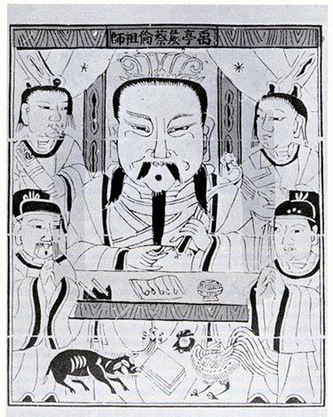
史籍記載蔡倫在這一年改進造紙技術，紙張的普及降低了書寫與複製文字的成本，為後來的印刷提供了便宜而平整的材料。

## 7世紀 | 雕版印刷出現
中國逐漸發展出成熟的雕版印刷：把文字或圖像刻在木板上，再塗墨印製。雕版的優點是同一塊版可以反覆印製大量相同的內容，缺點是每一頁都要單獨刻版，如果要修改，往往必須重新雕刻部分版面。
雕版印刷的確切起源年代至今仍有討論：有說法認為六朝或隋朝已經有，也有人認為始於唐太宗貞觀年間，但這些推論並沒有定論。唐代雕版佛像與經文的盛行，與佛教有很大的關係。

## 690 ~ 699 | 現存最早的印刷品 {label="690–699年"}
1906年在新疆吐魯番出土的《妙法蓮華經》，印刷於690至699年之間，是目前可以確認的最早印刷品實物之一，現藏日本。

## 702 ~ 751 | 《無垢淨光大陀羅尼經》 {label="約702–751年"}
1966年在韓國慶州佛國寺釋迦塔發現的《無垢淨光大陀羅尼經》是現存最早的印刷文獻之一。韓國學者主張它是新羅時期（約742–751年）所印，但依近年的研究，這部經在701年於洛陽翻譯完成，702年刊刻於長安，703年分批傳入新羅，也就是說它很可能是唐朝武周的刻本。這個年代與產地的爭議至今沒有一致的結論，可以確定的是它顯示了東亞印刷術的早期發展。

## 754 | 印刷術傳入日本
唐代高僧鑒真東渡日本，主持印刷三部佛經，據說把印刷術傳入日本。日本奈良法隆寺的《百萬塔陀羅尼經》約在770年印刷，同樣屬於中國唐武周的刻本，可能是日本僧人道慈在兩次來華時帶回的。

## 868 | 《金剛經》
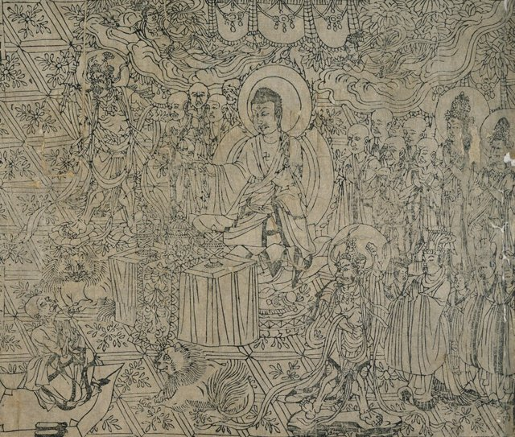
敦煌發現的《金剛經》在這一年印刷，卷首有佛陀說法的插圖，雕工精細，遠勝早期的陀羅尼經，是現存有明確年代的重要早期印刷品，顯示唐代的雕版印刷已經相當成熟。

## 932 | 雕版刊印儒家經典 {label="約932年"}
中國以雕版印刷大量刊印儒家的經典，印刷逐漸應用於典籍的保存、教育與文化傳承。10世紀東亞的印刷活動持續發展，佛教經典、儒家典籍與其他文獻的複製與傳播逐漸擴大。

## 1041 ~ 1048 | 畢昇發明泥活字
北宋慶曆年間，工匠畢昇發明膠泥活字印刷：把單字分別製成活字，可以重新排列組合。沈括的《夢溪筆談》完整記錄了制字、貯字、排版、拆板與刷印的整套工序，原理與後世的鉛字排版相同，改變了傳統雕版的製作方式。
活字印刷對中文這類字形眾多的文字也有限制：活字的製作、分類、儲存與檢索都很複雜，所以並沒有在所有時期、所有出版領域完全取代雕版。

## 1234 | 高麗的金屬活字 {label="約1234年"}
史料顯示高麗在13世紀已經使用金屬活字印書。1236至1251年，高麗又雕刻了《高麗大藏經》木版，製作大規模的佛教經典，展現雕版印刷在大型文獻保存上的能力。金屬活字比泥活字耐用，也能重複使用，為印刷技術開闢了新的方向。

## 1294 | 波斯印發仿元鈔
蒙古人統治的波斯，在大不里士印發仿照元朝的紙鈔，上面還印著漢字的「鈔」字；1310年波斯歷史學家拉希德丁在《世界史》中詳細記載了中國的雕版印刷。印刷術最可能通過絲綢之路上的維吾爾人傳入中亞，經過阿拉伯世界再傳到歐洲。

## 1298 | 王禎《造活字印書法》
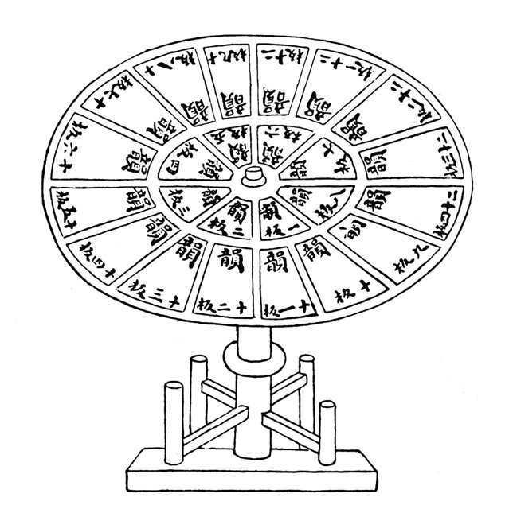
元代科學家王禎在《造活字印書法》中，記錄了他發明的木活字與轉輪排字架，並提到「近世又鑄錫作字」，說明中國在宋代已經有錫活字，只是因為難以著墨，沒有長久流行。從非金屬活字到金屬活字，是印刷材料與造字工藝的重大改革。

## 1377 | 高麗印製《直指》
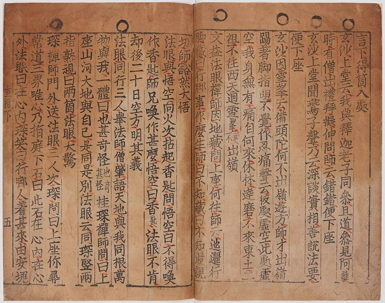
高麗印製《白雲和尚抄錄佛祖直指心體要節》（簡稱《直指》），是現存最早有明確年代、以金屬活字印刷的書籍。
1403年朝鮮王朝設置鑄字相關機構，製作癸未字；1420年製作庚子字，1434年製作甲寅字，政府有組織地投入金屬活字製作，促進典籍印刷，並持續改良活字形制與排印效果。

## 1440 | 古騰堡的印刷系統 {label="約1440–1450年"}
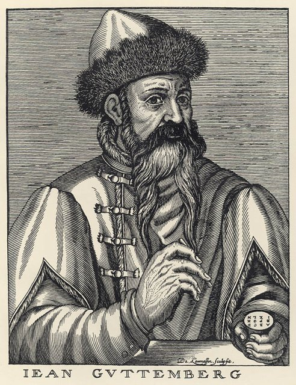
德國人約翰尼斯·古騰堡（約1397–1468）在1430至1440年代逐步發展出可調整的鑄字模具，約1450年前後在美因茲建立機械活字印刷系統，結合金屬活字、油性墨水、鑄字技術與葡萄酒壓榨機改良而成的機械壓印。德國人認為他在1440年發明了印刷術。
古騰堡並不是第一個發明印刷術或活字的人，他的貢獻是發展出適合歐洲字母文字的機械化印刷系統。關於印刷術如何傳入歐洲，學者提出三條可能的路線：經由元朝杭州的威尼斯商人、經由中亞西亞北非，以及從高麗經撒馬爾罕與諾夫哥羅德到漢薩同盟，這些路線都沒有定論，漢學家安田朴也批評過把古騰堡當成唯一發明人的歐洲中心論。

## 1454 | 贖罪券
與古騰堡有關的贖罪券印刷品出現，顯示新式印刷技術已經開始投入實際生產。約1455年完成的《古騰堡聖經》是早期歐洲活字印刷的代表作，展示了大量複製書籍的能力。

## 1469 | 威尼斯印刷社
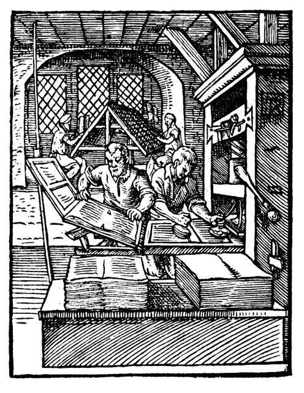
威尼斯成立第一家印刷社，1460年代印刷技術開始傳入義大利等歐洲地區；1500年威尼斯已有417家印刷廠，成為歐洲最重要的印刷中心之一。1470年代印刷業擴展到更多歐洲城市，書籍的生產成本與規模逐漸改變，學術與文學作品更容易流通。

## 1476 | 卡克斯頓在英格蘭開業
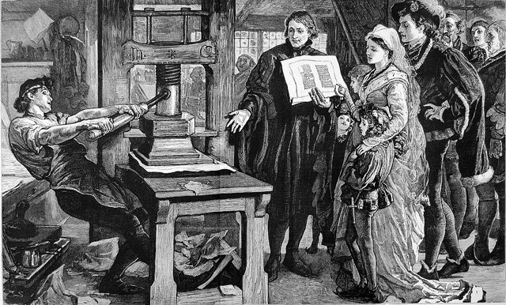
威廉·卡克斯頓在英格蘭成立第一家印刷社，英格蘭的印刷出版業逐漸發展。1493年出版的《紐倫堡編年史》結合文字與大量的木刻插圖，展現當時的出版形式。

## 1501 | 阿爾杜斯的斜體字與小開本
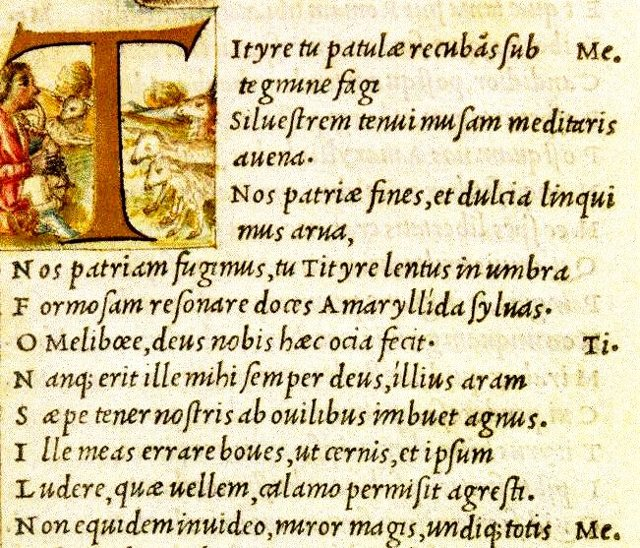
威尼斯出版商阿爾杜斯·馬努提烏斯推廣斜體字與小開本的書籍，有助於提高排版效率，並發展出較方便攜帶的書籍形式。

## 1517 | 《九十五條論綱》
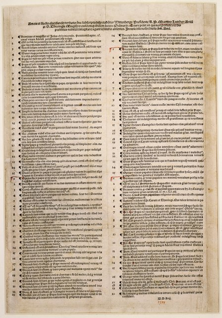
馬丁·路德提出《九十五條論綱》，相關的宗教論述經由印刷品迅速傳播，成為宗教改革擴散的重要因素之一。16世紀歐洲的印刷出版業迅速發展，宗教文獻、古典著作、地圖與教育讀物的流通擴大。

## 1539 | 美洲第一家印刷坊
印刷工匠胡安·帕布洛斯在墨西哥城設立印刷坊，印刷術進入西班牙在美洲的殖民地，是美洲出版史上的重要事件。

## 1592 ~ 1616 | 朝鮮的活字傳入日本
1592年日本出兵朝鮮，帶回數以萬計的朝鮮銅活字，1593年刊行《古文孝經》；1607年直江兼續在京都刊行銅活字本《六臣注文選》，1615年林羅山又排印了《大藏要覽》。16至17世紀，印刷地圖、航海資料與科學著作增加，有助於知識累積、地理資訊的傳播與學術交流。

## 1605 | 早期定期報紙
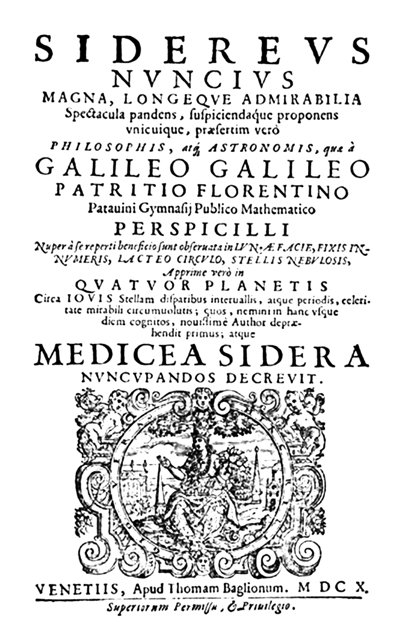
定期新聞出版物在歐洲出現，印刷逐漸成為傳播新聞與公共資訊的重要媒介。1610年，伽利略出版《星際信使》，以印刷迅速傳播天文觀測成果，顯示印刷對科學革命的影響。17世紀報紙、學術出版物與商業印刷持續發展。

## 1710 | 《安妮女王法令》
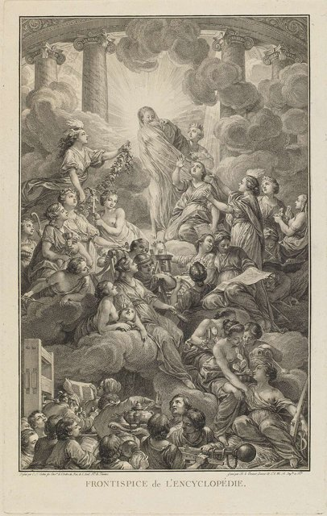
英國通過《安妮女王法令》，成為現代著作權制度發展的重要歷史節點。1751年起，狄德羅與達朗貝爾主持的《百科全書》陸續出版，透過系統化的編輯與印刷，整理並傳播啟蒙時代的知識。

## 1796 | 平版印刷術
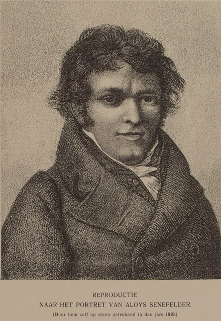
阿洛伊斯·塞內菲爾德發明平版印刷術，利用油水相斥的原理選擇著墨區域，適合圖像、海報與藝術作品，降低某些圖文複製工作的技術門檻。1804年，英國的斯坦厄普又針對活字版的缺點發明泥型鉛版，後來法國人在1829年發明紙型鉛版。

## 1814-11-29 | 《泰晤士報》使用蒸汽印刷機
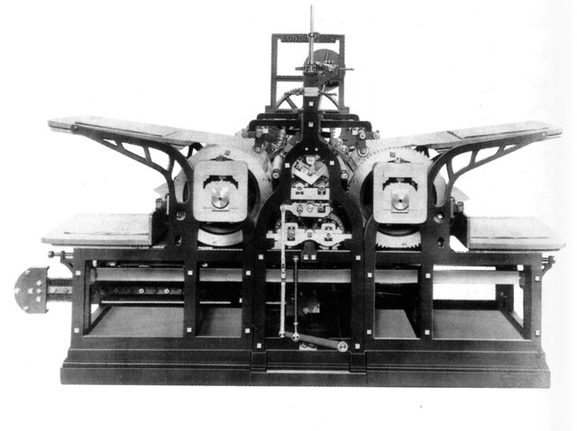
《泰晤士報》開始使用蒸汽動力印刷機，報紙的生產能力大幅提高，推動大規模的新聞出版。19世紀前半鑄鐵印刷機逐漸改良，機器更堅固，印刷更穩定；1837年彩色平版印刷技術取得重要進展，多色圖像的商業印製逐漸發展。

## 1843 | 旋轉印刷機
理查·霍設計出圓筒式的旋轉印刷機，促進連續、高速的印刷生產；19世紀後半輪轉印刷機廣泛發展，報紙、雜誌與商業印刷進入更大規模的工業生產。1855年法國人發明照相銅鋅版，1882年德國人發明照相網版，把照相製版向前推進了一大步。

## 1884 | 行式鑄排機
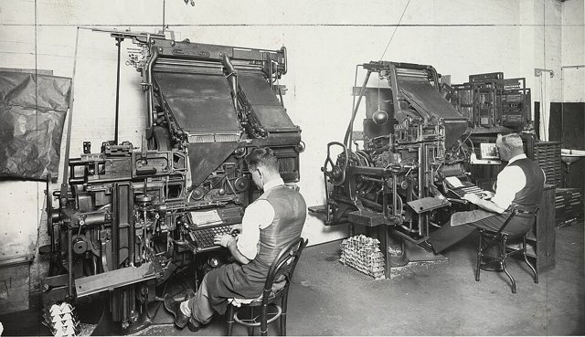
奧特瑪·默根塔勒發明行式鑄排機，活字排版的速度顯著提高，特別適用於報紙與大量出版物；1886年行式鑄排機投入《紐約論壇報》的生產流程，排版自動化進一步推動報業工業化。1875年膠印技術的重要早期專利已經出現。

## 1904 | 膠印普及 {label="1904年左右"}
膠印技術開始在商業印刷中逐漸普及，油墨先轉印到橡皮布，再轉印到紙張，有助於提高印刷品質與生產效率。20世紀初高速輪轉印刷機與彩色印刷技術持續發展，1920至1930年代照相製版技術逐漸成熟，可以透過攝影與化學處理製作印版。

## 1938 | 靜電複印
切斯特·卡爾森提出靜電複印技術的關鍵構想，為後來的影印機與部分數位印刷技術奠定基礎。1940年代照相排版持續發展，部分文字排版開始從金屬活字轉向光學方式，20世紀中葉膠印成為商業出版的重要技術。

## 1959 | 施樂914影印機
施樂914影印機問世，靜電影印進入重要的商業應用階段，辦公文件的複製更加方便。1960年代電子照相排版逐漸發展，1969年雷射列印技術的重要早期原型出現，1970年代點陣印表機逐漸普及，1976年噴墨列印技術的重要早期商業產品出現，1980年代雷射印表機進入辦公室。

## 1984 | Macintosh與桌上出版
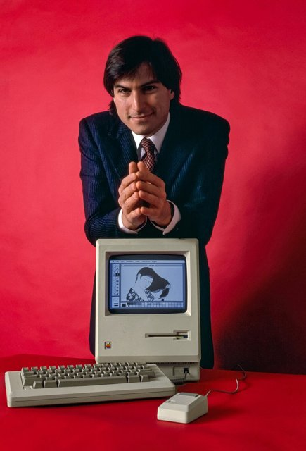
蘋果推出Macintosh電腦，圖形化介面讓一般使用者接觸電腦排版。1985年PostScript頁面描述語言與Aldus PageMaker問世，桌上出版（DTP）逐漸成熟，使用者可以在個人電腦上完成部分專業排版工作。印刷從「印刷廠專用技術」走向一般辦公室與個人電腦也能參與文件製作。

## 1993 | 數位印刷
早期的數位彩色印刷系統進入市場，1990年代數位印刷設備與直接製版技術逐漸成熟，印刷工作可以直接根據數位檔案進行，短版彩色印刷與個人化印製逐漸發展。1990年代後半，網際網路與電子出版迅速發展，電子文件與網站成為印刷品之外的重要資訊傳播方式。

## 2000 | 隨選印刷與電子書 {label="2000年代"}
隨選印刷（Print on Demand）逐漸普及，可以依實際訂單印製少量書籍，降低庫存與印製成本；數位噴墨與數位膠印技術持續改進。2007年以後智慧型手機與行動網路迅速發展，2010年代雲端出版與電子書持續發展，作者、出版社與讀者之間的數位出版流程更加成熟。

## 2010 | 3D列印與智慧製造 {label="2010年代至今"}
3D列印設備與材料逐漸普及，列印的概念從平面圖文擴展到逐層製造三維物件；它屬於積層製造，雖然是廣義列印技術的延伸，但不能直接視為雕版或活字印刷的同一條技術路線。工業級數位噴墨印刷在包裝、標籤與紡織等產業持續發展。

## 2020 | AI輔助與按需生產 {label="2020年代"}
AI輔助排版、圖像生成與印前處理工具逐漸發展，數位印刷與傳統膠印並存，印刷業依照數量、品質、材料、成本與交期選擇不同的技術。按需生產、可變資料印刷與個人化出版持續發展，印刷從大量標準化生產，擴展到彈性、小批量與客製化生產。
