<!--
內容整理自中文維基百科「謝爾蓋·普羅高菲夫」與英文維基百科「Sergei Prokofiev」條目（CC BY-SA 4.0），並以台灣用語改寫摘要。
https://zh.wikipedia.org/zh-tw/谢尔盖·普罗科菲耶夫
https://en.wikipedia.org/wiki/Sergei_Prokofiev
中文條目較簡略，生平細節主要參考英文條目。兩者不一致處以英文條目為準（例如生日，中文條目作4月23日，英文條目作新曆4月27日）。
圖片皆為 Wikimedia Commons 上的公有領域作品（封面：約1918年的肖像照）。
-->

# Periods
- 1891 ~ 1904 | 童年@松措夫卡
  生於烏克蘭草原上的莊園，父親是農學家，熱愛音樂的母親每晚彈蕭邦與貝多芬。5歲作曲、9歲寫歌劇，11歲起由格利埃爾到莊園教他作曲。
- 1904 ~ 1914 | 聖彼得堡音樂學院
  13歲在格拉祖諾夫的鼓勵下入學，比同學小好幾歲，以古怪、自負出名。師從林姆斯基－高沙可夫、利亞多夫等人，以尖銳不協和的鋼琴作品贏得「音樂叛逆者」的名聲。
- 1914 ~ 1918 | 狄亞基列夫與革命
  結識俄羅斯芭蕾舞團的狄亞基列夫，寫出《斯基泰組曲》與芭蕾《丑角》。革命期間寫下《古典交響曲》，隨後獲准出國。
- 1918 ~ 1936 | 旅居海外@Paris
  先到美國，後定居巴黎，以作曲家、鋼琴家、指揮家的身分活躍國際。與狄亞基列夫合作多部芭蕾，與西班牙歌手莉娜結婚。1927年起數度回蘇聯巡演，逐漸與祖國重建關係。
- 1936 ~ 1948 | 回到蘇聯@Moscow
  舉家定居莫斯科，寫出《彼得與狼》、《羅密歐與茱麗葉》、《亞歷山大·涅夫斯基》、《戰爭與和平》、第五號交響曲等名作，成為蘇聯首屈一指的作曲家。
- 1948 ~ 1953 | 批判與晚年
  在日丹諾夫的「形式主義」批判中遭點名，作品被禁、負債累累，前妻被捕入勞改營。健康每況愈下，仍為年輕的羅斯托波維奇等人創作，最後與史達林在同一天去世。

# Events

## 1891-04-27 | 出生@松措夫卡
生於俄羅斯帝國葉卡捷琳諾斯拉夫省（今屬烏克蘭）的松措夫卡莊園。父親是出身莫斯科商人家庭的農學家，在同學的莊園擔任土壤工程師；母親來自曾是農奴的家庭。母親先前失去了兩個女兒，此後把生活重心放在音樂上，每年都到莫斯科或聖彼得堡上兩個月的鋼琴課。

## 1896 | 5歲的第一首曲子
聽著母親晚上練習蕭邦與貝多芬，5歲寫下第一首鋼琴曲〈印度加洛普〉，由母親幫他記譜。因為「不想碰黑鍵」，這首曲子用的是利底亞調式。7歲學會下西洋棋，此後終生熱愛，1914年還在車輪戰中贏過世界棋王卡帕布蘭卡。

## 1900 | 9歲寫歌劇《巨人》
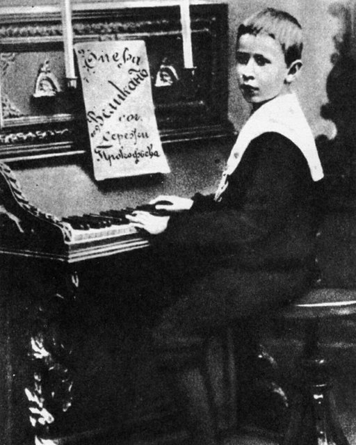
寫下第一部歌劇《巨人》，以及一首序曲和其他小品。歌劇一直是他最喜歡的創作類型。

## 1902 | 格利埃爾的家教課
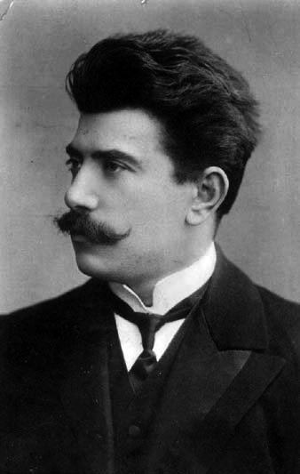
莫斯科音樂學院院長塔涅耶夫安排作曲家格利埃爾整個夏天到莊園教他，11歲的他堅持要嘗試寫一首交響曲。隔年夏天格利埃爾又來上課。他日後雖然感謝老師，卻抱怨格利埃爾教給他的「方塊式」樂句結構和傳統轉調，讓他後來得花工夫擺脫。

## 1904 | 進入聖彼得堡音樂學院
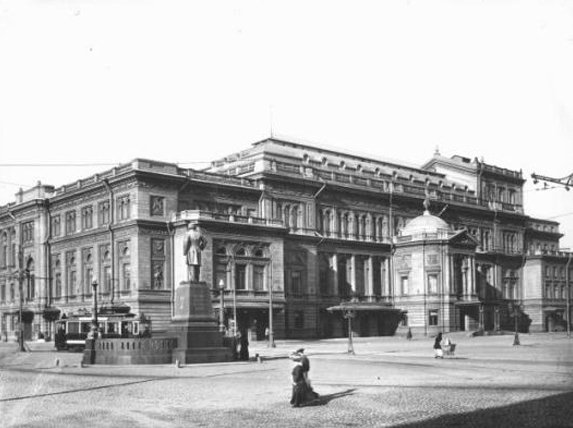
母親帶他到聖彼得堡，見到音樂學院教授格拉祖諾夫。當時他已寫了好幾部歌劇，格拉祖諾夫看了大為讚賞，力勸母親讓他報考，他順利入學。他比大部分同學小好幾歲，被認為古怪又自負，還會統計同學犯錯的次數惹人討厭。他跟利亞多夫學和聲與對位、跟契爾品學指揮，也上過林姆斯基－高沙可夫的配器課，並和同學米亞斯科夫斯基成為終生好友。

## 1909 | 作曲科畢業
以平平的成績從作曲科畢業，之後繼續留校跟名師葉西波娃學鋼琴、跟契爾品學指揮。他在聖彼得堡的現代音樂之夜演奏自己大膽的不協和鋼琴作品，名聲漸起，還受邀在俄國首演荀白克的鋼琴小品。

## 1910 | 父親去世
父親過世後，家裡的經濟支援中斷。幸好他已在校外打出名號，1911年經樂評家奧索夫斯基推薦，與出版商尤爾根森簽約。

## 1913-08-23 | 第二號鋼琴協奏曲引發醜聞
在帕夫洛夫斯克首演，據說觀眾離場時大罵：「這種未來派音樂見鬼去吧！屋頂上的貓都比這好聽！」現代派樂迷則如癡如醉。這一年他也第一次出國，到巴黎和倫敦接觸到狄亞基列夫的俄羅斯芭蕾舞團。

## 1914 | 「鋼琴大戰」奪冠
畢業時參加學院為五位最優秀鋼琴學生舉辦的比賽，獎品是一台平台鋼琴，他以自己的第一號鋼琴協奏曲奪冠。隨後到倫敦見狄亞基列夫，接下第一部芭蕾的委託。

## 1915 | 《斯基泰組曲》；芭蕾《丑角》
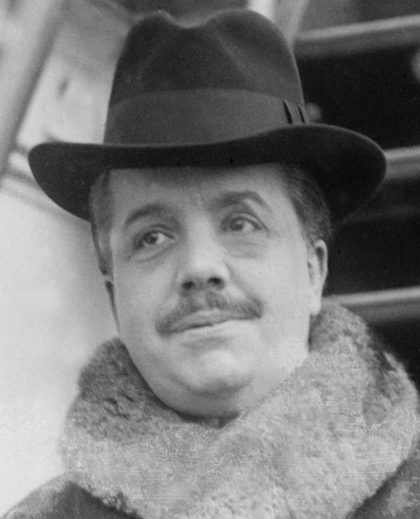
狄亞基列夫嫌他的芭蕾《阿拉與洛利》「不夠俄國」而退件，他把音樂改編成管弦樂《斯基泰組曲》。狄亞基列夫改請他寫一部「具有民族特色」的芭蕾，於是以民間故事寫成《丑角》。為了避免被徵召入伍，他回音樂學院學管風琴。

## 1917 | 《古典交響曲》
他的歌劇《賭徒》因二月革命取消首演。夏天他寫下第一號交響曲《古典》，用他的話說，這是假如海頓活在當代會寫出的音樂，被視為新古典主義的先驅。同時期也寫了第一號小提琴協奏曲。

## 1918-05 | 獲准出國
認為俄國「此刻用不上音樂」，決定到美國碰碰運氣。教育人民委員盧那察爾斯基批准他出國，對他說：「你是音樂上的革命家，我們是生活上的革命家，我們應該一起努力。但你若想去美國，我也不會攔你。」4月，《古典交響曲》在彼得格勒首演。

## 1918-08 | 抵達舊金山
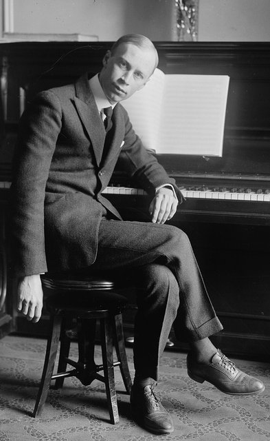
在天使島接受移民官盤問後入境美國，很快就被拿來和拉赫曼尼諾夫等流亡俄國名人相提並論。他在紐約的首場獨奏會帶來更多邀約，芝加哥歌劇院也委託他寫歌劇《三橘之戀》，但總監病逝讓首演一再延後，他也因此錯失了在美國發展演奏事業的機會。

## 1920-04 | 移居巴黎
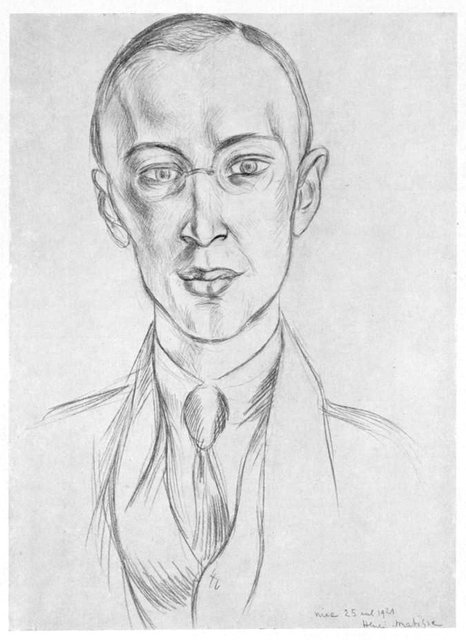
在美國陷入財務困境，又不願失敗回國，於是前往巴黎，重新與狄亞基列夫的舞團合作，並完成第三號鋼琴協奏曲等舊作。

## 1921-05-17 | 芭蕾《丑角》巴黎首演
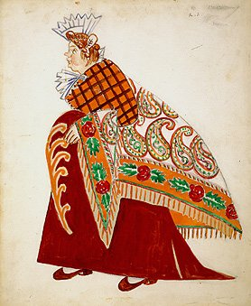
大獲成功，觀眾中包括考克多、史特拉汶斯基與拉威爾。史特拉汶斯基說這是他「唯一能愉快聆聽的現代音樂」，拉威爾則稱它為「天才之作」。

## 1921-12-30 | 《三橘之戀》芝加哥首演
他親自指揮首演，此後十年在歐洲與俄國廣泛演出，劇中的〈進行曲〉家喻戶曉。這也是他生前唯一一部成功的歌劇。

## 1922 | 與史特拉汶斯基爭吵；隱居埃塔爾
他為狄亞基列夫彈奏《三橘之戀》，在場的史特拉汶斯基聽完第一幕就不肯再聽，還說他「浪費時間寫歌劇」。兩人吵到差點動手，關係緊張了好幾年。3月他和母親搬到巴伐利亞阿爾卑斯山區的埃塔爾，專心寫歌劇《炎之天使》一年多。

## 1923 | 與莉娜結婚
與西班牙歌手卡羅琳娜·柯迪娜（藝名莉娜）結婚，之後搬回巴黎，兩人育有兩個兒子。他在巴黎發表的第二號交響曲等作品反應冷淡，他覺得自己「顯然已不再是轟動人物」。

## 1924 | 信奉基督教科學會
開始實踐基督教科學會的教義，相信這對他的健康與火爆脾氣有幫助，此後終生信奉。這也讓他從表現主義轉向他所謂的「新簡約」風格。後來他和史特拉汶斯基恢復了友誼，史特拉汶斯基稱他是當代最偉大的俄國作曲家——僅次於自己。

## 1927 | 第一次回蘇聯巡演
在莫斯科與列寧格勒待了兩個多月，《三橘之戀》在馬林斯基劇院的演出非常成功。同年狄亞基列夫製作的芭蕾《鋼鐵之步》在巴黎大受歡迎。1928年完成以歌劇《炎之天使》為基礎的第三號交響曲，指揮家庫塞維茲基稱它是「柴可夫斯基第六號以來最偉大的交響曲」。

## 1929-05-21 | 芭蕾《浪子》
他為狄亞基列夫寫的最後一部芭蕾，由巴蘭欽編舞，最後一幕浪子跪地爬向父親的場景令人動容。狄亞基列夫認為他的音樂「從來沒有這麼清晰、簡單、優美而溫柔」。幾個月後狄亞基列夫去世。同年10月他開車載家人回巴黎時翻車，左手肌肉拉傷；在莫斯科，他的《鋼鐵之步》被無產階級音樂家協會批為「反蘇維埃」，大劇院只好放棄演出。

## 1932 | 往返巴黎與莫斯科
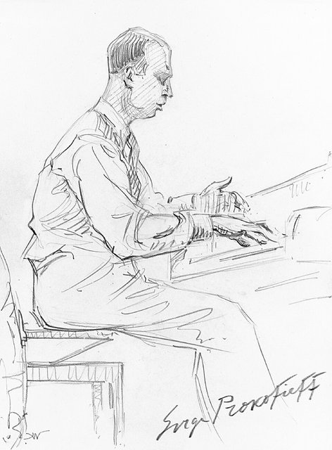
經濟大恐慌讓歐美的歌劇與芭蕾製作大減，他也厭倦了占去作曲時間的鋼琴巡演。思鄉的他逐漸與蘇聯建立關係，接受蘇聯的委託，例如電影配樂《基傑中尉》，以及後來的芭蕾《羅密歐與茱麗葉》。

## 1936 | 定居莫斯科；《彼得與狼》
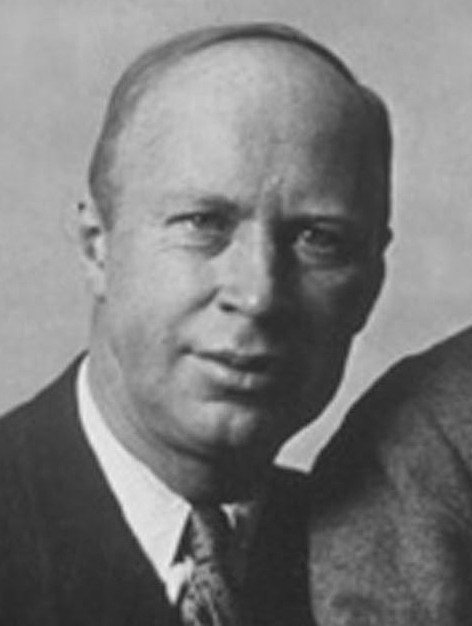
在巴黎與莫斯科之間往返四年後，舉家定居莫斯科。同年為莫斯科中央兒童劇院寫下用樂器扮演角色的音樂童話《彼得與狼》，成為他最著名的作品之一。他為十月革命20週年寫的大型清唱劇則被文化官員擋下，直到他死後13年才首演。

## 1938 | 電影《亞歷山大·涅夫斯基》
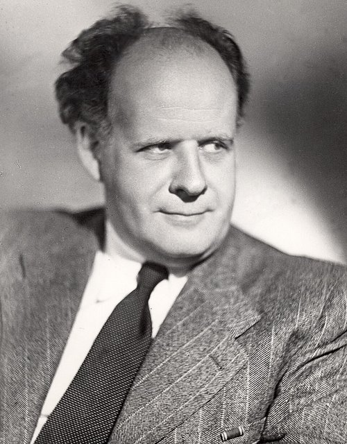
與導演艾森斯坦合作這部歷史史詩電影，寫出他最富創意與戲劇性的音樂。電影的錄音品質很差，他便把配樂改編成大型清唱劇，廣受演出與錄音。

## 1939 | 《祝酒歌》與「戰爭奏鳴曲」
他的歌劇《謝苗·科特科》原本要由導演梅耶荷德執導，但梅耶荷德被祕密警察逮捕、處決，首演因而延後。年底他受命為史達林60歲生日寫了清唱劇《祝酒歌》。同時期他寫下第六、七、八號鋼琴奏鳴曲，被稱為「戰爭奏鳴曲」，傳記作者認為他在這三首曲子中才表達了真正的感受。

## 1940-01-11 | 芭蕾《羅密歐與茱麗葉》首演
由基洛夫芭蕾舞團首演。舞者們一開始難以適應音樂的切分節奏，幾乎要罷演，結果卻一炮而紅，被譽為蘇聯戲劇芭蕾的最高成就，〈騎士之舞〉至今仍家喻戶曉。

## 1941 | 戰爭與分居
德軍入侵蘇聯，讓他早就在構思的托爾斯泰《戰爭與和平》歌劇更顯應景。他和許多藝術家一起被疏散到喬治亞的提比里斯，在那裡開始寫作《戰爭與和平》。這時他已因為與25歲的作家米拉·孟德爾松的關係而和妻子莉娜分居，他勸莉娜和兒子一起疏散，莉娜選擇留在莫斯科。

## 1943 | 《伊凡雷帝》與《灰姑娘》
到哈薩克的阿拉木圖與艾森斯坦會合，為電影《伊凡雷帝》配樂，並寫下他最優美的芭蕾之一《灰姑娘》。《戰爭與和平》則因政府的意見被要求一再修改。

## 1945-01-13 | 第五號交響曲首演
他親自指揮首演，同場還有《彼得與狼》與《古典交響曲》，這是他作為蘇聯首席作曲家的聲望巔峰。但一週後他因長期未治療的高血壓在家中昏倒、腦震盪，此後再也沒有完全康復，只能遵照醫囑減少作曲。

## 1948-02 | 日丹諾夫批判
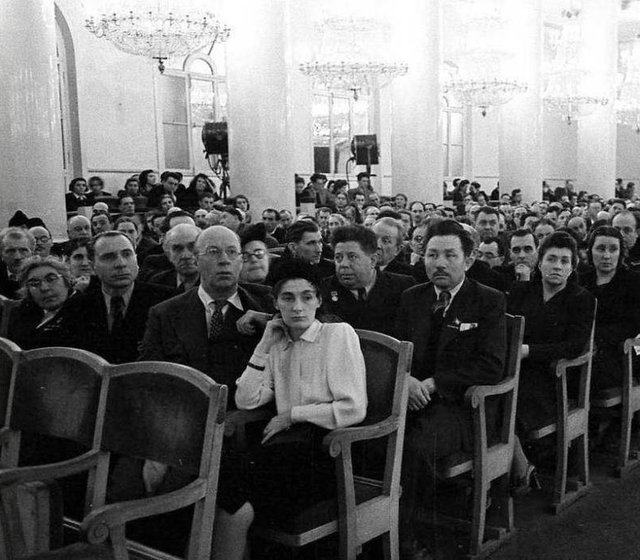
4月他和米拉一起出席了第一屆蘇聯作曲家大會。批判前一天，他才在克里姆林宮獲頒俄羅斯聯邦人民藝術家的頭銜。2月11日公布的決議點名蕭士塔高維奇、普羅高菲夫、哈察都量、米亞斯科夫斯基等六人犯了「形式主義」，他有八部作品被禁演。據說會議中有官員要他安靜，他反問：「你是誰？」對方說名字不重要，他回嘴：「沒被介紹給我認識的人說的話，我從來不理。」到8月，他已負債18萬盧布。

## 1948-01-13 | 與米拉結婚；前妻被捕
法院判定他與莉娜在德國結婚、沒有在蘇聯登記，婚姻無效，他隨即與米拉結婚。2月20日，莉娜因為想匯錢給在西班牙的母親，被以間諜罪逮捕，判處20年勞改，八年後才獲釋，1974年離開蘇聯。

## 1949 | 中風；為羅斯托波維奇作曲
7月中風後，醫生限制他每天只能作曲一小時。他逐漸退出公共生活，連西洋棋都不下了。這一年他為22歲的大提琴家羅斯托波維奇寫了大提琴奏鳴曲，1950年由羅斯托波維奇與鋼琴家李希特首演；之後又為羅斯托波維奇把大提琴協奏曲改寫成《交響協奏曲》。

## 1952-10-11 | 第七號交響曲首演
他最後完成的作品，原本是為兒童廣播部而寫，這也是他最後一次出席的公開演出。蕭士塔高維奇寫信給他：「聽到像你第七號交響曲這樣的作品，讓人活得更輕鬆、更快樂。」

## 1953-03-05 | 逝世@莫斯科
因高血壓危症（一般認為是腦溢血）去世，享年61歲，和史達林死在同一天。他住在紅場旁的公寓，成千上萬的群眾湧向紅場悼念史達林，靈車無法靠近，他的棺木只好由人抬著穿過小巷，逆著人潮移出。葬禮只有約30人參加，蕭士塔高維奇也在其中。蘇聯最重要的音樂期刊直到第116頁才簡短報導他的死訊，前115頁全是史達林。他安葬於莫斯科新聖女公墓，第二任妻子米拉1968年去世後與他合葬。
