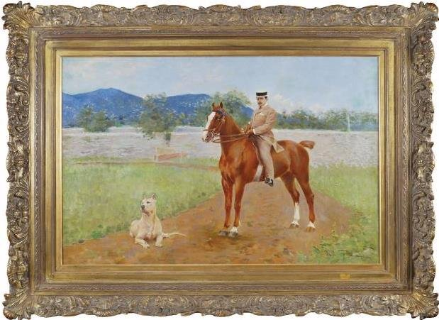

<!--
內容整理自中文維基百科「賈科莫·普契尼」與英文維基百科「Giacomo Puccini」條目（CC BY-SA 4.0），並以台灣用語改寫摘要。
https://zh.wikipedia.org/zh-tw/贾科莫·普契尼
https://en.wikipedia.org/wiki/Giacomo_Puccini
兩者不一致處以英文條目為準（例如1903年車禍，中文條目說是普契尼自己開快車，英文條目說是司機駕駛）。
《波希米亞人》、《托斯卡》、《三聯劇》、《杜蘭朵公主》等作品的確切首演日期，以及1876年步行到比薩觀賞《阿依達》的年份，係依一般公認的史實補充。
圖片皆為 Wikimedia Commons 上的公有領域（含PD-US）作品（封面：1908年的肖像照）。
-->

# Periods
- 1858 ~ 1880 | 盧卡的音樂世家
  曾曾祖父起，普契尼家族四代都擔任盧卡聖馬丁大教堂的樂長，長達124年。父親在他5歲時去世，他由舅舅指導音樂，當過唱詩班男童與教堂管風琴師。
- 1880 ~ 1891 | 米蘭求學與起步@Milan
  靠王后的獎學金進入米蘭音樂學院，和馬斯卡尼同住一間宿舍，過著和《波希米亞人》劇中一樣窮困的生活。第一部歌劇《群妖》受到出版商里科第賞識，第二部《埃德加》卻失敗。
- 1891 ~ 1904 | 托雷德拉戈的黃金時期@Torre del Lago
  定居湖畔小鎮托雷德拉戈，享受打獵和汽車。與劇作家伊利卡、賈科薩合作，接連寫出《瑪儂·雷斯考》、《波希米亞人》、《托斯卡》、《蝴蝶夫人》，成為威爾第之後最受歡迎的義大利歌劇作曲家。
- 1904 ~ 1924 | 晚期作品與醜聞
  車禍重傷、女傭自殺的醜聞與出版商里科第去世，讓他的創作變慢。他仍寫出《西部女郎》、《燕子》、《三聯劇》，最後的《杜蘭朵公主》因喉癌病逝而未能完成。

# Events

## 1858-12-22 | 出生@盧卡
生於托斯卡尼大公國的盧卡，是九個孩子中的第六個。從曾曾祖父賈科莫起，普契尼家族歷代都在波隆那學音樂、擔任盧卡聖馬丁大教堂的樂長，大家都預期他將來也會接下這個職位。

## 1864 | 父親去世
父親米凱萊在當時的北義頗有名望，葬禮成為公眾哀悼的場合。6歲的普契尼無法接任樂長，普契尼家族連續124年擔任樂長的傳統就此中斷。他後來在大教堂當唱詩班男童，之後擔任代理管風琴師，並由舅舅福圖納托·馬吉指導音樂。據中文條目，舅舅認為他是個沒有修養又粗俗的學生。

## 1876 | 步行到比薩看《阿依達》
據中文條目，他在看了威爾第的《阿依達》之後，才下定決心要當歌劇作曲家。傳說他和朋友從盧卡走了二十多公里路到比薩觀賞這部歌劇。

## 1880 | 《彌撒曲》；進入米蘭音樂學院
從盧卡的帕奇尼音樂學校畢業，寫下《彌撒曲》，為普契尼家族與盧卡宗教音樂的長久淵源畫下句點；這部作品已透露出他的戲劇天分。之後靠瑪格麗塔王后的獎學金與舅舅的資助，進入米蘭音樂學院學作曲三年，老師包括龐開利與巴齊尼，室友是後來的作曲家馬斯卡尼。

## 1883-07-14 | 《交響隨想曲》
他的畢業作品，在學院的學生音樂會上首演，獲得米蘭報紙好評，從此在米蘭樂壇嶄露頭角。

## 1884-05-31 | 第一部歌劇《群妖》首演
龐開利介紹他認識劇作家豐塔納，兩人合寫這部獨幕歌劇參加出版商松佐尼奧舉辦的歌劇比賽，卻因為手稿字跡太潦草無法辨認而被取消資格（1889年的第二屆比賽由馬斯卡尼的《鄉村騎士》奪冠）。後來《群妖》在米蘭達爾維爾梅劇院首演成功，出版商里科第買下了它。

## 1884 | 與艾維拉私奔
秋天，他和以前的鋼琴學生、已婚的艾維拉相戀。艾維拉懷孕後離開盧卡避人耳目，1886年在蒙扎生下兒子安東尼奧，之後帶著孩子與前夫的女兒和普契尼同住。

## 1889-04-21 | 《埃德加》失敗
里科第委託的第二部歌劇在斯卡拉劇院首演，反應冷淡，演了三場就撤下修改。里科第的同事們建議放棄普契尼，里科第卻堅持支持他，繼續支付他生活費直到下一部歌劇。

## 1891 | 定居托雷德拉戈

開始住在盧卡附近、位於海與馬薩丘科利湖之間的小村托雷德拉戈，在這裡盡情打獵。他說：「我愛打獵，我熱愛汽車：在托雷德拉戈的孤獨裡，我對它們始終如一。」1900年他在湖畔蓋了別墅，一直住到1921年。

## 1893-02-02 | 《瑪儂·雷斯考》一鳴驚人

他起初說要自己寫劇本，免得被「蠢劇作家」搞砸，結果前後換了好幾位劇作家，最後才由伊利卡與賈科薩完成。在杜林首演大獲成功，是他「唯一一部同時得到樂評與觀眾一致喝采的作品」。首演一週後，威爾第的最後一部歌劇《法斯塔夫》在斯卡拉劇院首演。1894年倫敦演出後，蕭伯納說：「在所有對手中，普契尼看起來最像威爾第的接班人。」

## 1896-02-01 | 《波希米亞人》首演

由托斯卡尼尼指揮在杜林首演，幾年內就傳遍歐美各大歌劇院，至今仍是最常演出的歌劇之一。劇中年輕藝術家的窮困生活，正是他學生時代的寫照，他說：「我過過那樣的波希米亞生活。」他的日記裡就記載過四個人分吃一條鯡魚當晚餐的事。作曲家雷昂卡伐洛也在寫同一題材，宣稱自己有優先權，普契尼回應：「讓他寫，我也寫，觀眾會決定。」結果雷昂卡伐洛的版本很快就被遺忘。

## 1900-01-14 | 《托斯卡》首演

他早在1889年看了薩杜的戲劇《托斯卡》就想把它寫成歌劇。這部作品在羅馬首演，是他第一次嘗試寫實主義，大膽描繪暴力等真實人生的面向。有人認為劇中代表人物與情緒的音樂主題受到華格納的影響，也有樂評說：「找不到比這更有普契尼味道的總譜了。」

## 1903-02-25 | 車禍重傷
深夜從盧卡回托雷德拉戈的路上，司機開的車衝出路面翻覆，艾維拉和兒子被拋出車外只受輕傷，普契尼卻被壓在車下，右腿嚴重骨折。傷勢復原得很慢，他治療了好幾個月，檢查時還發現他患有糖尿病。據中文條目，《蝴蝶夫人》就是在這段身體極度痛苦的時期完成的。車禍隔天，艾維拉的丈夫被情婦的丈夫殺害。

## 1904-01 | 與艾維拉結婚
艾維拉的丈夫死後，兩人終於能在1904年初結婚，兒子安東尼奧也因此取得合法身分。

## 1904-02-17 | 《蝴蝶夫人》首演失敗

在斯卡拉劇院首演時遭到觀眾強烈敵視，可能主要是排練不足。女主角的和服不小心掀起時，有觀眾大喊「蝴蝶懷孕了」、「那是小托斯卡尼尼」，影射她和托斯卡尼尼的戀情。普契尼撤回作品修改，5月在布雷西亞重新上演大獲成功，1907年的第五個版本成為今天最常演出的「標準版」。他在總譜中融入了日本音樂元素。

## 1906 | 賈科薩去世
重要的劇作夥伴賈科薩去世。普契尼對劇本要求極高，常常反覆修改、猶豫不決，和劇作家的關係有時非常緊張，出版商里科第經常得出面調解。

## 1909 | 女傭自殺醜聞
艾維拉公開指控家中女傭多莉亞·曼弗雷迪和普契尼有染，多莉亞因此自殺，驗屍卻證明她仍是處女。艾維拉被判誹謗罪，普契尼付錢給曼弗雷迪家族，她才免於入獄。有樂評認為這件事影響了他後來的創作，例如《杜蘭朵公主》中為愛自盡的女奴柳兒。2007年發現的文件顯示，普契尼其實是和多莉亞的表姊茱莉亞有染。

## 1910-12-10 | 《西部女郎》大都會歌劇院首演

改編自貝拉斯科的戲劇，由大都會歌劇院委託，卡羅素與德絲汀主演、托斯卡尼尼指揮，是大都會歌劇院第一次舉行歌劇的世界首演，大獲成功。他為了掌握氣氛，還研究了美國民謠。

## 1912 | 里科第去世
一路支持他的出版商朱利奧·里科第去世，結束了他創作的豐產期。

## 1914 | 與托斯卡尼尼決裂
一次大戰初期，他說義大利可以從德國的組織學到東西，和托斯卡尼尼大吵一架，兩人的友誼中斷了將近十年。據說有一次他誤寄了聖誕蛋糕給正在冷戰的托斯卡尼尼，又發電報說「蛋糕寄錯了。普契尼」，托斯卡尼尼回電：「蛋糕吃錯了。托斯卡尼尼。」他對政治幾乎毫無興趣，戰時沒有參與公開的戰爭支援，私下卻幫助了許多受戰爭影響的家庭。

## 1917-03-27 | 《燕子》首演
原本受維也納的劇院委託，因為大戰爆發，最後改在中立的摩納哥蒙地卡羅首演。里科第的兒子嫌它是「拙劣的雷哈爾」而拒絕出版，由對手松佐尼奧接手。這是他成熟期作品中最少人知道的一部，他直到去世前都還在修改。

## 1918-12-14 | 《三聯劇》紐約首演
由三齣獨幕歌劇組成，都和隱瞞死亡有關：恐怖的《外套》、感人的悲劇《修女安潔莉卡》，以及喜劇《強尼·史基基》。其中最受歡迎的是《強尼·史基基》，詠嘆調〈親愛的爸爸〉家喻戶曉。

## 1919 | 《羅馬頌》
受託為紀念義大利一次大戰勝利的頌歌譜曲，雖然不是為法西斯而寫，後來卻常在法西斯的遊行與典禮上演奏。

## 1921 | 搬到維亞雷焦
湖畔的泥炭工廠造成污染，他離開住了三十年的托雷德拉戈別墅，搬到附近的維亞雷焦。

## 1923 | 與墨索里尼會面
維亞雷焦的法西斯黨給了他榮譽黨員證，但他是否真的入黨至今仍有爭議。他希望能像威爾第一樣獲任參議員，也想在維亞雷焦建立國家劇院，為此兩度與墨索里尼會面。劇院計畫沒有實現，他在去世前幾個月獲任終身參議員。年底他開始抱怨長期喉嚨痛。

## 1924-11-29 | 逝世@布魯塞爾
他是雪茄與香菸的老菸槍，被診斷出喉癌後，到比利時布魯塞爾接受新的實驗性放射治療，病情的嚴重程度只告訴了兒子。手術後隔天因出血失控引發心臟病去世，享年65歲。死訊傳到羅馬時，正在上演的《波希米亞人》立刻停演，樂團為震驚的觀眾演奏了蕭邦的〈送葬進行曲〉。他先暫時安葬在米蘭托斯卡尼尼家族的墓中，1926年由兒子遷葬到托雷德拉戈別墅內的禮拜堂。

## 1926-04-25 | 《杜蘭朵公主》首演

他的最後一部歌劇，大量運用五聲音階營造東方色彩，〈公主徹夜未眠〉是最著名的詠嘆調。最後兩景由阿爾法諾根據他的草稿補完。托斯卡尼尼在斯卡拉劇院指揮首演，演到普契尼親筆完成的部分結束時，他停下樂團，轉身對觀眾說：「歌劇到這裡結束，因為大師寫到這裡就去世了。」2001年，作曲家貝里歐又根據手稿另寫了新的結局。
