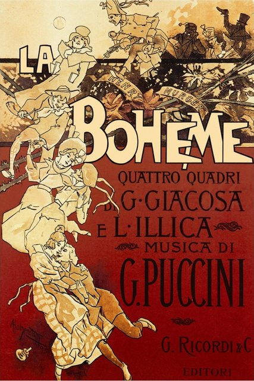
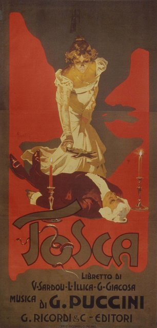
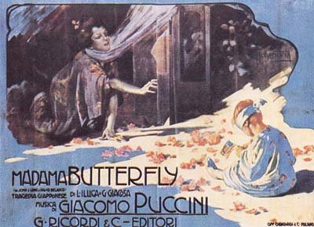
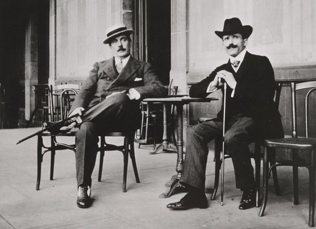
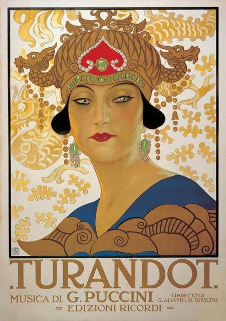

<!--
內容整理自本機筆記〈普契尼主要作品〉（D:\Books\md\音樂\普契尼主要作品.md；知識圖譜的「5-2-1.音樂家作品」尚無這份筆記的網頁版），做法比照「貝多芬主要作品」。
- 每首作品一則事件，日期採「創作時間」（多年創作的作品以區間呈現；「年代」以十年計、「世紀」以百年計，修訂或出版年份只寫在顯示文字裡），事件顏色依筆記的類別段落區分：歌劇作品、管弦樂作品、室內樂作品、宗教音樂與合唱作品、藝術歌曲與聲樂作品、鋼琴作品與其他器樂小品。
- 「約」、「前後」、修訂、出版等不是單純年份的寫法，以原文作為顯示文字。
- 作品編號是目錄編號，不等於創作順序，時間軸依創作時間排序；筆記中只是表格序號的「編號」欄不列為作品編號。
- 筆記的推薦清單、依年代整理的總覽與編號說明，和前面的作品表重複，未另立事件。
- 時期沿用「普契尼生平」時間軸的主要時期（重疊的細分時期不列）。
- 筆記推薦清單中的作品另註明順序。
- 以 follows 排在「普契尼生平」之後；生平事件見該時間軸。
圖片來源（皆為 Wikimedia Commons 公有領域／CC0 作品，沿用生平時間軸的圖片）：
- puccini-cover.jpg（與普契尼生平共用）
- puccini-1900-piano.jpg（與普契尼生平共用）
- puccini-1896-boheme.jpg（與普契尼生平共用）
- puccini-1900-tosca.jpg（與普契尼生平共用）
- puccini-1904-butterfly.jpg（與普契尼生平共用）
- puccini-1910-toscanini.jpg（與普契尼生平共用）
- puccini-1926-turandot.jpg（與普契尼生平共用）
-->

# Periods
- 1858 ~ 1880 | 盧卡的音樂世家
  曾曾祖父起，普契尼家族四代都擔任盧卡聖馬丁大教堂的樂長，長達124年。父親在他5歲時去世，他由舅舅指導音樂，當過唱詩班男童與教堂管風琴師。
- 1880 ~ 1891 | 米蘭求學與起步@Milan
  靠王后的獎學金進入米蘭音樂學院，和馬斯卡尼同住一間宿舍，過著和《波希米亞人》劇中一樣窮困的生活。第一部歌劇《群妖》受到出版商里科第賞識，第二部《埃德加》卻失敗。
- 1891 ~ 1904 | 托雷德拉戈的黃金時期@Torre del Lago
  定居湖畔小鎮托雷德拉戈，享受打獵和汽車。與劇作家伊利卡、賈科薩合作，接連寫出《瑪儂·雷斯考》、《波希米亞人》、《托斯卡》、《蝴蝶夫人》，成為威爾第之後最受歡迎的義大利歌劇作曲家。
- 1904 ~ 1924 | 晚期作品與醜聞
  車禍重傷、女傭自殺的醜聞與出版商里科第去世，讓他的創作變慢。他仍寫出《西部女郎》、《燕子》、《三聯劇》，最後的《杜蘭朵公主》因喉癌病逝而未能完成。

# Events

## 1883 ~ 1884 | 《群妖》／《女妖》Le Villi {color=#c92a2a}
類別：一幕歌劇，後改為兩幕；普契尼第一部成功上演的歌劇（歌劇作品）。入門推薦聆聽第 9 首。

## 1885 ~ 1889 | 《艾德加》Edgar {color=#c92a2a label="1885–1889；後續修訂至1905"}
類別：四幕歌劇，後改為三幕；普契尼早期探索之作（歌劇作品）。

## 1889 ~ 1892 | 《曼儂·雷斯考》Manon Lescaut {color=#c92a2a}

類別：四幕歌劇；描寫愛情、慾望與悲劇命運（歌劇作品）。

## 1893 ~ 1895 | 《波希米亞人》La bohème {color=#c92a2a}

類別：四幕歌劇；描寫巴黎青年藝術家的生活與愛情（歌劇作品）。入門推薦聆聽第 1 首。

## 1896 ~ 1899 | 《托斯卡》Tosca {color=#c92a2a}

類別：三幕歌劇；政治迫害、愛情與犧牲交織（歌劇作品）。入門推薦聆聽第 2 首。

## 1901 ~ 1903 | 《蝴蝶夫人》Madama Butterfly {color=#c92a2a label="1901–1903；後續修訂至1907"}

類別：歌劇；描寫日本女子巧巧桑與美國海軍軍官的悲劇（歌劇作品）。入門推薦聆聽第 3 首。

## 1907 ~ 1910 | 《西部女郎》La fanciulla del West {color=#c92a2a}

類別：三幕歌劇；以美國西部淘金時代為背景（歌劇作品）。入門推薦聆聽第 6 首。

## 1914 ~ 1916 | 《燕子》La rondine {color=#c92a2a label="1914–1916；後續修訂至1921"}
類別：抒情喜歌劇；描寫愛情、自由與現實的衝突（歌劇作品）。

## 1913 ~ 1916 | 《外套》Il tabarro {color=#c92a2a}
類別：獨幕歌劇；《三聯劇》第一部，寫實風格濃厚（歌劇作品）。

## 1917 ~ 1918 | 《修女安潔莉卡》Suor Angelica {color=#c92a2a}
類別：獨幕歌劇；以修道院為背景，描寫母愛、罪疚與救贖（歌劇作品）。入門推薦聆聽第 8 首。

## 1917 ~ 1918 | 《強尼·史基基》Gianni Schicchi {color=#c92a2a}
類別：獨幕喜歌劇；以遺產爭奪與欺詐為題材（歌劇作品）。

## 1920 ~ 1924 | 《杜蘭朵》Turandot {color=#c92a2a}

類別：三幕歌劇；未完成，由佛朗哥・阿爾法諾依據遺稿補完後首演（歌劇作品）。入門推薦聆聽第 5 首。

## 1875 | 《管弦樂前奏曲》Preludio a orchestra（E 小調） {color=#1971c2}
類別：早期管弦樂作品（管弦樂作品）。

## 1882 | 《交響前奏曲》Preludio sinfonico（A 大調） {color=#1971c2}
類別：管弦樂作品；展現早期交響性寫作（管弦樂作品）。

## 1882 ~ 1883 | 《諧謔曲與中段》Scherzo–Trio {color=#1971c2}
類別：管弦樂／室內樂相關作品；亦有弦樂版本資料（管弦樂作品）。

## 1881 ~ 1883 | 《小行板》Adagetto {color=#1971c2 label="約1881–1883"}
類別：管弦樂小品（管弦樂作品）。

## 1883 | 《交響隨想曲》Capriccio sinfonico {color=#1971c2}
類別：管弦樂作品；米蘭音樂學院畢業作品，後來的歌劇《波希米亞人》使用了其中的音樂素材（管弦樂作品）。

## 1882 | 《D 大調弦樂四重奏》Quartetto in Re {color=#e67700 label="約1882"}
類別：弦樂四重奏；早期室內樂作品（室內樂作品）。

## 1880 ~ 1884 | 《三首小步舞曲》Tre minuetti per quartetto d’archi {color=#e67700 label="約1880–1884"}
類別：弦樂四重奏；三首古典風格舞曲（室內樂作品）。

## 1890 | 《菊花》Crisantemi {color=#e67700}
類別：弦樂四重奏單樂章；為紀念薩伏依公爵阿梅迪奧而作，後來亦有弦樂團演出版本（室內樂作品）。入門推薦聆聽第 10 首。

## 1880 ~ 1883 | 《A 小調諧謔曲》Scherzo in A minor {color=#e67700 label="約1880–1883"}
類別：弦樂四重奏作品（室內樂作品）。

## 1883 | 《賦格》Fuga reale {color=#e67700 label="約1883"}
類別：弦樂室內樂／對位法練習性作品（室內樂作品）。

## 1878 ~ 1880 | 《四聲部彌撒曲》Messa a quattro voci（《榮耀彌撒曲》Messa di Gloria） {color=#2f9e44}
類別：獨唱、合唱與管弦樂；普契尼早期重要宗教作品（宗教音樂與合唱作品）。

## 1878 | 《信經》Credo {color=#2f9e44}
類別：宗教合唱作品；後來與彌撒作品的素材及版本關係密切（宗教音樂與合唱作品）。

## 1877 | 《聖保利諾經文歌》Mottetto per San Paolino {color=#2f9e44 label="約1877"}
類別：宗教聲樂作品（宗教音樂與合唱作品）。

## 1874 ~ 1880 | 《聖旗前進》Vexilla Regis prodeunt {color=#2f9e44 label="約1874–1880"}
類別：宗教合唱作品；確切創作時間仍有不確定性（宗教音樂與合唱作品）。

## 1905 | 《安魂曲》Requiem {color=#2f9e44}
類別：宗教合唱作品；篇幅較短，與普契尼大型歌劇不同（宗教音樂與合唱作品）。

## 1877 | 《四聲部合唱作品〈美麗義大利的孩子們〉》I figli d’Italia bella {color=#2f9e44}
類別：合唱作品；屬於早期聲樂創作（宗教音樂與合唱作品）。

## 1875 ~ 1880 | 《致你》A te {color=#862e9c label="約1875–1880"}
類別：聲樂與鋼琴；早期歌曲（藝術歌曲與聲樂作品）。

## 1880 ~ 1881 | 《憂鬱……》Melanconia!... {color=#862e9c label="約1880–1881"}
類別：藝術歌曲（藝術歌曲與聲樂作品）。

## 1882 | 《萬福，天上之后》Salve del ciel Regina／相關《Salve Regina》版本 {color=#862e9c label="約1882"}
類別：宗教性聲樂作品；題名與版本在目錄中有所差異（藝術歌曲與聲樂作品）。

## 1883 | 《愛情小故事》Storiella d’amore {color=#862e9c}
類別：聲樂與鋼琴；早期藝術歌曲（藝術歌曲與聲樂作品）。

## 1883 | 《致一位逝者》Ad una morta! {color=#862e9c}
類別：藝術歌曲；另有男中音與管弦樂版本（藝術歌曲與聲樂作品）。

## 1883 | 《預言是謊言》Mentìa l’avviso {color=#862e9c}
類別：藝術歌曲（藝術歌曲與聲樂作品）。

## 1888 | 《太陽與愛》Sole e amore {color=#862e9c}
類別：藝術歌曲；部分旋律素材後來與《波希米亞人》有關（藝術歌曲與聲樂作品）。

## 1896 | 《前進吧，烏拉妮亞！》Avanti Urania! {color=#862e9c}
類別：聲樂作品（藝術歌曲與聲樂作品）。

## 1897 | 《向戴安娜致敬》Inno a Diana {color=#862e9c}
類別：頌歌／藝術歌曲（藝術歌曲與聲樂作品）。

## 1899 | 《小鳥兒》E l’uccellino（《搖籃曲》） {color=#862e9c}
類別：聲樂與鋼琴；搖籃曲風格（藝術歌曲與聲樂作品）。

## 1901 | 《大地與海洋》Terra e mare {color=#862e9c}
類別：藝術歌曲（藝術歌曲與聲樂作品）。

## 1904 | 《靈魂之歌》Canto d’anime {color=#862e9c}
類別：聲樂作品（藝術歌曲與聲樂作品）。

## 1908 | 《我的家，我的家》Casa mia, casa mia {color=#862e9c}
類別：藝術歌曲（藝術歌曲與聲樂作品）。

## 1912 ~ 1913 | 《金色夢境》Sogno d’or {color=#862e9c label="約1912–1913"}
類別：藝術歌曲（藝術歌曲與聲樂作品）。

## 1917 | 《死亡？》Morire? {color=#862e9c label="約1917"}
類別：晚期歌曲（藝術歌曲與聲樂作品）。

## 1919 | 《羅馬頌》Inno a Roma {color=#862e9c}
類別：頌歌；晚期聲樂作品（藝術歌曲與聲樂作品）。

## 1870 | 《八首鋼琴小品》Eight Piano Pieces {color=#0c8599 label="1870年以前"}
類別：早期鋼琴習作（鋼琴作品與其他器樂小品）。

## 1870 | 《六首鋼琴小品及交響曲》Six Piano Pieces and Sinfonia {color=#0c8599 label="1870年以前"}
類別：早期器樂作品及改編性作品（鋼琴作品與其他器樂小品）。

## 1870 | 《C 大調賦格》Fuga in C major {color=#0c8599 label="1870年以前"}
類別：鋼琴／對位法習作（鋼琴作品與其他器樂小品）。

## 1886 | 《降 A 大調圓舞曲》Valzer in A-flat major {color=#0c8599}
類別：鋼琴圓舞曲（鋼琴作品與其他器樂小品）。

## 1894 | 《小圓舞曲》Piccolo valzer {color=#0c8599}
類別：鋼琴小品（鋼琴作品與其他器樂小品）。

## 1890 ~ 1899 | 《電力》Scossa elettrica（《光輝進行曲》） {color=#0c8599 label="1890年代末"}
類別：鋼琴進行曲小品（鋼琴作品與其他器樂小品）。

## 1907 ~ 1910 | 《小探戈》Piccolo tango {color=#0c8599 label="約1907或1910"}
類別：鋼琴小品；作品目錄對年代有不同推測（鋼琴作品與其他器樂小品）。

## 1907 ~ 1910 | 《紀念冊小品》Foglio d’album {color=#0c8599 label="約1907或1910"}
類別：鋼琴小品；創作年份尚有不確定性（鋼琴作品與其他器樂小品）。

## 1904 | 《托雷德拉戈》Torre del Lago {color=#0c8599}
類別：鋼琴小品；題名與作曲家的居住地有關（鋼琴作品與其他器樂小品）。

## 1881 ~ 1882 | 《G 大調慢板》Adagio in G major {color=#0c8599 label="約1881–1882"}
類別：早期器樂／鋼琴作品相關資料（鋼琴作品與其他器樂小品）。
