<!--
內容整理自中文維基百科「謝爾蓋·拉赫曼尼諾夫」與英文維基百科「Sergei Rachmaninoff」條目（CC BY-SA 4.0），並以台灣用語改寫摘要。
https://zh.wikipedia.org/zh-tw/谢尔盖·拉赫玛尼诺夫
https://en.wikipedia.org/wiki/Sergei_Rachmaninoff
兩者不一致處以英文條目為準（例如進入聖彼得堡音樂學院的年份，中文條目作1882年，英文條目作1883年）。日期採新曆。
圖片皆為 Wikimedia Commons 上的公有領域（含PD-US）作品（封面：1921年的肖像照）。
-->

# Periods
- 1873 ~ 1885 | 童年@奧涅格、聖彼得堡
  出身俄國貴族地主家庭，4歲跟母親學琴。愛賭博的父親敗光了五座莊園，全家搬到聖彼得堡的小公寓；祖母常帶他上東正教教堂，聖詠與鐘聲成了他日後音樂的重要元素。
- 1885 ~ 1892 | 莫斯科音樂學院
  轉到莫斯科跟嚴師茲韋列夫學琴，與史克里亞賓同窗。19歲以最高榮譽畢業，寫出歌劇《阿列科》與著名的升c小調前奏曲，深得柴可夫斯基賞識。
- 1892 ~ 1900 | 挫敗與憂鬱
  偶像柴可夫斯基去世後陷入低潮，第一號交響曲首演慘敗，讓他陷入長達三年的憂鬱與創作瓶頸，只能靠教琴與擔任歌劇院指揮維生。
- 1900 ~ 1906 | 重生
  接受達爾醫師的催眠治療後重拾創作，第二號鋼琴協奏曲大獲成功。與表妹娜塔莉亞結婚，並出任莫斯科大劇院指揮。
- 1906 ~ 1917 | 德勒斯登與巔峰之作
  為了躲避革命動亂與社交生活，舉家遷居德勒斯登。寫下第二號交響曲、第三號鋼琴協奏曲、《鐘》、《晚禱》等巔峰之作，並首度赴美巡演。
- 1917 ~ 1943 | 流亡美國的鋼琴家
  十月革命後帶著家人與幾件行李離開俄國，從此再也沒有回去。為了養家轉型為職業鋼琴家，成為20世紀最偉大的鋼琴家之一，作曲卻幾乎停擺，晚年才在瑞士別墅寫出《帕格尼尼主題狂想曲》等作品。

# Events

## 1873-04-01 | 出生@謝苗諾沃
生於諾夫哥羅德省舊魯薩附近的家族莊園，是六個孩子中的第三個。家族自稱是摩爾達維亞大公的後裔，有濃厚的音樂與從軍傳統：祖父曾跟愛爾蘭作曲家菲爾德學琴，父親是退役軍官兼業餘鋼琴家，母親是富有將軍的女兒，嫁妝有五座莊園。據中文條目，他的姓氏在俄語中有「揮霍無度」的意思。

## 1877 | 4歲開始學琴
全家搬到北方的奧涅格莊園，他在那裡長大到9歲。母親發現他能憑記憶正確彈出聽過的段落，於是請來剛從聖彼得堡音樂學院畢業的奧爾納茨卡婭住在家裡教他。據中文條目，小時候母親處罰他的方式，是叫他坐在鋼琴底下。

## 1882 | 家道中落
父親不善理財，又被他形容為「強迫性賭徒、病態說謊者、好色之徒」，把五座莊園一一賣掉還債，最後一座奧涅格莊園也被拍賣，全家搬進聖彼得堡的小公寓。

## 1883 | 聖彼得堡音樂學院；父親離家
10歲進入聖彼得堡音樂學院。同年姊姊蘇菲亞死於白喉，父親拋下家人去了莫斯科。祖母接手照顧孩子們，常帶他上東正教教堂，讓他第一次接觸到聖詠與教堂鐘聲。

## 1885 | 轉學莫斯科，拜茲韋列夫為師
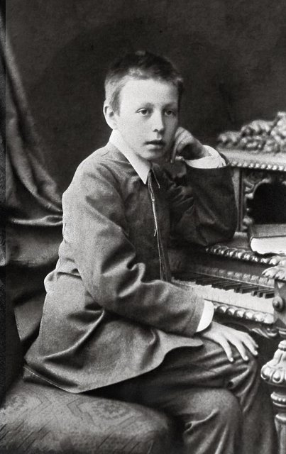
另一位姊姊葉蓮娜病逝，她正是帶他認識柴可夫斯基音樂的人。他在學校翹課、考試不及格，還偷改成績單，差點被退學。母親向外甥、李斯特的學生西洛第求助，西洛第建議讓他轉到莫斯科，跟以嚴格出名的茲韋列夫學琴。秋天他住進茲韋列夫家，和另外三個學生同房，輪流每天練琴三小時，同學中有史克里亞賓。

## 1889 | 與茲韋列夫決裂
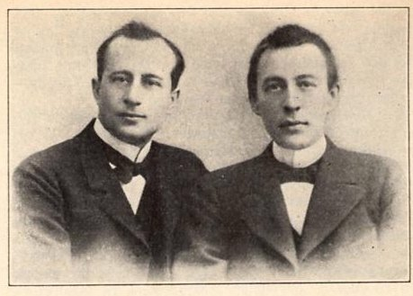
他想要一台鋼琴和安靜的空間作曲，認為作曲是浪費鋼琴天才的茲韋列夫拒絕了，兩人因此鬧翻，他搬到姨媽薩丁家住。後來跟西洛第學鋼琴、跟塔涅耶夫學對位、跟阿連斯基學作曲。

## 1890 | 伊凡諾夫卡莊園
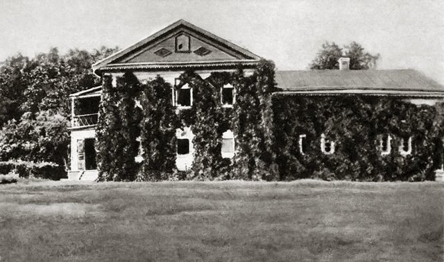
第一次到薩丁家位於坦波夫附近的伊凡諾夫卡莊園避暑，此後直到1917年他常回到這裡，寧靜的田園風光成為他創作的泉源。1891年在這裡完成作品1：第一號鋼琴協奏曲。

## 1892-05 | 歌劇《阿列科》；以最高榮譽畢業
他只花17天就以普希金的長詩寫成獨幕歌劇《阿列科》作為畢業作品，在莫斯科大劇院首演，出席的柴可夫斯基大加讚賞。他獲頒大金質獎章，此前只有塔涅耶夫等兩人得過。身為評審之一的茲韋列夫送他一隻金錶，師徒終於和好。5月29日，19歲的他以作曲與鋼琴雙最高榮譽畢業。

## 1892-09 | 升c小調前奏曲
在莫斯科電氣博覽會上首次以鋼琴家身分公開演出，首演升c小調前奏曲，酬勞50盧布。這首曲子成了他最受歡迎的作品之一。據中文條目，他後來很後悔寫了它，因為觀眾總是要他在音樂會最後彈這首。

## 1893 | 柴可夫斯基去世
柴可夫斯基原本答應在歐洲巡演中指揮他的交響詩《岩石》，他卻在基輔聽到偶像因霍亂去世的消息。當天他就開始寫第二號悲歌三重奏，一個月內完成，以表達深切的哀悼。

## 1897-03-28 | 第一號交響曲首演慘敗
由格拉祖諾夫指揮首演，作曲家居伊批評它像是在描繪「埃及的七災」，只有地獄音樂學院的「囚犯」才會欣賞。據他的朋友與妻子說，格拉祖諾夫沒好好排練，甚至可能喝醉了。這首交響曲在他生前再也沒有演出過，他自己則陷入長達三年的憂鬱與創作瓶頸，形容自己「就像中風的人，好久都不能使用頭腦與雙手」。

## 1897-10 | 歌劇院助理指揮
實業家馬蒙托夫邀他到莫斯科私人歌劇院擔任助理指揮，他以聖桑的《參孫與大利拉》首次指揮歌劇。在這裡他結識了男低音夏里亞平，兩人成為終生好友。1899年他第一次到倫敦演出。

## 1900 | 拜訪托爾斯泰；達爾醫師的治療
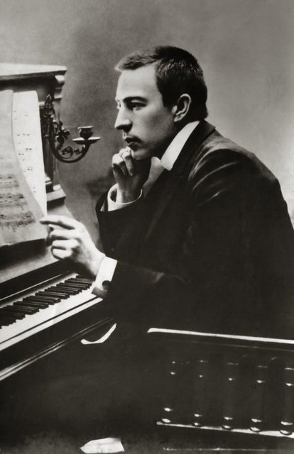
姨媽安排他去拜訪他崇拜的托爾斯泰，希望能讓他重拾創作慾，結果毫無幫助。之後他從1月到4月每天接受達爾醫師的催眠與支持性治療。據中文條目，他每次都坐在漆黑的房間裡，聽醫生不斷重複：「你將開始寫協奏曲……你會寫得很順利……你的協奏曲會非常出色……」夏天，他終於感覺到「新的音樂靈感開始湧現」。

## 1901 | 第二號鋼琴協奏曲
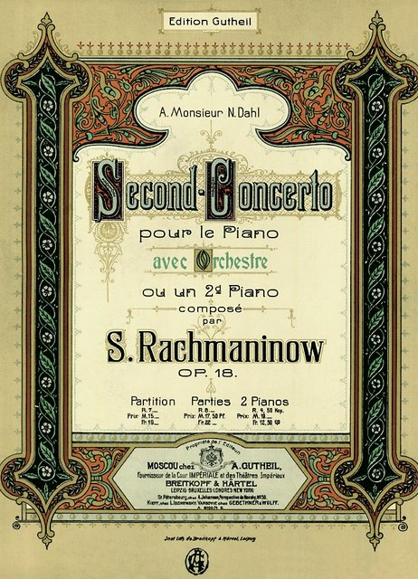
4月完成，獻給達爾醫師。他親自擔任獨奏，全曲首演獲得熱烈迴響，為他贏得第一座格林卡獎，也成為他最受歡迎的作品。同年完成大提琴奏鳴曲。

## 1902-05-12 | 與娜塔莉亞結婚
與交往多年的表妹娜塔莉亞·薩丁娜結婚。東正教會禁止表親通婚，他又不常上教堂、也不告解，兩人只好借助軍方背景，在莫斯科郊區軍營的小禮拜堂舉行婚禮，由西洛第等人擔任伴郎。婚後到歐洲度蜜月三個月，長女伊琳娜生於1903年。

## 1904 | 莫斯科大劇院指揮
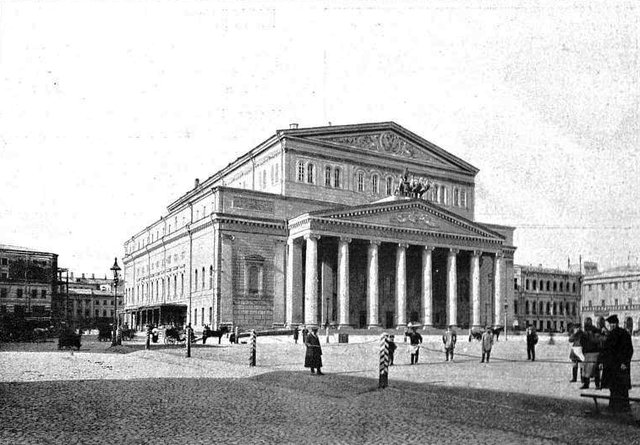
擔任大劇院指揮兩季，要求嚴格。他受華格納影響，開創了今天樂池的樂團座位安排，以及站著指揮的習慣。他的歌劇《吝嗇的騎士》與《弗蘭切斯卡·達·里米尼》也在這裡首演。

## 1906-11 | 遷居德勒斯登
1905年革命的動盪影響到劇院，他辭去指揮一職。為了遠離政治紛擾和熱鬧的社交生活、專心作曲，舉家搬到德國德勒斯登，夏天才回伊凡諾夫卡。

## 1907-05 | 巴黎的俄羅斯音樂季
參加狄亞基列夫在巴黎舉辦的俄羅斯音樂季，演奏第二號鋼琴協奏曲並以升c小調前奏曲安可，大獲成功。同年夏天他在巴黎看到勃克林的畫作《死之島》的黑白複製品，後來寫成同名交響詩。

## 1908 | 第二號交響曲
在第一號交響曲慘敗12年後，第二號交響曲首演大受歡迎，讓他重拾自信，並獲得第二座格林卡獎。

## 1909-11 | 第一次美國巡演；第三號鋼琴協奏曲
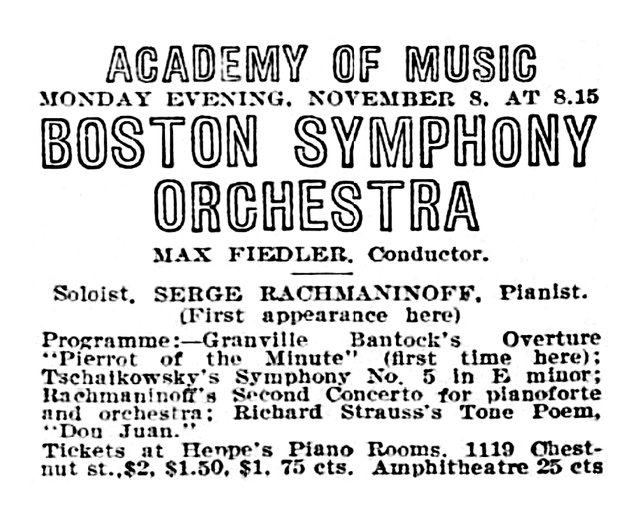
應波士頓交響樂團之邀赴美巡演，演出26場。為此他特地寫了被譽為最難的第三號鋼琴協奏曲，題獻給鋼琴家霍夫曼。1910年1月在紐約演出第二場時，由馬勒指揮，他非常珍惜這段經驗。

## 1910 | 返俄任職
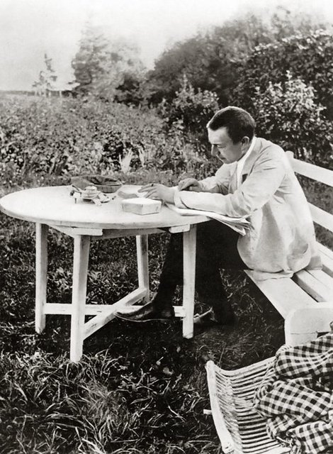
回國後擔任帝國俄羅斯音樂協會副會長，1911到1913年也擔任莫斯科愛樂協會的常任指揮。1912年他得知協會一位行政人員因為是猶太人而被解職，憤而辭去副會長職務。

## 1913 | 合唱交響曲《鐘》
在羅馬西班牙廣場附近的小公寓獨居作曲時，收到一封匿名信，裡面是愛倫坡的詩〈鐘〉的俄文譯本，深受感動而寫成合唱交響曲《鐘》，年底在聖彼得堡親自指揮首演。

## 1915 | 《晚禱》；史克里亞賓與塔涅耶夫去世
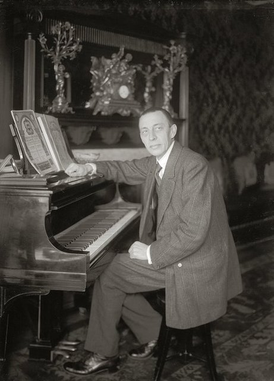
無伴奏合唱曲《晚禱》在莫斯科為戰爭救濟首演，反應熱烈到很快又加演四場。據中文條目，他只花兩週就寫成，被譽為東正教無伴奏合唱的巔峰。4月同窗好友史克里亞賓去世，他舉辦專門演奏史克里亞賓作品的巡迴獨奏會，為遺孀募款，這也是他第一次公開演奏別人的作品；夏天恩師塔涅耶夫也過世了。年底完成以無言歌〈練聲曲〉作結的歌曲集。

## 1917 | 革命：失去伊凡諾夫卡
二月革命爆發當天，他正在莫斯科為傷兵舉辦獨奏會。兩個月後回到伊凡諾夫卡，莊園已被社會革命黨人占為公有，他在那裡待了三週便離開，發誓不再回去。9月5日在雅爾達的音樂會，是他在俄國的最後一場演出。十月革命期間，他在槍聲與遊行聲中修改第一號鋼琴協奏曲。

## 1917-12-22 | 離開俄國
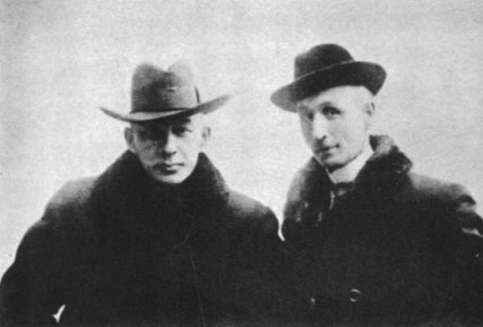
意外收到在斯堪地那維亞舉辦十場獨奏會的邀約，他立刻接受，藉此取得出境許可。全家帶著幾只小行李箱從聖彼得堡搭火車到芬蘭邊境，再坐無篷雪橇與火車到赫爾辛基，平安夜抵達斯德哥爾摩。他只帶了一些作品草稿和林姆斯基－高沙可夫的歌劇總譜。從此他再也沒有回到祖國。

## 1918-11 | 抵達紐約
44歲、負債的他決定以鋼琴演奏為生，開始苦練技巧、擴充曲目。11月搭船抵達紐約，大批音樂家與樂迷聚在他下榻的飯店外。好幾家鋼琴廠商出錢請他使用自己的琴，他選了唯一沒有提供報酬的史坦威，此後終生合作。12月他在西班牙流感尚未痊癒的情況下展開美國巡演，曲目中還有自己改編的〈星條旗之歌〉。

## 1920 | 錄音合約；接濟祖國親友
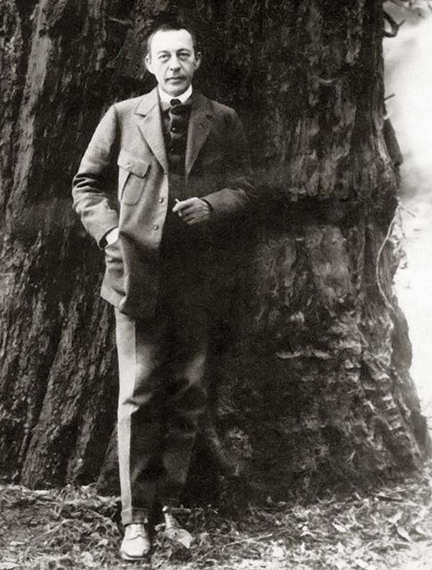
與勝利唱片公司簽約，開始長期錄音。他透過銀行定期寄錢與食物包裹給仍在俄國的家人、朋友、學生和需要幫助的人。他在紐約公寓裡請俄國員工、招待俄國客人，重現伊凡諾夫卡的生活氣氛。

## 1926 | 第四號鋼琴協奏曲
專心巡演八年後休息一年，完成1917年就開始寫的第四號鋼琴協奏曲。他坦承：「離開俄國，我也失去了作曲的慾望；失去祖國，我也失去了自己。」移居美國後的24年間，他只完成了6部新作品。

## 1928 | 結識霍洛維茲
與鋼琴家霍洛維茲成為好友，兩人互相出席對方的音樂會，霍洛維茲一生大力推廣他的作品，尤其是第三號鋼琴協奏曲。

## 1931 | 作品在蘇聯遭抵制
他與幾位人士在《紐約時報》聯名發表文章批評蘇聯的文化政策，他的音樂因此在蘇聯遭到抵制，直到1933年。

## 1934 | 《帕格尼尼主題狂想曲》
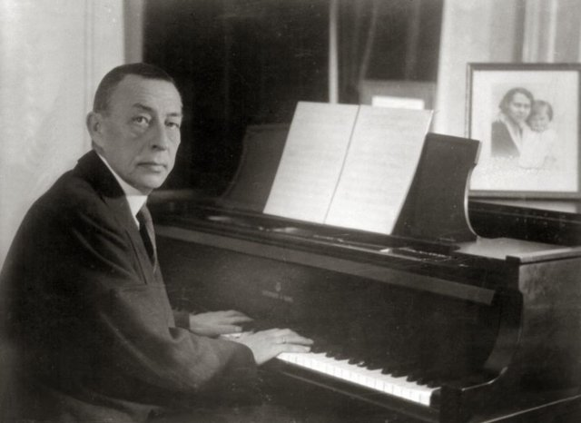
在瑞士琉森湖畔蓋了別墅「塞納爾」，名字取自他和妻子名字的前兩個字母，再加上姓氏的「R」。他常和女兒、孫子在湖上開汽艇，並在這裡寫出《帕格尼尼主題狂想曲》，其中的第18變奏最廣為人知。1936年又完成第三號交響曲。

## 1939-08-11 | 在歐洲的最後一場音樂會
在琉森國際音樂節演出，這是他在歐洲的最後一場音樂會。二次大戰一觸即發，他與妻子和兩個女兒在巴黎最後一次團聚後，8月23日離開歐洲。1941年中起，他把許多音樂會的收入捐給紅軍抗擊納粹。

## 1940 | 最後的作品《交響舞曲》
在長島休養期間寫成最後一部作品《交響舞曲》，1941年1月由奧曼第指揮費城管弦樂團首演。

## 1942 | 遷居比佛利山
醫生建議他搬到氣候溫暖的地方，他在加州比佛利山買了房子，鄰居霍洛維茲常來和他四手聯彈。他也請史特拉汶斯基來家裡吃飯，兩人都擔憂著飽受戰火的俄國和身在法國的孩子。

## 1943-02 | 入籍美國；最後的演出
2月1日與妻子歸化為美國公民。同月他在芝加哥最後一次以獨奏者身分演出，演奏貝多芬第一號鋼琴協奏曲與《帕格尼尼主題狂想曲》，2月17日在田納西大學舉行最後一場獨奏會。之後病情加重，被診斷出惡性黑色素瘤。

## 1943-03-28 | 逝世@比佛利山
在家中去世，享年69歲，距離70歲生日只差幾天，莫斯科作曲家們發來的祝賀電報來不及讓他看到。他希望能安葬在莫斯科新聖女公墓，與史克里亞賓、塔涅耶夫、契訶夫為鄰，但美國公民的身分讓這個心願無法實現，最後安葬於紐約州瓦爾哈拉的肯西科公墓。據中文條目，葬禮上依他的遺願演唱了他的《晚禱》。
