<!--
內容整理自 D:\Books\html\9-2.藝術家\拉斐爾生平大事記.html（沒有對應的 md 筆記），以自己的話改寫。
時期依頁面的七個階段歸納：出身與早年學藝、翁布里亞與早期成熟期、佛羅倫斯時期、羅馬時期、教廷壁畫與建築事業擴展、藝術聲望的高峰、晚期創作與逝世；後四段中羅馬時期的前兩段、聲望高峰與晚期合併為「羅馬」與「晚期」。
處理方式：
- 出生日期：頁面說明確切生日有不同說法，傳統上多採4月6日，也有3月28日或29日之說；born 採4月6日並在內文註明。1520年4月6日的逝世日期依頁面。
- 頁面說明確切死因的歷史記載並不一致，不宜把某一種傳說當成已證實的結論，這裡只寫「去世」，不寫死因。
- 頁面中的作品年代多為藝術史的概略定年，不同博物館或研究者的編年可能略有差異；「約」「前後」的年份照寫，用 label 保留。例如《加拉忒亞的凱旋》在敘述裡是約1514年、在總表是約1511–1512年，這裡依敘述，內文註明另有約1511–1512年之說。
- 頁面把《基督顯聖》寫成1518–1519年前後「持續創作」，總表又寫約1516–1520年，這裡依敘述放在1518年，內文並陳。
- 美第奇依本站既有寫法統一為梅迪奇；儒略二世、利奧十世、布拉曼特的譯名依頁面。頁面提到的李奧納多·達文西，這裡統一寫成達文西。
- 頁面的「重要作品總表」「藝術特色」「與達文西、米開朗基羅比較」「濃縮年表與總結」寫進時期說明與最後一則事件，不另立事件；頁尾「參考資料」五項（倫敦國家美術館、普拉多博物館、大都會藝術博物館、Smarthistory、Vatican Rome）只列了名稱，未收錄。
- 人名索引：「拉斐爾前派」指19世紀的英國藝術運動，以 notNames 排除。
圖片（皆為 Wikimedia Commons 上的公有領域或 CC0 作品，縮成最長邊 640px 的 JPEG）：
- rap-cover.jpg：Raffaello Sanzio.jpg（拉斐爾的自畫像）
- rap-urbino.jpg：Urbino casa ove nacque Raffaello Sanzio.jpg（烏爾比諾拉斐爾的出生之屋）
- rap-perugino.jpg：Madonna and Child with Two Angels - Pietro Perugino - Louvre INV 719.jpg（佩魯吉諾《聖母子與兩位天使》（羅浮宮））
- rap-marriage.jpg：Raffaello - Spozalizio - Web Gallery of Art.jpg（《聖母的婚禮》，1504）
- rap-meadow.jpg：Raphael - Madonna in the Meadow - Google Art Project.jpg（《草地上的聖母》，約1505）
- rap-goldfinch.jpg：Raffaello Sanzio - Madonna del Cardellino - Google Art Project.jpg（《金翅雀聖母》，約1506–1507）
- rap-entombment.jpg：Deposizione borghese 02.jpg（《基督下葬》，1507）
- rap-athens.jpg："The School of Athens" by Raffaello Sanzio da Urbino.jpg（簽署廳的《雅典學院》）
- rap-heliodorus.jpg：Raphael - The Expulsion of Heliodorus from the Temple.jpg（赫利奧多羅廳的《逐出赫利奧多羅》）
- rap-sistine.jpg：Raphael - The Sistine Madonna - Google Arts & Culture.jpg（《西斯汀聖母》，約1512–1513）
- rap-leo.jpg：Portrait of Pope Leo X and his cousins, cardinals Giulio de' Medici and Luigi de' Rossi (by Raphael).jpg（《利奧十世及其兩位堂弟樞機的肖像》，1518–1520）
- rap-galatea.jpg：Raphael's Triumph of Galatea 01.jpg（法爾內西納別墅的《加拉忒亞的凱旋》）
- rap-castiglione.jpg：Raffaello Sanzio - Portrait of Baldassare Castiglione - WGA18821.jpg（《巴爾達薩雷·卡斯蒂廖內肖像》，約1514–1515）
- rap-cartoon.jpg：Raphael - The Miraculous Draft of Fishes - Google Art Project.jpg（掛毯草圖《神奇的捕魚》，1515）
- rap-transfiguration.jpg：Transfiguration Raphael.jpg（《基督顯聖》）
- rap-tomb.jpg：RaphaelTombInscriptionPantheon.JPG（羅馬萬神殿拉斐爾墓上的銘文）
-->

# Periods
- 1483 ~ 1499 | 烏爾比諾與早年學藝 | #868e96
  生於烏爾比諾，父親是宮廷畫家兼詩人；母親、父親先後在他約八歲與十一歲時去世，約1495年起向佩魯吉諾學習。
- 1500 ~ 1503 | 翁布里亞的早期成熟 | #2f9e44
  承接《聖尼各老祭壇畫》，創作《蒙德受難像》與《奧迪祭壇畫》，開始建立個人風格。
- 1504 ~ 1507 | 佛羅倫斯時期 | #f08c00
  1504年完成《聖母的婚禮》並前往佛羅倫斯，研究達文西與米開朗基羅，創作一系列聖母畫與《基督下葬》。
- 1508 ~ 1514 | 羅馬：簽署廳與教廷事業 | #e03131
  1508年受儒略二世之召到羅馬，完成簽署廳壁畫（含《雅典學院》），再裝飾赫利奧多羅廳，利奧十世繼位後接手聖彼得大教堂的建築工作。
- 1515 ~ 1520 | 聲望高峰與晚期 | #7048e8
  設計西斯汀禮拜堂掛毯草圖、調查古羅馬遺跡、工作坊規模成熟；1520年去世，《基督顯聖》由工作坊接續完成。

# Events

## 1483-04-06 | 出生於烏爾比諾
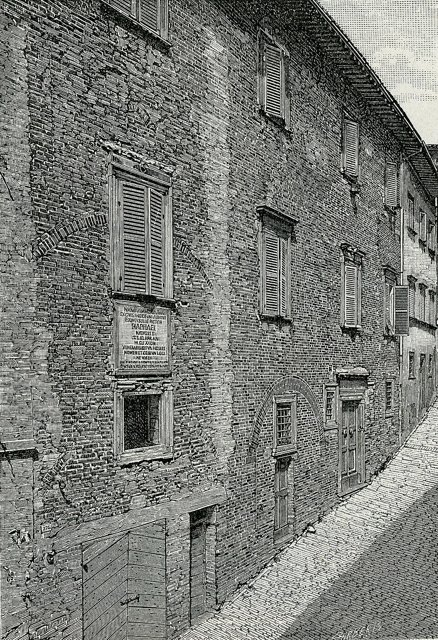
出生於義大利中部的烏爾比諾（Urbino）。這座城市在蒙特費爾特羅家族的統治下成為文藝復興時期重要的文化中心；父親喬瓦尼·桑蒂是宮廷畫家，也是詩人。確切的生日有不同說法：傳統上多採4月6日，也有3月28日或29日之說。拉斐爾自幼生活在藝術與人文主義的環境中，較早接觸繪畫、古典文化與宮廷藝術，烏爾比諾宮廷的文化氣氛，為他日後優雅、均衡的藝術風格提供了重要的基礎。

## 1491 | 母親去世
母親瑪吉亞·迪·巴蒂斯塔·恰拉去世，當時拉斐爾約8歲，家庭生活開始出現重大變化。

## 1494 | 父親去世
父親喬瓦尼·桑蒂去世，拉斐爾當時只有11歲左右。父親的離世使他失去家庭中重要的藝術導師，但早年接受的訓練與家庭工作坊的經驗仍為他奠定了繪畫的基礎；此後他逐步進入更成熟的藝術工作環境，繼續學習繪畫技法與工作坊的經營方式。

## 1495 | 向佩魯吉諾學習 {label=約1495年起}
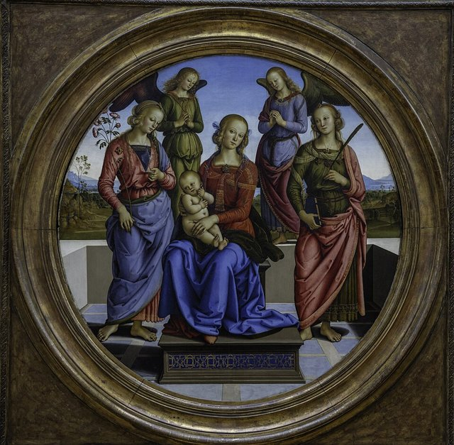
後來與畫家佩魯吉諾建立師徒或工作坊關係。佩魯吉諾擅長以清晰的空間安排、平衡的構圖、柔和的人物表情與優雅的姿態組織宗教畫，拉斐爾早期作品深受其影響，尤其重視人物之間的秩序、畫面的平衡與空間的清楚安排。不過，他究竟何時正式進入佩魯吉諾的工作坊、學習多久，學界仍有不同看法。

## 1498 | 開始展現獨立創作能力 {label=1498—1500年前後}
逐漸從學徒成長為能獨立承接委託的畫家，在烏爾比諾、佩魯賈與翁布里亞地區累積經驗，開始接受宗教畫的委託。這一階段的作品仍可看到佩魯吉諾的影響，但拉斐爾已展現對構圖、人物姿態與畫面秩序的敏銳掌握。

## 1500 ~ 1501 | 《聖尼各老祭壇畫》
與其他畫家合作，為奇塔迪卡斯泰洛（Città di Castello）的教堂創作祭壇畫，通常被視為他早期職業生涯的重要里程碑，顯示他已逐漸進入正式的藝術委託市場。原作後來散失，只剩部分殘件。

## 1502 ~ 1503 | 《蒙德受難像》與《奧迪祭壇畫》
持續為教堂創作大型宗教畫。《蒙德受難像》（Mond Crucifixion）把人物、十字架與風景安排在清晰有秩序的構圖中；《奧迪祭壇畫》（Oddi Altarpiece）以聖母加冕等宗教主題為核心，顯示他在多人物敘事與空間安排上逐漸成熟。這些作品反映他不再只是模仿老師，而是開始建立個人風格。

## 1504 | 《聖母的婚禮》
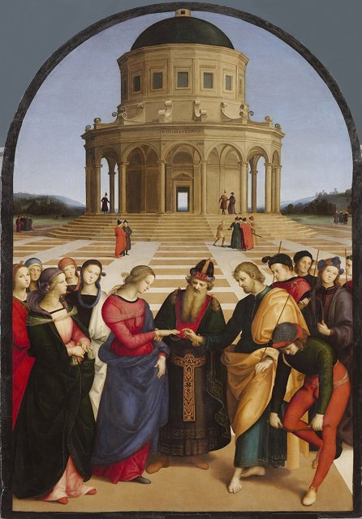
《聖母的婚禮》（The Marriage of the Virgin）描繪聖母瑪利亞與約瑟的婚禮，人物位於前景，後方是一座有中央透視結構的宏偉建築；建築的幾何秩序與人物排列互相呼應，使整幅畫有穩定、清晰而和諧的效果，也顯示他已逐步超越佩魯吉諾的早期風格，建立自己的構圖語言。

## 1504 | 前往佛羅倫斯 {label=1504年前後}
約自1504年起，開始在佛羅倫斯活動，並在此後數年間反覆或長期停留。當時佛羅倫斯聚集了許多重要藝術家，尤其是達文西與米開朗基羅。拉斐爾並沒有單純模仿兩人，而是吸收其長處，轉化為自己清晰、優雅而富有秩序的風格。1504至1505年，他研究達文西的金字塔式構圖、人物心理表現與柔和的明暗處理，以及米開朗基羅對人體結構與動勢的探索，透過臨摹、素描與觀察，學習如何使人物更有立體感，以及如何利用姿勢、手勢與眼神表達情緒；作品逐漸從早期較為僵直、規整的構圖，轉向更自然的人物互動與更複雜的空間安排。這是他由地方性畫家成長為文藝復興盛期大師的關鍵時期。

## 1505 | 《草地上的聖母》 {label=約1505年}
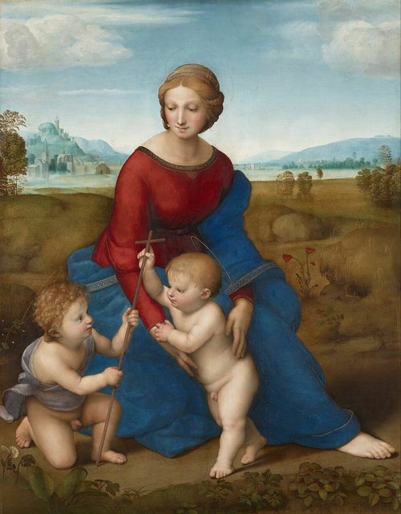
《草地上的聖母》（Madonna of the Meadow）是他聖母畫的重要代表作之一。聖母、聖嬰與幼年施洗者約翰構成穩定的三角形，人物之間的視線與動作形成自然的互動，畫面把人物、草地與遠景結合，呈現寧靜、優美而有古典秩序的氛圍。

## 1506 | 《金翅雀聖母》與《多尼夫婦肖像》 {label=約1506—1507年}
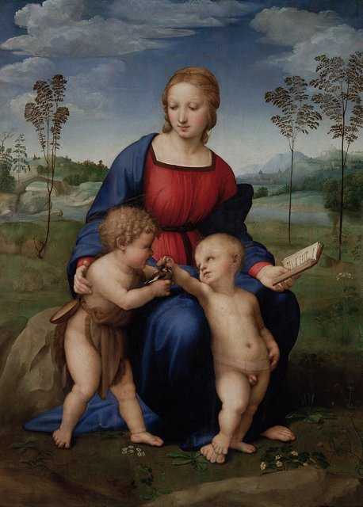
《金翅雀聖母》（Madonna of the Goldfinch）延續聖母、聖嬰與施洗者約翰的題材，人物透過眼神、手勢與身體姿態建立溫柔的互動，他以自然的身體結構與和諧的色彩，把宗教象徵融入日常般親切的情境，後來成為歐洲聖母畫傳統的重要典範。約同時期的《多尼夫婦肖像》展現他在人物肖像上的能力：他重視面部特徵、服飾細節、身體姿態與背景環境，透過細膩的觀察與穩定的構圖，不只呈現外貌，也顯示文藝復興對個人身分與人格的重視。

## 1507 | 《基督下葬》
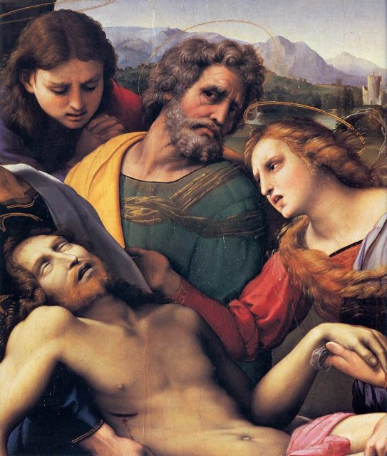
《基督下葬》（The Entombment of Christ）表現基督的遺體被抬往安葬地點，人物以強烈的身體動勢與情緒反應構成複雜的群像。作品可看出他對米開朗基羅人體表現的研究，也反映他試圖處理更具戲劇性與情感張力的宗教題材；與早期較靜謐的聖母畫相比，這件作品更強調行動、悲傷與群體情緒。1507至1508年，他在佛羅倫斯與其他義大利城市逐漸建立聲譽，能根據不同委託者的需求創作祭壇畫、聖母畫與肖像畫；社交能力、工作坊管理能力，以及對委託者需求的掌握，也為他日後進入羅馬教廷服務創造了條件。

## 1508 | 受儒略二世之邀前往羅馬
前往羅馬，接受教宗儒略二世的委託，參與梵蒂岡宮殿房間的壁畫裝飾。儒略二世積極推動羅馬的建築與藝術工程，希望透過藝術展現教廷的宗教權威、文化成就與政治地位。拉斐爾當時年僅25歲左右，卻獲得極為重要的教廷委託，從地方性的宗教畫家躍升為羅馬最重要的藝術家之一。

## 1509 | 簽署廳壁畫 {label=1508—1511年}
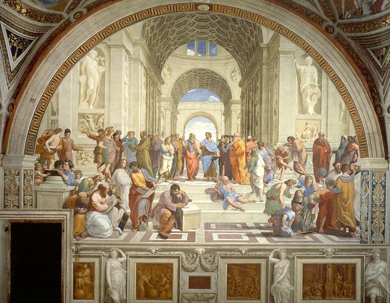
裝飾簽署廳（Stanza della Segnatura），這裡成為他最具代表性的創作空間之一，三幅主要壁畫是：《雅典學院》（The School of Athens），以古希臘哲學家為主題，把不同時代的思想家安排在宏偉的古典建築中，畫面中央通常被辨認為柏拉圖與亞里斯多德，柏拉圖的手勢指向上方，象徵他重視理念與超越性的真理，亞里斯多德則指向前方，強調經驗、現實與具體的事物，它不只是哲學家群像，更是文藝復興人文主義的視覺象徵；《聖體的辯論》（Disputation of the Holy Sacrament），呈現基督教神學對聖體與神聖真理的探討，與《雅典學院》相互呼應，前者呈現基督教神學，後者呈現古典哲學，共同反映文藝復興對古典知識與基督教信仰之關係的思考；《帕納蘇斯山》（Parnassus），以阿波羅與詩人為主題，象徵詩歌、音樂與文學，把古典神話與文學傳統納入教廷空間的整體規畫。主要壁畫在1509至1511年間完成。他透過清晰的空間、優雅的人物姿態與均衡的群像，把哲學、神學、詩歌與法律等主題組織成完整的藝術計畫，這批作品確立了他在羅馬教廷的地位，也成為文藝復興盛期繪畫的典範。

## 1511 | 赫利奧多羅廳壁畫 {label=1511—1514年}
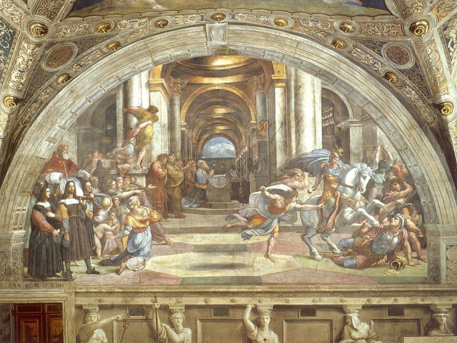
接續進行梵蒂岡宮殿赫利奧多羅廳（Stanza di Eliodoro）的壁畫工程。相較於簽署廳較強調知識秩序與古典和諧，這一階段的壁畫更強調戲劇性、動勢與神聖的力量，顯示他並非固定停留在一種優雅平衡的風格，而是能依題材與時代需求調整表現方式。

## 1512 | 《西斯汀聖母》 {label=約1512—1513年}
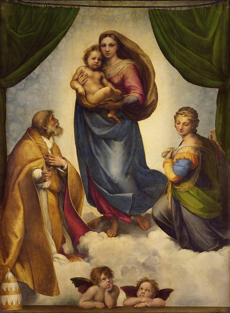
《西斯汀聖母》（Sistine Madonna）是他最著名的聖母畫之一：畫面中央的聖母抱著聖嬰，兩側安排聖徒，底部有兩位廣為人知的小天使。聖母的姿態兼具莊嚴與親切，人物與觀者之間形成直接的視覺聯繫，把宗教象徵、理想化的美感與人性情感融為一體。

## 1513 | 儒略二世去世，利奧十世繼任
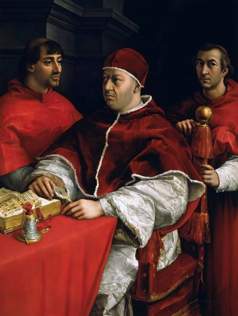
拉斐爾在儒略二世任內獲得大量重要委託，已是羅馬教廷最受重視的藝術家之一。新任教宗利奧十世延續梅迪奇家族對藝術與文化的支持，使他得以繼續承擔大型壁畫、建築與其他藝術工程。1513至1514年，他持續參與梵蒂岡宮殿的裝飾，也接受來自教廷與私人贊助者的肖像畫與宗教畫委託，並逐步建立規模龐大的工作坊，由助手協助完成大型工程，自己則負責設計、構圖、重要人物與整體品質的控制，使他能同時處理多項委託。

## 1514 | 接手聖彼得大教堂的建築工作
建築師布拉曼特於1514年去世後，拉斐爾接手聖彼得大教堂工程中的重要建築工作，從畫家進一步擴展為重要的建築師。不過，聖彼得大教堂的設計在後續數十年間仍經歷多次調整，他的方案只是整個長期工程中的一個階段。

## 1514 | 《加拉忒亞的凱旋》 {label=約1514年}
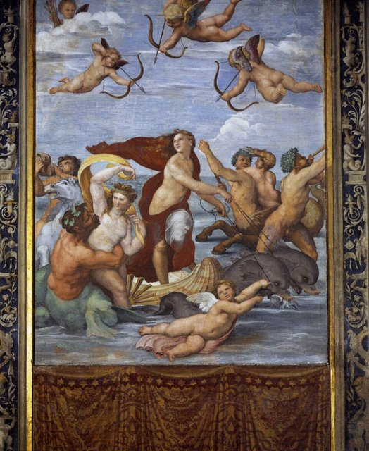
在羅馬的法爾內西納別墅（Villa Farnesina）創作《加拉忒亞的凱旋》（Triumph of Galatea），展現海中女神加拉忒亞與周圍人物的動態，人物的姿勢、流動的線條與均衡的構圖，呈現他對古典神話題材的掌握，也反映文藝復興藝術對古典文化的濃厚興趣（頁面的作品總表另有約1511–1512年之說）。

## 1514 | 《巴爾達薩雷·卡斯蒂廖內肖像》 {label=約1514—1515年}
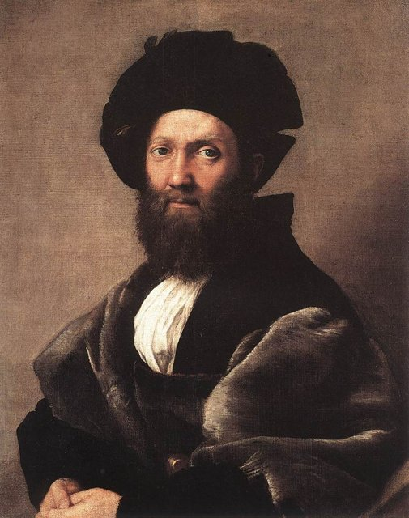
卡斯蒂廖內是文藝復興時期重要的外交官、作家與宮廷文化人物。肖像沒有以華麗的背景或誇張的姿態突出人物，而是透過服飾、神情、眼神與穩定的構圖，呈現人物的沉著、修養與內在氣質，常被視為文藝復興肖像畫的典範之一。

## 1515 | 西斯汀禮拜堂掛毯草圖與古羅馬遺跡調查 {label=1515年前後}
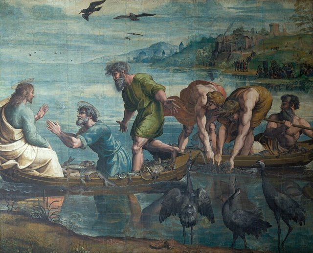
為西斯汀禮拜堂設計一組大型掛毯的草圖，題材包括使徒彼得與保羅的事蹟，通稱「掛毯草圖」（Raphael Cartoons），後來被製作成大型掛毯，顯示他的創作不只限於木板畫與壁畫，也延伸到織物設計與其他裝飾藝術。他受到教廷重視，不只因為繪畫成就，也因為對古典藝術與建築的理解：他參與羅馬古代建築與遺跡的調查，並關心古蹟保存。這反映文藝復興時期藝術家角色的擴展，藝術家不再只是執行委託，也可能成為古典文化的研究者、建築規畫者與文化保存的倡議者。

## 1515 | 梵蒂岡長廊與工作坊成熟 {label=1515—1517年前後}
他的工作坊持續參與梵蒂岡宮殿的裝飾，包括長廊（Loggias）的設計與裝飾，結合建築、壁畫、裝飾圖案與古典題材，呈現教廷藝術的宏大規模。隨著委託增加，工作坊成為羅馬最重要的藝術工作室之一，他必須在設計、人才管理、工程進度與贊助者要求之間取得平衡；這套工作模式提高創作效率，也使他的風格透過助手與學生傳播到其他城市。

## 1517 | 持續承接委託，研究古蹟 {label=1517年前後}
在羅馬的藝術聲望達到高峰，持續接受宗教畫、肖像畫、建築與裝飾工程的委託，繪畫中愈來愈重視人物情緒、空間層次與戲劇性的視覺安排。約1517至1519年，他持續參與羅馬的建築工程並投入古羅馬建築遺跡的研究；他對古典建築的興趣不只是形式模仿，也包括對建築秩序、比例與城市文化的理解，顯示文藝復興藝術家的專業範圍可以涵蓋繪畫、建築、古典學術與大型工程管理。

## 1518 | 《基督顯聖》 {label=1518—1519年前後}
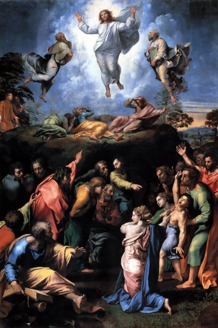
《基督顯聖》（Transfiguration）是他晚年的重要作品（頁面的作品總表另寫約1516–1520年）。作品結合基督顯聖與下方人物試圖治癒患病少年的情節，形成上下兩個彼此呼應、情緒差異鮮明的場景：上半部呈現神聖光輝與超越性的力量，下半部則表現人間的苦難、混亂與求助，把神聖與世俗、平靜與激動、信仰與苦難放在同一幅畫中。他在這一時期也畫了《利奧十世及其侄子肖像》（1518至1520年），展現教廷肖像畫中的人物刻畫、服飾細節與權力象徵。

## 1520-04-06 | 逝世於羅馬
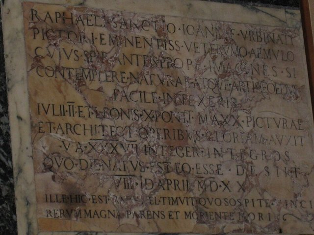
在羅馬去世，年僅37歲。他去世時《基督顯聖》尚未完全完成，後來由工作坊接續完成。他依照自己的意願安葬於羅馬的萬神殿（Pantheon），墓葬所在之處成為後世紀念這位藝術家的重要地點；關於確切的死因，歷史記載並不一致，不宜把某一種傳說當成已證實的結論。他的藝術成就在於把前輩的探索轉化為成熟而有感染力的視覺語言：《雅典學院》體現他對哲學與理性秩序的理解，《西斯汀聖母》呈現他對宗教情感與理想美的掌握，《基督顯聖》顯示他晚年逐漸加強的戲劇性、情緒張力與複雜敘事。最鮮明的特色有四點：構圖均衡與古典秩序，能把複雜的人物、建築與背景組織成清楚穩定的整體；人體優雅、情感自然，善用眼神、手勢與身體方向表達親情、信仰、思考或悲傷，宗教人物因此也有可親近的人性；融合前輩的成就，從達文西學到人物的心理互動與柔和明暗，從米開朗基羅學到人體的立體感與動勢；以及大型工作坊讓他的設計與風格透過學生與助手傳播到其他地方。與達文西的細膩觀察、心理表現與科學探索，以及米開朗基羅的人體力量與精神衝突相比，他最重要的歷史地位，是把文藝復興盛期的繪畫理想推向成熟：構圖的秩序、人體的優雅、情感的自然與古典文化的精神，在同一幅作品中達到高度和諧。儘管只活到37歲，他的風格仍透過大量作品、工作坊制度與教廷藝術工程，影響了後世歐洲的學院派繪畫與古典主義藝術。
