<!--
內容整理自中文維基百科「莫里斯·拉威爾」與英文維基百科「Maurice Ravel」條目（CC BY-SA 4.0），並以台灣用語改寫摘要。
https://zh.wikipedia.org/zh-tw/莫里斯·拉威尔
https://en.wikipedia.org/wiki/Maurice_Ravel
中文條目的生平只寫到音樂學院時期，之後主要參考英文條目。
圖片皆為 Wikimedia Commons 上的公有領域（含PD-US）作品（封面：1925年的肖像照）。
-->

# Periods
- 1875 ~ 1889 | 童年@錫布爾、巴黎
  生於靠近西班牙邊境的巴斯克小鎮，三個月大就隨家人搬到巴黎。工程師父親常帶他參觀工廠的新奇機械，也悉心培養他的音樂品味；巴斯克裔的母親唱給他聽的民謠，是他最早的記憶之一。
- 1889 ~ 1903 | 巴黎音樂學院
  14歲考進巴黎音樂學院，鋼琴不如同學用功，一心想當作曲家。兩度因沒得獎被退學，後來跟隨佛瑞學作曲，寫出《悼念公主的帕凡舞曲》、《水之嬉戲》等早期名作。
- 1903 ~ 1914 | 「阿帕契」與「拉威爾事件」
  和一群前衛藝術家組成「阿帕契」，熱烈支持德布西，後來兩人卻漸行漸遠。羅馬大獎五度落選引發全國醜聞，之後他寫下《鏡》、《夜之加斯巴》、《達夫尼與克蘿伊》等代表作，聲望日隆。
- 1914 ~ 1919 | 戰爭歲月
  40歲的他自願從軍，在砲火下開軍用卡車運送彈藥。母親在戰時過世讓他陷入絕望，《庫普蘭之墓》每一樂章都獻給一位陣亡的朋友。
- 1920 ~ 1932 | 法國樂壇第一人@Montfort-l'Amaury
  德布西死後被公認為法國最重要的在世作曲家。搬到巴黎近郊的「觀景樓」隱居，作品不多卻篇篇精彩：《圓舞曲》、《展覽會之畫》配器、《波麗露》與兩首鋼琴協奏曲。1928年的北美巡演是他國際聲望的巔峰。
- 1932 ~ 1937 | 失語的晚年
  一場計程車事故後，腦部疾病逐漸惡化，他再也無法寫字作曲，腦中卻仍聽得見音樂。1937年腦部手術後不久去世。

# Events

## 1875-03-07 | 出生@錫布爾
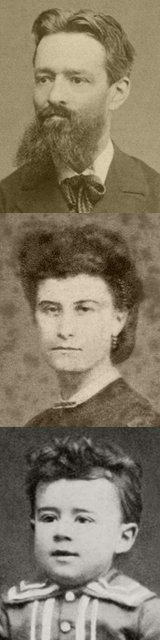
生於法國西南部巴斯克地區的錫布爾，距離西班牙邊境只有18公里。父親是出生於瑞士邊境的工程師兼發明家，母親是在馬德里長大的巴斯克人。出生六天後在當地教堂受洗。

## 1875-06 | 舉家遷居巴黎
三個月大時全家搬到巴黎，弟弟愛德華在巴黎出生，後來跟隨父親當了工程師。家境不算富裕但生活安穩，兄弟倆都有快樂的童年。父親的發明包括早期的內燃機，以及一種名為「死亡旋風」的馬戲團汽車翻圈特技裝置。

## 1882 | 開始學鋼琴
7歲跟夏布里耶的朋友吉斯學鋼琴。1887年起又隨德利伯的學生夏爾－勒內學和聲、對位與作曲，老師發現他對音樂的理解是天生的，「不像許多人是靠努力得來」。

## 1888 | 結識維涅斯
認識了年輕的西班牙鋼琴家維涅斯，兩人成為終生好友。維涅斯後來是他作品最重要的詮釋者之一，也是他和西班牙音樂之間的橋樑。兩人一起欣賞華格納、俄國音樂，以及愛倫坡、波特萊爾與馬拉美的作品。

## 1889 | 萬國博覽會；首次公開演出
在巴黎萬國博覽會上，林姆斯基－高沙可夫指揮的俄國新作與爪哇甘美朗的音色都讓他印象深刻，這同樣影響了德布西。同年他在艾拉爾音樂廳與同門學生柯爾托等人同台，首次公開演奏。

## 1889-11 | 考進巴黎音樂學院
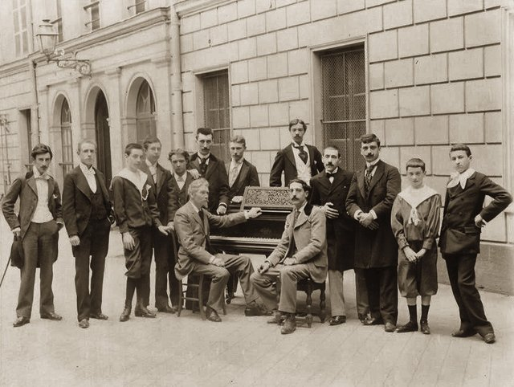
以蕭邦的作品通過預科鋼琴班的入學考試，1891年贏得學院鋼琴比賽一等獎，之後卻沒有特別突出的表現。老師形容他「只能照他自己的方式教」。

## 1893 | 最早留存的作品；結識薩提
最早完整流傳下來的作品《怪誕小夜曲》與歌曲〈為愛而死的皇后之歌〉寫於這一年。差不多同一時期，父親介紹他認識當時在咖啡館彈琴維生的薩提，他是最早看出薩提原創才華的音樂家之一。

## 1895 | 第一次被退學
因為沒再得到任何獎項被音樂學院開除。他從此專心作曲，寫了《古風小步舞曲》與四手聯彈《哈巴奈拉》，後者日後收入《西班牙狂想曲》。

## 1897 | 重回學院，拜佛瑞為師
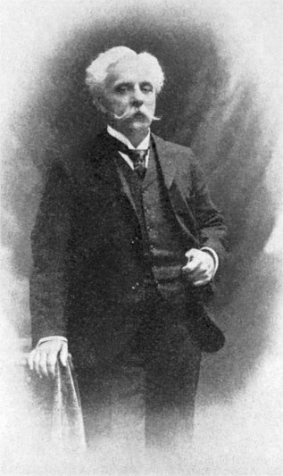
重新入學，跟佛瑞學作曲，並私下隨蓋達爾吉學對位。佛瑞非常欣賞他，稱讚他「明顯更成熟……想像力豐富迷人」，但保守的院長杜布瓦對他在音樂與政治上的前衛立場很反感。5月他指揮《天方夜譚》序曲首演，觀眾噓聲與掌聲交雜，樂評拉洛從此成為他最頑固的批評者。

## 1899 | 《悼念公主的帕凡舞曲》
應波利尼亞克親王夫人委託寫的鋼琴曲，是他第一首廣為人知的作品，雖然一開始反應平平。1910年他又改編成管弦樂版。

## 1900 | 再度被退學；「阿帕契」團體
因沒得獎第二度被開除，之後以旁聽生身分繼續上佛瑞的課到1903年。差不多同時，他和一群前衛藝術家、詩人與音樂家組成非正式團體，維涅斯取名為「阿帕契」（意思近似「流氓」），自嘲是藝術界的邊緣人，成員後來還包括史特拉汶斯基與法雅。

## 1901 | 《水之嬉戲》；羅馬大獎第二名
寫下鋼琴曲《水之嬉戲》，同年參加羅馬大獎得到第二名。1902、1903年再試都落選，據說評審懷疑他故意交出過度學院派的康塔塔來嘲弄他們。

## 1902-04 | 力挺德布西的《佩利亞與梅莉桑》
「阿帕契」們熱烈支持德布西的歌劇，院長杜布瓦禁止學生去看也沒用，拉威爾把首輪14場演出全部看完。他比德布西小12歲，兩人的友誼維持了十多年，但始終不算親近。

## 1903 | 弦樂四重奏與《天方夜譚》歌曲集
完成F大調弦樂四重奏與管弦樂伴奏的歌曲集《天方夜譚》，評論者認為四重奏「既是向德布西致敬，也是在驅除德布西的影響」。

## 1904 | 與德布西漸行漸遠
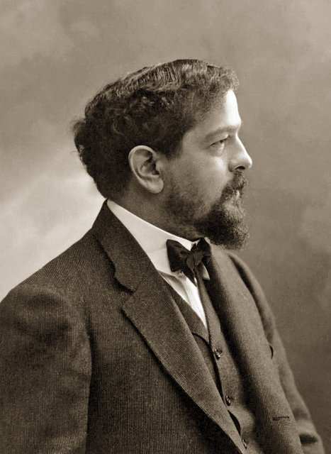
兩派支持者開始互相攻訐，爭論誰影響了誰，拉洛寫道：「德布西先生是全然的敏感，拉威爾先生是全然的無感。」德布西拋下妻子莉莉後，拉威爾和好友米西亞等人定期接濟莉莉，這可能也讓德布西心生不滿。

## 1905 | 「拉威爾事件」
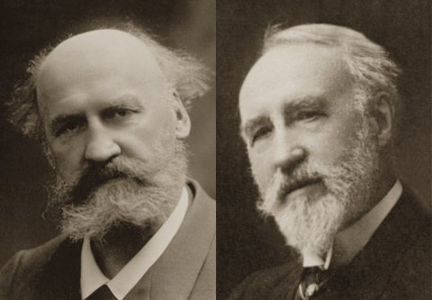
30歲最後一次參加羅馬大獎，竟在第一輪就被淘汰，連一向批評他的拉洛都說這毫無道理。媒體更發現評審之一勒內普教授的學生全部進入決賽，輿論譁然，演變成全國醜聞，院長杜布瓦提前退休，由佛瑞接任並大刀闊斧改革音樂學院。同年寫下鋼琴組曲《鏡》。

## 1905-06 | 萊茵河遊艇之旅
報業大亨愛德華茲與妻子米西亞邀他搭遊艇遊覽萊茵河七週，這是他第一次出國。

## 1907 | 佛漢威廉士來學作曲
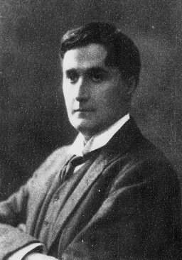
英國作曲家佛漢威廉士跟他學了三個月，他幫佛漢威廉士擺脫「沉重的德式對位風格」，座右銘是「複雜，但不繁複」。他一向不愛收學生，只教他認為有幫助的少數人。同年完成獨幕歌劇《西班牙時光》。

## 1908 | 《西班牙狂想曲》與《夜之加斯巴》
《西班牙狂想曲》首演，鋼琴組曲《夜之加斯巴》則以艱難的技巧著稱，至今仍是鋼琴家的試金石。他習慣先寫鋼琴曲再改編成管弦樂，《鵝媽媽》也在這時期寫成。

## 1909 | 第一次在國外演出
應佛漢威廉士之邀訪問倫敦，演奏自己的作品，獲得好評，國際聲望日漸提升。

## 1910-04-20 | 成立獨立音樂協會
不滿國民音樂協會被保守派把持，他與佛瑞的其他學生另組「獨立音樂協會」，由佛瑞擔任會長。開幕音樂會首演了四手聯彈版《鵝媽媽》，以及由他親自彈奏的德布西新作。

## 1911-05 | 歌劇《西班牙時光》首演
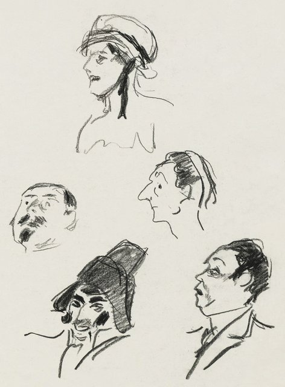
1907年就已完成，但喜歌劇院經理擔心這齣臥房鬧劇會冒犯重要的主顧——那些極為體面的母親和女兒們，一再延後上演。首演反應普通，到1920年代才流行起來。

## 1912-06-08 | 《達夫尼與克蘿伊》首演
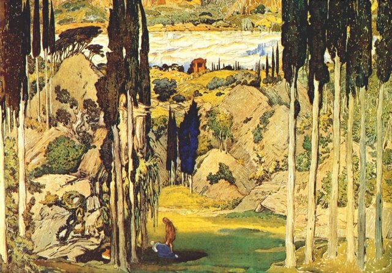
1912年他有三部芭蕾作品首演：1月的《鵝媽媽》大受好評，4月的《阿德萊德》，以及6月由狄亞基列夫的俄羅斯芭蕾舞團推出的《達夫尼與克蘿伊》。這是他規模最大的管弦樂作品，花了好幾年才完成，但因為合作者意見不合、排練不足，首演反應冷淡，隔年在蒙地卡羅與倫敦重演才獲得成功。他因此累到神經衰弱，休養了好幾個月。

## 1913 | 《春之祭》彩排
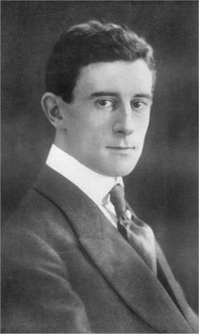
與史特拉汶斯基合作整理穆索斯基未完成的歌劇《霍凡希納》。他和德布西都出席了《春之祭》的彩排，史特拉汶斯基後來說，拉威爾是唯一一個當場就聽懂這部作品的人；拉威爾則預言它的首演將和《佩利亞》一樣具有歷史意義。

## 1915-03 | 40歲從軍當卡車司機
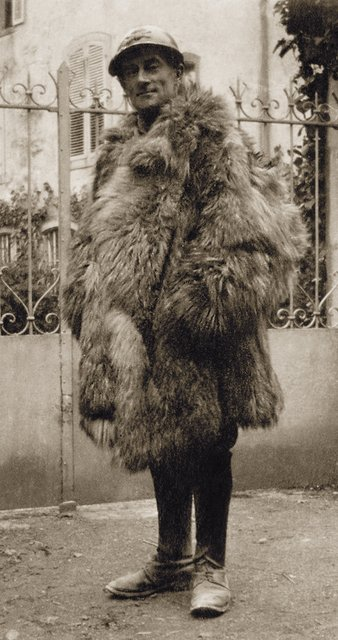
一戰爆發後，他自認身材矮小、體重輕，正適合當飛行員，卻因年齡與輕微心臟問題被拒。等待入伍期間寫了唯一的無伴奏合唱曲《三首歌》。多次嘗試後終於加入砲兵團擔任卡車司機，常在德軍猛烈砲火下連夜運送彈藥。史特拉汶斯基佩服地說：「以他的年紀和名氣，大可以找個輕鬆的差事，或什麼都不做。」

## 1916 | 拒絕禁演德國音樂
聖桑、杜布瓦等人成立「捍衛法國音樂國家聯盟」，主張禁演當代德國音樂。他拒絕加入，表示法國作曲家若刻意忽視外國同行，法國音樂很快就會「在陳腔濫調中孤立退化」，聯盟於是禁演他的作品。同年9月他因阿米巴痢疾接受腸道手術，冬天雙腳又凍傷。

## 1917-01 | 母親去世；《庫普蘭之墓》
與他最親近的母親去世，他陷入「可怕的絕望」。同年完成鋼琴組曲《庫普蘭之墓》，向18世紀法國作曲家庫普蘭致敬，六個樂章各獻給一位在戰爭中陣亡的朋友。

## 1920 | 拒領榮譽軍團勳章；《圓舞曲》
政府要頒給他榮譽軍團勳章，他婉拒了，昔日好友薩提挖苦道：「拉威爾拒絕了勳章，但他所有的音樂都接受了。」受狄亞基列夫委託寫的《圓舞曲》被對方退件，評語是「這是傑作，但不是芭蕾，而是一幅芭蕾的肖像」。拉威爾一句話也沒反駁，從此不再與他往來。12月《圓舞曲》在音樂會首演。

## 1921-05 | 搬到「觀景樓」
覺得城市生活令人疲憊，搬到巴黎西方50公里的蒙佛爾拉莫里，住進一棟小屋「觀景樓」，在忠心的管家照顧下度過餘生。不演出時，他就在這裡作曲、蒔花弄草。

## 1922 | 《展覽會之畫》管弦樂版
將穆索斯基的鋼琴組曲《展覽會之畫》改編成管弦樂，成為他最著名的配器作品，展現了他以樂團描繪光影色彩的高超技巧。

## 1924 | 《吉普賽人》
小提琴與管弦樂團的狂想曲，充滿炫技的吉普賽風味。1920年代他也深受爵士樂吸引，曾說自己寧可聽爵士也不想聽大歌劇。

## 1925-03 | 歌劇《小孩與魔法》
與女作家柯蕾特合作的奇幻歌劇，描寫頑皮的小孩被他弄壞的家具、玩具與動物們教訓。

## 1928-01 | 北美巡演
為期四個月的北美巡演，造訪25個城市，保證酬勞至少一萬美元，外加源源不絕的高盧牌香菸。在紐約由庫塞維茲基指揮的拉威爾專場音樂會上，他一入座，全場觀眾起立鼓掌，他感動地說：「在巴黎可不會這樣。」他還參觀了愛倫坡的故居，遊覽尼加拉瀑布與大峽谷。據說蓋希文想拜他為師，他考慮後婉拒，理由是怕蓋希文「寫出拙劣的拉威爾，失去自己的旋律天賦與自然」。

## 1928-11-22 | 《波麗露》首演
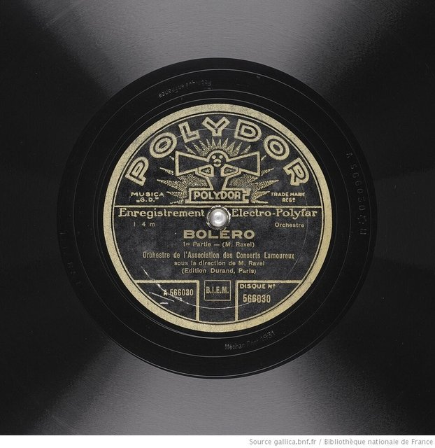
為舞蹈家伊達·魯賓斯坦的舞團而寫，他形容這是「一個非常特殊而有限的實驗」：一段長達17分鐘、不斷漸強的樂曲，「幾乎沒有任何創意，只有計畫和執行方式」。首演時一位老太太大喊「垃圾！」，他笑說：「那位老太太聽懂了！」在托斯卡尼尼推廣下大受歡迎，成為他最有名的作品。他曾對作曲家奧乃格說：「我只寫過一部傑作——《波麗露》。可惜裡面沒有音樂。」

## 1932-01 | 兩首鋼琴協奏曲首演
《左手鋼琴協奏曲》是為一次大戰中失去右臂的鋼琴家保羅·維根斯坦而寫，在維也納首演即大受讚賞。同月，G大調鋼琴協奏曲由瑪格麗特·隆首演，之後兩人在二十多個歐洲城市巡演。

## 1932-10 | 計程車事故
在計程車事故中頭部受到撞擊，當時沒被當成重傷，但神經學家後來認為它可能加速了原本已有的腦部疾病。早在1927年朋友們就發現他愈來愈健忘，事故後一年內他開始出現失語症狀。

## 1933 | 最後的作品《唐吉訶德致杜西妮亞》
原本要為電影《唐吉訶德》配樂，卻趕不上進度，大部分配樂由伊貝爾完成。他完成了三首男中音歌曲，此後再也無法作曲。他的病至今仍不確定是什麼，專家推測可能是額顳葉失智症或阿茲海默症等。他雖然無法寫字或演奏，腦中卻依然聽得見音樂。

## 1937-12-28 | 逝世@巴黎
病情惡化後，弟弟愛德華同意讓知名神經外科醫生動腦部手術。術後一度好轉，不久便陷入昏迷，享年62歲。他是無神論者，12月30日在沒有宗教儀式的情況下，安葬於巴黎西北郊勒瓦盧瓦－佩雷公墓，與父母同眠。
