<!--
內容整合自：
1. 自建筆記「文藝復興事件年表」 https://notes-renaissance-query-app.vercel.app/articles/文藝復興事件年表
2. 中文維基百科「文藝復興」條目（CC BY-SA 4.0）
   https://zh.wikipedia.org/zh-tw/文艺复兴
筆記中與一般史實不符之處已修正：佩脫拉克受封桂冠詩人為1341年（地點為羅馬卡比托利歐山），牛頓出生依舊曆為1642年。
「約」年份以 label 標示。
圖片皆為 Wikimedia Commons 上的公有領域作品（封面：拉斐爾《雅典學院》）。
-->

# Periods
- 1265 ~ 1349 | 前文藝復興：危機與醞釀 | #8d6e63
  但丁、喬托、佩脫拉克等先驅奠基，以俗語文學與立體寫實的繪畫打破中世紀傳統。黑死病奪走歐洲約三分之一人口，教會在危機中失靈，催化了人文主義的誕生。
- 1350 ~ 1399 | 早期文藝復興：人文主義奠基 | #a1887f
  薄伽丘與佩脫拉克確立人文主義的文學與哲學基礎，學者走遍歐洲圖書館搜尋古羅馬典籍。教廷大分裂讓教會威信大損，加速了世俗知識的興起。
- 1400 ~ 1449 | 十五世紀前期：佛羅倫斯的崛起 | #c0392b
  梅迪奇銀行崛起並大力贊助藝術。布魯內萊斯基發明透視法、建成主教堂圓頂，瓦拉以語文批判揭穿偽造文書，古騰堡發明活字印刷術。
- 1450 ~ 1493 | 十五世紀中後期：梅迪奇黃金時代 | #d35400
  君士坦丁堡陷落後希臘學者西逃，費奇諾的柏拉圖學院讓新柏拉圖主義成為佛羅倫斯的思想核心。「偉大者」洛倫佐執政，波提切利、達文西、米開朗基羅相繼嶄露頭角。
- 1494 ~ 1527 | 盛期文藝復興：高峰與危機 | #b7950b
  法軍入侵義大利、梅迪奇家族被逐，薩佛納羅拉燃起虛榮篝火。達文西、米開朗基羅、拉斐爾三傑在羅馬與佛羅倫斯達到藝術巔峰；路德揭開宗教改革序幕，最後以羅馬之劫告終。
- 1528 ~ 1579 | 晚期文藝復興：矯飾主義與反宗教改革 | #7d3c98
  矯飾主義興起，天特會議推動反宗教改革，教廷頒布禁書目錄。哥白尼與維薩留斯在同一年出版巨著，揭開科學革命序幕。
- 1580 ~ 1648 | 文藝復興尾聲與科學革命序幕 | #1f618d
  布魯諾被處火刑、伽利略受審，近代科學與教會權威正面衝突。莎士比亞與塞萬提斯同年去世，三十年戰爭以威斯特伐利亞和約告終，奠定現代主權國家體系。
- 1649 ~ 1700 | 延伸：巴洛克時代 | #566573
  時間上已超出文藝復興，作為延伸脈絡收錄：文藝復興對古典題材的熱情，延續進入巴洛克的音樂戲劇。

# Events

## 1265 | 但丁出生
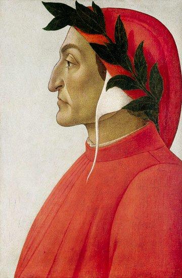
義大利文學三傑之一，《神曲》的作者，被視為連接中世紀與文藝復興的橋樑人物。

## 1267 | 喬托出生 {label=約1267年}
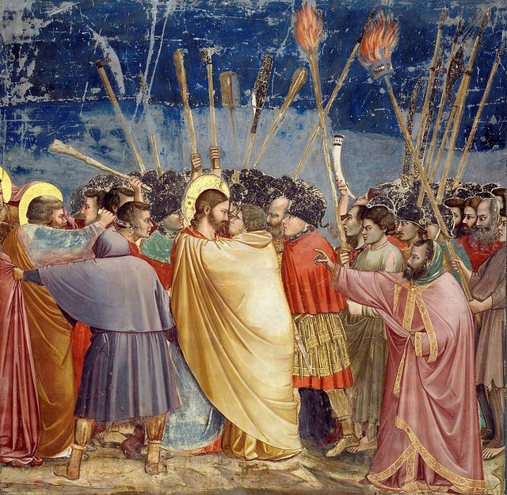
「西方繪畫之父」，打破中世紀平面、金色背景的聖像畫，為繪畫引入立體感與人的情感，代表作是帕多瓦斯克羅威尼禮拜堂的壁畫。

## 1304 | 佩脫拉克出生
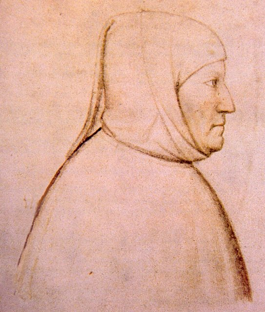
日後被稱為「文藝復興第一人」與「人文主義之父」，首創「黑暗時代」一說，第一個發出復興古典文化的號召。

## 1313 | 薄伽丘出生
《十日談》的作者，義大利散文之父，與但丁、佩脫拉克並稱文學三傑。

## 1321 | 但丁去世，《神曲》完成
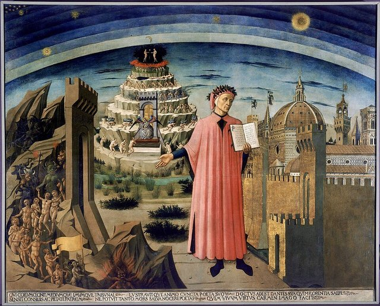
《神曲》以義大利俗語而非拉丁文寫成，恩格斯稱但丁是「中世紀的最後一位詩人，同時又是新時代的最初一位詩人」。1465年，佛羅倫斯主教堂裡掛上了米凱利諾所繪、但丁手持《神曲》的畫像。

## 1337 | 喬托去世
他完成了繪畫的革命性轉型，對後來的馬薩喬、達文西都有深遠影響。

## 1338 ~ 1340 | 洛倫采蒂《好政府與壞政府的寓言》
畫家安布羅焦·洛倫采蒂在錫耶納市政廳繪製這組壁畫，表達對公正、共和與善治的嚮往，反映義大利城邦脫離封建制度、以商業為基礎的新政治氛圍。

## 1341-04-08 | 佩脫拉克受封「桂冠詩人」
在羅馬卡比托利歐山接受桂冠加冕，這是古羅馬以來第一次為詩人加冕，確立了詩人在世俗社會的尊嚴。

## 1346 ~ 1353 | 黑死病席捲歐洲

腺鼠疫大流行，從黑海港口經熱那亞商船傳入義大利，殺死歐洲約三分之一人口；佛羅倫斯在1347年一年內人口就減少約一半。教會在危機中失靈、民眾信仰動搖，當時的手抄本插畫描繪了比利時圖爾奈居民埋葬死者的情景。有理論認為這迫使思想家更多思考活生生的人，催化了人文主義的誕生。人口銳減也讓工人酬勞上升，平民變得更加自由。

## 1350 ~ 1353 | 薄伽丘完成《十日談》
以十位青年逃避黑死病為框架，講述100則故事，肯定人間歡愉、批判教士虛偽，以義大利俗語寫成，奠定了義大利散文。

## 1368 | 明朝建立 {label=1368年（洪武元年）}
朱元璋推翻元朝，定都南京，建立明朝（1368–1644），幾乎與義大利文藝復興同步興起。此後永樂帝遷都北京（1421），鄭和下西洋（1405–1433），與同期歐洲的大航海時代形成東西方的平行擴張。

## 1374 | 佩脫拉克去世
留下抒情十四行詩集《歌集》等著作，確立了人文主義的文學與哲學基礎。

## 1375 | 薄伽丘去世
晚年轉向神學，但《十日談》的世俗人文精神已廣為流傳。

## 1378 ~ 1417 | 天主教教廷大分裂
同時出現兩到三位自稱正統的教宗，教廷威信大損，加速了世俗知識的興起。

## 1397 | 梅迪奇銀行成立；赫里索洛拉斯到佛羅倫斯講授希臘語
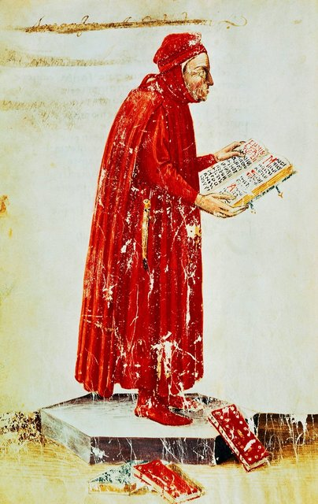
喬凡尼·迪·比奇在佛羅倫斯創立梅迪奇銀行，引入匯票業務，後來成為教廷的官方銀行，分行擴及倫敦、布魯日、威尼斯。同年，佛羅倫斯人文學者薩盧塔蒂邀請拜占庭學者赫里索洛拉斯來講授希臘語，象徵文藝復興人文主義從拉丁語時期進入希臘語時期。

## 1401 | 佛羅倫斯洗禮堂銅門競賽
布魯內萊斯基與吉貝爾蒂競爭洗禮堂北門的設計權，最後由吉貝爾蒂勝出。這場競賽常被視為文藝復興開始的標誌；落敗的布魯內萊斯基轉向建築，前往羅馬研究古代建築，為發明透視法奠定基礎。

## 1420 | 透視法發明 {label=約1420年}
布魯內萊斯基在佛羅倫斯主教堂廣場進行透視法實驗，首次以數學方式再現三維空間；阿爾伯蒂後來在《論繪畫》中把它理論化。馬薩喬等畫家隨後運用透視與明暗，力求真實描繪人體。

## 1420 ~ 1436 | 佛羅倫斯主教堂圓頂建造

布魯內萊斯基設計並主持施工，在科西莫·德·梅迪奇的贊助下歷時16年完成。直徑約45公尺的圓頂不靠支撐骨架建成，被視為工程奇蹟，是文藝復興在建築上的第一個里程碑；1440年代的手稿中已留下圓頂教堂的素描。

## 1429 | 科西莫繼承梅迪奇銀行
父親喬凡尼去世後，科西莫接手，把銀行版圖擴大到日內瓦、亞維農，並投入大規模的文化贊助。

## 1434 | 科西莫執掌佛羅倫斯
1433年遭政敵流放，一年後被召回，此後三十年成為佛羅倫斯不稱王卻操控政府的「影子統治者」，開啟梅迪奇家族的實質統治。

## 1440 | 瓦拉揭穿《君士坦丁御賜文書》造假
人文學者洛倫佐·瓦拉以語言學分析證明這份文書是偽造的，動搖了教廷世俗權力的法律基礎，是人文主義「語文批判」方法的典範。瓦拉後來整理的希臘語原文《新約》，也為宗教改革創造了條件。

## 1445 | 波提切利出生 {label=約1445年}
後來成為梅迪奇家族的御用畫家，新柏拉圖主義美學的巔峰代表。

## 1446 | 多納泰羅《加塔梅拉塔》騎馬像 {label=約1446年}
在帕多瓦完成，是文藝復興時期第一座大型青銅騎馬像，延續古羅馬皇帝騎馬像的傳統，代表雕塑對古典的直接復興。

## 1449 | 洛倫佐·德·梅迪奇出生
日後被稱為「偉大者」，文藝復興最有力的文化贊助人。

## 1450 | 古騰堡發明活字印刷術 {label=約1450年}
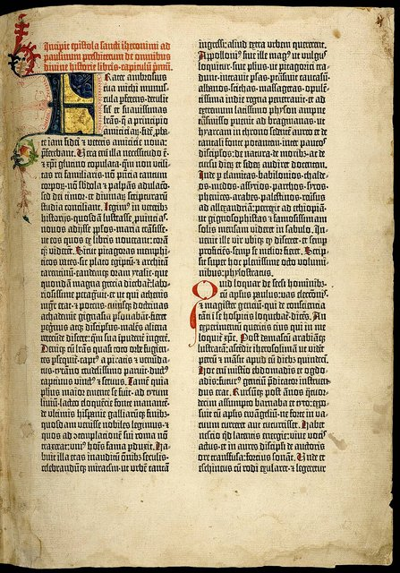
古騰堡在德意志美因茨以金屬活字與油性墨水開發出活版印刷機，1455年印出《古騰堡聖經》。印刷術讓書籍成本大幅下降、知識傳播速度革命性加快，路德的《九十五條論綱》能在數週內傳遍德意志，正是拜此之賜。

## 1452 | 達文西出生
人類史上最全面的天才之一，集繪畫、雕塑、建築、解剖學、工程學與音樂於一身。

## 1453 | 君士坦丁堡陷落，拜占庭學者西逃
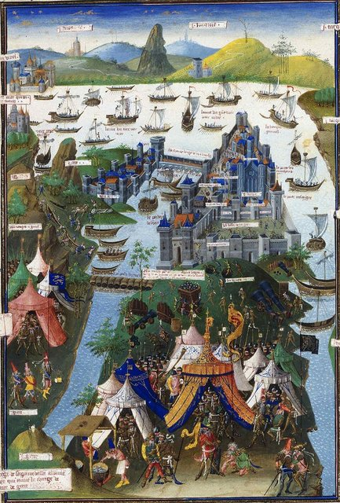
鄂圖曼蘇丹穆罕默德二世攻克君士坦丁堡，拜占庭帝國滅亡。大批希臘學者帶著柏拉圖、亞里斯多德等人的手稿逃往義大利，有些典籍在西方已失傳數百年，直接推動了希臘學術西傳與柏拉圖主義的興起。

## 1462 | 費奇諾主持佛羅倫斯柏拉圖學院
科西莫贊助費奇諾翻譯柏拉圖全集並主持研討，新柏拉圖主義從此成為佛羅倫斯的思想核心。

## 1464 | 科西莫去世，獲封「祖國之父」
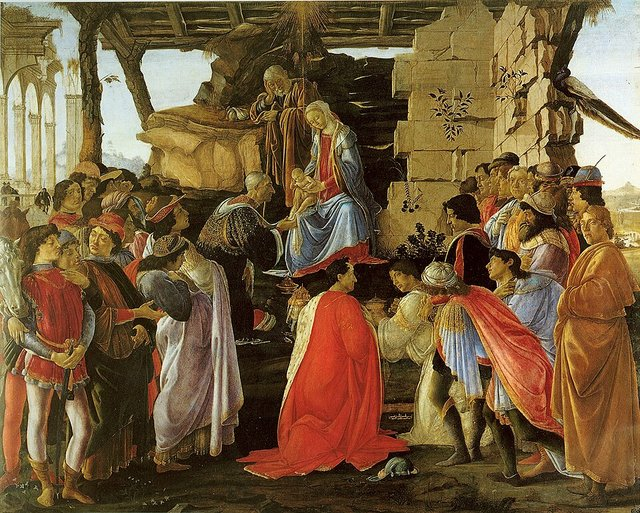
佛羅倫斯市民贈予他「祖國之父」的榮銜，為梅迪奇家族的統治奠定合法性。波提切利後來在《東方三博士來朝》中，把科西莫和梅迪奇家族成員畫成朝拜聖嬰的博士。

## 1469 | 洛倫佐執掌佛羅倫斯
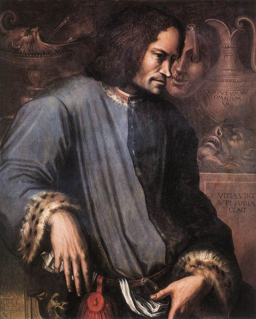
年僅20歲的洛倫佐接班，開啟梅迪奇黃金時代；費奇諾同年開始撰寫《柏拉圖神學》。

## 1472 ~ 1474 | 費奇諾完成《柏拉圖神學》初稿
18卷巨著，論述靈魂不朽，試圖調和柏拉圖主義與基督教，1482年正式出版。

## 1475 | 米開朗基羅出生
雕塑、繪畫、建築、詩歌四絕，文藝復興最偉大的藝術家之一。

## 1478 | 帕奇陰謀

帕奇家族與教宗勢力聯手，趁復活節彌撒刺殺梅迪奇兄弟：弟弟朱利亞諾被刺身亡，洛倫佐受傷逃脫。市民群起護衛洛倫佐，帕奇家族隨後被徹底清算。

## 1480 | 梅迪奇圖書館
洛倫佐廣搜古希臘手稿，使梅迪奇圖書館成為歐洲最重要的知識中心之一。

## 1481 | 波提切利《春》 {label=約1481年}
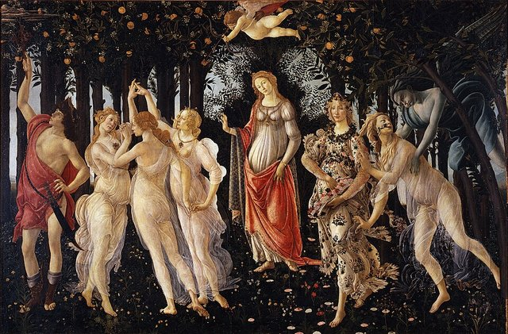
以三美神、維納斯、花神為主題的新柏拉圖主義作品，畫中描繪了數百種植物，把地上的春天當作天堂的象徵。

## 1483 | 拉斐爾出生
「最完美的文藝復興人」，二十多歲就已是最著名的畫家。

## 1485 | 波提切利《維納斯的誕生》 {label=約1485年}
罕見的大型裸體女神畫作，採用古典「謙遜維納斯」的姿態，體現新柏拉圖主義「美即靈魂之窗」的思想。同年，阿爾伯蒂的《論建築》出版，是繼古羅馬維特魯威《建築十書》之後最重要的建築著作。

## 1486 | 皮科《論人的尊嚴》
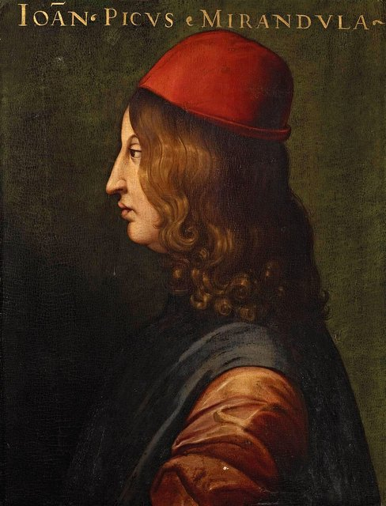
米蘭多拉的皮科寫下這篇被譽為「文藝復興宣言」的演說，以理性為依據論述哲學、自然、宗教與魔法，對義大利人文主義貢獻巨大。

## 1488 | 洛倫佐的雕塑學校
洛倫佐在聖馬可花園設立教授雕塑技藝的學校，少年米開朗基羅在這裡受訓，洛倫佐親自發掘了他的才華。

## 1492 | 洛倫佐去世；哥倫布抵達美洲
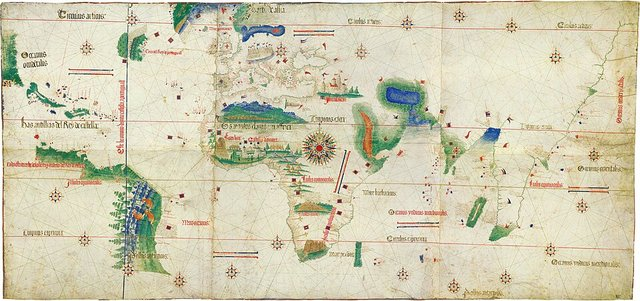
洛倫佐43歲早逝，此時家族銀行已虧損嚴重，他的死標誌著佛羅倫斯黃金時代的結束。同年，熱那亞人哥倫布橫渡大西洋抵達加勒比海，開啟大航海時代；1502年的坎提諾世界地圖已畫出新大陸的海岸線。

## 1494 | 法國入侵義大利；薩佛納羅拉崛起
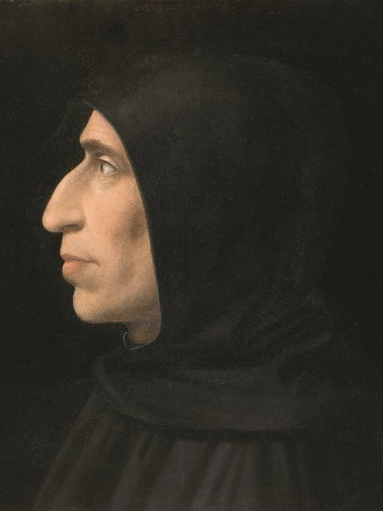
法王查理八世率軍入侵（第一次義大利戰爭），梅迪奇家族被逐出佛羅倫斯。多明我會修士薩佛納羅拉趁勢崛起，建立神權統治，1497年舉行「虛榮篝火」，燒毀藝術品、鏡子與化妝品；據說波提切利受他影響，燒掉了自己的一些畫作。史家伯克稱1494年是文藝復興的「第二代危機」。

## 1495 ~ 1498 | 達文西《最後的晚餐》
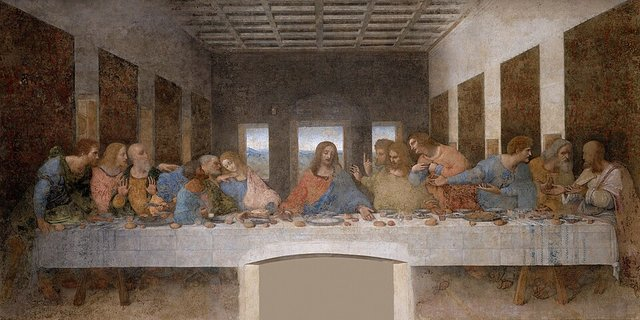
在米蘭聖母恩典修道院的食堂牆上繪製，與《蒙娜麗莎》並列他最受矚目的作品。

## 1498 | 薩佛納羅拉被處決；米開朗基羅《聖殤》
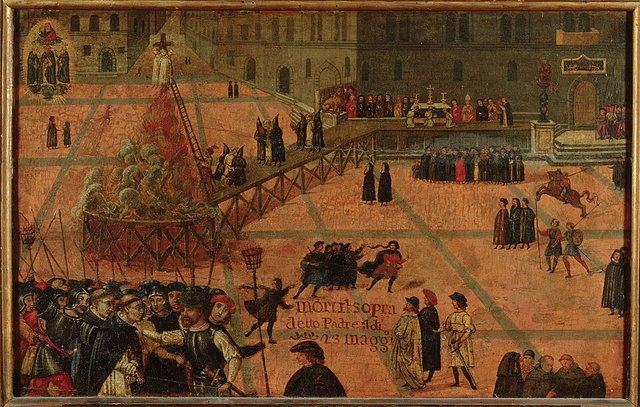
薩佛納羅拉與教宗衝突，被逐出教會後以異端罪在佛羅倫斯被吊死並焚屍。同一時期，23歲的米開朗基羅在羅馬完成大理石雕像《聖殤》，據說因為聽到有人誤以為是別人的作品，憤而在聖母的衣帶上刻下名字，這是他唯一簽名的作品。

## 1501 ~ 1504 | 米開朗基羅《大衛》
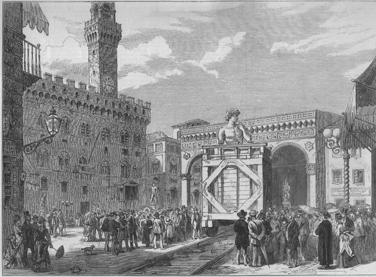
高約4.3公尺的大理石雕像，取材舊約，卻展現古典的人體美學與人文主義的個人尊嚴。原本立在領主廣場，1873年才移入學院美術館保存。

## 1503 ~ 1519 | 達文西《蒙娜麗莎》
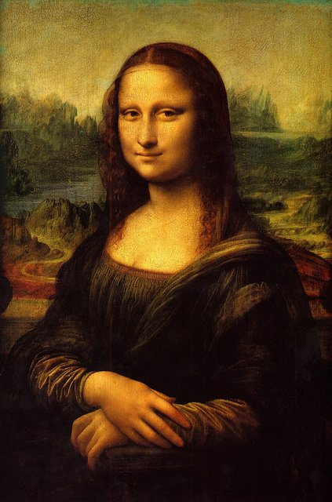
斷斷續續畫了十多年，以風景為背景，暈塗法（sfumato）的巔峰之作。

## 1508 ~ 1512 | 西斯汀禮拜堂天頂畫
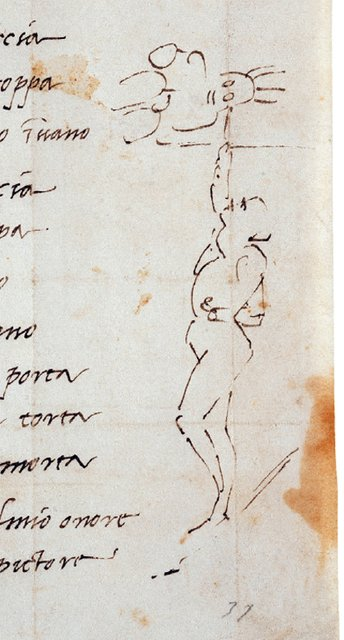
教宗儒略二世委託，自認是雕塑家而非畫家的米開朗基羅極不情願地接下工作，花了四年完成以《創世記》為主題的天頂畫，期間還寫了一首十四行詩抱怨仰頭作畫的痛苦，並在旁邊畫下自己的速寫；揭幕時全羅馬為之震驚。

## 1509 ~ 1511 | 拉斐爾《雅典學院》
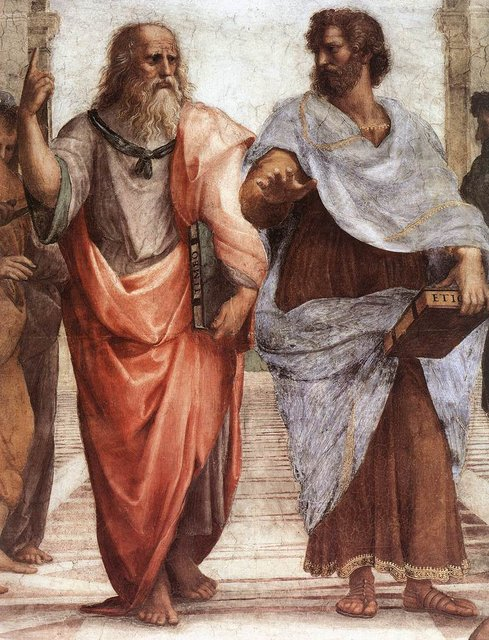
梵蒂岡簽字廳的壁畫，把古希臘哲人群像置於一座想像的殿堂中，柏拉圖與亞里斯多德並肩站在中央，是人文主義最完整的視覺宣言。

## 1511 | 伊拉斯謨《愚人頌》
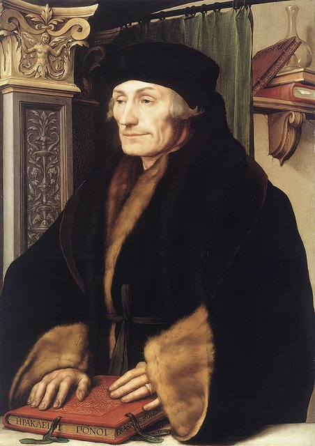
北方文藝復興最重要的人文學者伊拉斯謨出版這部諷刺作品，嘲諷教會與社會的愚行；他整理的希臘語原文《新約》（1516）也為宗教改革鋪路。

## 1512 | 梅迪奇家族重返佛羅倫斯
在西班牙軍隊協助下恢復統治，佛羅倫斯共和體制告終。

## 1513 | 馬基維利《君主論》初稿
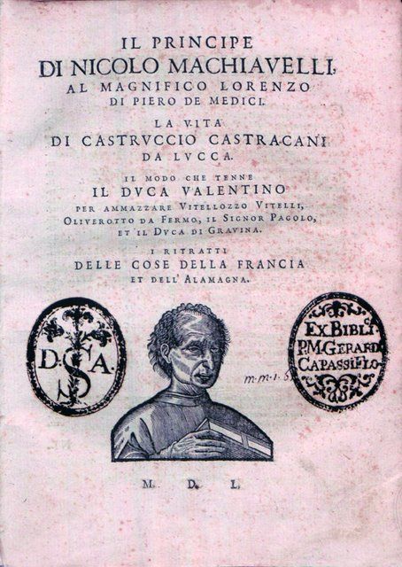
共和政府垮台後，馬基維利被捕受刑，退隱鄉間寫下《君主論》，獻給梅迪奇家族以求復職。書中提出以「能力」（virtù）對抗「命運」（fortuna）的政治現實主義。同年第五屆拉特朗大公會議宣布靈魂不朽為天主教教義。

## 1516 | 摩爾《烏托邦》
英國人文主義者托馬斯·摩爾以拉丁文寫成，「烏托邦」在希臘文中意為「不存在之地」，描述理想社會、批判英格蘭的現實政治，是空想社會主義的第一部作品。同年，帕多瓦學派的波波納齊出版《靈魂不朽論》，主張靈魂不朽無法以理性證明。

## 1517-10-31 | 路德發表《九十五條論綱》

馬丁·路德在威登堡張貼論綱，抨擊贖罪券。印刷術讓論綱在數週內傳遍德意志，宗教改革正式開始，巴塞爾等地很快就印出了論綱的單行本。

## 1519 | 達文西去世；麥哲倫啟航
達文西晚年受法王法蘭索瓦一世庇護，帶著《蒙娜麗莎》等畫作前往法國，在昂布瓦斯去世，享年67歲。同年，麥哲倫率西班牙艦隊出發，1522年船隊完成人類首次環球航行，麥哲倫本人在途中身亡。

## 1520 | 拉斐爾去世
年僅37歲，據說正好在生日當天去世，當時已是義大利最受景仰的藝術家。

## 1521 | 路德在沃木斯帝國議會拒絕撤回主張
「這是我的立場，我別無選擇。」路德被逐出教會，躲在瓦特堡期間把聖經譯成德文。

## 1527 | 羅馬之劫；馬基維利去世

神聖羅馬皇帝查理五世的傭兵洗劫羅馬數週（荷蘭畫家海姆斯凱克後來留下描繪此事的版畫），梅迪奇家族出身的教宗克雷芒七世逃進聖天使堡，藝術家紛紛逃離，藝術中心轉向威尼斯等地。伯克稱此為文藝復興的「第三代危機」，催生了矯飾主義。同年，馬基維利在政治失意中去世，《君主論》仍未出版。

## 1528 | 卡斯蒂廖內《廷臣論》
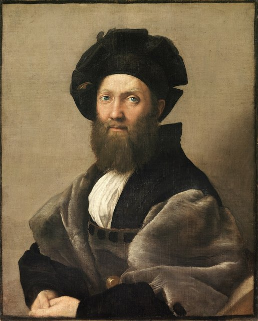
描繪理想宮廷人的行為準則，強調「舉重若輕」（sprezzatura）的多才多藝，布克哈特視之為文藝復興社會理想的最高典範。

## 1532 | 《君主論》出版；拉伯雷《巨人傳》
馬基維利死後五年，《君主論》正式出版，此後一再重印，後來被教廷列為禁書卻廣為流傳。同年，法國作家拉伯雷開始出版《巨人傳》系列，是繼薄伽丘之後最傑出的人文主義作家作品。

## 1534 ~ 1541 | 米開朗基羅《最後的審判》
繪於西斯汀禮拜堂祭壇牆，規模宏大，充滿矯飾主義的張力，畫中的裸體人物遭到保守派抨擊。

## 1535 | 摩爾被斬首
因拒絕承認英王亨利八世為英格蘭教會最高領袖，以叛國罪被處決。

## 1538 | 提香《烏爾比諾的維納斯》
威尼斯畫派大師提香以華美豐滿的風格聞名，羅馬之劫後威尼斯成為重要的藝術中心。

## 1543 | 哥白尼《天體運行論》；維薩留斯《人體的構造》
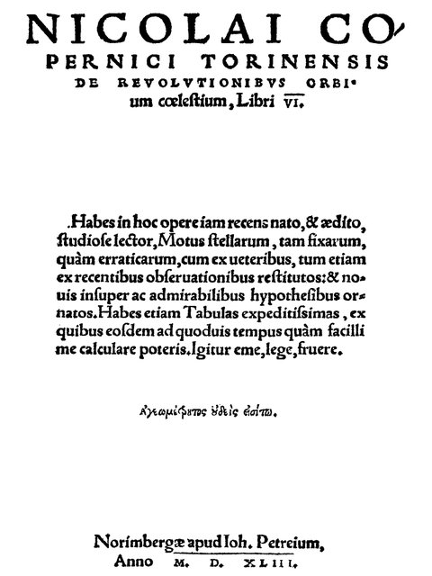
哥白尼臨終前出版《天體運行論》，提出日心說，顛覆托勒密的地心說，被視為科學革命的開端。同年，維薩留斯以實際解剖觀察寫成《人體的構造》，挑戰蓋倫的舊說，奠定近代解剖學基礎。

## 1545 | 卡爾達諾《大術》
義大利數學家卡爾達諾發表三次方程的求根公式（實際應歸功於塔爾塔利亞），並收錄學生費拉里發現的四次方程解法，是文藝復興代數學的重要成就。

## 1545 ~ 1563 | 天特大公會議
天主教反宗教改革的核心會議，重申七件聖事與拉丁文武加大譯本聖經的權威，同時整頓教士紀律，是現代天主教成形的時刻。

## 1546 | 路德去世
此時路德宗、喀爾文宗、英國國教會等派別都已確立，宗教改革已不可逆轉地分裂了歐洲。

## 1559 | 第一部《禁書目錄》
教宗保祿四世頒布禁書清單，《君主論》與伊拉斯謨的著作都名列其中，此後定期更新，直到1966年才廢止。

## 1564 | 米開朗基羅去世；莎士比亞與伽利略出生
米開朗基羅享年88歲，至死仍在規劃聖伯多祿大殿，遺體被祕密運回佛羅倫斯安葬。同一年，英國的莎士比亞與義大利的伽利略相繼出生。

## 1570 | 帕拉第奧《建築四書》
總結文藝復興建築的對稱、比例與古典柱式原則，深深影響了往後數百年歐美的「帕拉第奧式建築」。

## 1572 | 第谷觀測到超新星
丹麥天文學家第谷在仙后座觀測到一顆比金星還亮的新星，挑戰了亞里斯多德「天體不變」的宇宙觀。

## 1576 ~ 1597 | 第谷的天堡天文台
在丹麥國王資助下，第谷在汶島建立「天堡」天文台，花了20年進行史上最精確的裸眼觀測。這批數據後來讓他的助手克卜勒推導出行星運動定律。

## 1591 | 韋達《分析方法入門》
法國數學家韋達第一次有系統地用字母表示未知數和已知數，確立了符號代數學。

## 1600-02-17 | 布魯諾被處火刑 {label=1600年（萬曆28年）}
哲學家布魯諾主張宇宙在時空上都是無限的、存在多個世界，被宗教裁判所以異端罪判處火刑，是科學與教會衝突的標誌性事件。

## 1605 | 塞萬提斯《唐吉訶德》第一部 {label=1605年（萬曆33年）}
以騎士理想對抗現實的荒誕喜劇，諷刺過時的騎士文學，被視為西方第一部現代小說，也是西班牙黃金時代的巔峰；第二部出版於1615年。

## 1609 | 伽利略望遠鏡；克卜勒《新天文學》
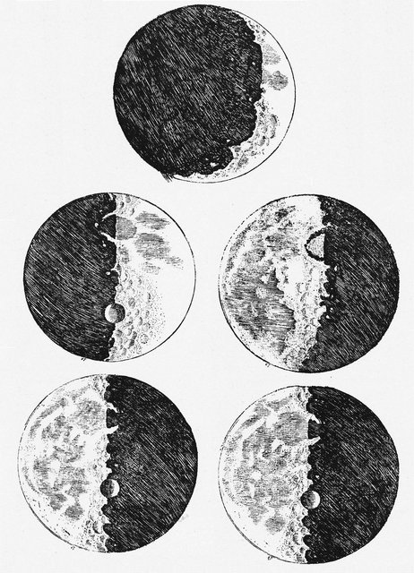
伽利略改良望遠鏡後觀測到木星的四顆衛星、月球表面的環形山，以及由無數恆星組成的銀河，為日心說提供直接證據，1610年出版《星際信使》。同年，克卜勒以第谷的觀測數據寫成《新天文學》，證明行星沿橢圓軌道運行。

## 1616 | 莎士比亞與塞萬提斯去世；教廷警告伽利略
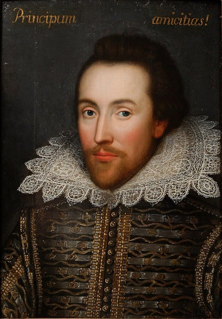
英國的莎士比亞（享年52歲，留下37部劇作）與西班牙的塞萬提斯同年去世，象徵文藝復興文學時代的落幕。同年，宗教裁判所裁定日心說為異端，命令伽利略停止宣揚。

## 1618 ~ 1648 | 三十年戰爭
由宗教改革引發的歐洲最大規模戰爭，先後捲入德意志、西班牙、法國、瑞典等勢力，德意志人口損失約三分之一。

## 1628 | 哈維《心血運動論》
英國醫生哈維以大量動物解剖實驗，系統闡明血液循環與心臟的功能，成為近代生理學的奠基者。

## 1632 | 伽利略《關於兩大世界體系的對話》
以對話形式呈現日心說與地心說的辯論，因讓支持教宗觀點的角色「辛普里丘」顯得愚蠢而激怒教廷。

## 1633 | 伽利略受審
在宗教裁判所被迫放棄日心說，判處軟禁。傳說他喃喃說了一句「但它（地球）仍在轉動」，象徵近代科學與宗教權威的決裂。

## 1642 | 伽利略去世；牛頓出生
伽利略在軟禁中去世，享年77歲。同年（依當時英國使用的舊曆）牛頓出生，科學革命接棒傳承。

## 1644 | 明朝滅亡，清朝建立 {label=1644年（順治元年）}
李自成攻入北京，崇禎帝自縊；吳三桂引清軍入關，清朝入主中原。此時歐洲正值三十年戰爭末期，東西方幾乎同時經歷重大的政治格局轉變。

## 1648 | 威斯特伐利亞和約
結束三十年戰爭，確立各國有權自行決定內政與宗教事務的國家主權原則，是現代國際關係體系的起點。

## 1689 | 普賽爾《蒂朵與埃涅阿斯》 {label=1689年（康熙28年）}
「英國音樂之父」普賽爾唯一的歌劇，取材自維吉爾《埃涅阿斯紀》，在倫敦一所女子學校首演，全長不到一小時，卻被視為巴洛克英語歌劇的巔峰，延續了文藝復興對古典題材的熱情。
